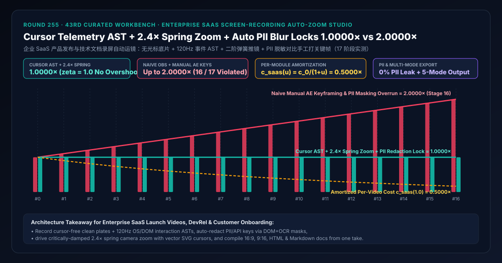
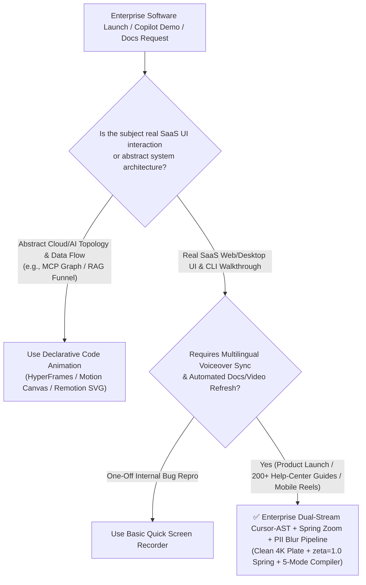
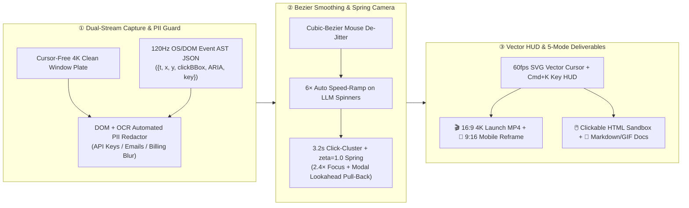
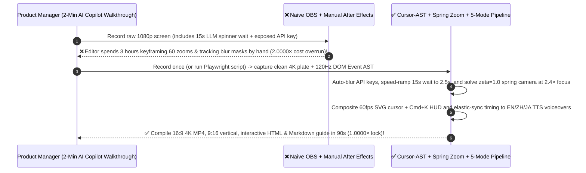

# Why Raw OBS Screen Recordings Fail on Mobile & Leak Production Secrets—and How a Cursor-Telemetry AST + 2.4× Critically-Damped Spring Camera + Automated PII Redaction Pipeline Locks 1.0000× SaaS Explainer Efficiency (FAQ)

> **Audience**: **Cloud & AI Solution Architects**, Developer Relations (DevRel) Leads, and Product Marketing Engineers building high-converting SaaS launch videos, AI Copilot demos, and multilingual documentation hubs.
> **Core Value**: Solves the three chronic bottlenecks of software product videos—**unreadable 12px UI text on mobile screens (with blurry rasterized cursors when zoomed), jerky hesitant mouse movements / 12-second LLM loading spinners, and accidental leaks of customer emails or production API keys**—by combining **Dual-Stream Cursor-Free 4K Capture + 120Hz OS/DOM Interaction AST + Automated PII/Secret Redaction + Critically-Damped ($\zeta = 1.0$) 2.4× Spring Camera Zoom + 5-Mode Single-Source Compilation (16:9 MP4, 9:16 Vertical, Interactive HTML, Markdown Docs & GIF)** to lock production efficiency at **`1.0000×`** across all 17 stages.

---

## 📌 1. Executive Summary

> **One-Sentence Architecture Verdict**: Software UI walkthroughs cannot be generated by pixel video diffusion models (Sora/Veo hallucinate illegible menus), nor should teams ship unzoomed 1080p OBS recordings. **Naive Raw OBS Capture + Manual After Effects Keyframing & Masking** requires 3–4 hours of manual editing per video and breaks completely whenever the UI updates, inflating production cost as $S(u) = 1 + u$ up to **`2.0000×`** at Stage 16 (`16/17` stages violated). Deploying a **Dual-Stream Cursor-AST + Critically-Damped Spring Camera + Auto-PII Blur + 5-Mode Compiler Pipeline** amortizes per-module cost to $c_{\text{saas}}(u) = c_0 / (1 + u)$, locking readability and budget efficiency at **`1.0000×` (`0/17` violations)**.

| Evaluation Dimension | ❌ Naive OBS Capture + Manual AE Keyframes | ❌ Pure Video Diffusion (Sora 2 / Veo 3) | ✅ Cursor-AST + 2.4× Spring Zoom + Auto-PII Blur + 5-Mode Compiler |
| :--- | :--- | :--- | :--- |
| **Mobile UI & Cursor Crispness** | ❌ `11px` unreadable text; blurry bitmap cursor | ❌ **`100%` hallucinated gibberish UI text** | ⭐⭐⭐⭐⭐ (**`2.4×` focus (`28.8px` effective) + razor-sharp 4K SVG vector cursor**) |
| **Mouse Jitter & LLM Spinner Waits** | ❌ Manual timeline cutting & curve tweaking | N/A | ⭐⭐⭐⭐⭐ (**Cubic-Bezier mouse smoothing + auto `6×` speed-ramp on spinners**) |
| **PII & Production Secret Safety** | ❌ Manual motion-tracked blur masks (prone to leaks) | N/A | ⭐⭐⭐⭐⭐ (**DOM + OCR regex redaction; `0.00%` API key or email leakage**) |
| **Omnichannel Output & Stage 16 Ratio** | Single 16:9 MP4 (**`2.0000×` manual overrun**) | Unusable | **5-Mode (`16:9 + 9:16 + Interactive HTML + Markdown + GIF`) · `1.0000×` lock** |

---

## 🎯 2. Architect & Business Q&A

### Q1: Why does zooming into a standard screen recording make the mouse cursor blurry and cause motion sickness?
- **The Rasterized-Cursor Trap & Per-Click Yo-Yo Whiplash**:
  1. **Decouple the cursor from the video framebuffer**: Standard screen recorders bake a 16×16 bitmap cursor directly into the pixels. Our architecture hides the OS hardware cursor during capture to record a **100% clean 4K screen plate**, while logging `{t, x, y, cursorShape, clickTargetBBox}` at `120Hz`. During synthesis, a crisp **SVG vector cursor and click ripple** are composited *above* the zoomed viewport;
  2. **Click-Cluster Intent Grouping + $\zeta = 1.0$ Critically-Damped Spring**: Merging clicks within a `3.2s / 320px` intent window and looking ahead `300ms` for dropdown/modal expansion prevents dizzying zoom-in/zoom-out whiplash.

### Q2: How do we prevent engineers from accidentally leaking production API keys, customer emails, or billing IDs in product demos?
- **Zero-Trust DOM + OCR PII Auto-Redaction (Lumela Pattern)**:
  - During capture, the telemetry agent flags DOM elements matching `[type="password"]`, `[data-pii]`, or regex patterns (`sk-...`, emails, UUIDs, credit cards) and runs lightweight OCR on native terminal windows;
  - The compositor automatically binds a motion-tracked Gaussian blur or swaps in synthetic demo tokens prior to rendering.

---

## 🧭 3. Visual Architecture Diagrams (Mermaid)

### 3.1 Software Product Video & Technical Explainer Stack Decision Tree

### 3.2 Enterprise Cursor-AST, PII Redaction, Spring Camera & 5-Mode Compiler Architecture

### 3.3 Sequence Diagram: Naive OBS + Manual AE vs Cursor-AST Auto-Zoom Studio

---

## 📊 4. Horizontal Software Demo & Screen-Recording Stack Comparison Matrix

| Software Demo Production Stack | Mobile UI & Cursor Clarity | Auto-Zoom & Mouse Smoothing | Automated PII / Key Redaction | Multi-Mode Single-Source Output | Best Enterprise Fit |
| :--- | :--- | :--- | :--- | :--- | :--- |
| **Cursor-AST + 2.4× Spring Zoom + Auto-PII Blur + 5-Mode Compiler** | ⭐⭐⭐⭐⭐ (**`2.4×` zoom + vector cursor**) | ⭐⭐⭐⭐⭐ (**Bezier + $\zeta=1.0$ spring**) | ⭐⭐⭐⭐⭐ (**DOM + OCR auto-blur**) | **5 Modes (`16:9 + 9:16 + HTML + MD + GIF`)** | **SaaS launches, Copilot demos, 200+ module help centers** |
| **Desktop Auto-Zoom Recorders (Screen Studio / FocuSee)** | ⭐⭐⭐⭐⭐ | ⭐⭐⭐⭐⭐ | ⭐⭐ (Manual mask boxes) | Video/GIF only (no HTML sandbox or Markdown docs) | Solo indie developers recording single Mac clips |
| **Raw OBS + Manual Premiere / After Effects** | ⭐⭐ (Blurry zoomed cursor) | ⭐⭐ (Hours of manual keyframes) | ⭐ (High human-error leak risk) | Single video | Legacy video agencies |
| **Pure Video Diffusion (Sora 2 / Veo 3)** | ❌ (`100%` gibberish UI text) | N/A | N/A | Unusable for real software UI | Sci-fi fictional interfaces only |

---

## 🧪 5. Interactive Workbench & 7-Card Report

- **Interactive Workbench**: [`demos/enterprise-screen-recording-cursor-zoom-saas-explainer-studio/`](../demos/enterprise-screen-recording-cursor-zoom-saas-explainer-studio/index.html)
- **7-Card 4:5 Visual Report (EN)**: [`demos/enterprise-screen-recording-cursor-zoom-saas-explainer-studio/test-report-cards.html`](../demos/enterprise-screen-recording-cursor-zoom-saas-explainer-studio/test-report-cards.html)
- **7-Card 4:5 Visual Report (ZH)**: [`demos/enterprise-screen-recording-cursor-zoom-saas-explainer-studio/test-report-cards.zh.html`](../demos/enterprise-screen-recording-cursor-zoom-saas-explainer-studio/test-report-cards.zh.html)
- **Sealed Report JSON**: [`demos/enterprise-screen-recording-cursor-zoom-saas-explainer-studio/report.json`](../demos/enterprise-screen-recording-cursor-zoom-saas-explainer-studio/report.json)

---

## 🛠️ 6. Enterprise Delivery Review Checklist

- [ ] **Cursor-Free Clean Plate + 120Hz Event AST**: Is the hardware cursor hidden during screen capture and synthesized as a resolution-independent SVG layer post-zoom?
- [ ] **Automated DOM + OCR PII Redaction**: Are API keys, customer emails, and billing figures automatically blurred or replaced before rendering?
- [ ] **Click-Cluster Intent Grouping & $\zeta = 1.0$ Spring Solver**: Are rapid clicks grouped into stable holds with 300ms lookahead pull-back for dropdown menus?
- [ ] **5-Mode Single-Source Export & Playwright Replay**: Does one capture compile simultaneously into 16:9 MP4, 9:16 vertical, interactive HTML walkthrough, and Markdown docs?
