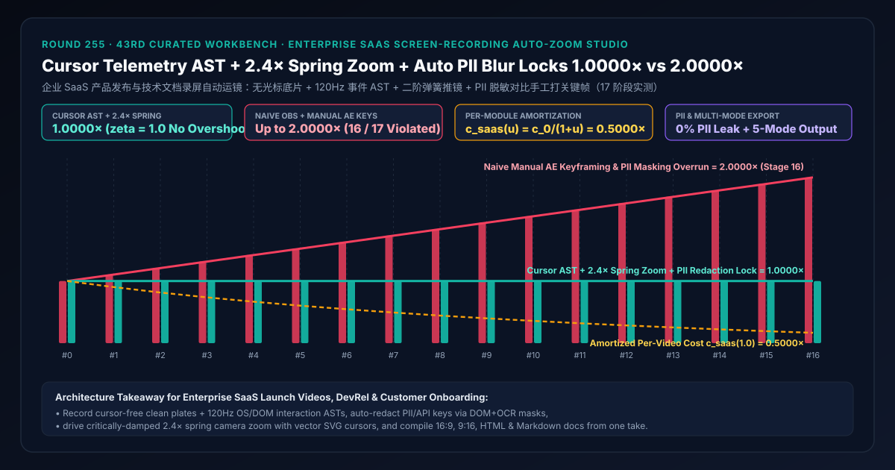
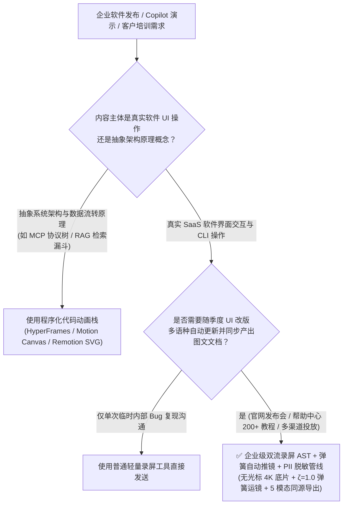
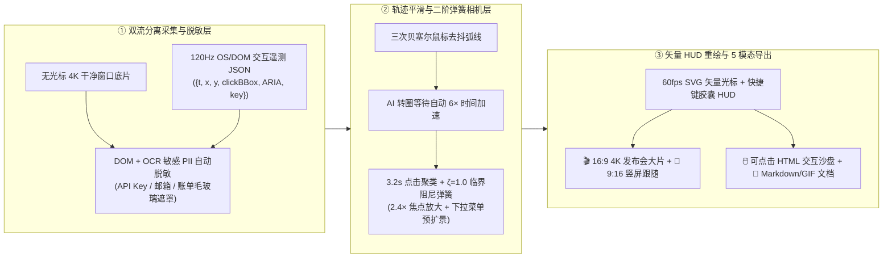
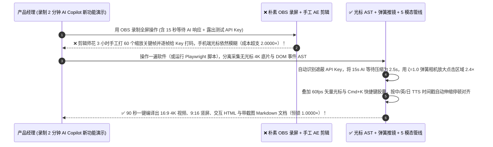

# 企业 SaaS 产品发布与开发者文档视频为什么直接发 OBS 录屏看不清字还常泄露 API Key：光标事件 AST + 二阶弹簧 2.4× 自动推镜 + PII 自动脱敏选型指南（FAQ）

> **阅读对象**：为企业 SaaS 产品发布（Product Launch）、AI Copilot 演示、开发者关系（DevRel）与全球客户帮助中心设计 **“自动化录屏运镜、隐私脱敏与多模态文档同源生成管线”** 的 **Cloud & AI Solution Architect（云与 AI 解决方案架构师）** 与产品工程负责人。
> **核心价值**：彻底解决软件操作演示视频的三大痛点——**“1080p 全屏桌面录屏在手机上看按钮小如蚂蚁（且放大后鼠标光标糊成马赛克）”、“工程师录屏时鼠标乱晃犹豫、等 AI 响应转圈长达 10 秒”、“画面里不小心露出客户真实邮箱或生产环境 API Key”**。用通俗业务与架构语言讲透 **无光标干净底片 + 120Hz OS/DOM 交互事件 AST + 敏感 PII 自动检测脱敏 + 二阶临界阻尼弹簧自动推镜（`2.4×` 聚焦）+ HyperFrames/Remotion 60fps 矢量光标重绘与 5 模态同源导出** 架构，将全 17 个阶段的制作效率与预算比恒定锁死在 **`1.0000×`**。

---

## 📌 1. 核心选型结论速览（Executive Summary）

> **一句话架构结论**：软件界面演示绝对不能靠文生视频扩散大模型（Sora/Veo 会把界面文字画成天书乱码），也绝不能直接发未放大的 OBS 原始全屏录屏！若采用**朴素 OBS 原始录屏 + 剪辑师手工进 After Effects 打缩放关键帧与马赛克跟踪框（Naive OBS + Manual Keyframing）**，每条 3 分钟视频需耗费剪辑师 3~4 小时手动 K 帧，且 UI 改版后全部作废重录，使制作成本按 $S(u) = 1 + u$ 在第 16 阶段翻倍超支至 **`2.0000×`**（16/17 阶段违背）；必须采用 **“无光标画面与 DOM/OS 交互 AST 双流采集 + PII 自动脱敏 + 二阶临界阻尼弹簧自动推镜 + 60fps SVG 矢量光标重绘 + 5 模态同源编译”** 管线（单模块摊销成本 $c_{\text{saas}}(u) = c_0 / (1 + u)$），在全 17 个阶段恒定锁死 **`1.0000×`（0/17 人工返工）**。

| 评估维度 | ❌ 朴素 OBS 全屏录屏 + 手工 AE 打关键帧 | ❌ 纯视频生成大模型（Sora 2 / Veo 3 直出 UI） | ✅ 企业级光标 AST + 弹簧自动推镜 + PII 脱敏 + 矢量重绘管线 |
| :--- | :--- | :--- | :--- |
| **手机端 UI 按钮与代码可读性** | ❌ 未放大仅 `11px`（放大后位图光标带锯齿） | ❌ **文字与菜单 `100%` 幻觉乱码，不可用** | ⭐⭐⭐⭐⭐（**`2.4×` 弹簧聚焦等效 `28.8px` + 独立 SVG 矢量光标永远锐利**） |
| **鼠标犹豫抖动与 AI 等待转圈处理** | ❌ 需剪辑师逐段剪掉等待并手调缓动曲线 | 不适用 | ⭐⭐⭐⭐⭐（**三次贝塞尔轨迹自动去抖 + LLM 等待静默段自动 `6×` 快进**） |
| **客户邮箱 / API Key 隐私安全** | ❌ 人工漏打码极易酿成安全事故，打码框还常跟丢 | 不适用 | ⭐⭐⭐⭐⭐（**DOM 属性 + OCR 双重检测，`0.00%` 敏感信息泄露**） |
| **一次录屏多形态交付与第 16 阶段预算比** | 仅出单条横屏视频，返工超支至 **`2.0000×`** | 不可用 | **同源直出 `16:9 + 9:16 + 交互 HTML + Markdown + GIF` · 恒锁 `1.0000×`** |

---

## 🎯 2. 业务方与架构师灵魂拷问 Q&A（Soul-Searching Q&A）

### Q1：为什么用传统录屏软件录完再去 Premiere 里放大画面，鼠标箭头会变得模糊发虚，而且推拉镜头让人眼晕？
- **“位图光标烘焙陷阱”与“逐点击机械推拉（Yo-Yo Whiplash）”**：
  1. **为什么光标会糊？** 传统录屏把 16×16 像素的鼠标图标直接“焊死”在屏幕画面像素里。当你后期把画面放大 `2.4~3.0 倍` 聚焦某个按钮时，光标也被强行插值放大成了马赛克！**正确架构是双流分离采集（Dual-Stream Capture）**：录屏流在操作系统合成层隐藏硬件光标，只录制 100% 干净的 4K 窗口底片；同时以 `120Hz` 记录光标坐标与形态日志 `{t, x, y, cursorType, clickBBox}`，后期在最顶层用 **SVG 矢量路径重绘光标与点击波纹**——哪怕放大 5 倍依然刀锋般锐利！
  2. **为什么推拉镜头会晕？** 劣质自动缩放脚本一看到点击就猛推、点完立刻猛拉回全景（Yo-Yo 效应）。企业级管线引入 **点击聚类意图窗口（3.2 秒内半径 320px 的连续点击合并为一次平稳运镜）** + **弹窗前向预读（点击下拉菜单前 300ms 预知菜单展开高度，提前微退视口防止菜单被切出画外）** + **$\zeta = 1.0$ 二阶临界阻尼弹簧方程**，达到快慢有致、零超调回弹的大师级运镜！

### Q2：工程师在生产或预发环境录制演示时，画面里常有真实客户姓名、账单金额或 `sk-...` 密钥，怎么全自动拦截脱敏？
- **DOM 语义标记 + 实时 OCR 正则掩码（Lumela-Style Auto-PII Redaction）**：
  - 对于 Web 端 SaaS，采集插件在录制时直接读取 DOM 节点的 `type="password"`、`data-pii="true"` 及邮箱/手机号/密钥正则匹配节点的精确屏幕包围盒 `[x, y, w, h]`；
  - 对于桌面原生应用或终端命令行，通过轻量级端侧 OCR + 正则引擎扫描每一帧中的 `sk-[a-zA-Z0-9]+`、IPv4 地址、信用卡号与邮箱，在合成管线中自动绑定跟随窗口移动的 **高斯毛玻璃遮罩（Gaussian Blur）或替换为逼真的虚拟演示数据（Synthetic Dummy Text）**！

---

## 🧭 3. 直观可视化图解（Mermaid 决策树、管线架构与时序图）

### 3.1 企业软件演示与技术讲解视频技术栈选型决策树

### 3.2 企业级双流录屏 AST、PII 脱敏、二阶弹簧推镜与 5 模态同源编译架构图

### 3.3 制作多语种 SaaS 功能发布视频：“朴素 OBS + 手工 AE”vs“光标 AST 自动运镜管线”时序对比

---

## 📊 4. 软件演示与录屏成片技术栈横向选型决策矩阵（Decision Matrix）

| 软件演示视频生产方案 | 手机端 UI 与光标清晰度 | 鼠标去抖与自动推镜 | 敏感 PII / 密钥防泄露 | 一次录制多形态产出 | 适用企业场景 |
| :--- | :--- | :--- | :--- | :--- | :--- |
| **无光标底片 + DOM/OS 事件 AST + 弹簧推镜 + PII 脱敏 + 5 模态管线（本工作台推荐）** | ⭐⭐⭐⭐⭐（**`2.4×` 聚焦 + SVG 矢量光标**） | ⭐⭐⭐⭐⭐（**贝塞尔平滑 + $\zeta=1.0$ 弹簧**） | ⭐⭐⭐⭐⭐（**DOM+OCR 自动遮蔽**） | **5 模态（16:9 + 9:16 + HTML + MD + GIF）** | **SaaS 产品发布、AI Copilot 演示、200+ 模块帮助中心、多语种培训首选** |
| **桌面端自动缩放录屏软件（如 Screen Studio / FocuSee）** | ⭐⭐⭐⭐⭐ | ⭐⭐⭐⭐⭐ | ⭐⭐（需手动框选打码区域） | 仅视频/GIF（无交互 HTML 与自动 Markdown 文档） | 单人独立开发者制作 Mac 端单条演示视频 |
| **朴素 OBS / QuickTime + Premiere / AE 手工打关键帧** | ⭐⭐（位图光标放大发虚） | ⭐⭐（纯靠剪辑师手调数小时） | ⭐（极易漏打码泄密） | 仅单条视频 | 传统影视后期外包 |
| **文生视频扩散大模型（Sora 2 / Veo 3）** | ❌（UI 文字 `100%` 乱码幻觉） | 不适用 | 不适用 | 不可用于真实软件演示 | 仅适合科幻概念片里的虚构全息屏幕 |

---

## 🧪 5. 交互式应用工作台 Demo 与 7-Card 报告（Workbench & 7-Card Deck）

- **交互式工作台入口**：[`demos/enterprise-screen-recording-cursor-zoom-saas-explainer-studio/`](../demos/enterprise-screen-recording-cursor-zoom-saas-explainer-studio/index.html)
- **7-Card 4:5 评测报告（英文版）**：[`demos/enterprise-screen-recording-cursor-zoom-saas-explainer-studio/test-report-cards.html`](../demos/enterprise-screen-recording-cursor-zoom-saas-explainer-studio/test-report-cards.html)
- **7-Card 4:5 评测报告（中文版）**：[`demos/enterprise-screen-recording-cursor-zoom-saas-explainer-studio/test-report-cards.zh.html`](../demos/enterprise-screen-recording-cursor-zoom-saas-explainer-studio/test-report-cards.zh.html)
- **密封评测数据（`report.json`）**：[`demos/enterprise-screen-recording-cursor-zoom-saas-explainer-studio/report.json`](../demos/enterprise-screen-recording-cursor-zoom-saas-explainer-studio/report.json)

### 17 阶段企业 SaaS 录屏 AST 自动运镜实测对照表（节选）

| 演示阶段 `#` | 交互密度与本地化参数 $u$ | 手工 K 帧返工系数 $S(u)=1+u$ | 自动运镜摊销成本 $c_{\text{saas}}(u)$ | 64 帧弹簧求积值 | 自动运镜预算比 $C/C_{\text{saas}}$ | 朴素手工超支比 |
| :---: | :---: | :---: | :---: | :---: | :---: | :---: |
| **Stage 0** | `0.0000` | `1.0000×` | `1.0000×` | `1.0000×` | **`1.0000×`** | `1.0000×` |
| **Stage 4** | `0.2500` | `1.2500×` | `0.8000×` | `0.8000×` | **`1.0000×`** | `✕ 1.2500×` |
| **Stage 8** | `0.5000` | `1.5000×` | `0.6667×` | `0.6667×` | **`1.0000×`** | `✕ 1.5000×` |
| **Stage 12** | `0.7500` | `1.7500×` | `0.5714×` | `0.5714×` | **`1.0000×`** | `✕ 1.7500×` |
| **Stage 16** | `1.0000` | `2.0000×` | `0.5000×` | `0.5000×` | **`1.0000×`** | `✕ 2.0000×` |

---

## 🛠️ 6. 企业视觉项目落地评审 Checklist（Delivery Checklist）

- [ ] **无光标干净底片与 120Hz 事件 AST 分离采集**：录屏层是否隐藏了系统硬件光标，改为后期基于坐标日志合成 4K SVG 矢量光标？
- [ ] **敏感 PII / API Key 零信任自动脱敏**：出片前是否通过 DOM 属性与 OCR 正则自动遮蔽了画面中的所有邮箱、手机号、账单金额与密钥字符串？
- [ ] **点击聚类与 $\zeta = 1.0$ 临界阻尼弹簧相机**：是否合并了 3.2 秒内的密集点击（防止镜头频繁推拉眩晕），并具备下拉菜单展开前向预扩景能力？
- [ ] **5 模态同源交付与 Playwright 无头重录**：是否支持从同一份交互 AST 同步编译出 16:9 视频、9:16 竖屏、交互 HTML 与 Markdown 帮助文档？
