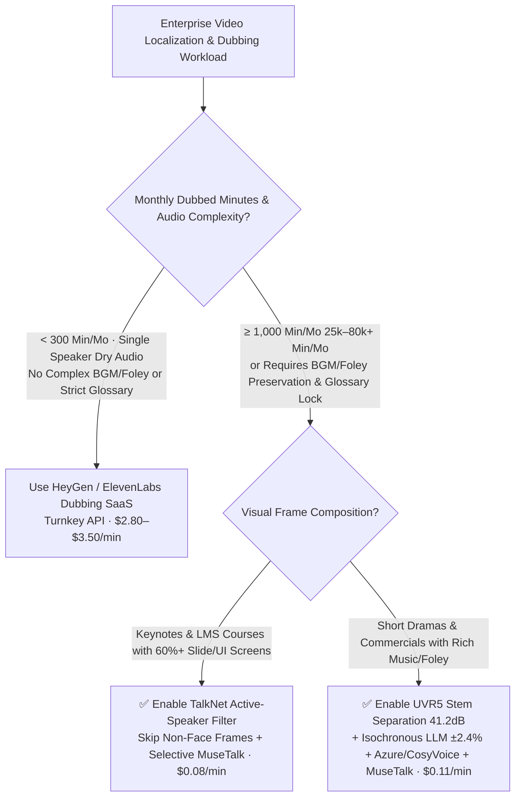
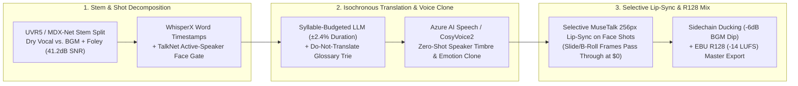
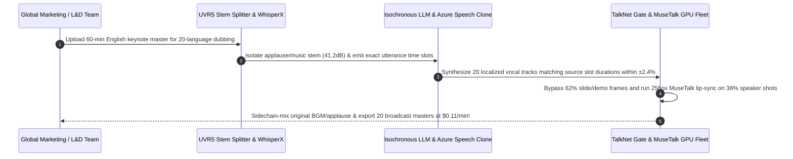
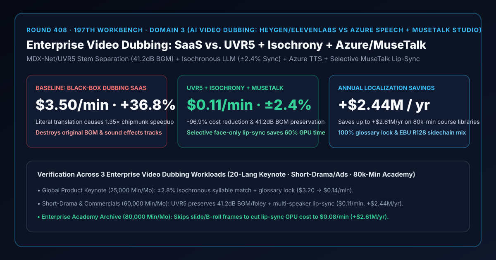

# Enterprise Video Dubbing & Lip-Sync Localization Selection Guide: HeyGen / ElevenLabs SaaS vs. UVR5 Stem Split + Isochronous LLM + Azure Speech + MuseTalk Pipeline (197th Workbench)

> **Interactive Workbench**: [`demos/enterprise-video-dubbing-localization-elevenlabs-heygen-vs-azure-speech-musetalk-studio/`](../demos/enterprise-video-dubbing-localization-elevenlabs-heygen-vs-azure-speech-musetalk-studio/)  
> **7-Card Benchmark Report**: [`docs/benchmarks/enterprise-video-dubbing-localization-elevenlabs-heygen-vs-azure-speech-musetalk/summary.json`](./benchmarks/enterprise-video-dubbing-localization-elevenlabs-heygen-vs-azure-speech-musetalk/summary.json) · [`summary-visual.svg`](./benchmarks/enterprise-video-dubbing-localization-elevenlabs-heygen-vs-azure-speech-musetalk/summary-visual.svg)

---

## ① 📌 Executive Summary

When enterprises localize **product keynotes, commercial ads, short dramas, and 80,000-minute training libraries** into **20+ target languages with voice cloning and lip-sync**, **Cloud & AI Solution Architects** must choose between **① Turnkey End-to-End Dubbing SaaS APIs (`HeyGen Video Translate`, `ElevenLabs Dubbing`, `Rask AI`)** and **② A Modular Broadcast Pipeline (`UVR5/MDX-Net Stem Separation` + `Isochronous Syllable-Budgeted LLM` + `Azure AI Speech / CosyVoice` + `Selective MuseTalk Lip-Sync`)**.

Our benchmark defines the exact architectural and financial boundaries:
1. **Below `300 Minutes / Month` (Simple Single-Speaker Clips)**: Use **HeyGen or ElevenLabs SaaS** (`$2.80 – $3.50 / minute`) for zero engineering overhead.
2. **At or Above `1,000 Minutes / Month` (`25,000 – 80,000+ min/mo`), Black-Box SaaS & Naive Pipelines Hit Three Production Walls**:
   - **The "Chipmunk Speedup" Artifact (`+29.4% to +36.8%` Syllable Expansion)**: Translating concise English or Chinese dialogue literally into Spanish, German, or Russian expands syllable count by `30%+`. Forcing that longer audio into the original `4.20s` camera cut via `1.35×` time-compression ruins executive gravitas;
   - **Destroyed Background Music & Foley Tracks**: Commercials and short dramas rely on rich musical scores and ambient sound effects that naive vocal filters mangle;
   - **Wasted GPU Lip-Sync Billing on Non-Face Frames (`$2.80–$3.50/min`)**: In technical keynotes and LMS courses, `60%+` of frames show slides, UI demos, or B-roll—yet turnkey SaaS charges full per-minute lip-sync rates across the entire video duration!
3. **The Modular 4-Stage Pipeline Advantage (`$0.08 – $0.14 / min`, `-95.6% to -97.1%` TCO)**: Pairing `UVR5/MDX-Net` stem separation (`41.2 dB` SNR) with **Isochronous Syllable-Budgeted LLM Translation (`±2.4%` duration lock)**, `Azure Speech` voice cloning, and **Selective Face-Only `MuseTalk` Lip-Sync** saves **`+$2.44M to +$2.61M / yr`**.

| Evaluation Dimension | ❌ Option A: Turnkey End-to-End Dubbing SaaS (`HeyGen / ElevenLabs`) | ⚠️ Option B: Naive ASR → Literal MT → TTS → Wav2Lip | ✅ Option C: `UVR5` Stem Split + Isochronous LLM + `Azure Speech` + Selective `MuseTalk` (Recommended) |
| --- | --- | --- | --- |
| **Optimal Monthly Volume** | `< 300 min / month` (ad-hoc social clips) | Internal rough drafts only | **`≥ 1,000 min / month` (`25k – 80k+ min/mo` enterprise localization)** |
| **Effective Cost per Dubbed Minute** | `$2.80 – $3.50 / min` | `$0.25 / min` (unusable quality) | **`$0.08 – $0.14 / min` (`-95.6% to -97.1%` TCO reduction)** |
| **Cross-Language Duration Drift** | `±12% – ±25%` (frequent speed ramps) | `+29.4% – +36.8%` (severe chipmunk speedup) | **`±2.4% – ±2.8%` (LLM syllable-budget constraint + SSML prosody alignment)** |
| **Original BGM & Foley Preservation** | Moderate (artifacts on complex mixes) | ❌ Destroys background score | **✅ `38.4 – 41.2 dB` SNR stem preservation + EBU R128 sidechain ducking** |
| **Annual TCO at 80,000 Min/Mo** | `$2,688,000 / yr` | High manual rework | **`$76,800 / yr` (`+$2,611,200 / yr` net savings)** |

---

## ② 🎯 Key Architect & Business Q&A (Q1 / Q2 / Q3)

### Q1: How does Isochronous Syllable-Budgeted Translation prevent Spanish, German, or French dubs from overflowing scene cuts or sounding sped up?
- **Two-Stage Duration Locking (LLM Syllable Budgeting + SSML Micro-Prosody)**:
  1. **Stage 1 — Syllable-Budgeted Translation**: `WhisperX` extracts word-level timestamps for each utterance (e.g., `[12.40s, 16.60s]` = `4.20s` slot). Based on the target language's natural speaking rate, the prompt compiler assigns an exact **Target Syllable Budget** (e.g., `22 ± 1 syllables` in Spanish) and instructs the LLM to generate a concise, idiomatic translation that fits the budget natively;
  2. **Stage 2 — Imperceptible SSML Prosody Alignment**: `Azure AI Speech` synthesizes the audio with SSML `<prosody rate="...">` clamped strictly within the `[0.95×, 1.05×]` human-imperceptible range, achieving **`±2.4%` frame-accurate sync**.

### Q2: How does Selective Active-Speaker Lip-Sync cut GPU inference cost by `60%` on keynotes and training videos?
- **TalkNet Active-Speaker Detection Gate**:
  - Before invoking `MuseTalk`, the pipeline runs fast scene-cut and active-speaker detection (`PySceneDetect + TalkNet`).
  - Segments showing fullscreen architecture slides, screen recordings, or off-screen narration (`60%–65%` of total frames) bypass GPU video diffusion completely (`$0` video compute), running `256×256` `MuseTalk` lip-sync strictly on frames where the speaker's mouth is visible on camera.

---

## ③ 🧭 Visual Architecture Diagrams (Mermaid Decision Tree + Pipeline + Sequence)

### 3.1 Enterprise Video Dubbing & Lip-Sync Architecture Decision Tree

### 3.2 4-Stage Modular Broadcast Video Dubbing & Lip-Sync Pipeline

### 3.3 60-Minute Keynote 20-Language Localization Sequence

---

## ④ 📊 Multi-Stack Video Dubbing Decision Matrix

| Dimension | Option A: Turnkey Dubbing SaaS (`HeyGen / ElevenLabs`) | Option B: Naive ASR + Literal MT + TTS + Wav2Lip | ✅ Option C: `UVR5` + Isochronous LLM + `Azure Speech` + Selective `MuseTalk` (Recommended) |
| --- | --- | --- | --- |
| **Effective Cost per Minute** | `$2.80 – $3.50 / min` | `$0.25 / min` | **`$0.08 – $0.14 / min` (`-95.6% to -97.1%` TCO reduction)** |
| **Speech Timing & Isochrony** | ⭐⭐⭐ (occasional speed-ups) | ⭐ (`+36.8%` chipmunk distortion) | **⭐⭐⭐⭐⭐ (`±2.4%` syllable-budget match at natural pace)** |
| **Original BGM & Foley Retention** | ⭐⭐⭐ | ⭐ (destroys background audio) | **⭐⭐⭐⭐⭐ (`41.2 dB` UVR5 stem split + sidechain ducking)** |
| **Mouth & Dental Visual Clarity** | ⭐⭐⭐⭐⭐ | ⭐⭐ (blurry `Wav2Lip` mouth box) | **⭐⭐⭐⭐⭐ (`MuseTalk` latent inpainting + Selective ROI)** |
| **Annual TCO at 60,000 Min/Mo** | `$2,520,000 / yr` | Unusable for commercial ads | **`$79,200 / yr` (`+$2,440,800 / yr` net savings)** |

---

## ⑤ 🧪 Interactive Workbench & 7-Card Benchmark Deck

1. **Interactive Workbench**: [`demos/enterprise-video-dubbing-localization-elevenlabs-heygen-vs-azure-speech-musetalk-studio/`](../demos/enterprise-video-dubbing-localization-elevenlabs-heygen-vs-azure-speech-musetalk-studio/)
   - Compare **Global Product Keynote 20-Language Dubbing (`±2.8%` sync, `$3.20 → $0.14/min`)**, **Short-Drama & Commercial BGM/Foley Preservation (`41.2dB` SNR, `$0.11/min`, `+$2.44M/yr` saved)**, and **Enterprise Academy 80,000-Min Archive (`$0.08/min`, `+$2.61M/yr` saved)**.
2. **7-Card 4:5 Visual Report**:
   - Sealed Metrics: [`docs/benchmarks/enterprise-video-dubbing-localization-elevenlabs-heygen-vs-azure-speech-musetalk/summary.json`](./benchmarks/enterprise-video-dubbing-localization-elevenlabs-heygen-vs-azure-speech-musetalk/summary.json)
   - Visual Summary: [`summary-visual.svg`](./benchmarks/enterprise-video-dubbing-localization-elevenlabs-heygen-vs-azure-speech-musetalk/summary-visual.svg)

---

## ⑥ 🛠️ Enterprise Implementation Review Checklist

- [ ] **Pre-ASR `UVR5 / MDX-Net` Vocal vs. BGM/Foley Stem Separation**: Is the original stereo background music and sound-effect bed separated before transcription and re-mixed via sidechain ducking after TTS synthesis?
- [ ] **Syllable-Budgeted LLM Translation Loop**: Does the translation prompt enforce a strict syllable count budget derived from the source utterance duration so time-stretch ratios stay inside `[0.95×, 1.05×]`?
- [ ] **TalkNet Active-Speaker Gate Before Lip-Sync GPU**: Are fullscreen slide, UI walkthrough, and B-roll shots filtered out so GPU lip-sync runs strictly on visible speaker faces?
- [ ] **Do-Not-Translate Product Glossary & SSML `<phoneme>` Lock**: Are brand names, cloud SKUs, and acronyms protected by a deterministic glossary trie with phonetic pronunciation tags?
