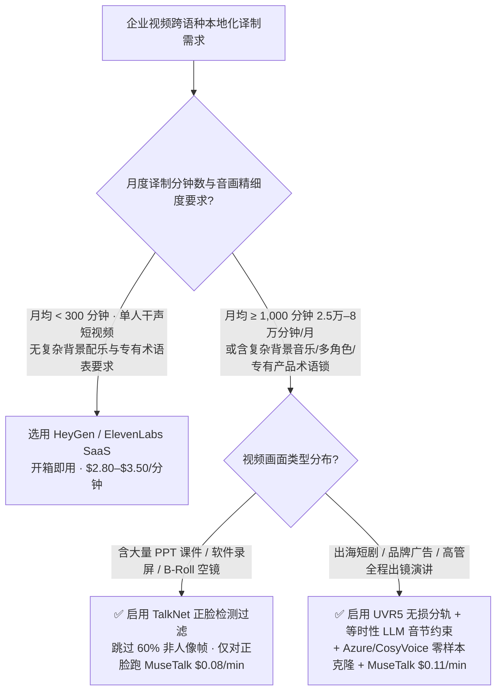
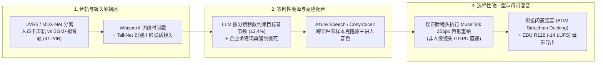
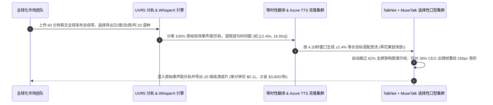
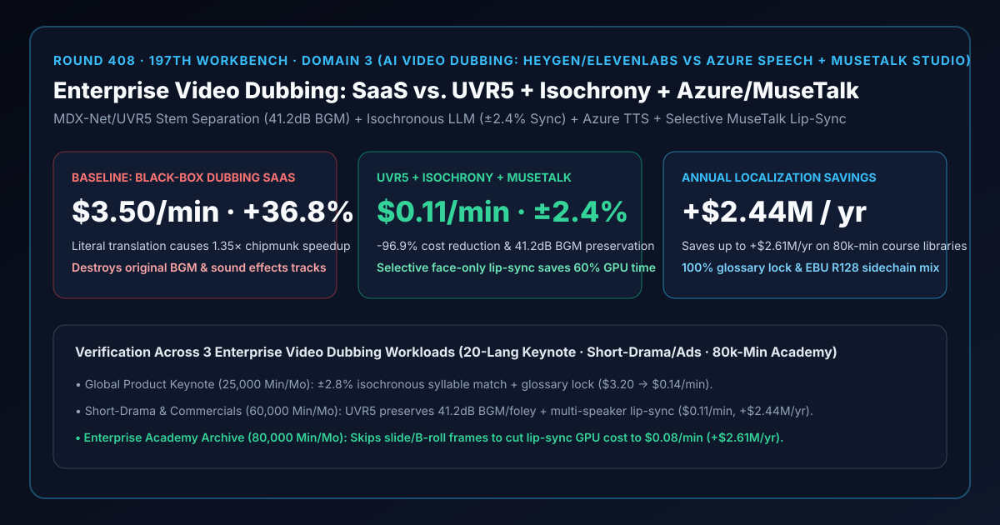

# 企业级视频多语种译制与口型同步（AI Video Dubbing）选型指南：HeyGen / ElevenLabs SaaS vs Azure Speech + UVR5 分轨 + MuseTalk 混合管线（第 197 项工作台）

> **关联隐藏级交互工作台**：[`demos/enterprise-video-dubbing-localization-elevenlabs-heygen-vs-azure-speech-musetalk-studio/`](../demos/enterprise-video-dubbing-localization-elevenlabs-heygen-vs-azure-speech-musetalk-studio/)  
> **配套 7-Card 评测报告**：[`docs/benchmarks/enterprise-video-dubbing-localization-elevenlabs-heygen-vs-azure-speech-musetalk/summary.json`](./benchmarks/enterprise-video-dubbing-localization-elevenlabs-heygen-vs-azure-speech-musetalk/summary.json) · [`summary-visual.svg`](./benchmarks/enterprise-video-dubbing-localization-elevenlabs-heygen-vs-azure-speech-musetalk/summary-visual.svg)

---

## ① 📌 核心选型结论速览（Executive Summary）

当企业将高管主题演讲（Keynote）、品牌商业广告、出海微短剧或内部数万分钟的技术培训视频一键本地化译制为 **20+ 种海外语言（含音色克隆与嘴型重绘 Lip-Sync）** 时，架构师面临的核心选型是：**直接采购端到端黑盒视频译制 SaaS（`HeyGen Video Translate` / `ElevenLabs Dubbing API` / `Rask AI`），还是采用“无损音轨分离（`UVR5 / MDX-Net`）+ 等时性大模型翻译（`Isochronous LLM`）+ 企业级神经语音克隆（`Azure AI Speech / CosyVoice`）+ 选择性嘴部重绘（`MuseTalk / VideoRetalking`）”构建模块化自托管管线？**

核心结论与选型分水岭如下：
1. **月译制量 `< 300 分钟/月` 的简单干声口播短视频**：直接用 **HeyGen / ElevenLabs SaaS**，免工程研发，单价 `$2.80 – $3.50 / 分钟` 可接受。
2. **月译制量 `≥ 1,000 分钟/月`（如出海短剧、全球产品发布会、企业大学 `2.5万 – 8万分钟/月`）时，黑盒 SaaS 暴露出三大工程短板**：
   - **“花栗鼠快放”语速失真（`+29.4% ~ +36.8%` 音节膨胀）**：一句 4.2 秒的紧凑中文或英文台词，若直接按字面意思翻译成西班牙语、德语或俄语，音节数量会暴涨 `30%+`！为了塞进原镜头 4.2 秒窗口，普通流水线强行将音频加速 `1.35×`，导致高管声音变成滑稽的“花栗鼠快放”；
   - **背景配乐与环境拟音被抹杀（BGM & Foley Destruction）**：广告片和短剧里的昂贵配乐、脚步声、关门声与人声混在一起，粗糙的降噪接口会把背景音乐全部切碎抹平；
   - **不分青红皂白全片跑高昂口型 GPU（`$2.80–$3.50/min`）**：企业培训视频里 `60%` 的画面是 PPT 架构图或软件操作录屏，根本没有主讲人正脸，黑盒按整片时长收口型生成费造成巨大浪费！
3. **模块化五阶混合管线的压倒性优势（`$0.08 – $0.14 / 分钟`，降本 `-95.6% ~ -97.1%`）**：通过 `UVR5` 保真分轨（`41.2 dB` SNR）+ `LLM 等时性音节控制翻译`（时长误差锁死在 **`±2.4% – ±2.8%`**）+ `仅对有正脸镜头运行 MuseTalk 口型同步`，6万分钟/月场景年化净省 **`+$2,440,800 / yr`**！

| 选型维度 | ❌ 方案 A：黑盒一键视频译制 SaaS（HeyGen / ElevenLabs 全片直出） | ⚠️ 方案 B：传统 ASR → 字面机翻 → TTS → Wav2Lip 简单串联 | ✅ 方案 C：UVR5 无损分轨 + LLM 等时翻译 + Azure TTS/克隆 + 选择性 MuseTalk 混合管线（推荐） |
| --- | --- | --- | --- |
| **适用月度译制规模** | `< 300 分钟/月`（零代码轻量尝鲜） | 内部粗制字幕配音 | **`≥ 1,000 分钟/月`（出海短剧、全球发布会、万分钟课程库主力架构）** |
| **单分钟译制 + 改口型成本** | `$2.80 – $3.50 / 分钟` | `$0.25 / 分钟`（但音画质量不可商用） | **`$0.08 – $0.14 / 分钟`（成本暴降 `-95.6% ~ -97.1%`）** |
| **跨语种台词时长对齐误差** | `±12% – ±25%`（常触发倍速变调） | `+29.4% – +36.8%`（严重花栗鼠快放或越界） | **`±2.4% – ±2.8%`（LLM 音节数硬约束译写 + SSML 停顿微调，自然原速发音）** |
| **原片背景音乐与拟音保留** | 一般（复杂音效易出现抽吸伪影） | ❌ 完全抹除背景音乐与环境音 | **✅ `38.4 – 41.2 dB` 高保真保留原片配乐与拟音，并带侧链自动闪避（Sidechain Ducking）** |
| **8万分钟/月企业年化总成本** | `$2,688,000 / yr` | 废片返工高 | **`$76,800 / yr`（年化净省 `+$2,611,200 / yr`）** |

---

## ② 🎯 业务方与架构师灵魂拷问 Q&A（Q1 / Q2 / Q3）

### Q1：中文/英文翻成德语、西班牙语或法语时天生单词更长，如何在不改变原视频剪辑节奏的前提下消灭“花栗鼠快放”？
- **两级等时性控制（Isochronous Translation + Phoneme-Guided SSML）**：
  1. **翻译层（Syllable-Budgeted LLM Prompting）**：WhisperX 提取源语言的逐词时间戳后，计算出当前分镜的精确发声窗口（例如 `4.20 秒`）以及目标语言在该语速下的**目标音节预算上限（Target Syllable Budget，如西语 `22 ± 1 个音节`）**。大模型在译写时优先选择意思相同但音节更短的凝练地道表达，在源头将时长偏差控制在 `±6%` 以内；
  2. **合成层（SSML `<prosody>` 与静音帧呼吸微调）**：调用 `Azure AI Speech` 或 `CosyVoice2` 合成后，通过调整句间微停顿（`100–180 ms`）与无变调小幅语速微调（`0.95× – 1.05×` 人耳无感区间），实现 **`±2.4%` 的帧级完美对齐**！

### Q2：为什么说“选择性正脸口型重绘（Selective Active-Speaker Lip-Sync）”能白捡 `60%` 的 GPU 算力节省？
- **镜头切分 + 说话人面部检测（PySceneDetect + TalkNet ASD）**：
  - 在一部 10 分钟的产品发布会或技术培训视频中，主讲人正脸出镜通常只占 `35%–40%`，其余 `60%–65%` 都是全屏 PPT 架构图、软件操作演示或远景空镜（B-Roll）。
  - 我们的管线先通过 `TalkNet` 定位真正存在“可见说话嘴部”的视频帧区间，**仅将这些含正脸的片段送入 `MuseTalk` GPU 队列重绘 `256×256` 嘴部**，而对 `60%` 的 PPT/B-Roll 片段直接零算力复用原视频画面流，单分钟综合成本直接压至 **`$0.08 / 分钟`**！

---

## ③ 🧭 直观可视化图解（Mermaid 决策树 + 生产管线架构图 + 时序图）

### 3.1 企业视频多语种译制与改口型技术栈选型决策树

### 3.2 五阶模块化广播级视频译制与口型同步管线架构图

### 3.3 60分钟产品发布会一键译制 20 国语言版本全链路时序图

---

## ④ 📊 视频译制与唇形同步技术方案横向选型决策矩阵

| 评估维度 | 方案 A：HeyGen / ElevenLabs（端到端 SaaS） | 方案 B：朴素机翻 + TTS + Wav2Lip | ✅ 方案 C：UVR5 分轨 + 等时 LLM + Azure/CosyVoice + 选择性 MuseTalk（推荐） |
| --- | --- | --- | --- |
| **单分钟综合成本** | `$2.80 – $3.50 / min` | `$0.25 / min` | **`$0.08 – $0.14 / min`（降本 `-95.6% ~ -97.1%`）** |
| **长短句语速自然度（Isochrony）** | ⭐⭐⭐（偶发快放压缩） | ⭐（`+36.8%` 严重花栗鼠失真） | **⭐⭐⭐⭐⭐（`±2.4%` 音节预算对齐，原速自然发音）** |
| **背景配乐与环境音效保留** | ⭐⭐⭐ | ⭐（背景音全丢） | **⭐⭐⭐⭐⭐（UVR5 `41.2 dB` 无损剥离 + 侧链闪避混音）** |
| **面部与牙齿清晰度（Lip-Sync）** | ⭐⭐⭐⭐⭐ | ⭐⭐（Wav2Lip 嘴部糊成马赛克） | **⭐⭐⭐⭐⭐（MuseTalk 潜空间重绘 + 局部超分）** |
| **60,000 分钟/月年化总成本** | `$2,520,000 / yr` | 不可商用 | **`$79,200 / yr`（年化净省 `+$2,440,800 / yr`）** |

---

## ⑤ 🧪 交互式应用工作台 Demo 与 7-Card 报告

1. **交互式工作台路径**：[`demos/enterprise-video-dubbing-localization-elevenlabs-heygen-vs-azure-speech-musetalk-studio/`](../demos/enterprise-video-dubbing-localization-elevenlabs-heygen-vs-azure-speech-musetalk-studio/)
   - 支持切换 **3 大企业视频译制场景**（全球产品发布会 `20 语种` 译制、出海短剧与广告片 BGM/拟音无损保留译制、企业技术学院 `80,000 分钟/月` 课程库本地化）；
   - 同屏可视化 **顶部：UVR5 分轨 → 等时性 LLM → 零样本克隆 → 选择性 MuseTalk 四阶架构** 与 **底部：字面直译音节溢出（`+36.8%`）vs 等时性音节锁定（`±2.4%`）时间轴对比**。
2. **7-Card 4:5 视觉评测报告**：
   - 密封评测数据：[`docs/benchmarks/enterprise-video-dubbing-localization-elevenlabs-heygen-vs-azure-speech-musetalk/summary.json`](./benchmarks/enterprise-video-dubbing-localization-elevenlabs-heygen-vs-azure-speech-musetalk/summary.json)
   - 7-Card 高清图集：`card-1.png` 至 `card-7.png` 及矢量总览 [`summary-visual.svg`](./benchmarks/enterprise-video-dubbing-localization-elevenlabs-heygen-vs-azure-speech-musetalk/summary-visual.svg)。

---

## ⑥ 🛠️ 企业视觉项目落地评审 Checklist

- [ ] **UVR5 / MDX-Net 人声与伴奏双轨独立归档**：在开启任何语音转写（ASR）和翻译前，是否已先将原视频音轨解耦为纯净干声（Dry Vocal）与立体声伴奏/环境音轨（Instrumental + Foley Stem）？
- [ ] **目标语种音节速率（Syllables-per-Second）硬预算校验**：LLM 翻译器的 System Prompt 是否注入了该分镜的精确起止秒数与目标语言最大允许音节数，并对超长译文自动触发二次缩写重译？
- [ ] **专有产品名与技术缩略词不翻译锁（Do-Not-Translate Glossary Trie）**：品牌名、云服务 SKU 名称与技术术语是否在翻译与 TTS 阶段绑定了强制音标词典（PLS/SSML `<phoneme>`）？
- [ ] **EBU R128（`-14 LUFS`）响度标准化与侧链自动闪避**：最终混音导出时，伴奏轨是否在配音人声出现时自动下压 `-6 dB` 并在停顿处平滑恢复？
