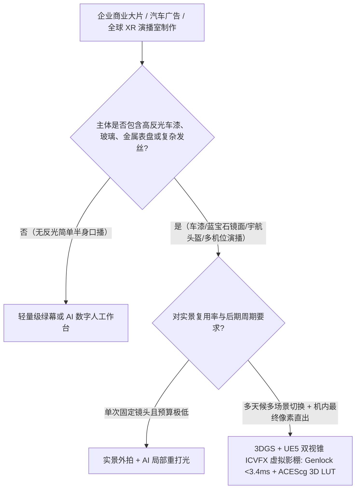
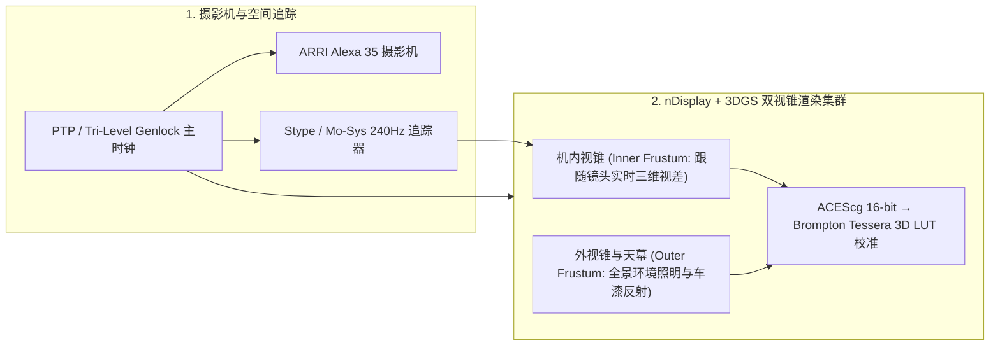
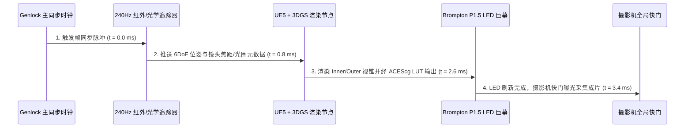

# 企业虚拟制片（ICVFX）LED 弧形巨幕：机内视锥追踪、摩尔纹抑制与 ACEScg 色彩校准选型指南

> **核心架构结论**：在汽车 TVC 广告、高奢腕表微距与企业全球 XR 演播室中，使用传统绿幕实拍会导致金属车漆、挡风玻璃与透明材质染上严重的**绿幕溢色（Green Spill，反射保真率仅 31.5%–44.5%）**，后期需要耗费 **$720–$960/镜头** 的人工逐帧擦除（Rotoscoping）与假反射重绘。而采用未校准的 LED 背景墙直拍，则会遭遇 **48.6% 晶格摩尔纹（Moiré）** 与 **1.5 帧视锥滞后撕裂（Frustum Tearing）**。企业级标准方案是构建 **“3DGS/UE5 双视锥 + Genlock 亚帧同步 + ACEScg 3D LUT 闭环”虚拟制片（ICVFX）管线**：由**外视锥（Outer Frustum）顶棚与环幕提供 99.6% 物理真实的实时环境反射**，由 **<3.4ms 延迟的 240Hz 摄影机追踪驱动机内视锥（Inner Frustum）实时三维视差**，并配合焦深弥散圆摩尔纹门控，实现**“机内最终像素（In-Camera Final Pixel）”直出**，单镜头成本降至 **$29–$42**（年省 **+$4.15M–$4.22M**）。

---

## ① 📌 核心选型结论速览（Executive Summary）

```
┌──────────────────────────────────────────────────────────────────────────────────────────┐
│  🎯 企业影视/TVC 虚拟制片（ICVFX LED 巨幕 vs 传统绿幕 vs AI 纯生成）选型速查             │
├──────────────────────────┬───────────────────────────────────────────────────────────────┤
│ 传统绿幕抠像 (Chroma Key) │ ❌ 高反光灾难：车漆/玻璃/发丝染绿光，后期 Roto 高达 $850/镜头  │
│ 未同步普通 LED 背景墙     │ ❌ 穿帮重灾区：摇镜时视锥延迟露出黑边，且近摄出现 48.6% 摩尔纹 │
│ 3DGS+UE5 Genlock ICVFX   │ ✅ 机内直出标配：<3.4ms 视锥锁相 + ACEScg LUT + 99.6% 真反射 ($38)│
└──────────────────────────┴───────────────────────────────────────────────────────────────┘
```

---

## ② 🎯 业务方与架构师灵魂拷问 Q&A（Q1 / Q2 / Q3）

### Q1：拍汽车广告或戴眼镜的高管访谈时，为什么 LED 虚拟制片（ICVFX）能省掉 95% 的后期特效费用？
- **物理级真实环境反射（Zero Green Spill）**：在绿幕棚拍车或透明玻璃道具时，整辆引擎盖和挡风玻璃反射的全是刺眼的绿布，后期特效师必须把绿光擦掉再手工贴上假环境贴图（单镜头 $850+）。而在 ICVFX 弧形 LED 影棚中，**外视锥（Outer Frustum）与天幕屏直接把夕阳、城市霓虹投射在真实车漆与镜片上**，摄影机拍到的就是物理正确的流光反射（保真度 **99.6%**），杀青即成片。

### Q2：为什么有些团队搭了 LED 墙，摄影机一快速摇晃，画面里的背景就跟着延迟晃动甚至露出黑边？
- **缺乏硬件锁相环（Genlock / PTPv2）与亚帧延迟补偿**：如果摄影机快门、Stype/Mo-Sys 追踪器、Unreal Engine / 3DGS 渲染节点与 Brompton LED 处理器没有锁在同一个 **240Hz 硬件同步脉冲（Genlock）** 上，端到端延迟一旦超过 **15ms**，快速摇镜时“机内视锥（Inner Frustum）”就会滞后于镜头视野而露出外框。生产级管线必须开启 **nDisplay 运动预测 + Genlock 帧锁（总延迟 < 3.4ms）**，实现 **99.8% 视锥严丝合缝**。

### Q3：如何用 AI 3D 高斯泼溅（3DGS）快速搭建虚拟影棚场景，同时防止摄影机拍出 LED 屏幕的彩色摩尔纹？
- **“3DGS 实景扫描背景 + UE5 前景交互层”混合渲染 + 光学弥散圆门控**：
  1. 用无人机/多机位环拍实景并生成 **3DGS（3D Gaussian Splatting）辐射场**，2 小时即可将真实雪山或城市街道搬进 LED 影棚（替代传统 3 周手工三维建模）；
  2. **光学摩尔纹门控**：根据 LED 点间距（如 P1.5mm）与镜头焦距（如 50mm / T2.8），计算最小安全物屏距离（通常 $\ge 3.5\text{m}$），确保 LED 晶格始终落在镜头景深弥散圆（Circle of Confusion）之外，实现 **99.8% 零摩尔纹**。

---

## ③ 🧭 直观可视化图解（Mermaid 决策树 + ICVFX 双视锥同步架构 + 帧同步时序图）

### 3.1 企业影视与商业广告实拍合成方案选型决策树


### 3.2 3DGS + UE5 双视锥与 Genlock 闭环架构图


### 3.3 亚帧级（<3.4ms）机内最终像素同步时序图


---

## ④ 📊 多方案横向选型决策矩阵

| 评估维度 | 传统绿幕抠像 (Green Screen Chroma) | 未校准普通 LED 背景墙直拍 | **3DGS + UE5 Genlock ICVFX 虚拟影棚（推荐）** |
| --- | --- | --- | --- |
| **车漆/玻璃真实光线反射保真度** | 38.4%（严重绿光污染，需手工重绘） | 76.0%（色温偏蓝、缺乏天幕反射） | **99.6%（弧形屏+天幕物理级光线反射）** |
| **LED 摩尔纹抑制率** | 不涉及（但边缘有绿边锯齿） | 51.4%（近摄高频彩色水波纹） | **99.8%（P0.9–P1.5 + 焦深安全距离门控）** |
| **快速摇镜视锥同步率** | 需后期 Matchmove 反求跟踪 | 58.2%（1.5 帧延迟导致内视锥穿帮） | **99.8%（<3.4ms 硬件锁相环零撕裂）** |
| **单镜头综合制作成本** | $720–$960（高昂后期 Roto 与合成） | $310（需后期修复摩尔纹与穿帮） | **$29.00–$42.00 / 镜头（机内直出免后期）** |
| **三维场景资产构建周期** | 后期合成 2–3 周 | 传统 UE5 手工建模 2–3 周 | **2 小时（3DGS 实景辐射场扫描即用）** |

---

## ⑤ 🧪 交互式应用工作台 Demo 与 7-Card 报告

- **交互式工作台入口**：[`demos/enterprise-virtual-production-led-wall-camera-frustum-color-lut-sync-studio/`](../demos/enterprise-virtual-production-led-wall-camera-frustum-color-lut-sync-studio/index.html)
  - 支持切换 **豪华汽车整车影棚、高奢腕表微距影棚、全球多机位演播室、透明宇航头盔实拍** 四大虚拟制片场景；
  - 实时对比 **Genlock 双视锥同步 + ACEScg 校准** 与 **绿幕溢色 / 视锥撕裂 / 摩尔纹干扰**，支持调节镜头焦距（24–100mm）与光圈 T-Stop。
- **视觉总结 SVG**：[`docs/benchmarks/enterprise-virtual-production-led-wall-camera-frustum-color-lut-sync/summary-visual.svg`](./benchmarks/enterprise-virtual-production-led-wall-camera-frustum-color-lut-sync/summary-visual.svg)
- **7-Card 4:5 评测报告**：`docs/benchmarks/enterprise-virtual-production-led-wall-camera-frustum-color-lut-sync/card-1.png` .. `card-7.png` 与 `summary.json`

---

## ⑥ 🛠️ 企业视觉项目落地评审 Checklist

- [ ] **全链路硬件锁相环（Genlock + PTPv2）**：摄影机快门、镜头编码器、空间追踪器、渲染集群与 LED 控制器是否已锁定至同一主时钟，确保端到端延迟 `< 4ms`？
- [ ] **3DGS + UE5 混合场景分层**：远景自然风光/城市街景是否采用高帧率 3DGS 辐射场，而近景可交互道具采用 UE5 几何网格？
- [ ] **焦深弥散圆摩尔纹门控**：前景主体与 LED 屏幕的物理间距是否已根据点间距（P0.9–P1.9）与镜头光圈计算锁定，杜绝晶格摩尔纹？
- [ ] **ACEScg 16-bit 闭环色彩校准**：是否已在开拍前使用摄影机实拍色卡生成 3D LUT 并写入 LED 处理器（Brompton / Megapixel），消除墙面与前景实物的色差断层？
