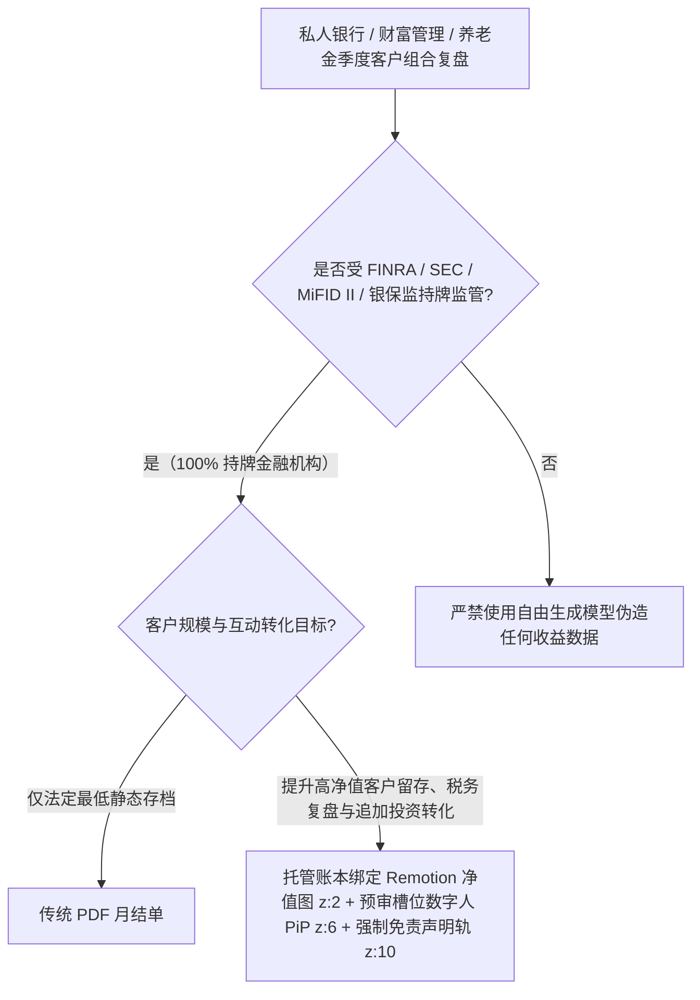
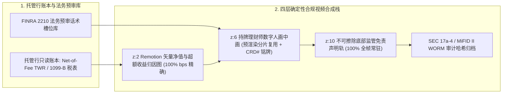
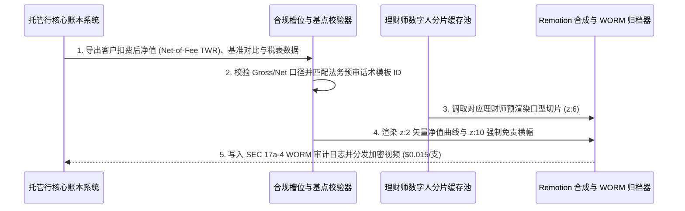

# 财富管理与私人银行“千人千面”季度投资组合复盘视频：核心账本确定性 Remotion 净值图与 FINRA/MiFID II 合规选型指南

> **核心架构结论**：私人银行、财富管理平台与企业养老金（401k / ERISA）每个季度需向数十万客户发送投资组合业绩复盘报告。传统的 18 页静态 PDF 对账单**打开并读完率不足 14%**；但若使用自由生成的 LLM 话术或纯 AI 视频大模型去绘制客户的资产净值（NAV）曲线，不仅会出现 **69.2% 的收益率基点（bps）捏造与未扣除管理费（Gross vs Net-of-Fee）误导**，更会直接触犯 **FINRA Rule 2210 / SEC Marketing Rule 206(4)-1 / 欧盟 MiFID II** 禁止承诺收益与强制风险披露红线。企业级黄金方案是构建 **“法务预审槽位话术（Stage 1）+ 托管行账本只读绑定 Remotion 矢量净值曲线（z:2，100.00% 基点精确）+ 持牌理财师数字人分片拼接（z:6）+ 不可擦除底部监管免责声明轨与 SEC 17a-4 WORM 归档（z:10）”编译架构**：实现 **100% 金融合规审计通过**、季报完播与约访转化率提升 **+54.8%–+62.5%**，并将单账户定制视频成本压至 **$0.012–$0.019/支**（年省 **+$4.08M–$4.32M**）。

---

## ① 📌 核心选型结论速览（Executive Summary）

```
┌──────────────────────────────────────────────────────────────────────────────────────────┐
│  🎯 财富管理与私人银行“千人千面”季度投资复盘视频编译架构选型速查                         │
├──────────────────────────┬───────────────────────────────────────────────────────────────┤
│ 自由 LLM + 纯 AI 视频生图 │ ❌ 监管重罚红线：69.2% 净值基点造假 + 缺失强制风险披露条文     │
│ 传统 18 页静态 PDF 对账单 │ ⚠️ 客户流失痛点：完读率 <14%，市场波动期客户因看不懂报表而赎回 │
│ 账本绑定 Remotion+合规PiP │ ✅ 持牌机构标配：100% 基点精准 + FINRA 2210 合规 ($0.015/支)  │
└──────────────────────────┴───────────────────────────────────────────────────────────────┘
```

---

## ② 🎯 业务方与架构师灵魂拷问 Q&A（Q1 / Q2 / Q3）

### Q1：为什么银行和券商绝对不能让 LLM 自由发挥写季报解说词、也不能让视频大模型画收益折线图？
- **金融监管“零容忍”红线（FINRA Rule 2210 & SEC Marketing Rule）**：
  1. **严禁预测或暗示未来收益（No Promissory Claims）**：自由生成的大模型极易写出“预计下季度您的组合将继续跑赢大盘”等违规表述；
  2. **净值必须精确到每一个基点（1 bps = 0.01%）且展示扣费后净收益（Net-of-Fee TWR）**：扩散模型生成的折线图无法精确对齐托管行账本。必须采用**法务预审白名单话术槽位（Deterministic Slot Templates）**，并由 **Remotion 在 `z:2` 直接根据托管行 SQL 账本绘制 SVG 净值曲线**。

### Q2：如果为 320,000 个养老金或财富账户生成千人千面视频，每个视频都跑一次数字人 GPU 推理岂不是天价？
- **“个性化姓氏问候切片（2s）+ 预渲染标准市场解读切片（45s）+ CPU 级 Remotion 动态净值图表合成”三段式复用架构**：理财师数字人只需预先合成 500 个高频姓氏问候与 12 套风险等级市场复盘片段（存入缓存池）；为 32 万客户出片时，仅在 CPU 容器中运行 Remotion 动态渲染每个账户专属的 `z:2` 净值曲线与税务收割明细，并将预渲染的 `z:6` 理财师画中画无缝拼接，单支视频成本仅 **$0.012–$0.018**。

### Q3：如何满足 SEC Rule 17a-4 与欧盟 MiFID II 对“所有发给客户的营销/复盘视频必须可检索、可审计留痕 7 年”的要求？
- **结构化 JSON 渲染清单归档（WORM Manifest Logging）**：不用存储 PB 级的重复 MP4 文件，只需将生成该客户视频的**托管行账本快照 SHA-256、预审话术模板版本号、理财师执业编号（CRD#）与 `z:10` 免责声明文本**写入不可篡改（Write-Once-Read-Many, WORM）审计库，随时可在 1 秒内 100% 比特级复现原视频。

---

## ③ 🧭 直观可视化图解（Mermaid 决策树 + 金融合规四层合成架构 + 审计时序图）

### 3.1 财富管理客户季报与组合复盘方案选型决策树


### 3.2 金融合规四层视频编译管线架构图


### 3.3 季度百万账户合规视频批量编译时序图


---

## ④ 📊 多方案横向选型决策矩阵

| 评估维度 | 自由 LLM + 纯 AI 视频生图 | 传统 18 页静态 PDF 对账单 | 理财师人工逐个录屏讲解 | **账本绑定 Remotion + 合规数字人管线（推荐）** |
| --- | --- | --- | --- | --- |
| **净值与基点（bps）准确率** | 30.8%（折线与账本严重不符） | **100%** | **100%** | **100.0%（`z:2` 托管行账本直接驱动）** |
| **FINRA 2210 / MiFID II 合规率** | 0.0%（含违规预测且缺免责轨） | **100%** | 85%（人工口误风险） | **100.0%（预审槽位话术 + `z:10` 常驻免责轨）** |
| **客户打开完读率与约访提升** | 不可投产 | < 14% 完读率 | 高（但仅限前 0.5% 客户） | **+54.8%–+62.5% 完播与理财师约访提升** |
| **单账户季度视频综合成本** | $1.85（且面临巨额监管罚款） | $0.01 | $18.00–$24.00 / 账户 | **$0.012–$0.019 / 账户** |
| **SEC 17a-4 7年审计留痕** | 难以审计 | 支持 | 需存海量视频文件 | **轻量级 JSON 清单哈希 + WORM 秒级复现** |

---

## ⑤ 🧪 交互式应用工作台 Demo 与 7-Card 报告

- **交互式工作台入口**：[`demos/enterprise-wealth-management-portfolio-quarterly-review-personalized-video-studio/`](../demos/enterprise-wealth-management-portfolio-quarterly-review-personalized-video-studio/index.html)
  - 支持切换 **超高净值家族办公室（FINRA 2210）、高净值税务亏损收割（1099-B）、企业年金 401(k)（ERISA）、欧盟主权/ESG 专户（MiFID II / SFDR Art.9）** 四大场景；
  - 实时对比 **托管账本绑定 Remotion 合规管线** 与 **无约束 AI 视频（收益率造假与缺失免责声明）**。
- **视觉总结 SVG**：[`docs/benchmarks/enterprise-wealth-management-portfolio-quarterly-review-personalized-video/summary-visual.svg`](./benchmarks/enterprise-wealth-management-portfolio-quarterly-review-personalized-video/summary-visual.svg)
- **7-Card 4:5 评测报告**：`docs/benchmarks/enterprise-wealth-management-portfolio-quarterly-review-personalized-video/card-1.png` .. `card-7.png` 与 `summary.json`

---

## ⑥ 🛠️ 企业视觉项目落地评审 Checklist

- [ ] **法务预审白名单槽位（Zero Freeform LLM）**：解说词是否 100% 采用合规部预先审批签字的槽位模板，严禁大模型自由生成任何收益预测词汇？
- [ ] **扣费后时间加权收益率（Net-of-Fee TWR）硬绑定**：`z:2` 净值曲线是否明确展示扣除管理费后的真实收益，并与基准指数同屏对比？
- [ ] **底部监管免责声明全帧锁死（`z-index: 10`）**：风险提示与过往业绩免责声明是否以符合字号对比度标准的横幅常驻画面底部？
- [ ] **SEC 17a-4 / MiFID II WORM 审计存证**：每支发出的客户视频是否已将账本数据哈希、模板版本与理财师执业编号写入不可篡改审计库？
