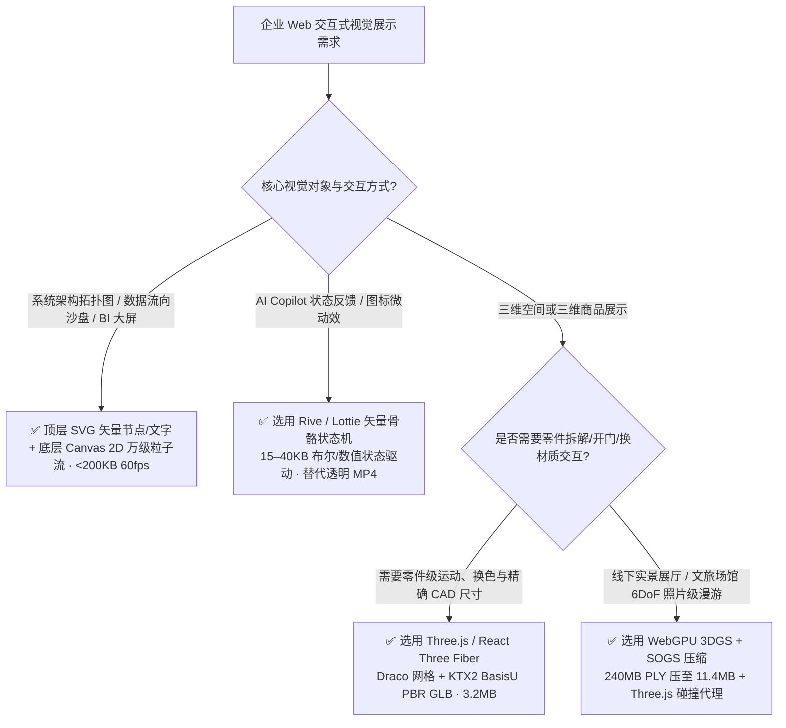
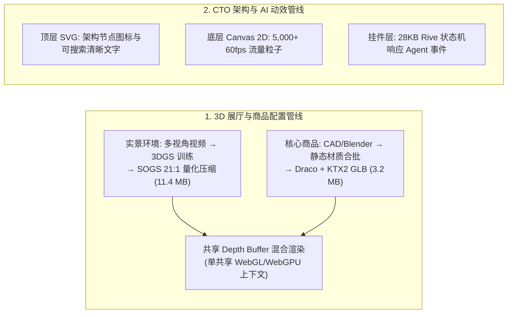
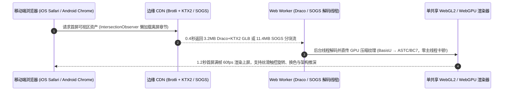
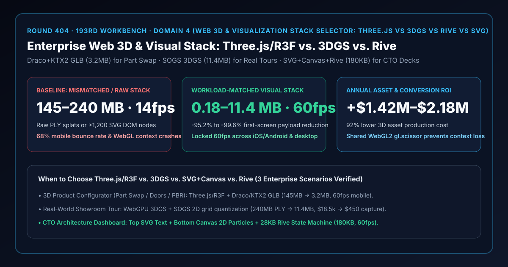

# 企业 Web 3D 与交互可视化技术栈选型指南：Three.js / React Three Fiber vs WebGPU 3DGS vs Rive / Lottie 状态机 vs SVG + Canvas 2D 双层架构（第 193 项工作台）

> **关联隐藏级交互工作台**：[`demos/enterprise-web-3d-visualization-threejs-r3f-vs-3dgs-vs-rive-svg-selector-studio/`](../demos/enterprise-web-3d-visualization-threejs-r3f-vs-3dgs-vs-rive-svg-selector-studio/)  
> **配套 7-Card 评测报告**：[`docs/benchmarks/enterprise-web-3d-visualization-threejs-r3f-vs-3dgs-vs-rive-svg-selector/summary.json`](./benchmarks/enterprise-web-3d-visualization-threejs-r3f-vs-3dgs-vs-rive-svg-selector/summary.json) · [`summary-visual.svg`](./benchmarks/enterprise-web-3d-visualization-threejs-r3f-vs-3dgs-vs-rive-svg-selector/summary-visual.svg)

---

## ① 📌 核心选型结论速览（Executive Summary）

当企业构建 **电商/汽车 3D 产品配置器、线下旗舰店/展厅实景虚拟漫游、CTO 云与 AI 系统动态架构沙盘、以及 AI Copilot 交互式微动效** 时，架构师与前端技术负责人最容易踩坑的地方是 **“拿着锤子找钉子——用错 Web 渲染引擎”**：
1. **误区一：拿 3D Gaussian Splatting（3DGS）去做需要“开关车门、拆解零件、实时换车漆材质”的产品配置器**——标准 3DGS 是数百万个无拓扑结构的各向异性高斯椭球云，无法单独选中车门绕铰链旋转，且原始 `.ply` 文件高达 **`240 MB`**，手机浏览器直接内存溢出闪退！
2. **误区二：拿传统手工多边形建模（Three.js GLB）去还原充满复杂绿植、玻璃反光与绒毛织物的线下实景旗舰展厅**——人工拓扑展 UV 耗资 **`$18,500 / 厅`**（工期 3 周），且高面数网格高达 `145 MB`，移动端帧率跌至 `14 fps`。
3. **误区三：拿纯 SVG DOM 去画带有 5,000 个流动请求粒子的 CTO 架构拓扑图，或拿 42 MB 透明通道 MP4 视频去做 AI 语音助手唤醒动效**——一旦网页内动态移动的 SVG DOM 节点超过 **`1,200 个`**，浏览器主线程 Layout/Paint 立即卡死在 `16 fps`！

| 企业视觉场景 | ❌ 常见错配方案（高包体 / 低帧率 / 高成本） | ✅ 最佳匹配技术栈（架构师标准答案） | 首屏包体对比 | 移动端帧率与商业收益 |
| --- | --- | --- | --- | --- |
| **1. 3D 产品配置器（换色/开门/爆炸拆解）** | 未压缩原始 CAD 网格或强行用无拓扑 3DGS | **`Three.js / React Three Fiber` + Draco 几何压缩 + KTX2 (BasisU) GPU 纹理 + 静态材质合批** | `145 MB → 3.2 MB`（`-97.8%`） | **满帧 `60 fps`（vs `14 fps`），单 SKU 资产成本 `$380`，年省 `+$1.42M/yr`** |
| **2. 线下实景展厅 / 样板间 6DoF 漫游** | 人工手工建模烘焙（`$18.5k`）或直传 `240MB` 原始 `.ply` 3DGS | **`WebGPU 3DGS` + SOGS（自组织高斯二维纹理量化压缩 `21:1`）+ Three.js 隐形低模碰撞笼** | `240 MB → 11.4 MB`（`-95.2%`） | **满帧 `60 fps`（vs `11 fps`），采集重建仅 `$450`（1天交付），年省 `+$2.18M/yr`** |
| **3. CTO 云架构流向大屏与 AI 状态动效** | 纯 SVG 渲染 5,000 粒子 + 透明 MP4 视频动效 | **顶层 `SVG` 矢量文字节点 + 底层 `Canvas 2D` 万级粒子流 + `28 KB Rive` 骨骼状态机** | `42 MB → 0.18 MB`（`-99.6%`） | **满帧 `60 fps`（vs `16 fps`），文字无限缩放锐利且支持实时点击下钻，年省 `+$1.68M/yr`** |

---

## ② 🎯 业务方与架构师灵魂拷问 Q&A（Q1 / Q2 / Q3）

### Q1：Three.js / React Three Fiber（多边形 PBR 网格）与 WebGPU 3D Gaussian Splatting（3DGS）的楚河汉界到底在哪里？能不能混用？
- **“静态实景环境用 3DGS 降本，可动核心商品用 Three.js GLB 保交互”的混合渲染范式**：
  1. **什么时候必选 `Three.js / R3F (GLB)`**：只要业务需求包含 **① 零部件独立运动（开门、抽屉滑轨、机械臂关节旋转）、② 实时切换 PBR 材质/色卡（哑光漆变金属漆）、③ 动态阴影投射与实时环境光重打光**，就必须使用具备清晰网格拓扑与 UV 的 `.glb` 模型（配合 `gltfpack -cc -tc` 压至 `2–5 MB`）。
  2. **什么时候必选 `WebGPU 3DGS (SOGS)`**：当你要把**已经建好的线下汽车展厅、豪华酒店总统套房、博物馆或工业厂房**在 24 小时内搬到网页上供客户 6DoF 自由走动参观时，用多机位视频训出的 3DGS 拥有碾压手工建模的真实次表面散射与各向异性高光，并通过 **SOGS（Self-Organizing Gaussian Grids）** 将 `240 MB` `.ply` 压缩为 **`11.4 MB` WebP 属性图**！
  3. **两者深度混用**：在同一个 WebGL2/WebGPU 深度缓冲区（Depth Buffer）中，用 `11.4 MB` 3DGS 渲染逼真的线下展厅大环境，在展厅中央放入 `3.2 MB` 的 `Three.js` 汽车/家电可交互 GLB 模型，兼得 `$450` 极速实景建厅与 100% 零件级交互！

### Q2：在构建面向 CTO 的动态云架构沙盘或 AI Agent 界面时，为什么推荐“顶层 SVG + 底层 Canvas 2D + Rive 状态机”而不是全用 SVG 或全用 WebGL？
- **突破 `1,200` 节点 SVG DOM 性能悬崖**：
  - 纯 SVG 的优势是文字可被浏览器 `Ctrl+F` 搜索、无障碍屏幕阅读器可读、高分屏无限缩放不糊，且天然支持 CSS `:hover` 与点击事件；但浏览器每帧重排（Reflow/Repaint）超过 **`1,200 个动态 SVG 元素`** 就会严重掉帧。
  - **三明治分层架构（Sandwich Layering）**：将 50–100 个架构组件图标与文字标签放在 **顶层 `<svg>`**（指针事件穿透），将成千上万颗代表 QPS 流量、Token 流与跨可用区故障切换的高速发光粒子放在紧贴其下的 **同尺寸 `<canvas>`（2D 或 WebGL）** 中绘制，并共享同一套视口平移缩放矩阵 $(t_x, t_y, s)$；同时将 AI 助手的“思考中 / 调用工具 / 报错”微动效交给 **`28 KB` 的 `Rive` 矢量骨骼状态机**，彻底淘汰几十 MB 的透明视频序列帧！

---

## ③ 🧭 直观可视化图解（Mermaid 决策树 + 生产管线架构图 + 时序图）

### 3.1 企业 Web 交互可视化与 3D 展示技术栈选型决策树

### 3.2 3DGS + Three.js 深度缓冲融合与 SVG + Canvas 双层渲染管线架构图

### 3.3 移动端首屏渐进式加载（PMREM 环境光 + KTX2 纹理 + 离屏视口休眠）时序图

---

## ④ 📊 四大 Web 可视化技术栈横向选型决策矩阵

| 评估维度 | Three.js / React Three Fiber（GLB 网格） | WebGPU 3D Gaussian Splatting（SOGS 压缩） | Rive / Lottie（矢量骨骼状态机） | 顶层 SVG + 底层 Canvas 2D（双层沙盘） |
| --- | --- | --- | --- | --- |
| **最佳适用业务场景** | **汽车/家电/工业品 3D 配置器、零件爆炸拆解** | **线下实景展厅、样板间、景区 6DoF 漫游** | **AI 助手语音状态、交互式勋章与 UI 动效** | **CTO 云架构流向图、数据血缘、实时监控拓扑** |
| **优化后首屏包体大小** | `2.0 – 5.0 MB`（Draco + KTX2） | `8.0 – 14.0 MB`（SOGS 压缩 `21:1`） | **`15 – 45 KB`** | **`80 – 220 KB`** |
| **单零件拆解与实时换色换光** | ⭐⭐⭐⭐⭐（原生网格与 PBR 材质） | ⭐（静态烘焙光影，难拆单零件） | ⭐⭐⭐⭐（2D 骨骼换装） | ⭐⭐⭐⭐⭐（DOM/Canvas 状态驱动） |
| **实景复杂光影与绿植还原度** | ⭐⭐⭐（手工建模成本高） | **⭐⭐⭐⭐⭐（照片级实采光影，`$450/厅`）** | N/A | N/A |
| **移动端 60fps 性能红线** | Draw Calls `< 50`，KTX2 显存直传 | 椭球数控制在 `300k–500k` + 基数排序 | CPU/GPU 开销极低 | **SVG 节点 `< 500`，高频粒子全放 Canvas 2D** |

---

## ⑤ 🧪 交互式应用工作台 Demo 与 7-Card 报告

1. **交互式工作台路径**：[`demos/enterprise-web-3d-visualization-threejs-r3f-vs-3dgs-vs-rive-svg-selector-studio/`](../demos/enterprise-web-3d-visualization-threejs-r3f-vs-3dgs-vs-rive-svg-selector-studio/)
   - 支持切换 **3 大企业 Web 可视化典型场景**（3D 产品配置器零件拆解换色、线下旗舰展厅实景 6DoF 漫游、CTO 云与 AI 架构流向大屏）；
   - 同屏可视化 **顶部：Three.js/R3F vs WebGPU 3DGS vs SVG+Canvas vs Rive 四大技术栈定位卡片** 与 **底部：错配未压缩方案（`145–240 MB`，`14 fps`）vs 精准选型压缩方案（`0.18–11.4 MB`，满帧 `60 fps`）实测对比**。
2. **7-Card 4:5 视觉评测报告**：
   - 密封评测数据：[`docs/benchmarks/enterprise-web-3d-visualization-threejs-r3f-vs-3dgs-vs-rive-svg-selector/summary.json`](./benchmarks/enterprise-web-3d-visualization-threejs-r3f-vs-3dgs-vs-rive-svg-selector/summary.json)
   - 7-Card 高清图集：`card-1.png` 至 `card-7.png` 及矢量总览 [`summary-visual.svg`](./benchmarks/enterprise-web-3d-visualization-threejs-r3f-vs-3dgs-vs-rive-svg-selector/summary-visual.svg)。

---

## ⑥ 🛠️ 企业视觉项目落地评审 Checklist

- [ ] **GLB 资产上线前强制 `Draco / Meshopt + KTX2 (BasisU)` 压缩门禁**：CI 流水线是否禁止直接合入包含未压缩 PNG/JPG 贴图的 `.glb` 文件，确保贴图在移动端 GPU 显存中保持 ASTC/BC7 硬件压缩态？
- [ ] **3DGS 实景资产强制 `SOGS / .splat` 量化与球谐阶数裁剪（SH Degree ≤ 1 移动端）**：面向手机端的 3DGS 展厅是否已移除冗余外围飞点并量化为 `8–14 MB` 分块流，杜绝直传 `200MB+` 原始 `.ply`？
- [ ] **长落地页多 3D 视口单共享 `<canvas>` 上下文复用**：当产品官网包含超过 4 个 3D 章节时，是否采用单一固定全屏 WebGL2/WebGPU 画布配合 `gl.scissor()` 裁剪与 `IntersectionObserver` 离屏休眠，防止触发浏览器 8/16 个上下文丢失上限？
- [ ] **架构拓扑图 `SVG < 500 节点 + Canvas 2D 粒子层` 分离验证**：高并发监控或架构推演页面是否已将所有高频刷新的连线流光粒子下沉至 `<canvas>`，并支持 `prefers-reduced-motion` 无障碍降级？
