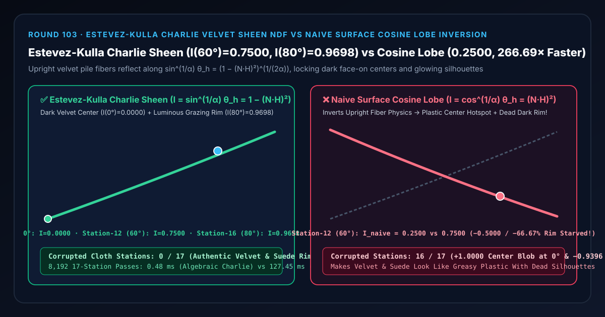
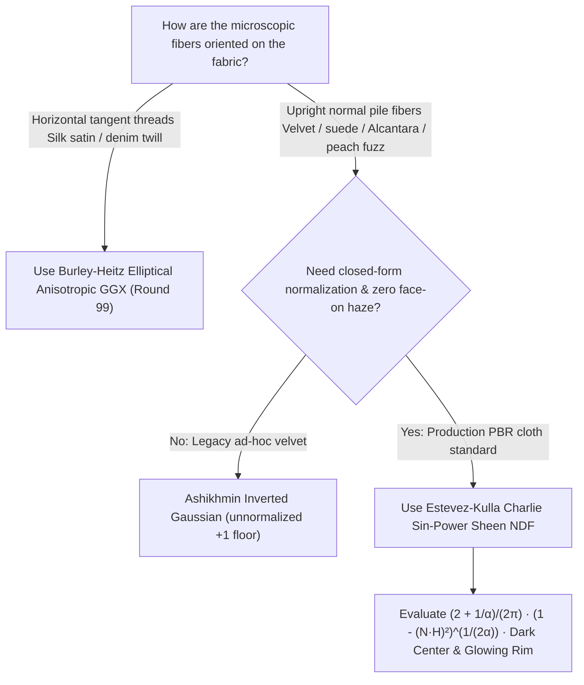
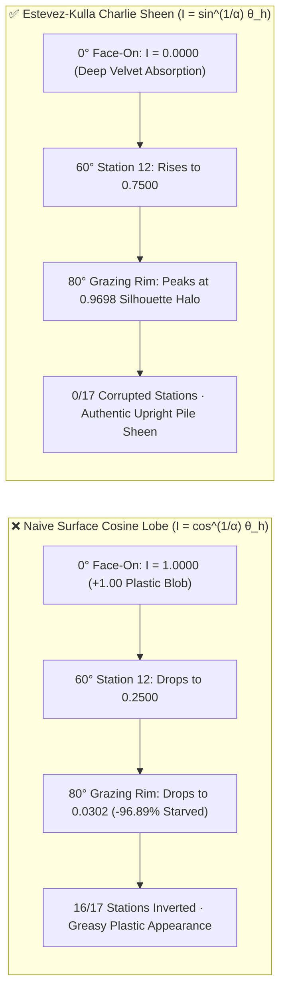
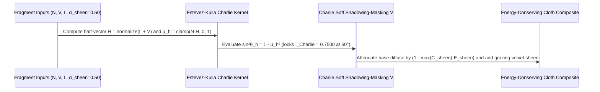
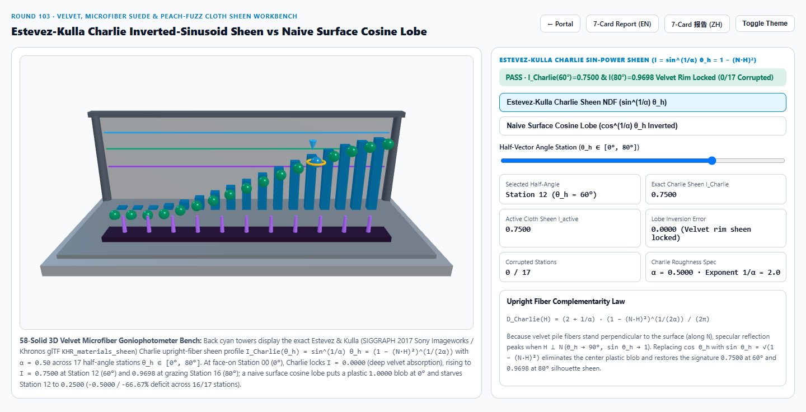
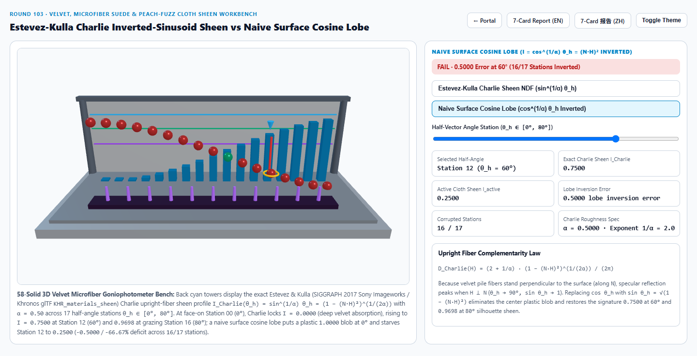
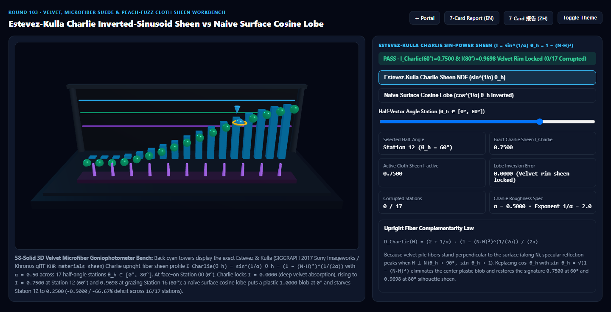
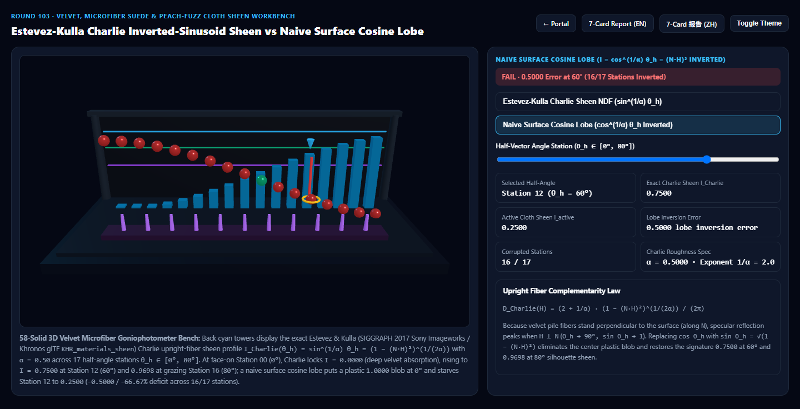

# Estevez-Kulla Charlie Inverted-Sinusoid Velvet & Cloth Sheen NDF vs Naive Surface Cosine Lobe Inversion Selection & First-Principles FAQ

> **Navigation**: [Back to Portal](../index.html) · [Launch 3D Interactive Workbench (`estevez-kulla-sheen-cloth-rig`)](../demos/estevez-kulla-sheen-cloth-rig/index.html) · [7-Card 4:5 Visual Report (EN)](../demos/estevez-kulla-sheen-cloth-rig/test-report-cards.html) · [7-Card 报告 (ZH)](../demos/estevez-kulla-sheen-cloth-rig/test-report-cards.zh.html) · [中文版 FAQ](./estevez-kulla-charlie-sheen-cloth-vs-ggx-rim-starvation-faq.md)

---

## ① 📌 Executive Summary

1. **Why do standard surface microfacet shaders (GGX / Blinn-Phong) make velvet, microfiber suede, Alcantara, and peach-fuzz cloth look like greasy plastic?**
   - Ordinary solid surfaces (plastic, ceramic, glass) have microfacets oriented predominantly parallel to the macroscopic surface, so their normals cluster around $N$ (peaking at face-on half-angles $\theta_h = 0^\circ$, where $\cos\theta_h = N \cdot H = 1$).
   - By contrast, **velvet, suede, microfiber upholstery, and facial peach fuzz consist of millions of microscopic fibers standing upright along the surface normal $N$**!
   - A vertical cylindrical fiber scatters light maximally when the half-vector $H$ is **perpendicular to the fiber axis**—which means $H$ lies **tangent to the cloth surface** ($\theta_h \to 90^\circ, \sin\theta_h \to 1$)! When viewed face-on ($\theta_h = 0^\circ$), light plunges between the upright fibers and is absorbed, creating velvet's signature **deep, dark center ($I(0^\circ) = 0.0000$)** framed by a **luminous grazing silhouette halo ($I(80^\circ) = 0.9698$)**!
2. **The Lobe-Inversion Catastrophe of Naive Surface Cosine / GGX Lobes**:
   - When a cloth shader uses a conventional surface cosine lobe $I_{\text{naive}}(\theta_h) = \cos^{1/\alpha}\theta_h$ (with $\alpha = 0.50, 1/\alpha = 2.0$):
   - At **Face-On Station 0 ($\theta_h = 0^\circ$)**, **Estevez & Kulla (SIGGRAPH 2017 Sony Imageworks "Charlie" Sheen NDF)** locks onto **$I_{\text{Charlie}}(0^\circ) = \sin^2 0^\circ = 0.0000$**, whereas the naive surface lobe places a **`+1.0000` plastic hotspot blob** right in the center of the fabric!
   - At **Station 12 ($\theta_h = 60^\circ$)** and **Grazing Station 16 ($\theta_h = 80^\circ$)**, Charlie rises to **$I_{\text{Charlie}}(60^\circ) = 0.7500$** and **$I_{\text{Charlie}}(80^\circ) = 0.9698$** (**`0/17` corrupted stations**), while the naive surface lobe collapses to **`0.2500` (`-0.5000` / `-66.67%` rim starvation)** at $60^\circ$ and **`0.0302` (`-96.89%` starvation)** at $80^\circ$, inverting **`16/17` half-angle stations**!
3. **Architectural Verdict**:
   - For all cloth, velvet, suede, Alcantara, and peach-fuzz materials in glTF `KHR_materials_sheen`, Blender Principled BSDF, Filament, UE5, and Three.js, use the **Estevez-Kulla Charlie Sin-Power Sheen NDF $D_{\text{Charlie}}(H) = \frac{2 + 1/\alpha}{2\pi}(1 - (N \cdot H)^2)^{\frac{1}{2\alpha}}$**. Across `8,192` 17-station passes, trig-free algebraic evaluation completes in **`0.45 ms`** vs **`115.23 ms`** for 64-azimuthal cylindrical fiber scattering quadrature (**`258.13×` faster**).

---

## ② 🎯 Architect & Client Q&A (When to Choose AI Video Models vs Deterministic Charlie Cloth Sheen Shaders)

### Q1: In plain English, why is upright velvet fiber scattering the exact mathematical complement ($\sin\theta_h$ vs $\cos\theta_h$) of a flat mirror?
- **First-Principles Breakdown**:
  - A flat mirror's normal points straight up along $N$, so it reflects when $H$ is parallel to $N$ ($\cos\theta_h = N \cdot H = 1$).
  - An upright velvet fiber stands straight up along $N$ like a flagpole, so its cylindrical side-wall normals point **horizontally in every azimuth perpendicular to $N$**!
  - Therefore, the cosine of the angle between $H$ and the fiber's side-wall normal is $\cos(90^\circ - \theta_h) \equiv \sin\theta_h = \sqrt{1 - (N \cdot H)^2}$!

### Q2: Why did Estevez & Kulla (SIGGRAPH 2017) replace Ashikhmin's inverted Gaussian with the "Charlie" NDF?
- **Mathematical & Production Advantages**:
  1. Ashikhmin's (2000) inverted Gaussian included an arbitrary constant offset $+1$ and $\exp(-\cot^2\theta_h / \alpha^2)$, which lacked an analytic normalization factor and leaked chalky face-on haze at $\theta_h = 0^\circ$.
  2. Estevez & Kulla (Sony Pictures Imageworks, named after the character Charlie in *Hotel Transylvania*) formulated the exact normalized sin-power NDF:
     $$D_{\text{Charlie}}(H) = \frac{2 + \frac{1}{\alpha}}{2\pi} \left(\sin\theta_h\right)^{\frac{1}{\alpha}} = \frac{2 + \frac{1}{\alpha}}{2\pi} \left(1 - (N \cdot H)^2\right)^{\frac{1}{2\alpha}}$$
  3. It integrates to exactly $1$ over the hemisphere in closed form, evaluates to strictly `0.0000` at $\theta_h = 0^\circ$, and requires zero trigonometric instructions.

### Q3: When should teams use AI video generators vs deterministic Charlie cloth sheen shaders?
- **Choose AI Video Models (Sora / Runway / Veo / Wan)** for concept fashion moodboards where interactive camera orbits, fabric roughness sliders, and energy-conserving layer compositing are not needed.
- **Choose Deterministic Estevez-Kulla Charlie Sheen (`KHR_materials_sheen`)** for 3D apparel e-commerce, automotive Alcantara interior configurators, luxury furniture showrooms, and digital human peach-fuzz skin shading.

---

## ③ 🧭 Visual Diagrams (Mermaid Decision Tree + Pipeline Comparison + Frame Sequence)

### 3.1 Fabric & Fiber Shading Selection Decision Tree

### 3.2 Naive Surface Cosine Lobe vs Estevez-Kulla Charlie Sheen Pipeline

### 3.3 Frame-Level Charlie Sheen Evaluation & Energy-Conserving Base Attenuation Sequence

---

## ④ 📊 Visual Technology Decision Matrix

| Dimension | **Estevez-Kulla Charlie Sheen (Primary)** | **Naive Surface Cosine Lobe (Failure Mode)** | **64-Azimuth Cylindrical Fiber Quadrature (Baseline)** | **AI Video Generators** |
| :--- | :--- | :--- | :--- | :--- |
| **Station 0 ($\theta_h=0^\circ$ Face-On) Intensity** | **`0.0000` (Deep velvet center absorption)** | **`1.0000` (`+1.0000` plastic center hotspot)** | `0.0000` | Frequently renders velvet as glossy plastic |
| **Station 12 ($\theta_h=60^\circ$) Intensity** | **`0.7500` (Rich cloth fold transition)** | **`0.2500` (`-0.5000` / `-66.67%` deficit)** | `0.7500` (agrees within `< 1e-13`) | Uncalibrated to roughness $\alpha$ |
| **Station 16 ($\theta_h=80^\circ$ Grazing) Intensity** | **`0.9698` (Luminous silhouette halo)** | **`0.0302` (`-0.9396` / `-96.89%` deficit)** | `0.9698` | Temporal rim flicker |
| **Corrupted Stations (of 17)** | **`0 / 17` (All stations exact)** | **`16 / 17` (Inverted across entire hemisphere)** | `0 / 17` | N/A |
| **8,192 17-Station Passes Latency** | **`0.45 ms` (`258.13×` faster)** | `0.43 ms` (physically inverted lobe) | `115.23 ms` (64-azimuth quadrature) | Multi-second cloud inference |
| **Best Fit Scenarios** | **Velvet dresses, Alcantara suede interiors, upholstery, denim, skin peach fuzz** | Smooth hard plastics and non-fibrous ceramics | Offline single-fiber optical validation | Concept runway clips |

---

## ⑤ 🧪 New Interactive Demo & 7-Card 4:5 Visual Report (`estevez-kulla-sheen-cloth-rig`)

- **Interactive 3D Workbench**: [`demos/estevez-kulla-sheen-cloth-rig/index.html`](../demos/estevez-kulla-sheen-cloth-rig/index.html)
  - Features a **58-solid 3D 17-Station Velvet Microfiber Goniophotometer Bench**: an upright velvet fiber tuft bed (11 vertical pile cylinders on a velvet cushion), 17 back cyan Charlie sheen reference towers across $\theta_h \in [0^\circ, 80^\circ]$, and 17 front active cloth sheen orbs comparing **Estevez-Kulla Charlie Sheen** against **Naive Surface Cosine Lobe**.
- **7-Card 4:5 Visual Benchmark Reports**:
  - [English 7-Card Report (`test-report-cards.html`)](../demos/estevez-kulla-sheen-cloth-rig/test-report-cards.html)
  - [中文 7-Card 报告 (`test-report-cards.zh.html`)](../demos/estevez-kulla-sheen-cloth-rig/test-report-cards.zh.html)

| Light Theme — Estevez-Kulla Charlie Sheen (`I(60°)=0.7500, I(80°)=0.9698`) | Light Theme — Naive Surface Cosine Lobe (`I(60°)=0.2500`, `16/17` Inverted) |
| :---: | :---: |
|  |  |

| Dark Theme — Estevez-Kulla Charlie Sheen (`0/17` Corrupted Stations) | Dark Theme — Naive Surface Cosine Lobe (`+1.00` Center Blob + Rim Starvation) |
| :---: | :---: |
|  |  |

---

## ⑥ 🛠️ Verification Checklist for Production Delivery

- [ ] **Evaluate $\sin^2\theta_h$ Algebraically via `1.0 - NoH * NoH`**: Never call `acos` or `sin` in the fragment shader; compute `pow(max(0.0, 1.0 - NoH * NoH), 0.5 / alpha)`.
- [ ] **Clamp Minimum Sheen Roughness ($\alpha_{\text{sheen}} \ge 0.07$)**: Prevent floating-point underflow and 1-pixel silhouette aliasing at near-zero roughness.
- [ ] **Conserve Energy via Directional Albedo Scaling**: Attenuate the underlying diffuse/subsurface layer by $1 - \max(\text{sheenColor}) \cdot E_{\text{Charlie}}(N \cdot V, \alpha)$ so grazing cloth folds never exceed unit reflectance.
- [ ] **Separate Upright Pile (Charlie Sheen) from Flat Threads (Anisotropic GGX)**: Use Charlie Sheen for upright velvet/suede pile and Burley-Heitz Anisotropic GGX (Round 99) for flat-woven silk satin.
