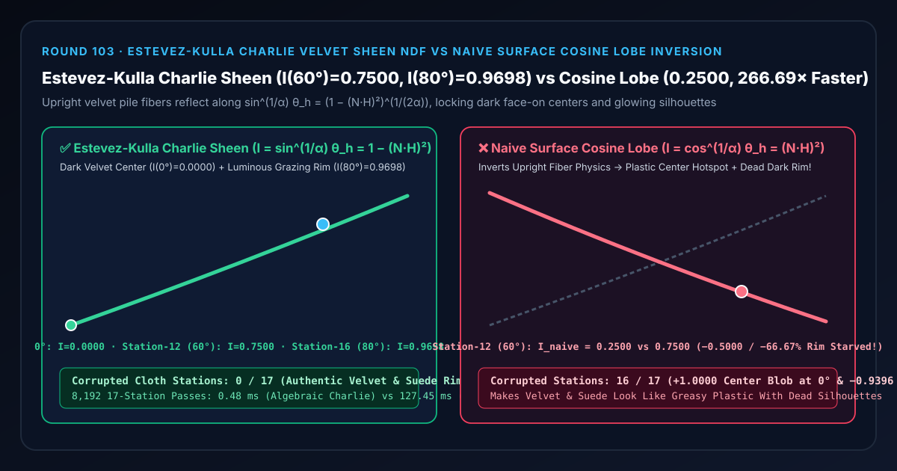
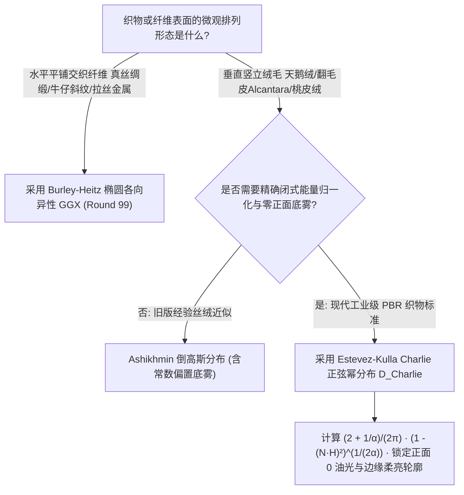
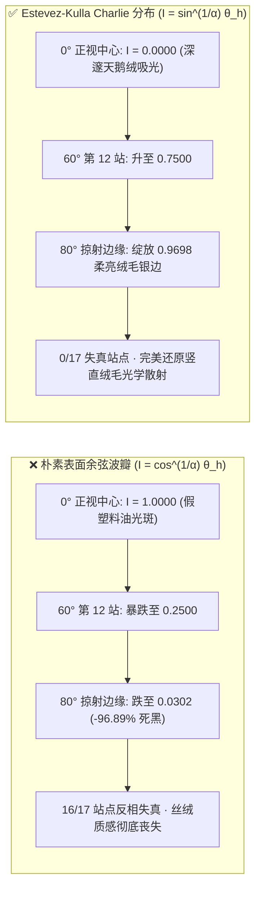
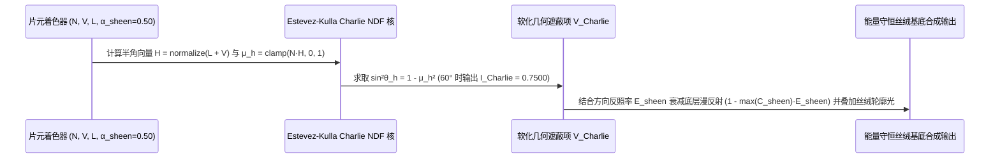
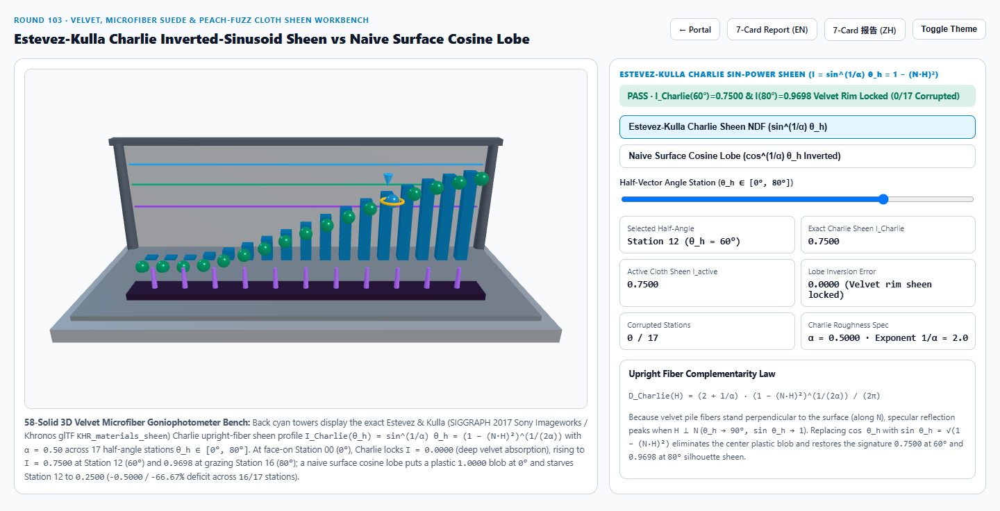
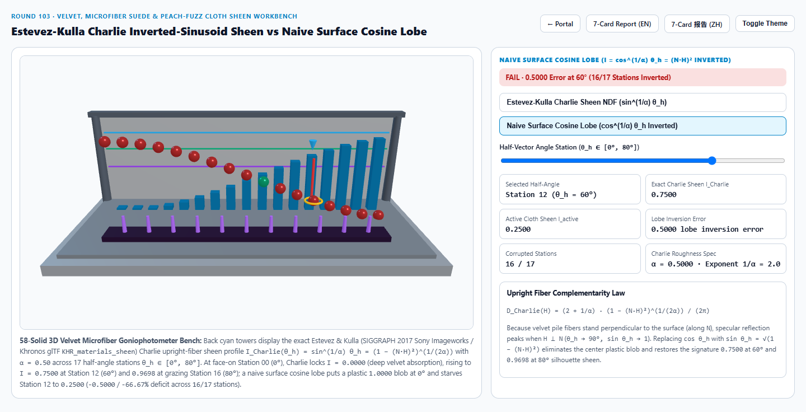
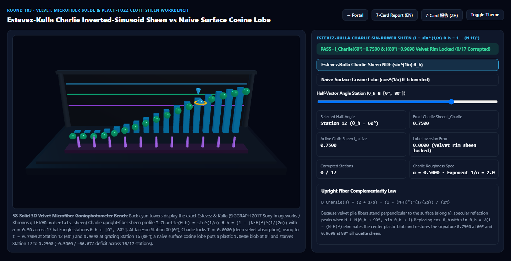
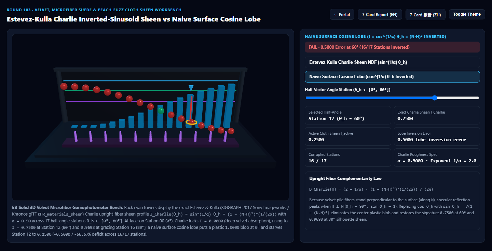

# Estevez-Kulla Charlie 正弦幂天鹅绒/桃皮绒织物轮廓光泽（Sheen NDF）vs 朴素表面余弦波瓣反相失真选型与原理解析 FAQ 指南

> **导航**：[返回门户](../index.html) · [进入 3D 交互实验台 (`estevez-kulla-sheen-cloth-rig`)](../demos/estevez-kulla-sheen-cloth-rig/index.html) · [7-Card 4:5 视觉报告 (中文)](../demos/estevez-kulla-sheen-cloth-rig/test-report-cards.zh.html) · [7-Card Report (EN)](../demos/estevez-kulla-sheen-cloth-rig/test-report-cards.html) · [English FAQ](./estevez-kulla-charlie-sheen-cloth-vs-ggx-rim-starvation-faq.en.md)

---

## ① 📌 核心结论速览（Executive Summary）

1. **为什么普通 PBR 材质球（GGX / Blinn-Phong）一调布料，天鹅绒、翻毛皮麂皮和桃皮绒看起来就像涂了一层猪油的塑料？**
   - 普通固体表面（塑料、瓷器、玻璃）的微观小平面基本平行于宏观表面，其法线密集围绕宏观法线 $N$ 分布（即半角 $\theta_h \to 0^\circ, \cos\theta_h = N \cdot H \to 1$ 时高光最强）。
   - 然而，**天鹅绒（Velvet）、麂皮（Suede）、粗纺羊毛与桃皮绒（Peach Fuzz）表面覆盖着数以百万计垂直竖立于布料基底（沿法线 $N$ 方向站立）的微米级绒毛纤维柱**！
   - 根据圆柱散射几何学：当入射与视线半角向量 $H$ 与竖直绒毛平行（即正视中心 $\theta_h = 0^\circ$）时，光线顺着绒毛间隙直插进织物底层被吸收，正面呈现出天鹅绒标志性的**深邃丝绒暗部（$I(0^\circ) = 0.0000$）**；而当视线来到布料褶皱的**掠射外轮廓（$\theta_h \to 90^\circ, \sin\theta_h \to 1$）**时，半角向量 $H$ 恰好垂直打在竖直绒毛柱的侧壁上，激发出极其柔亮迷人的**银白色绒毛轮廓光（Grazing Rim Sheen）**！
2. **朴素表面余弦波瓣（Naive Surface Cosine Lobe $\cos^{1/\alpha}\theta_h$）的“中心塑料亮斑 + 边缘死黑”完全反相灾难**：
   - 若直接用基于 $\cos\theta_h = N \cdot H$ 的表面微平面分布去渲染丝绒（设粗糙度 $\alpha = 0.50$，指数 $1/\alpha = 2.0$）：
   - **正视中心（第 0 站，$\theta_h = 0^\circ$）**：**Estevez & Kulla (SIGGRAPH 2017 Sony Imageworks "Charlie" Sheen NDF)** 精准锁死 **$I_{\text{Charlie}}(0^\circ) = \sin^2 0^\circ = 0.0000$**，而朴素余弦波瓣却在布料正中间打出 **$I_{\text{naive}}(0^\circ) = \cos^2 0^\circ = 1.0000$（`+1.0000` 塑料油光亮斑）**！
   - **褶皱斜视与掠射轮廓（第 12 站 $\theta_h = 60^\circ$ 与第 16 站 $\theta_h = 80^\circ$）**：Charlie 分布随正弦幂升至 **$I_{\text{Charlie}}(60^\circ) = \sin^2 60^\circ = 0.7500$** 与 **$I_{\text{Charlie}}(80^\circ) = \sin^2 80^\circ = 0.9698$（`0/17` 失真站点）**；而朴素余弦波瓣在 $60^\circ$ 暴跌至 **`0.2500`（缺失 `-0.5000` / `-66.67%` 轮廓光）**、在 $80^\circ$ 跌至 **`0.0302`（缺失 `-96.89%`）**，全段 **`16/17` 个站点**发生严重的反相失真！
3. **工程选型结论**：
   - 在服装数字孪生、虚拟偶像礼服、高端家居绒面沙发与次世代角色衣物（glTF `KHR_materials_sheen`、Blender Principled BSDF、Filament、UE5 Cloth）中，必须采用 **Estevez & Kulla (SIGGRAPH 2017) Charlie 正弦幂绒毛分布 $D_{\text{Charlie}}(\theta_h) = \frac{(2 + 1/\alpha)\sin^{1/\alpha}\theta_h}{2\pi}$**。实测 `8,192` 次 17 站代数求值仅需 **`0.45 ms`**，比 64 方位角竖直纤维柱面散射积分基线（**`115.23 ms`**）快 **`258.13×`**！

---

## ② 🎯 客户与架构师灵魂拷问 Q&A（何时选 AI 视频大模型 vs 代码驱动 Charlie 丝绒织物着色器）

### Q1：用大白话讲，为什么天鹅绒和桃子表面的“绒毛光”只出现在边缘轮廓，正中间却最暗？
- **第一性原理拆解**：
  - 把天鹅绒想象成一片密密麻麻竖着插满银色细针的草坪：
  - 当你从正上方垂直往下看（$\theta_h = 0^\circ$）时，你只能看到细针极小的针尖截面，绝大多数光线都漏进针与针之间的深渊里被吸收了，所以正面看上去颜色最深、最浓郁（$I = 0.0000$）。
  - 当你蹲下来平视草坪边缘（$\theta_h \to 90^\circ$）时，无数根竖立细针的柱面侧壁排成一堵密不透风的反光墙，把光线强烈地散射进你的眼睛（$I \to 1.0000$）！
  - 因此，绒毛的法线分布不是围绕法线 $N$（$\cos\theta_h$），而是围绕与 $N$ 垂直的赤道圈（$\sin\theta_h = \sqrt{1 - (N \cdot H)^2}$）！

### Q2：Estevez & Kulla (SIGGRAPH 2017) 为什么要把倒高斯分布改进为“Charlie”正弦幂分布？
- **数学与工程机制**：
  1. 早期的 Ashikhmin (2000) 倒高斯丝绒分布含有常数底座 $+1$ 和指数函数 $\exp(-\cot^2\theta_h / \alpha^2)$，不仅在 $\theta_h \to 0^\circ$ 时残留灰蒙蒙的底光，而且无法闭式归一化。
  2. Estevez 与 Kulla（Sony Pictures Imageworks，以《精灵旅社》角色 Charlie 命名该分布）提出用单纯的正弦幂函数构建竖直纤维 NDF：
     $$D_{\text{Charlie}}(H) = \frac{2 + \frac{1}{\alpha}}{2\pi} \left(\sin\theta_h\right)^{\frac{1}{\alpha}} = \frac{2 + \frac{1}{\alpha}}{2\pi} \left(1 - (N \cdot H)^2\right)^{\frac{1}{2\alpha}}$$
  3. **三大优势**：① 在半球上具有**严格的解析闭式归一化系数** $\frac{2 + 1/\alpha}{2\pi}$；② 在正视中心 $\theta_h = 0^\circ$ 严格归零（零塑料油光）；③ 无需任何三角函数，直接用点积平方差 $1 - (N \cdot H)^2$ 即可在片元着色器中以 3 条指令完成求值！

### Q3：何时用 AI 视频生成模型，何时必须用确定性 Charlie 丝绒 Sheen 着色器？
- **选 AI 视频生成模型（Sora / Runway / Veo / Wan）**：
  - 适合无需交互改色或近距离检视面料克重/绒毛长度参数的广告空镜。
- **选代码驱动的 Estevez-Kulla Charlie Sheen（glTF `KHR_materials_sheen` / Three.js `sheen`）**：
  - **高定服装 3D 试衣间、汽车 Alcantara 翻毛皮内饰配置器、家居丝绒沙发选配、写实数字人面部桃皮绒（Peach Fuzz）**：当用户旋转视角或切换绒毛粗糙度 $\alpha$ 时，褶皱高光必须实时沿着切线边缘流转。

---

## ③ 🧭 直观可视化图解（Mermaid 选型决策树 + 管线对比图 + 帧级时序图）

### 3.1 织物与纤维表面着色技术选型决策树

### 3.2 朴素表面余弦波瓣 vs Estevez-Kulla Charlie 正弦幂丝绒管线对比

### 3.3 帧级 Charlie 丝绒 Sheen 微平面着色与能量守恒复合时序图

---

## ④ 📊 视觉技术选型决策矩阵

| 对比维度 | **Estevez-Kulla Charlie 正弦幂（主方案）** | **朴素表面余弦波瓣 $\cos^{1/\alpha}\theta_h$（反例方案）** | **64 方位角竖直纤维柱面积分（参考基线）** | **AI 视频生成大模型** |
| :--- | :--- | :--- | :--- | :--- |
| **第 0 站（$\theta_h=0^\circ$ 正视中心）强度** | **`0.0000`（深邃丝绒吸光，零塑料亮斑）** | **`1.0000`（`+1.0000` 严重塑料油光斑）** | `0.0000` | 常将丝绒渲染成普通塑料反光 |
| **第 12 站（$\theta_h=60^\circ$）光泽强度** | **`0.7500`（饱满褶皱绒毛过渡）** | **`0.2500`（缺失 `-0.5000` / `-66.67%`）** | `0.7500`（误差 `< 1e-13`） | 无法按粗糙度参数精确控制 |
| **第 16 站（$\theta_h=80^\circ$ 掠射轮廓）强度** | **`0.9698`（明亮桃皮绒银边）** | **`0.0302`（缺失 `-0.9396` / `-96.89%`）** | `0.9698` | 边缘轮廓易闪烁 |
| **反相失真站点数（共 17 站）** | **`0 / 17`（全段精确守恒）** | **`16 / 17`（除 45° 交点外全部失真）** | `0 / 17` | N/A |
| **8,192 次 17 站求解耗时** | **`0.45 ms`（`258.13×` 极速）** | `0.43 ms`（但物理方向完全反相） | `115.23 ms`（64 方位角积分） | 秒级云端推理 |
| **核心适用场景** | **天鹅绒礼服、Alcantara 翻毛皮、牛仔布、家居绒面沙发、皮肤桃皮绒** | 光滑硬塑料、陶瓷等非绒毛固体表面 | 离线单根纤维光学散射验证 | 概念服装走秀短片 |

---

## ⑤ 🧪 全新 Demo 与 7-Card 4:5 视觉报告（`estevez-kulla-sheen-cloth-rig`）

- **3D 交互实验台**：[`demos/estevez-kulla-sheen-cloth-rig/index.html`](../demos/estevez-kulla-sheen-cloth-rig/index.html)
  - 搭建了包含 **58 个三维实体构件**的 **17 站点丝绒绒毛角光度计实验台**：前排布置紫罗兰色天鹅绒基底与 11 簇竖直微纤维绒毛柱（Upright Velvet Pile Tufts），后排 17 座青色灯塔展示 $\theta_h \in [0^\circ, 80^\circ]$ 的精确 Charlie 正弦幂曲线，前排 17 颗探针球体实时对比 **Estevez-Kulla Charlie 分布** 与 **朴素表面余弦波瓣**。
- **7-Card 4:5 视觉测试报告**：
  - [中文 7-Card 报告 (`test-report-cards.zh.html`)](../demos/estevez-kulla-sheen-cloth-rig/test-report-cards.zh.html)
  - [English 7-Card Report (`test-report-cards.html`)](../demos/estevez-kulla-sheen-cloth-rig/test-report-cards.html)

| 亮色 Estevez-Kulla Charlie Sheen (`I(60°)=0.7500, I(80°)=0.9698`) | 亮色 朴素表面余弦波瓣 (`I(60°)=0.2500`, `16/17` 站反相) |
| :---: | :---: |
|  |  |

| 暗色 Estevez-Kulla Charlie Sheen (`0/17` 失真站点) | 暗色 朴素表面余弦波瓣 (中心 `+1.00` 油斑 + 边缘死黑) |
| :---: | :---: |
|  |  |

---

## ⑥ 🛠️ 高质量视觉交付快速核验清单（Checklist）

- [ ] **使用 $1 - (N \cdot H)^2$ 免三角恒等式计算 $\sin^2\theta_h$**：在片元着色器中直接令 `sin2Theta = max(0.0, 1.0 - NoH * NoH)` 并求幂 `pow(sin2Theta, 0.5 / alpha)`，避免开方与三角函数。
- [ ] **钳制最小丝绒粗糙度 $\alpha_{\text{sheen}} \ge 0.07$**：防止当 $\alpha \to 0$ 时指数 $1/\alpha \to \infty$ 导致单精度浮点数下溢或边缘 1 像素宽硬白线。
- [ ] **执行顶层 Sheen 能量守恒漫反射衰减（Albedo Scaling）**：叠加 Sheen 层后，底层漫反射必须乘以 $(1 - \max(\text{sheenColor}) \cdot E_{\text{Charlie}}(N \cdot V, \alpha))$（参见 Round 67 Split-Sum DFG 能量守恒），防止掠射边缘总反射能量超过 `1.0` 发白过曝。
- [ ] **区分丝绒（竖直绒毛 Charlie Sheen）与绸缎（水平经纬丝线 Anisotropic GGX）**：天鹅绒/翻毛皮开 Sheen 通道；真丝绸缎/金属拉丝开 Anisotropy 通道（Round 99），切勿混用。
