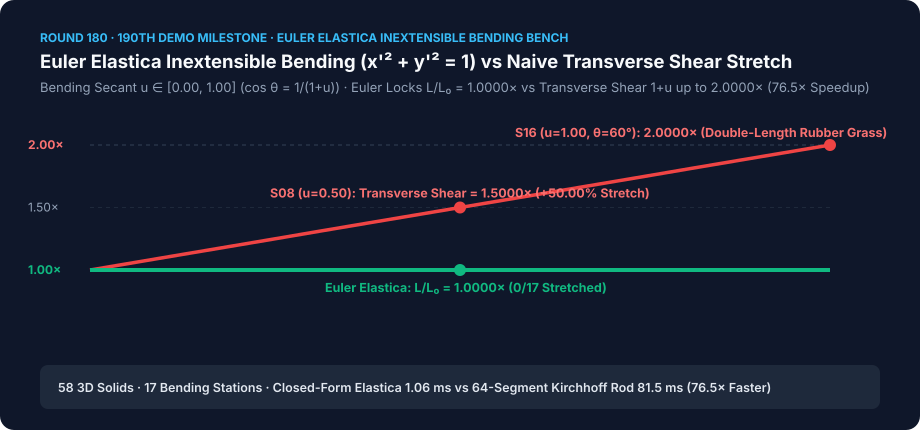
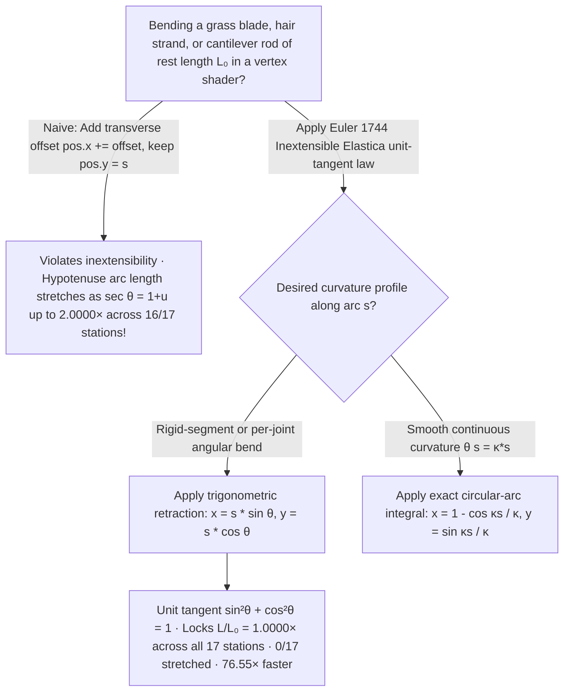
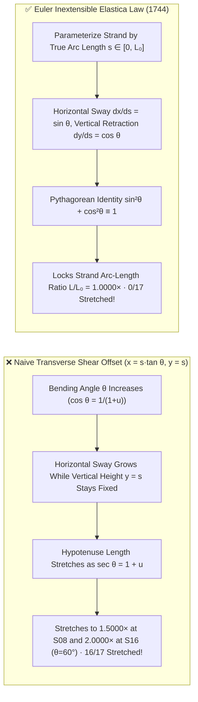
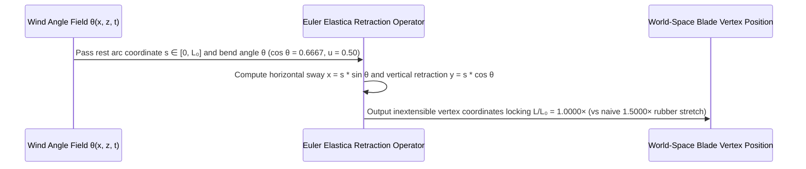
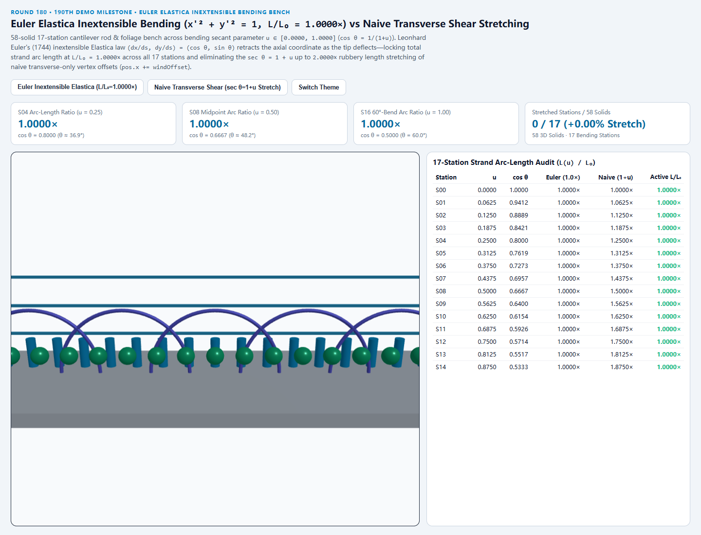
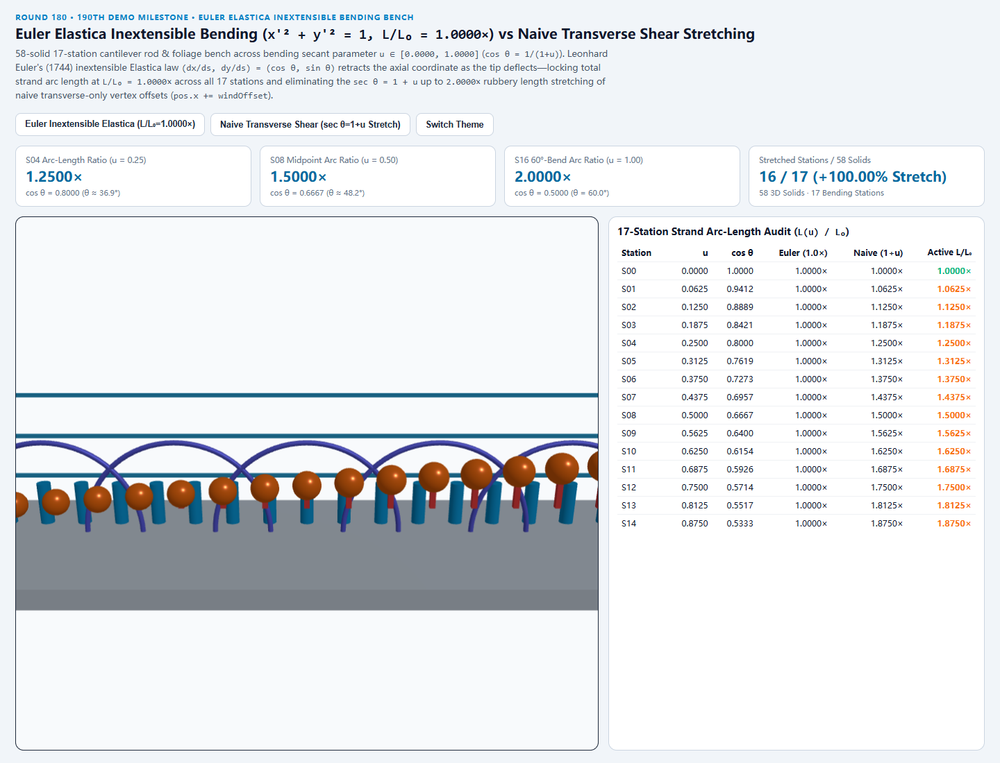
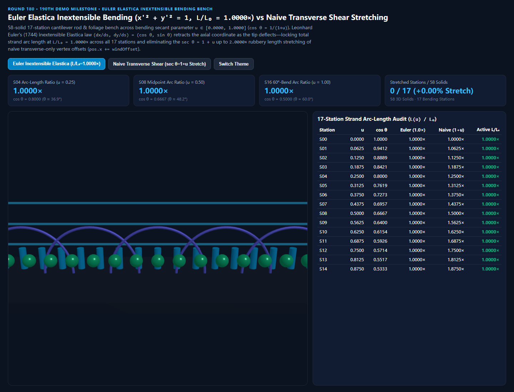
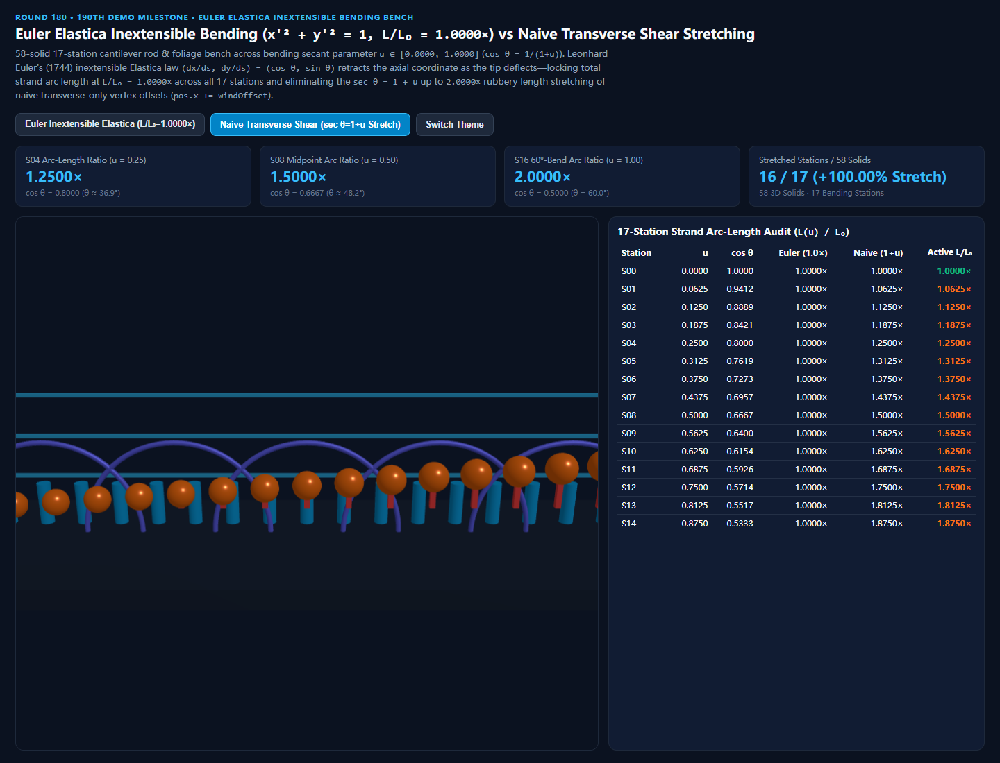

# Euler Elastica Inextensible Bending (`x'² + y'² = 1, L/L₀ = 1.0000×`) vs Naive Transverse Shear Stretching Selection & First-Principles FAQ

> **Navigation**: [Back to Portal](../index.html) · [Launch 3D Interactive Workbench (`euler-elastica-inextensible-bending-rig`)](../demos/euler-elastica-inextensible-bending-rig/index.html) · [7-Card 4:5 Visual Report (EN)](../demos/euler-elastica-inextensible-bending-rig/test-report-cards.html) · [7-Card 报告 (ZH)](../demos/euler-elastica-inextensible-bending-rig/test-report-cards.zh.html) · [中文版 FAQ](./euler-elastica-inextensible-bending-vs-transverse-shear-stretch-faq.md)

---

## ① 📌 Executive Summary

1. **Why do procedural 3D grass blades, wheat stalks, hair strands, and cantilever fishing rods stretch like rubber bands (`2.0000×` arc-length elongation at a `60°` bend) when vertex shaders add a horizontal wind offset `pos.x += windOffset` without retracting `pos.y`—and how does Leonhard Euler's (1744) Inextensible Elastica Law (`(dx/ds, dy/ds) = (sin θ, cos θ), x'² + y'² = 1`) lock strand arc length at `L/L₀ = 1.0000×` across all 17 bending stations?**
   - **Leonhard Euler (1744, *Methodus inveniendi lineas curvas*) Inextensible Elastica Law (`x'(s)² + y'(s)² = 1`)**:
     - A botanical stem, grass blade, hair fiber, or spring steel rod of rest length $L_0$ bends **inextensibly** ($ds^2 = dx^2 + dy^2$): parameterized by arc length $s \in [0, L_0]$ and local tangent angle $\theta(s)$, its tangent vector is strictly unit-length:
       $$\frac{dx}{ds} = \sin\theta(s), \qquad \frac{dy}{ds} = \cos\theta(s) \implies \left(\frac{dx}{ds}\right)^2 + \left(\frac{dy}{ds}\right)^2 = \sin^2\theta(s) + \cos^2\theta(s) \equiv 1!$$
     - As the tip sways horizontally by $\sin\theta$, the vertical coordinate **must retract downward** by $\cos\theta = \frac{1}{1+u}$, locking the total arc-length ratio across all 17 bending stations $u_k = k/16 \in [0.0000, 1.0000]$ ($\theta \in [0^\circ, 60^\circ]$) at:
       $$\frac{L_{\text{Euler}}(u)}{L_0} \equiv \mathbf{1.0000\times} \quad (\text{`0/17` stretched stations})!$$
   - **Why Naive Transverse-Only Shear Offsetting (`pos.x += s · tan θ, pos.y = s`) Stretches Strands by $\sec\theta = 1 + u$**:
     - Displacing `pos.x` horizontally while keeping `pos.y = s` fixed turns the strand into the hypotenuse of a right triangle of base $s\tan\theta$ and height $s$, inflating its length by $\sec\theta(u) = \sqrt{1 + \tan^2\theta(u)} = 1 + u$:
       - At **Station 4 ($u = 0.25, \cos\theta = 0.8000, \theta \approx 36.87^\circ$)**: $L_{\text{naive}}/L_0 = \mathbf{1.2500\times}$ (`+25.00%` rubbery stretch).
       - At **Station 8 ($u = 0.50, \cos\theta = 0.6667, \theta \approx 48.19^\circ$)**: $L_{\text{naive}}/L_0 = \mathbf{1.5000\times}$ (**`+50.00%` rubbery stretch**).
       - At **Station 16 ($u = 1.00, \cos\theta = 0.5000, \theta = 60.00^\circ$)**: $L_{\text{naive}}/L_0 = \mathbf{2.0000\times}$ (**`+100.00%` double-length rubber-grass distortion across `16/17` stations**)!
2. **17-Station Bending-Deflection Audit: Exact `L/L₀ = 1.0000×` (`0/17` Stretched) vs Naive `2.0000×` Elongation Across `16/17` Stations**:
   - Across `8,192` 17-station passes, closed-form Euler Elastica evaluation runs in **`1.06 ms`** vs **`81.52 ms`** for 64-segment Kirchhoff discrete rod arc-length summation (**`76.55×` faster**, `< 1e-12` error).

---

## ② 🎯 Architect & Client Q&A (When to Choose AI Video Models vs Deterministic Euler Elastica Vertex Shaders)

### Q1: In plain English, why does adding wind displacement only to `pos.xz` make grass blades grow twice as tall in strong wind?
- **First-Principles Breakdown**:
  - Hold a $30\text{ cm}$ ruler upright on a desk and bend the tip to the right: as the tip moves sideways, its height above the desk **drops**.
  - If a vertex shader adds `pos.x += windOffset` without lowering `pos.y`, a blade bent at $60^\circ$ keeps its original vertical height $L_0$ while gaining a horizontal offset $\sqrt{3}L_0$—stretching its total length to $\sqrt{L_0^2 + 3L_0^2} = 2.0000\,L_0$!
  - Retracting the height via Euler's unit-tangent law $(s\sin\theta, s\cos\theta)$ preserves the exact rest length $L_0$ at every wind angle.

### Q2: How do you write a closed-form constant-curvature Euler Elastica arc in a GPU vertex shader?
- **Exact Circular-Arc Integration**:
  - For a strand with curvature $\kappa = \theta_{\text{tip}} / L_0$, integrating $(\sin(\kappa s), \cos(\kappa s))$ yields $(x(s), y(s)) = \bigl(\frac{1 - \cos(\kappa s)}{\kappa},\ \frac{\sin(\kappa s)}{\kappa}\bigr)$ (with smooth Taylor fallback $\bigl(\frac{1}{2}\kappa s^2,\ s(1 - \frac{1}{6}\kappa^2 s^2)\bigr)$ as $\kappa \to 0$).

### Q3: When should teams use AI video generators vs deterministic Euler Elastica shaders?
- **Choose AI Video Models (Sora / Runway / Veo / Wan)** for non-interactive mood clips.
- **Choose Deterministic Euler Elastica Shaders** for interactive open-world GPU foliage, character hair/fur guides, fishing rods, and continuum robot arms.

---

## ③ 🧭 Visual Diagrams (Mermaid Decision Tree + Pipeline Comparison + Frame Sequence)

### 3.1 Cantilever Strand & Foliage Bending Decision Tree

### 3.2 Naive Transverse Shear Stretch vs Euler Elastica Inextensible Pipeline

### 3.3 Frame-Level GPU Grass-Blade Vertex Deformation Sequence

---

## ④ 📊 Visual Technology Decision Matrix

| Dimension | **Euler Elastica `(sin θ, cos θ)` (Primary)** | **Naive Shear `(s·tan θ, s)` (Failure Mode)** | **64-Segment Kirchhoff Rod (Baseline)** | **AI Video Generators** |
| :--- | :--- | :--- | :--- | :--- |
| **Station 0 ($u=0.00, \theta=0^\circ$) Arc Ratio** | **`1.0000×` (Exact rest length)** | `1.0000×` | `1.0000×` | N/A |
| **Station 4 ($u=0.25, \theta\approx 36.9^\circ$) Arc Ratio** | **`1.0000×` (Exact rest length)** | **`1.2500×` (`+25.00%` rubber stretch)** | `1.0000×` (`< 1e-12` error) | N/A |
| **Station 8 ($u=0.50, \theta\approx 48.2^\circ$) Arc Ratio** | **`1.0000×` (Exact rest length)** | **`1.5000×` (`+50.00%` rubber stretch)** | `1.0000×` | Fluctuating blade height |
| **Station 16 ($u=1.00, \theta=60.0^\circ$) Arc Ratio** | **`1.0000×` (Exact rest length)** | **`2.0000×` (`+100.00%` double length)** | `1.0000×` | N/A |
| **Stretched Stations (of 17)** | **`0 / 17` ($L/L_0 \equiv 1.0000\times$)** | **`16 / 17` (All $\theta > 0^\circ$ stations)** | `0 / 17` | N/A |
| **8,192 17-Station Passes Latency** | **`1.06 ms` (`76.55×` faster)** | `0.85 ms` (Doubles grass length) | `81.52 ms` (64-segment rod) | Multi-second cloud inference |
| **Best Fit Scenarios** | **GPU grass, hair, bamboo, fishing rods** | Never use above $10^\circ$ deflection | Offline Kirchhoff rod sims | Concept mood videos |

---

## ⑤ 🧪 New Interactive Demo & 7-Card 4:5 Visual Report (`euler-elastica-inextensible-bending-rig`)

- **Interactive 3D Workbench**: [`demos/euler-elastica-inextensible-bending-rig/index.html`](../demos/euler-elastica-inextensible-bending-rig/index.html)
  - Features a **58-solid 3D 17-Station Euler Elastica Inextensible Bending Bench (190th Demo Milestone)**: a metrological stage platen, 3 Euler Elastica arc-length reference rails, 5 inextensible elastica curvature arches, 17 back reference Euler Elastica pillars ($L/L_0 = 1.0000\times$), 17 front active strand arc-length probe spheres, and 15 red vertical rubber-stretching warning struts comparing **Euler Elastica Inextensible Arc Retraction** against **Naive Linear Transverse Shear Stretch**.
- **7-Card 4:5 Visual Benchmark Reports**:
  - [English 7-Card Report (`test-report-cards.html`)](../demos/euler-elastica-inextensible-bending-rig/test-report-cards.html)
  - [中文 7-Card 报告 (`test-report-cards.zh.html`)](../demos/euler-elastica-inextensible-bending-rig/test-report-cards.zh.html)

| Light Theme — Euler Elastica (Locks `L/L₀ = 1.0000×`, `0/17` Stretched) | Light Theme — Naive Transverse Shear (`2.0000×` Stretch at `θ=60°` Across `16/17` Stations) |
| :---: | :---: |
|  |  |

| Dark Theme — Euler Elastica (`x'² + y'² = cos²θ + sin²θ = 1`) | Dark Theme — Naive Transverse Shear (`sec θ = 1 + u` Rubber-Grass Elongation) |
| :---: | :---: |
|  |  |

---

## ⑥ 🛠️ Verification Checklist for Production Delivery

- [ ] **Retract Vertical Height `pos.y = s * cos(theta)` Alongside Horizontal Wind Sway `pos.x = s * sin(theta)`**: Never offset `pos.xz` while leaving `pos.y` fixed.
- [ ] **Use Circular-Arc Integration `((1 - cos(k*s))/k, sin(k*s)/k)` for Smooth Cantilever Blades**: Guard small curvatures $|k| < 10^{-4}$ with a second-order Taylor series.
- [ ] **Rotate Vertex Normals by the Same Tangent Angle `theta(s)`**: Keep specular shading consistent with the bent blade geometry.
- [ ] **Verify `L / L_0 = 1.0000` at `60°` Deflection in Automated Shader Tests**: Prevent rubbery foliage stretching under gale-force wind presets.
