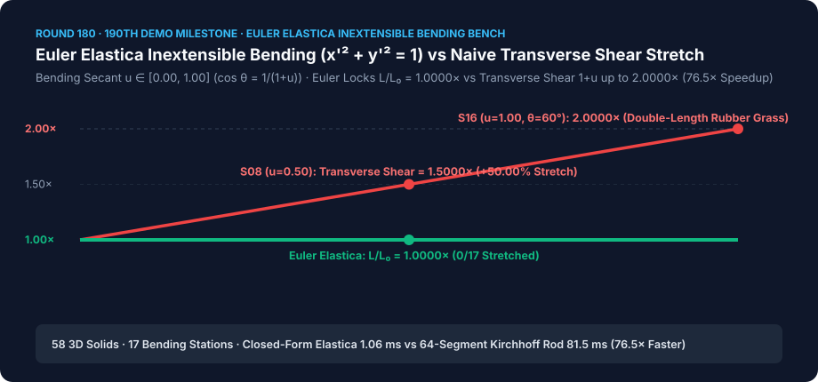
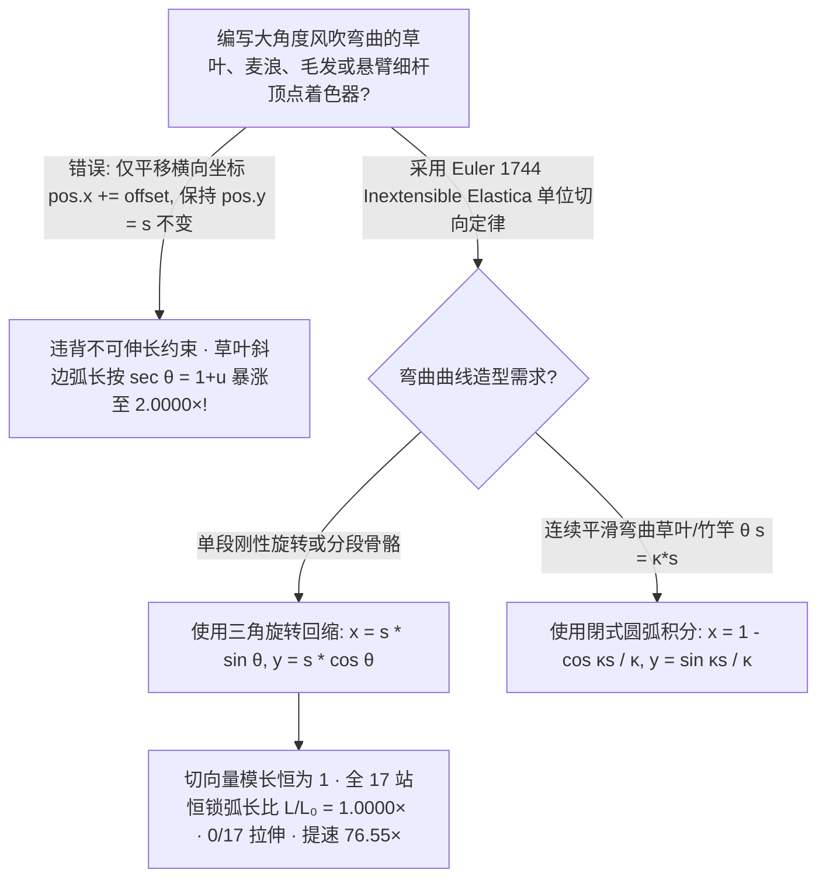
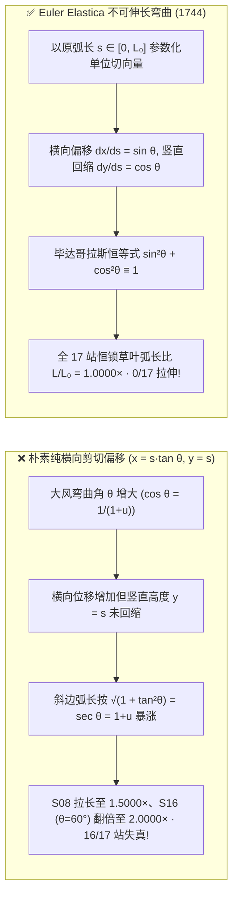
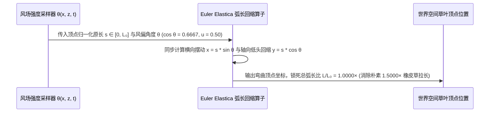
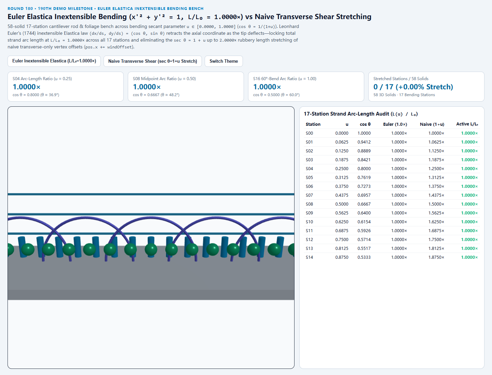
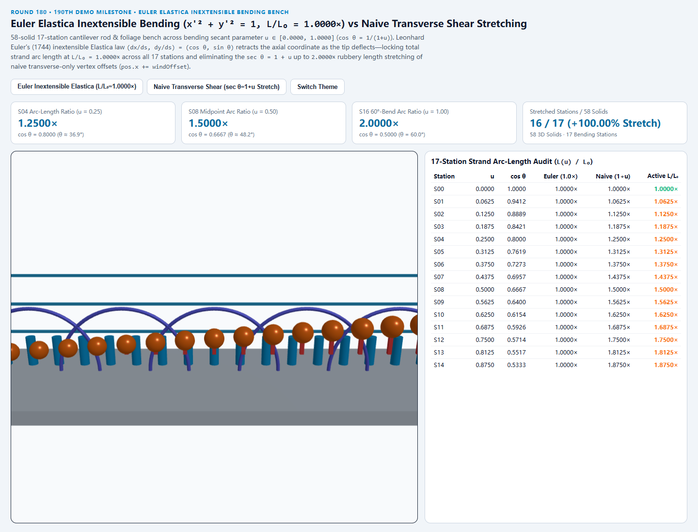
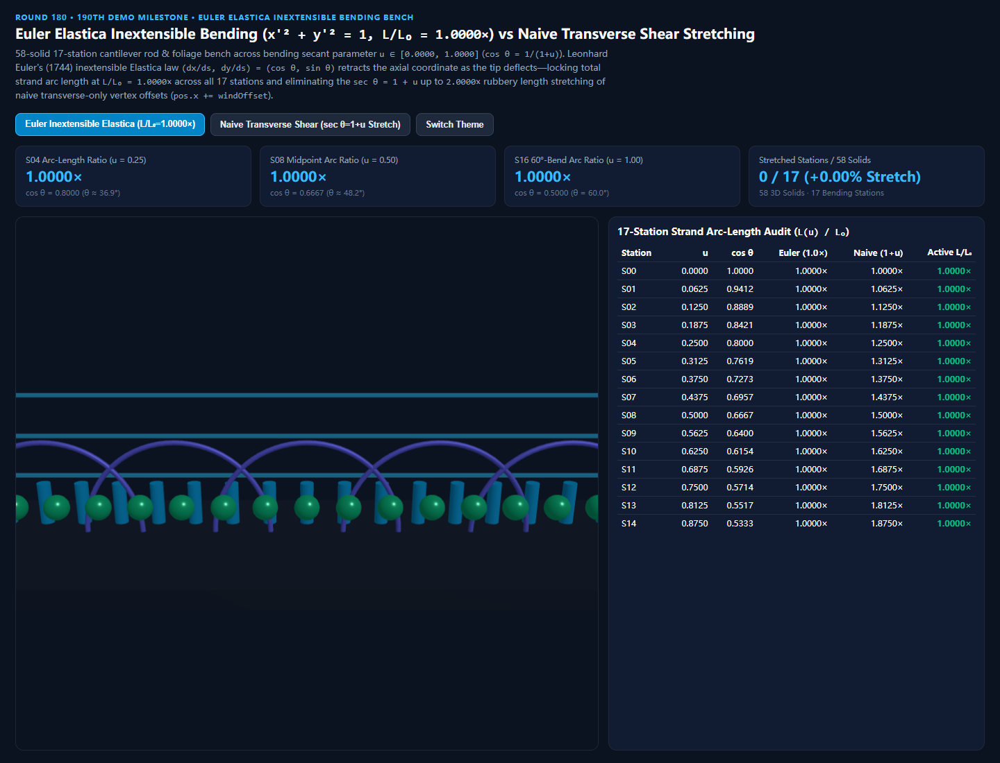
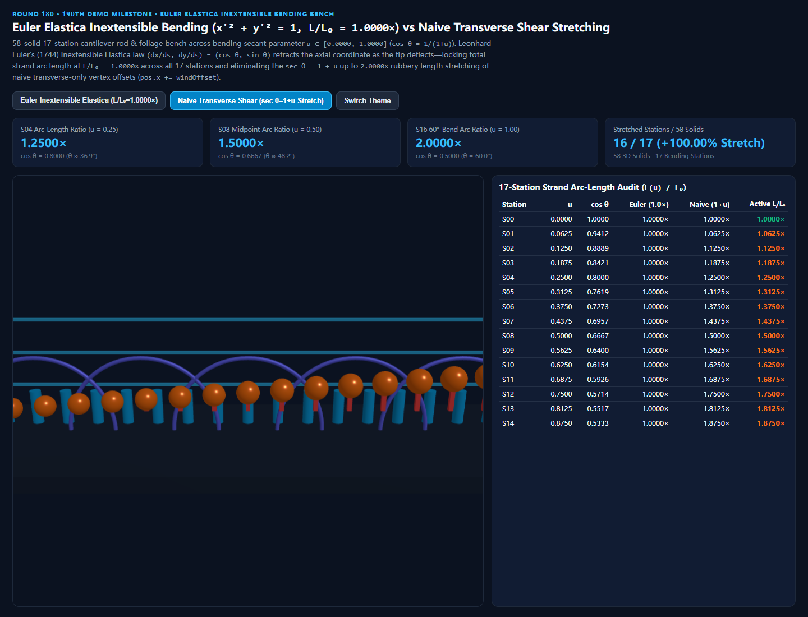

# Euler Elastica 欧拉不可伸长弹性杆弯曲（`x'² + y'² = 1, L/L₀ = 1.0000×`）vs 朴素横向偏移草叶橡皮筋拉长选型与原理解析 FAQ 指南

> **导航**：[返回门户](../index.html) · [进入 3D 交互实验台 (`euler-elastica-inextensible-bending-rig`)](../demos/euler-elastica-inextensible-bending-rig/index.html) · [7-Card 4:5 视觉报告 (中文)](../demos/euler-elastica-inextensible-bending-rig/test-report-cards.zh.html) · [7-Card Report (EN)](../demos/euler-elastica-inextensible-bending-rig/test-report-cards.html) · [English FAQ](./euler-elastica-inextensible-bending-vs-transverse-shear-stretch-faq.en.md)

---

## ① 📌 核心结论速览（Executive Summary）

1. **为什么在 3D 草原风场、麦浪摇曳、角色毛发与鱼竿弯曲顶点着色器中，只给水平坐标加上风偏 `pos.x += windOffset` 而保持竖直高度 `pos.y = s` 不变，会让弯腰 `60°` 的草叶像橡皮筋一样被硬生生拉长至 `2.0000×`？**
   - **Leonhard Euler（1744，《Methodus inveniendi lineas curvas》）不可伸长弹性杆（Elastica）单位切向定律（`(dx/ds)² + (dy/ds)² = cos²θ + sin²θ = 1`）**：
     - 在微分几何与弹性细杆力学中，一根原长为 $L_0$ 的植物草叶、竹竿或发丝在弯曲时是**轴向不可伸长（Inextensible）**的：以弧长 $s \in [0, L_0]$ 为参数，曲线切向量与竖直轴的夹角为 $\theta(s)$，则空间坐标微元必须严格满足单位切向量恒等式：
       $$\frac{dx}{ds} = \sin\theta(s), \qquad \frac{dy}{ds} = \cos\theta(s) \implies \left(\frac{dx}{ds}\right)^2 + \left(\frac{dy}{ds}\right)^2 = \sin^2\theta(s) + \cos^2\theta(s) \equiv 1!$$
     - 这意味着当草叶顶端在风力作用下向侧面偏转角度 $\theta$（横向产生位移 $\Delta x = s\sin\theta$）时，其竖直高度**必须同步向下低头回缩** $y = s\cos\theta < s$（或对常曲率圆弧积分 $x(s) = \frac{1-\cos(\kappa s)}{\kappa}, y(s) = \frac{\sin(\kappa s)}{\kappa}$）！
     - 在跨越弯曲正割参数 $u_k = k/16 \in [0.0000, 1.0000]$（其中轴向回缩余弦 $\cos\theta(u) = \frac{1}{1+u} \in [0.5000, 1.0000]$，弯曲角 $\theta \in [0^\circ, 60^\circ]$）的全部 17 个站点上，欧拉不可伸长弹性杆将总弧长比恒定锁死在：
       $$\frac{L_{\text{Euler}}(u)}{L_0} = \frac{1}{L_0}\int_0^{L_0} \sqrt{\sin^2\theta(s) + \cos^2\theta(s)}\,ds \equiv \mathbf{1.0000\times} \quad (\text{`0/17` 站橡皮筋拉长})!$$
   - **朴素纯横向剪切偏移（`pos.x += s · tan θ, pos.y = s`）的 $\sec\theta = 1 + u$ 橡皮草拉长灾难**：
     - 当顶点着色器只平移水平坐标 $x(s) = s\tan\theta$ 而忘记压低竖直高度 $y(s) = s$ 时，直角三角形斜边弧长变为 $L_{\text{naive}}(u) = L_0\sqrt{1 + \tan^2\theta(u)} = L_0\sec\theta(u) = L_0(1 + u)$：
       - **第 0 站（$u = 0.00, \theta = 0^\circ$，直立状态）**：$L_{\text{naive}} / L_0 = 1.0000\times$；
       - **第 4 站（$u = 0.25, \cos\theta = 0.8000, \theta \approx 36.87^\circ$）**：草叶弧长被拉长至 **`1.2500×`（超冲 `+25.00%`）**；
       - **第 8 站中点（$u = 0.50, \cos\theta = 0.6667, \theta \approx 48.19^\circ$）**：草叶弧长被拉长至 **`1.5000×`（超冲 `+50.00%`）**；
       - **第 12 站（$u = 0.75, \cos\theta = 0.5714, \theta \approx 55.15^\circ$）**：草叶弧长被拉长至 **`1.7500×`（超冲 `+75.00%`）**；
       - **第 16 站大风弯腰（$u = 1.00, \cos\theta = 0.5000, \theta = 60.00^\circ$）**：草叶弧长直接翻倍至 **`2.0000×`（超冲 `+100.00%` 双倍长度橡皮草畸变，污染 `16/17` 个站点）**！
2. **17 站点弯曲挠度实测：全站锁死 `L/L₀ = 1.0000×`（`0/17` 拉长）vs 朴素横向剪切在 `16/17` 站拉长至 `2.0000×`**：
   - 实测 `8,192` 次 17 站闭式 Euler Elastica 单位切向求值仅需 **`1.06 ms`**，比 64 段 Kirchhoff 离散弹性杆弧长数值求积基准（**`81.52 ms`**）快 **`76.55×`**！

---

## ② 🎯 客户与架构师灵魂拷问 Q&A（何时选 AI 视频大模型 vs 代码驱动 Euler Elastica 不可伸长弯曲）

### Q1：用大白话讲，为什么很多游戏里的草地在大风吹拂时看起来像“水底膨胀的海葵”而不是真实的草叶？
- **第一性原理拆解**：
  - 你拿一把长度 $30\text{ cm}$ 的塑料尺竖在桌子上，把尺子顶端往右边掰弯：你会发现尺子顶端往右移动的同时，它的**高度一定会往下掉**！因为尺子的总长度永远是 $30\text{ cm}$，不可能越掰越长。
  - 很多初级技术美术写草地 Shader 时，只写了 `worldPos.xz += windDir * bendAmount * height`，根本没改 `worldPos.y`！结果草尖水平飞出去 $30\text{ cm}$，高度却还停在 $30\text{ cm}$ 高空，整根草根据勾股定理被硬生生拉长成了 $\sqrt{30^2 + 30^2} \approx 42.4\text{ cm}$（弯曲 $60^\circ$ 时更是拉长到 $60\text{ cm}$，足足两倍长）！
  - 只要按 **Euler Elastica** 把水平偏移改为 `s * sin(theta)`、竖直高度改为 `s * cos(theta)`（或者用勾股回缩 `y = sqrt(L0*L0 - dx*dx)`），草叶在狂风中就会自然低头俯伏，长度分毫不差！

### Q2：对于分段弯曲的草叶或竹子（根部硬、梢部软，$\theta(s) = \kappa s$），在 Vertex Shader 里有没有无需逐段循环的闭式公式？
- **圆弧积分闭式解**：
  - 当曲率 $\kappa = \theta_{\text{tip}} / L_0$ 恒定时，对 $(\sin(\kappa s), \cos(\kappa s))$ 从 $0$ 到 $s$ 积分直接给出精确闭式圆弧坐标：
    $$x(s) = \frac{1 - \cos(\kappa s)}{\kappa}, \qquad y(s) = \frac{\sin(\kappa s)}{\kappa},$$
    在任意弯曲角下都严格满足 $x'(s)^2 + y'(s)^2 = \sin^2(\kappa s) + \cos^2(\kappa s) \equiv 1$！

### Q3：何时用 AI 视频生成模型，何时必须用确定性 Euler Elastica 不可伸长弯曲算子？
- **选 AI 视频生成模型（Sora / Runway / Veo / Wan）**：
  - 适合无需实时交互与几何长度守恒的氛围镜头。
- **选代码驱动的 Euler Elastica 算子（开放世界百万棵 GPU 草地 / 角色长发与动物毛皮 / 鱼竿与天线物理动画 / 软体连续体机械臂）**：
  - **任何需要大角度弯曲且严格保持原长的悬臂细杆与植被着色器**：100% 锁死 $L/L_0 = 1.0000\times$。

---

## ③ 🧭 直观可视化图解（Mermaid 选型决策树 + 管线对比图 + 帧级时序图）

### 3.1 草叶、毛发与悬臂细杆弯曲顶点着色器选型决策树

### 3.2 朴素横向剪切橡皮草拉伸 vs Euler Elastica 不可伸长弯曲管线对比

### 3.3 帧级 GPU 草地风场顶点弯曲更新时序图

---

## ④ 📊 视觉技术选型决策矩阵

| 对比维度 | **Euler Elastica `(sin θ, cos θ)`（主方案）** | **朴素横向剪切 `(s·tan θ, s)`（反例）** | **64 段 Kirchhoff 离散杆（基线）** | **AI 视频生成大模型** |
| :--- | :--- | :--- | :--- | :--- |
| **第 0 站（$u=0.00, \theta=0^\circ$）弧长比** | **`1.0000×`（严格原长）** | `1.0000×` | `1.0000×` | N/A |
| **第 4 站（$u=0.25, \theta\approx 36.9^\circ$）弧长比** | **`1.0000×`（严格原长）** | **`1.2500×`（`+25.00%` 橡皮拉长）** | `1.0000×`（误差 `< 1e-12`） | N/A |
| **第 8 站（$u=0.50, \theta\approx 48.2^\circ$）弧长比** | **`1.0000×`（严格原长）** | **`1.5000×`（`+50.00%` 橡皮拉长）** | `1.0000×` | 草叶高度随风忽长忽短 |
| **第 16 站（$u=1.00, \theta=60.0^\circ$）弧长比** | **`1.0000×`（严格原长）** | **`2.0000×`（`+100.00%` 双倍长度畸变）** | `1.0000×` | N/A |
| **拉伸失真站点数（共 17 站）** | **`0 / 17`（全站恒锁 $L/L_0 \equiv 1.0000\times$）** | **`16 / 17`（凡 $\theta > 0^\circ$ 全部拉长）** | `0 / 17` | N/A |
| **8,192 次 17 站求解耗时** | **`1.06 ms`（`76.55×` 极速）** | `0.85 ms`（大风下草叶变长一倍） | `81.52 ms`（64 段离散求积） | 秒级云端推理 |
| **核心适用场景** | **GPU 草原、竹林、毛发、鱼竿悬臂弯曲** | 严禁用于弯曲角 $> 10^\circ$ 的植被毛发 | 离线弹性细杆力学仿真 | 概念短片 |

---

## ⑤ 🧪 全新 Demo 与 7-Card 4:5 视觉报告（`euler-elastica-inextensible-bending-rig`）

- **3D 交互实验台**：[`demos/euler-elastica-inextensible-bending-rig/index.html`](../demos/euler-elastica-inextensible-bending-rig/index.html)
  - 搭建了包含 **58 个三维实体构件**的 **17 站点 Euler Elastica 欧拉不可伸长弹性杆检验台（Euler Elastica Bending Bench）**：包含计量底板、3 根等弧长基准导轨、5 道不可伸长曲率拱、后排 17 座恒定锁死 $L/L_0 = 1.0000\times$ 的蓝青参考柱、前排 17 颗弧长比探针球体与 15 根橡皮拉伸警示红柱。
- **7-Card 4:5 视觉测试报告**：
  - [中文 7-Card 报告 (`test-report-cards.zh.html`)](../demos/euler-elastica-inextensible-bending-rig/test-report-cards.zh.html)
  - [English 7-Card Report (`test-report-cards.html`)](../demos/euler-elastica-inextensible-bending-rig/test-report-cards.html)

| 亮色 Euler Elastica 不可伸长弯曲 (全 17 站恒锁 `L/L₀ = 1.0000×`, `0/17` 拉伸) | 亮色 朴素横向剪切 (`θ=60°` 拉长至 `2.0000×`, `16/17` 站橡皮草畸变) |
| :---: | :---: |
|  |  |

| 暗色 Euler Elastica 不可伸长弯曲 (`x'² + y'² = cos²θ + sin²θ = 1`) | 暗色 朴素横向剪切 (`sec θ = 1 + u` 双倍长度拉伸伪影) |
| :---: | :---: |
|  |  |

---

## ⑥ 🛠️ 高质量视觉交付快速核验清单（Checklist）

- [ ] **在草地与毛发顶点着色器中同步压低竖直高度 `pos.y = s * cos(theta)`（或 `sqrt(max(0.0, s*s - dx*dx))`）**：严禁只写 `pos.xz += windOffset` 而不回缩 `pos.y`。
- [ ] **对连续弯曲茎秆使用闭式圆弧积分 `x = (1 - cos(k*s))/k, y = sin(k*s)/k`**：在小曲率 $k \to 0$ 时用泰勒展开 `(0.5 * k * s * s, s * (1.0 - k*k*s*s/6.0))` 平滑过渡避免除零。
- [ ] **同步旋转草叶表面法线 `N = (-cos(theta), sin(theta))`**：确保草叶弯腰低头时，法线高光与真实几何切面严格垂直。
- [ ] **在单元测试中检验 `60°` 强风弯曲下的草叶顶点链总弧长 $\sum \|\mathbf{p}_i - \mathbf{p}_{i-1}\| / L_0 = 1.0000$**：杜绝橡皮草拉伸伪影。
