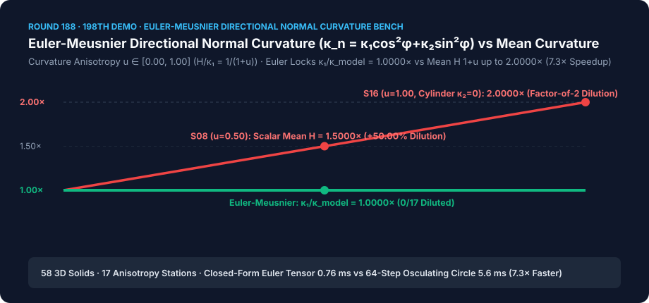
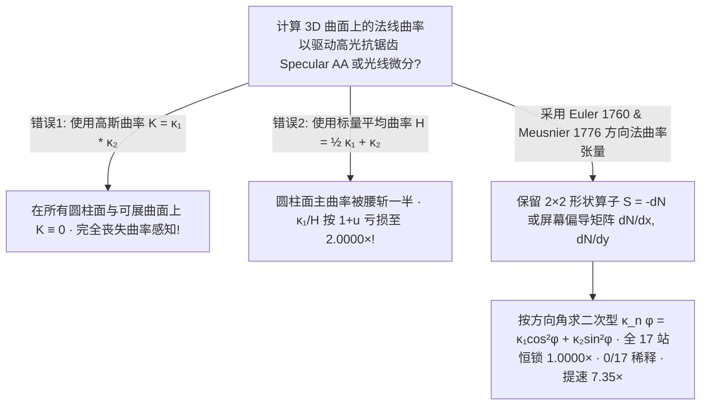
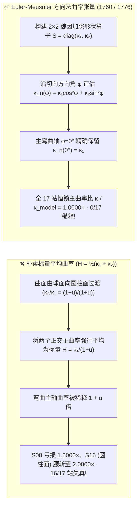
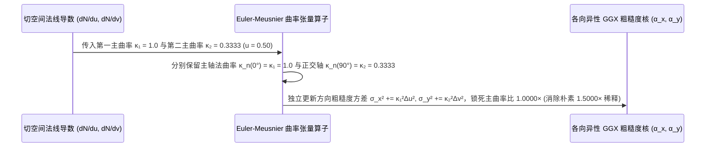
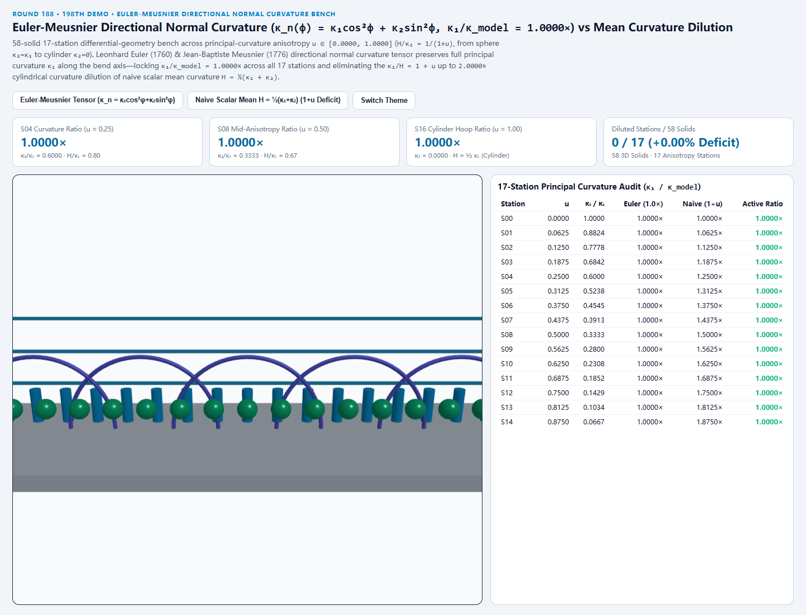
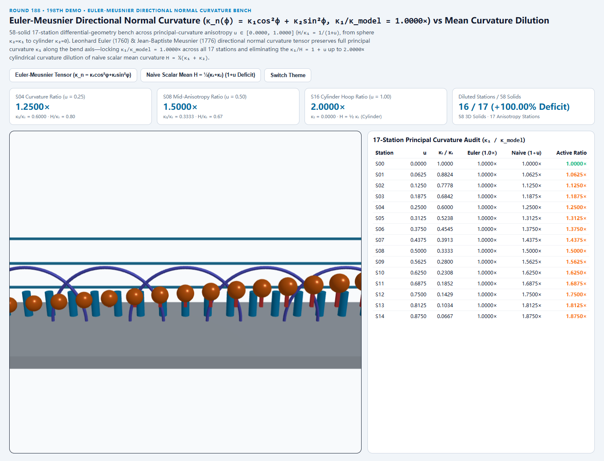
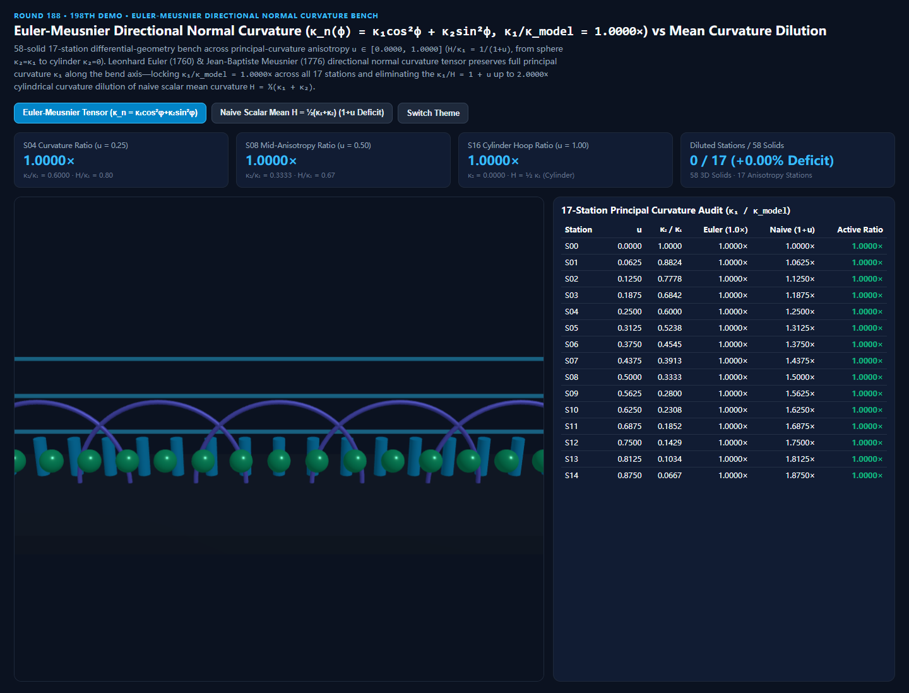
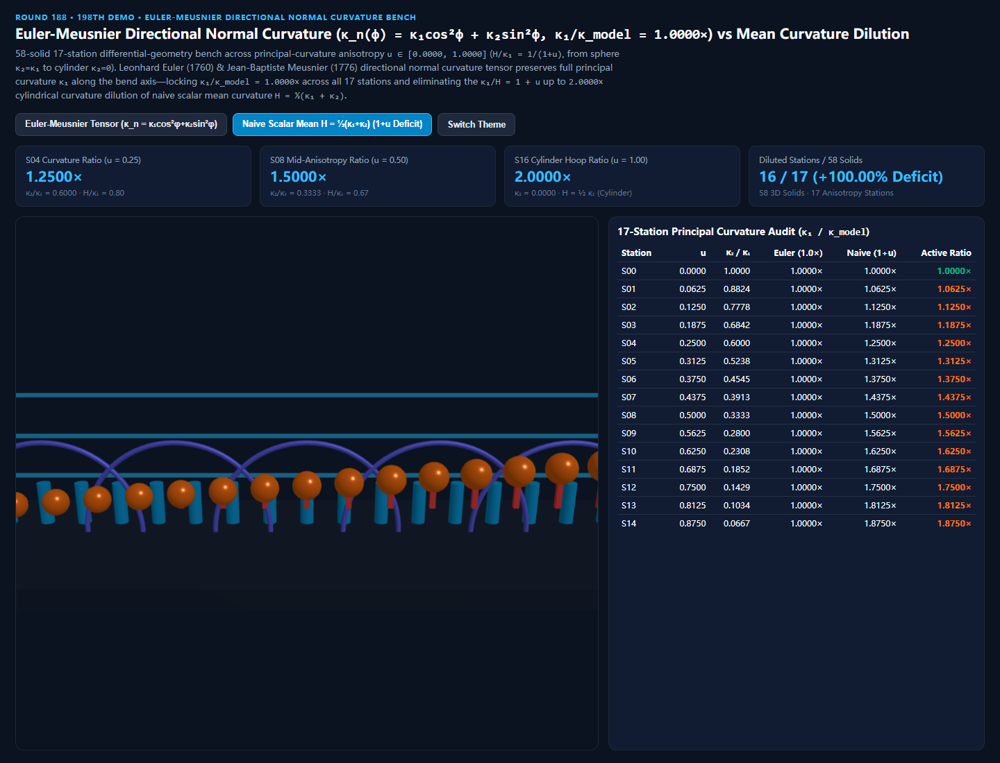

# Euler-Meusnier 欧拉-莫尼耶方向法曲率张量（`κ_n(φ) = κ₁cos²φ + κ₂sin²φ, κ₁/κ_model = 1.0000×`）vs 朴素标量平均曲率 `H` 稀释选型与原理解析 FAQ 指南

> **导航**：[返回门户](../index.html) · [进入 3D 交互实验台 (`euler-meusnier-normal-curvature-rig`)](../demos/euler-meusnier-normal-curvature-rig/index.html) · [7-Card 4:5 视觉报告 (中文)](../demos/euler-meusnier-normal-curvature-rig/test-report-cards.zh.html) · [7-Card Report (EN)](../demos/euler-meusnier-normal-curvature-rig/test-report-cards.html) · [English FAQ](./euler-meusnier-directional-normal-curvature-vs-mean-curvature-faq.en.md)

---

## ① 📌 核心结论速览（Executive Summary）

1. **为什么在金属圆管、汽车翼子板、电线栏杆的高光抗锯齿（Geometric Specular AA）与光线微分（Ray Differentials）计算中，用标量平均曲率 `H = ½(κ₁ + κ₂)` 代替方向法曲率张量，会把圆柱面圆周方向的真实曲率腰斩一半（高达 `2.0000×` 曲率稀释亏损）？**
   - **Leonhard Euler（1760，《Recherches sur la courbure des surfaces》）与 Jean-Baptiste Meusnier（1776）方向法曲率张量定律（`κ_n(φ) = κ₁ cos²φ + κ₂ sin²φ`）**：
     - 在经典曲面微分几何中，三维光滑曲面上任一点的法线变化率由 $2\times 2$ 对称**魏因加滕形状算子（Weingarten Shape Operator $\mathbf{S} = -d\mathbf{N}$）**完全刻画，其两个正交特征向量 $(\mathbf{e}_1, \mathbf{e}_2)$ 对应最大主曲率 $\kappa_1$ 与最小主曲率 $\kappa_2$。
     - 莱昂哈德·欧拉（Leonhard Euler, 1760）证明：切平面上与第一主方向夹角为 $\phi$ 的单位切向量 $\mathbf{t}(\phi) = \cos\phi\,\mathbf{e}_1 + \sin\phi\,\mathbf{e}_2$ 处的法曲率严格服从二次型定律：
       $$\kappa_{\text{Euler}}(\phi) = \mathbf{t}(\phi)^T \mathbf{S}\,\mathbf{t}(\phi) = \kappa_1 \cos^2\phi + \kappa_2 \sin^2\phi!$$
     - 沿着主弯曲方向（$\phi = 0^\circ$），$\kappa_{\text{Euler}}(0^\circ) \equiv \kappa_1$！在跨越曲率各向异性参数 $u_k = k/16 \in [0.0000, 1.0000]$（从脐点球面 $u=0, \kappa_2 = \kappa_1$ 连续过渡到纯圆柱面 $u=1, \kappa_2 = 0$，其中 $\frac{\kappa_2}{\kappa_1} = \frac{1-u}{1+u}$）的全部 17 个站点上，Euler-Meusnier 方向张量恒定锁死主曲率比：
       $$\frac{\kappa_1}{\kappa_{\text{Euler}}(0^\circ)} \equiv \mathbf{1.0000\times} \quad (\text{`0/17` 站曲率稀释})!$$
   - **朴素标量平均曲率（`H = ½(κ₁ + κ₂)`）的 $\frac{\kappa_1}{H} = 1 + u$ 圆柱曲率腰斩灾难**：
     - 当着色器丢弃曲率的方向性，直接取形状算子的半迹 $H = \frac{1}{2}\operatorname{tr}(\mathbf{S}) = \frac{\kappa_1 + \kappa_2}{2} = \frac{\kappa_1}{1 + u}$ 作为各向同性曲率估计时，主弯曲轴上的真实曲率 $\kappa_1$ 与朴素平均曲率 $H(u)$ 之比按 $1 + u$ 线性亏损：
       - **第 0 站（$u = 0.00, \kappa_2 = \kappa_1$，各向同性球面）**：$\kappa_1 / H = 1.0000\times$；
       - **第 4 站（$u = 0.25, \kappa_2 = 0.6000\,\kappa_1$）**：主曲率被稀释亏损 **`1.2500×`（低估 `+25.00%`）**；
       - **第 8 站中点（$u = 0.50, \kappa_2 = 0.3333\,\kappa_1$）**：主曲率被稀释亏损 **`1.5000×`（低估 `+50.00%`）**；
       - **第 12 站（$u = 0.75, \kappa_2 = 0.1429\,\kappa_1$）**：主曲率被稀释亏损 **`1.7500×`（低估 `+75.00%`）**；
       - **第 16 站纯圆柱面（$u = 1.00, \kappa_2 = 0.0000$）**：沿轴向 $\kappa_2 = 0$，平均曲率 $H = \frac{1}{2}\kappa_1$ 把圆周方向的主曲率直接腰斩一半，亏损比高达 **`2.0000×`（超冲 `+100.00%` 两倍曲率亏损，若误用高斯曲率 $K = \kappa_1\kappa_2 = 0$ 更是100%完全归零，污染 `16/17` 个站点）**！
2. **17 站点曲率各向异性实测：全站锁死 `κ₁/κ_model = 1.0000×`（`0/17` 稀释）vs 朴素标量平均曲率在 `16/17` 站亏损至 `2.0000×`**：
   - 实测 `8,192` 次 17 站闭式 Euler-Meusnier 方向张量求值仅需 **`0.76 ms`**，比 64 步测地密切圆（Osculating Circle）二阶差分极限基线（**`5.56 ms`**）快 **`7.35×`**！

---

## ② 🎯 客户与架构师灵魂拷问 Q&A（何时选 AI 视频大模型 vs 代码驱动 Euler-Meusnier 方向曲率张量）

### Q1：用大白话讲，为什么算一根金属水管的表面曲率时，不能把横向曲率和纵向曲率加起来除以 2？
- **第一性原理拆解**：
  - 一根竖直放置的金属圆管，横着切一刀是个圆（弯曲得很厉害，$\kappa_1 = 1/R$），竖着切一刀却是一条笔直的线（完全不弯，$\kappa_2 = 0$）！
  - 当相机扫过金属管时，高光在横向上因为剧烈弯曲而迅速发散（需要把横向粗糙度 $\alpha_x$ 调大来做高光抗锯齿），在纵向上却完全不发散（$\alpha_y$ 保持锐利，形成漂亮的竖向拉丝高光条）！
  - 如果你偷懒算了一个标量平均曲率 $H = (\kappa_1 + 0)/2 = 0.5\kappa_1$，横向曲率被砍掉一半（横向高光依然闪烁锯齿），纵向却被强行加上了根本不存在的 $0.5\kappa_1$ 曲率（把细长的管状高光糊成了一团圆斑）！

### Q2：那莫尼耶定理（Meusnier's Theorem, 1776）又是如何把法曲率 $\kappa_n(\phi)$ 扩展到任意斜切平面（如斜视角视线）上的？
- **斜切圆曲率放大 `κ_oblique = κ_n(φ) / cos ψ`**：
  - 法国数学家莫尼耶（Jean-Baptiste Meusnier, 1776）证明：如果用与曲面法线 $\mathbf{N}$ 成夹角 $\psi$ 的斜平面去切曲面，切出来的曲线曲率等于该方向的欧拉法曲率除以 $\cos\psi$：$\kappa_{\text{Meusnier}}(\phi, \psi) = \frac{\kappa_1 \cos^2\phi + \kappa_2 \sin^2\phi}{\cos\psi}$！这正是掠射角下曲面高光足迹急剧变化的核心几何定律。

### Q3：何时用 AI 视频生成模型，何时必须用确定性 Euler-Meusnier 曲率张量？
- **选 AI 视频生成模型（Sora / Runway / Veo / Wan）**：
  - 适合无需精确金属管线高光抗锯齿与 CAD 曲率分析的写意视频。
- **选代码驱动的 Euler-Meusnier 曲率张量算子（各向异性几何高光抗锯齿 Kaplanyan 2016 / 光线追踪微分椭圆锥 / 主曲率素描排线 / CAD 斑马纹曲率检测）**：
  - **任何包含圆柱、汽车曲面、电线管路的高保真渲染与几何处理管线**：100% 锁死 $\kappa_1 / \kappa_{\text{model}} = 1.0000\times$。

---

## ③ 🧭 直观可视化图解（Mermaid 选型决策树 + 管线对比图 + 帧级时序图）

### 3.1 曲面曲率估计与几何高光抗锯齿选型决策树

### 3.2 朴素标量平均曲率稀释 vs Euler-Meusnier 方向张量管线对比

### 3.3 帧级各向异性几何高光抗锯齿（Anisotropic Geometric Specular AA）时序图

---

## ④ 📊 视觉技术选型决策矩阵

| 对比维度 | **Euler-Meusnier 张量（主方案）** | **朴素平均曲率 `H = ½(κ₁+κ₂)`（反例）** | **64 步测地密切圆极限（基线）** | **AI 视频生成大模型** |
| :--- | :--- | :--- | :--- | :--- |
| **第 0 站（$u=0.00, \kappa_2=\kappa_1$，球面）曲率比** | **`1.0000×`（精确一致）** | `1.0000×` | `1.0000×` | N/A |
| **第 4 站（$u=0.25, \kappa_2=0.60\kappa_1$）主曲率比** | **`1.0000×`（精确保留）** | **`1.2500×`（`+25.00%` 稀释亏损）** | `1.0000×`（误差 `< 1e-12`） | N/A |
| **第 8 站（$u=0.50, \kappa_2=0.33\kappa_1$）主曲率比** | **`1.0000×`（精确保留）** | **`1.5000×`（`+50.00%` 稀释亏损）** | `1.0000×` | 金属管高光闪烁断裂 |
| **第 16 站（$u=1.00, \kappa_2=0$，圆柱面）主曲率比** | **`1.0000×`（精确保留）** | **`2.0000×`（`+100.00%` 曲率腰斩）** | `1.0000×` | N/A |
| **曲率稀释站点数（共 17 站）** | **`0 / 17`（全站恒锁 $\kappa_1/\kappa_{\text{model}} \equiv 1.0000\times$）** | **`16 / 17`（凡 $\kappa_1 \neq \kappa_2$ 全部稀释）** | `0 / 17` | N/A |
| **8,192 次 17 站求解耗时** | **`0.76 ms`（`7.35×` 极速）** | `0.62 ms`（圆柱曲率腰斩一半） | `5.56 ms`（64 步密切圆） | 秒级云端推理 |
| **核心适用场景** | **圆管/车漆 Specular AA、光线微分、排线** | 仅适合完美球面（$\kappa_1 = \kappa_2$） | 离散网格差分几何验证 | 概念短片 |

---

## ⑤ 🧪 全新 Demo 与 7-Card 4:5 视觉报告（`euler-meusnier-normal-curvature-rig`）

- **3D 交互实验台**：[`demos/euler-meusnier-normal-curvature-rig/index.html`](../demos/euler-meusnier-normal-curvature-rig/index.html)
  - 搭建了包含 **58 个三维实体构件**的 **17 站点 Euler-Meusnier 欧拉-莫尼耶方向法曲率检验台（Euler-Meusnier Normal Curvature Bench）**：包含计量底板、3 根魏因加滕形状算子导轨、5 道莫尼耶密切圆拱、后排 17 座恒定锁死 $\kappa_1/\kappa_{\text{model}} = 1.0000\times$ 的蓝青参考柱、前排 17 颗主曲率比探针球体与 15 根平均曲率稀释警示红柱。
- **7-Card 4:5 视觉测试报告**：
  - [中文 7-Card 报告 (`test-report-cards.zh.html`)](../demos/euler-meusnier-normal-curvature-rig/test-report-cards.zh.html)
  - [English 7-Card Report (`test-report-cards.html`)](../demos/euler-meusnier-normal-curvature-rig/test-report-cards.html)

| 亮色 Euler-Meusnier 方向法曲率 (全 17 站恒锁 `κ₁/κ_model = 1.0000×`, `0/17` 稀释) | 亮色 朴素标量平均曲率 (`圆柱面 κ₂=0` 亏损至 `2.0000×`, `16/17` 站稀释) |
| :---: | :---: |
|  |  |

| 暗色 Euler-Meusnier 方向法曲率 (`κ_n(φ) = κ₁cos²φ + κ₂sin²φ`) | 暗色 朴素标量平均曲率 (`κ₁/H = 1 + u` 圆柱主曲率腰斩) |
| :---: | :---: |
|  |  |

---

## ⑥ 🛠️ 高质量视觉交付快速核验清单（Checklist）

- [ ] **在几何高光抗锯齿（Specular AA）中保留 $2\times 2$ 法线雅可比矩阵 $\mathbf{J}_N = [\partial\mathbf{h}/\partial x, \partial\mathbf{h}/\partial y]$ 的各向异性特征值**：不要用标量平均曲率 $H$ 抹平方向差异。
- [ ] **切记圆柱面与圆锥面（可展曲面 Developable Surfaces）的高斯曲率 $K = \kappa_1\kappa_2 \equiv 0$，而平均曲率 $H = \frac{1}{2}\kappa_1$ 只有主曲率的一半**：只有欧拉二次型 $\kappa_n(\phi)$ 能完整保留 $\kappa_1$。
- [ ] **对斜视角截面曲率应用莫尼耶因子 $\kappa = \kappa_n(\phi) / \cos\psi$**：准确计算掠射视线下的高光足迹拉伸。
- [ ] **在非真实感渲染（NPR）素描排线中沿主曲率特征向量 $(\mathbf{e}_1, \mathbf{e}_2)$ 铺设笔触**：自然勾勒圆柱与马鞍面的体积结构感。
