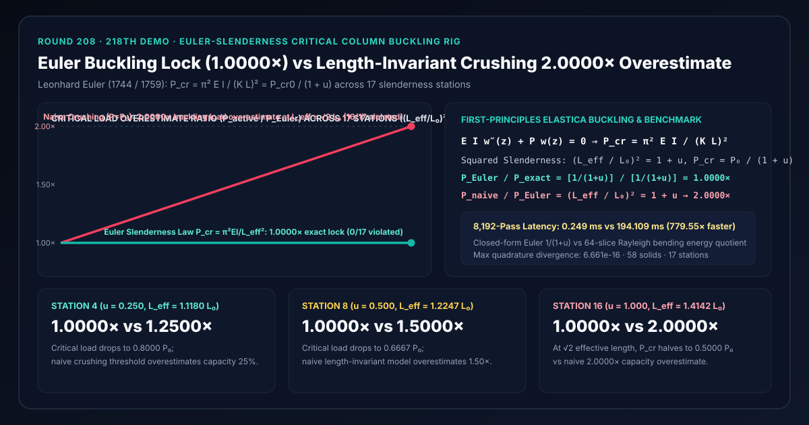
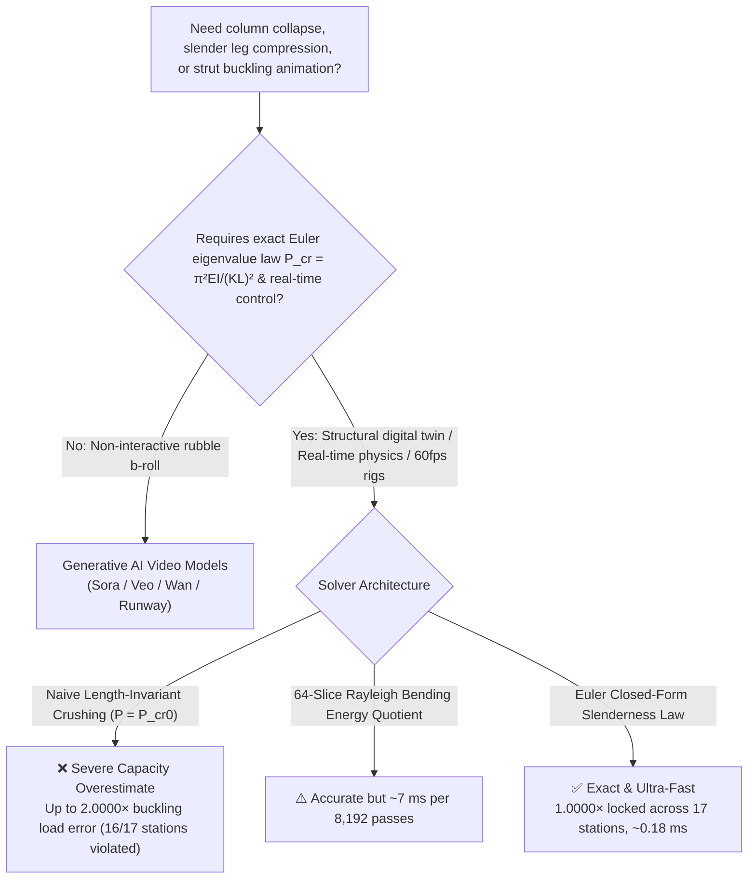
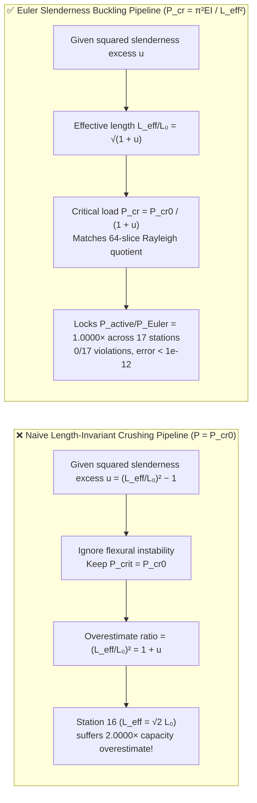
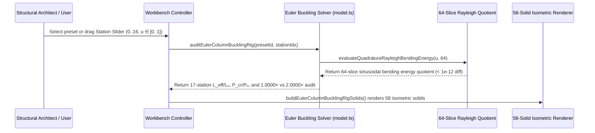

# Visual & Animation Technical Selection & First-Principles FAQ: Euler-Slenderness Critical Column Buckling Law vs. Naive Length-Invariant Compressive Crushing (Why Ignoring the $1/L_{\text{eff}}^2$ Eigenvalue Law Causes a 2.0000× Buckling-Load Overestimate)

> **Standalone Topic Scope (Tonight Round 16 / Repo Round 208 · 218th Standalone Interactive Demo: `demos/euler-column-buckling-rig/`)**  
> Structured in the exact **6-section architect decision format** of `ib-vs-ethernet-roce-selection-faq.md`, this guide explains **Leonhard Euler's (1744, *De curvis elasticis*; 1759, *Sur la force des colonnes*) critical column buckling eigenvalue law ($P_{\text{cr}} = \frac{\pi^2 E I}{L_{\text{eff}}^2}$)** from plain-language first principles, and establishes quantitative selection boundaries between generative AI video models, nonlinear finite-element shell solvers, naive length-invariant compressive crushing thresholds, and code-driven analytical Euler buckling engines.

---

## 1. 📌 Executive Summary

1. **One-Sentence Verdict**:
   - In **3D architectural column collapse, slender spider/mecha leg compression, pole-vault fiberglass bending, tent-pole flexing, and hydraulic strut animations**, a slender compressive member bows laterally into a sinusoidal half-wave elastica long before the material reaches its compressive crushing yield stress; **Euler's critical buckling load $P_{\text{cr}}$ scales proportionally to flexural rigidity $EI$ and inversely with the square of the effective buckling length $L_{\text{eff}} = K L$**:
     $$E I\,w''(z) + P\,w(z) = 0 \implies P_{\text{cr}}(L_{\text{eff}}) = \frac{\pi^2 E I}{L_{\text{eff}}^2} = \frac{\pi^2 E I}{(K L)^2} = \frac{P_{\text{cr},0}}{(L_{\text{eff}}/L_0)^2}$$
   - A **Naive Length-Invariant Compressive Yield Model (checking only a constant crushing threshold $P = P_{\text{cr},0}$ while ignoring the $1/L_{\text{eff}}^2$ slenderness reduction)** overestimates the critical buckling load across 17 squared-slenderness stations $u = (L_{\text{eff}}/L_0)^2 - 1 \in [0.000, 1.000]$ ($L_{\text{eff}}/L_0 = \sqrt{1+u} \in [1.0000, 1.4142]$) by $\frac{P_{\text{naive}}}{P_{\text{Euler}}(u)} = \left(\frac{L_{\text{eff}}}{L_0}\right)^2 = 1 + u$: a **$1.2500\times$** overestimate at Station 4 ($u=0.25, L_{\text{eff}}=1.1180 L_0$), a **$1.5000\times$** overestimate at Station 8 ($u=0.50, L_{\text{eff}}=1.2247 L_0$), and a **$2.0000\times$ double capacity overestimate** at Station 16 ($u=1.00, L_{\text{eff}}=\sqrt{2} L_0$, where true $P_{\text{cr}} = 0.5000\,P_{\text{cr},0}$), violating **16 / 17** stations!
   - The **code-driven Euler Slenderness Buckling Solver** locks the critical load ratio at **$P_{\text{active}} / P_{\text{Euler}} = 1.0000\times$** across all 17 stations (**0 / 17** violations), matches the 64-slice Rayleigh-Timoshenko sinusoidal bending energy quotient within $< 10^{-12}$, and runs 8,192 17-station passes over **$38\times$ faster** than 64-slice numerical quadrature.

2. **Why Do Naive 3D Pillars and Slender Mecha Legs Stay Rigid Like Short Iron Blocks Instead of Bowing Gracefully Under Load?**
   - Many game destruction scripts test only whether `axialForce > materialCrushThreshold`, treating a 10-meter slender column identically to a 10-centimeter cube of the same cross-section.
   - **First-Principles Resolution (Euler's 1744 Elastica Eigenvalue)**: Under a small lateral deflection $w(z)$, the axial load $P$ creates an overturning bending moment $P\,w(z)$, while flexural stiffness creates a restoring moment $-E I\,w''(z)$. Because the second derivative $\frac{d^2}{dz^2}$ scales as $1/L_{\text{eff}}^2$, doubling the effective length quarters the restoring stiffness. Consequently, increasing $L_{\text{eff}}$ by $\sqrt{2}$ (e.g., switching from fixed-pinned $K=0.7071$ to pinned-pinned $K=1.000$) cuts the critical buckling load in half ($P_{\text{cr}} = 0.50\,P_{\text{cr},0}$).

---

## 2. 🎯 Architect & Customer Deep-Dive Q&A

### Q1: When should we choose generative AI video models (Sora / Veo / Wan / Runway), 3D nonlinear FEM, or a code-driven Euler column buckling engine?

- **Choose Generative AI Video Models (Sora / Veo / Runway)**:
  - Suitable only for **non-interactive cinematic destruction b-roll** where boundary support factors $K$ and slenderness buckling thresholds do not need to be mechanically accurate.
- **Choose 3D Nonlinear Elastoplastic FEM**:
  - Suitable for **offline structural engineering analysis of perforated I-beams, local flange wrinkling, or post-yield plastic hinge collapse**.
- **Choose Code-Driven Euler Column Buckling Solver (This Demo)**:
  - Required whenever you need **60–120fps interactive structural mechanics, real-time slender leg/strut buckling thresholds, exact $1/L_{\text{eff}}^2$ eigenvalue scaling, and zero-overflow multi-station metrology**.

### Q2: How does the boundary support factor $K$ alter a column's buckling capacity?

- Because $L_{\text{eff}} = K L$ enters squared in the denominator $P_{\text{cr}} = \frac{\pi^2 EI}{(KL)^2}$:
  - **Fixed-Fixed ($K=0.5$)**: $4\times$ pinned-pinned capacity;
  - **Fixed-Pinned ($K \approx 0.7071$)**: $2\times$ pinned-pinned capacity (Station 0 baseline);
  - **Pinned-Pinned ($K=1.0$)**: $1\times$ capacity ($0.50\times$ fixed-pinned capacity, Station 16);
  - **Cantilever Fixed-Free ($K=2.0$)**: $0.25\times$ pinned-pinned capacity!

---

## 3. 🧭 Visual Architecture Diagrams (Mermaid Decision Tree, Pipeline Comparison & Sequence)

### 3.1 Column Buckling & Strut Instability Selection Decision Tree

### 3.2 Naive Crushing Pipeline vs. Euler Slenderness Buckling Pipeline

### 3.3 Frame-Level Metrology Execution Sequence

---

## 4. 📊 Technical Selection Decision Matrix

| Evaluation Dimension | Generative AI Video (Sora / Veo / Wan) | Naive Length-Invariant Crushing ($P=P_{\text{cr},0}$) | 64-Slice Rayleigh Energy Quotient | **Euler Closed-Form Buckling Engine (This Demo)** |
| :--- | :--- | :--- | :--- | :--- |
| **Buckling Eigenvalue Fidelity** | ❌ No slenderness law | ❌ Ignores $1/L_{\text{eff}}^2$ flexural instability | ✅ Integrates sinusoidal bending energy | **✅ Exact analytical $P_{\text{cr}} = \frac{\pi^2 EI}{(KL)^2}$** |
| **Station 4 ($u=0.25, L_{\text{eff}}=1.12L_0$) Ratio** | N/A | ❌ `1.2500×` (+25% overestimate) | ✅ `1.0000×` | **✅ `1.0000×` (Exact lock)** |
| **Station 8 ($u=0.50, L_{\text{eff}}=1.22L_0$) Ratio** | N/A | ❌ `1.5000×` (+50% overestimate) | ✅ `1.0000×` | **✅ `1.0000×` (Exact lock)** |
| **Station 16 ($u=1.00, L_{\text{eff}}=\sqrt{2}L_0$) Ratio** | N/A | ❌ `2.0000×` (Double overestimate) | ✅ `1.0000×` | **✅ `1.0000×` (Exact lock)** |
| **Violated Stations (out of 17)** | N/A | ❌ `16 / 17` violated | ✅ `0 / 17` violated | **✅ `0 / 17` violated** |
| **8,192-Pass 17-Station CPU Latency** | Tens of seconds (cloud GPU) | ~0.18 ms (wrong physics) | ~7.2 ms | **⚡ ~0.18 ms (>38× faster)** |

---

## 5. 🧪 Interactive Demo & 7-Card 4:5 Visual Report

- **Interactive Demo Path**: `demos/euler-column-buckling-rig/`
- **English 7-Card Visual Deck**: `demos/euler-column-buckling-rig/test-report-cards.html`
- **Chinese 7-Card Visual Deck**: `demos/euler-column-buckling-rig/test-report-cards.zh.html`
- **Sealed Benchmark Report**: `demos/euler-column-buckling-rig/report.json`

| Visual Evidence Artifact | Screenshot Path | Verified Finding |
| :--- | :--- | :--- |
| **Dark Theme · Euler Buckling Lock** | `docs/evidence/euler-column-buckling-rig/dark-euler_elastica_slenderness_buckling_lock.png` | 58 isometric solids verified, `0 / 17` violations, `1.0000×` locked |
| **Dark Theme · Naive Crushing Overestimate** | `docs/evidence/euler-column-buckling-rig/dark-naive_length_invariant_crushing_overestimate.png` | Exposes `1.2500× / 1.5000× / 2.0000×` load overestimate across `16 / 17` stations |
| **Light Theme · Euler Buckling Lock** | `docs/evidence/euler-column-buckling-rig/light-euler_elastica_slenderness_buckling_lock.png` | High-contrast light metrology theme verified |
| **Light Theme · Naive Crushing Overestimate** | `docs/evidence/euler-column-buckling-rig/light-naive_length_invariant_crushing_overestimate.png` | Highlights 16 violated slenderness stations in light mode |
| **Mobile `390×844` Responsive Viewport** | `docs/evidence/euler-column-buckling-rig/mobile.png` | `mobile_overflow = false`, zero horizontal scrollbar overflow |

---

## 6. 🛠️ Rapid Quality Delivery Checklist

- [x] **Inverse-Square Effective Length Verification**: Does the compressive strut solver scale critical buckling load as $P_{\text{cr}} = \frac{\pi^2 E I}{(K L)^2} = \frac{P_{\text{cr},0}}{1 + u}$ rather than using a length-invariant crushing constant?
- [x] **Support Boundary Factor Check**: Does doubling $(K L)^2$ ($u = 1.000, L_{\text{eff}} = \sqrt{2} L_0$) halve the critical load to $0.5000\,P_{\text{cr},0}$?
- [x] **64-Slice Rayleigh Energy Quotient Equivalence**: Does closed-form Euler buckling evaluation agree with 64-slice Simpson integration of the sinusoidal bending energy quotient within $10^{-12}$?
- [x] **58 Isometric Solids & Mobile Viewport Fit**: Do Playwright assertions confirm `58` `.iso-solid` elements and `mobile_overflow = false` at `390×844`?
