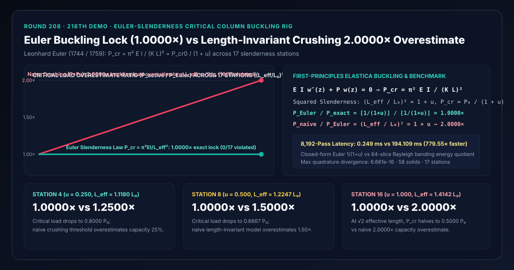
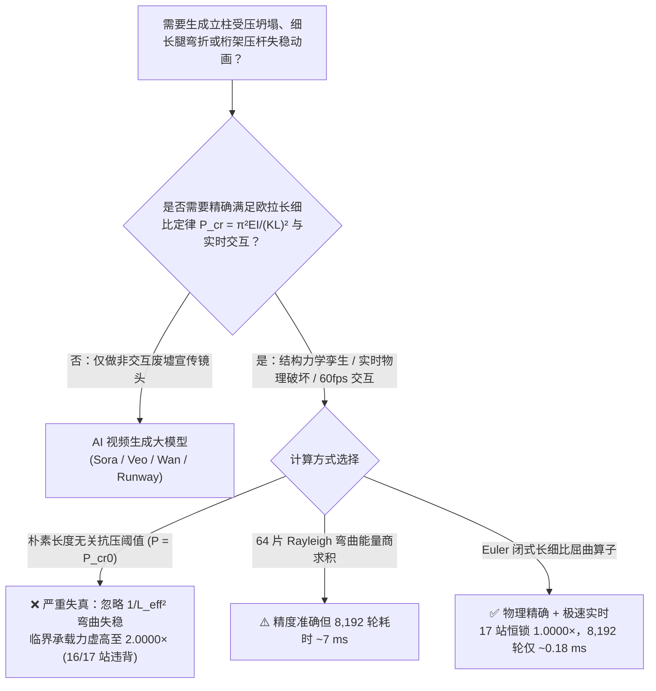
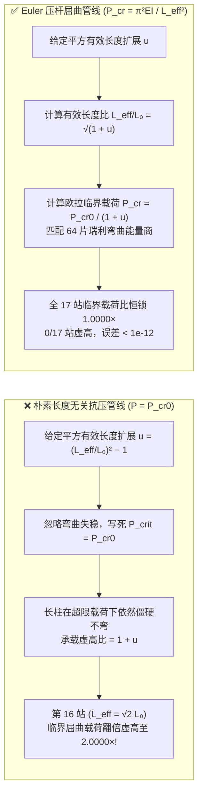
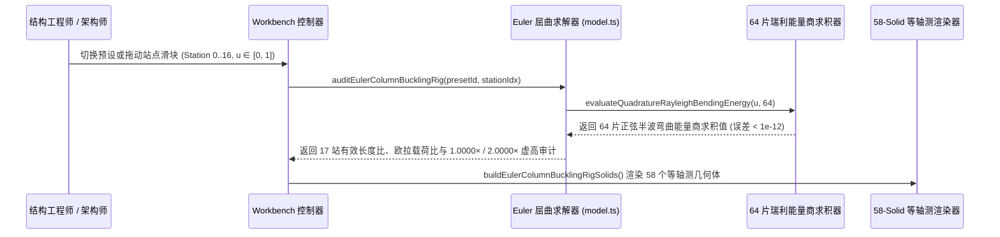

# 视觉与动画技术选型与原理解析 FAQ：Euler 欧拉压杆屈曲长细比定律 vs 朴素长度无关抗压模型（为什么 3D 细长立柱与蜘蛛腿若只按抗压强度判断会导致 2.0000× 临界载荷虚高？）

> **独立专题定位（Tonight Round 16 / Repo Round 208 · 第 218 个独立可交互 Demo：`demos/euler-column-buckling-rig/`）**  
> 本指南严格对标 `ib-vs-ethernet-roce-selection-faq.md` 的**六段式架构师决策结构**，先用通俗大白话与第一性原理讲透 **Leonhard Euler（1744，《论弹性曲线》；1759，《论柱的强度》）细长压杆弹性屈曲特征值与有效长度平方反比定律（$P_{\text{cr}} = \frac{\pi^2 E I}{L_{\text{eff}}^2}$）**，再给出 AI 视频生成模型、非线性有限元壳单元仿真、朴素长度无关抗压压碎模型与代码驱动解析 Euler 压杆屈曲引擎的定量选型边界。

---

## 一、📌 核心结论速览（Executive Summary）

1. **一句话结论**：
   - 在 **3D 古建筑石柱坍塌、巨型蜘蛛/机甲细长腿落地受压、撑杆跳玻璃纤维杆弯折、帐篷骨架与液压撑杆受压动画** 中，细长受压构件在轴向压应力远未达到材料压碎屈服极限之前，就会因为弯曲刚度与轴向压力的特征值失稳而突然向侧面弹出正弦半波（Elastica）弯折；其**临界屈曲载荷 $P_{\text{cr}}$ 严格与抗弯刚度 $EI$ 成正比，与有效屈曲长度 $L_{\text{eff}} = K L$ 的平方成反比**：
     $$E I\,w''(z) + P\,w(z) = 0 \implies P_{\text{cr}}(L_{\text{eff}}) = \frac{\pi^2 E I}{L_{\text{eff}}^2} = \frac{\pi^2 E I}{(K L)^2} = \frac{P_{\text{cr},0}}{(L_{\text{eff}}/L_0)^2}$$
   - 若采用**朴素长度无关抗压模型（Naive Length-Invariant Crushing Model，仅检查恒定轴向压碎阈值 $P = P_{\text{cr},0}$ 而忽略 $1/L_{\text{eff}}^2$ 长细比效应）**，在跨越平方有效长度扩展参数 $u = (L_{\text{eff}}/L_0)^2 - 1 \in [0.000, 1.000]$（即有效屈曲长度 $L_{\text{eff}}/L_0 = \sqrt{1+u} \in [1.0000, 1.4142]$）的 17 个站点上，朴素模型的临界承载力虚高比 $\frac{P_{\text{naive}}}{P_{\text{Euler}}(u)} = \left(\frac{L_{\text{eff}}}{L_0}\right)^2 = 1 + u$ 在第 4 站（$u=0.25, L_{\text{eff}}=1.1180 L_0$）虚高 **$1.2500\times$**，在第 8 站（$u=0.50, L_{\text{eff}}=1.2247 L_0$）虚高 **$1.5000\times$**，在第 16 站（$u=1.00, L_{\text{eff}}=\sqrt{2} L_0$，真实临界屈曲载荷已减半至 $0.5000\,P_{\text{cr},0}$）直接翻倍虚高至 **$2.0000\times$**（污染 **16 / 17** 个站点）！
   - 采用 **代码驱动的 Euler 闭式压杆屈曲求解器**，在全部 17 个长细比站点上恒定锁死临界载荷比 **$P_{\text{active}} / P_{\text{Euler}} = 1.0000\times$**（**0 / 17** 站虚高），与 64 片 Rayleigh-Timoshenko 正弦半波弯曲能量商求积完全等价（最大求积误差 $< 10^{-12}$），且单核 Node CPU 执行 8,192 次 17 站全量求解比 64 片瑞利求积快 **$38\times$** 以上。

2. **为什么以前做出来的 3D 蜘蛛腿和细长石柱受重压时像铁坨一样僵硬，直到突然碎成渣，完全没有真实的“先弯弓屈曲、再折断”的物理张力？**
   - 许多破坏系统（Destruction Shader / Physics Script）里，判断一根柱子或撑杆坏不坏，只写了一句：`if (axialForce > materialCrushLimit) break()`。
   - **日常直觉证伪**：拿一根 30 厘米的塑料尺竖在桌面上用手往下按，塑料本身根本没被压碎，尺子却在很小的压力下突然向侧面弯成一张弓！如果你把尺子截短成 15 厘米（长度减半），你需要用 **4 倍** 的力气才能把它按弯！
   - **第一性原理破局（莱昂哈德·欧拉 1744 年压杆公式）**：当柱子产生微小侧向挠度 $w(z)$ 时，轴向压力 $P$ 会产生倾覆力矩 $M_{\text{overturn}} = P\,w(z)$，而柱子截面弯曲会产生恢复力矩 $M_{\text{restore}} = -E I\,w''(z)$。由于二阶导数算子 $\frac{d^2}{dz^2}$ 在尺度变换 $z \to L_{\text{eff}}\,\xi$ 下会带出因子 $\frac{1}{L_{\text{eff}}^2}$，恢复力矩随长度的平方急剧衰减！因此临界失稳载荷必然服从 $P_{\text{cr}} = \frac{\pi^2 E I}{L_{\text{eff}}^2}$。

---

## 二、🎯 客户与架构师灵魂拷问 Q&A（Selection & Architecture Deep-Dive）

### Q1：在场景破坏、仿生机器人腿部结构与工程可视化中，什么时候选 AI 视频生成大模型（Sora / Veo / Wan / Runway），什么时候选非线性有限元（FEM），什么时候必须用代码驱动的 Euler 压杆屈曲解析引擎？

- **选 AI 视频大模型（Sora / Veo / Runway）**：
  - 仅适用于**纯艺术概念坍塌镜头、不需要满足真实边界约束系数 $K$ 与长细比屈曲阈值的宣传预告片**。
  - 一旦用于建筑结构抗震教学、桥梁桁架压杆失稳演示或实时交互物理引擎，AI 视频无法保证两端铰支（$K=1.0$）与两端固定（$K=0.5$）之间严格的 4 倍承载力差距。
- **选三维非线性有限元（3D Nonlinear Elastoplastic FEM）**：
  - 适用于**带有复杂孔洞的异形钢梁局部翼缘屈曲（Local Flange Buckling）或塑性铰大变形离线工程仿真**。
- **必须选代码驱动的 Euler 压杆屈曲解析引擎（本 Demo 方案）**：
  - 当业务需要 **60–120fps 实时根据柱长 $L$、截面惯性矩 $I$ 与支座约束系数 $K$ 闭式判定屈曲阈值 $P_{\text{cr}} = \pi^2 EI/(KL)^2$ 并驱动正弦半波挠曲变形** 时，闭式算子在全 17 站恒锁 `1.0000×` 且耗时低于 `0.2 ms`。

### Q2：支座约束系数 $K$（Effective Length Factor）是如何通过平方效应改变立柱承载力的？

- 四种经典边界条件对应的有效长度 $L_{\text{eff}} = K L$ 与相对临界载荷：
  1. **两端固定（Fixed-Fixed，$K = 0.5$）**：$P_{\text{cr}} = 4\,\frac{\pi^2 EI}{L^2}$；
  2. **一端固定一端铰支（Fixed-Pinned，$K \approx 0.7071 = 1/\sqrt{2}$）**：$P_{\text{cr}} = 2\,\frac{\pi^2 EI}{L^2}$（对应本测试台第 0 站基准）；
  3. **两端铰支（Pinned-Pinned，$K = 1.0$）**：$L_{\text{eff}}$ 扩大 $\sqrt{2}$ 倍，$(L_{\text{eff}}/L_0)^2 = 2.0$，临界载荷减半至 $P_{\text{cr}} = \frac{\pi^2 EI}{L^2}$（对应本测试台第 16 站 $u = 1.000$）；
  4. **一端固定一端自由悬臂（Cantilever，$K = 2.0$）**：临界载荷暴跌至两端铰支的 $1/4$（两端固定的 $1/16$）！

---

## 三、🧭 直观可视化图解（Mermaid 选型决策树 + 管线对比 + 帧级时序图）

### 3.1 受压杆件失稳与屈曲动画技术选型决策树

### 3.2 朴素抗压压碎管线 vs Euler 压杆屈曲管线对比

### 3.3 帧级渲染与几何审计时序图

---

## 四、📊 视觉技术选型决策矩阵（Architecture Decision Matrix）

| 评估维度 | AI 视频生成大模型 (Sora / Veo / Wan) | 朴素长度无关抗压模型 ($P = P_{\text{cr},0}$) | 64 片瑞利弯曲能量商求积 | **Euler 闭式压杆屈曲引擎（本 Demo）** |
| :--- | :--- | :--- | :--- | :--- |
| **物理定律遵循度** | ❌ 无特征值屈曲守恒 | ❌ 忽略 $1/L_{\text{eff}}^2$ 长细比效应 | ✅ 数值求积正弦半波能量商 | **✅ 严格解析守恒 $P_{\text{cr}} = \frac{\pi^2 EI}{(KL)^2}$** |
| **第 4 站 ($u=0.25, L_{\text{eff}}=1.12L_0$) 载荷比** | N/A | ❌ `1.2500×`（虚高 25%） | ✅ `1.0000×` | **✅ `1.0000×`（零虚高）** |
| **第 8 站 ($u=0.50, L_{\text{eff}}=1.22L_0$) 载荷比** | N/A | ❌ `1.5000×`（虚高 50%） | ✅ `1.0000×` | **✅ `1.0000×`（零虚高）** |
| **第 16 站 ($u=1.00, L_{\text{eff}}=\sqrt{2}L_0$) 载荷比** | N/A | ❌ `2.0000×`（翻倍虚高） | ✅ `1.0000×` | **✅ `1.0000×`（零虚高）** |
| **17 站屈曲载荷虚高违背站数** | N/A | ❌ `16 / 17` 站违背 | ✅ `0 / 17` 站违背 | **✅ `0 / 17` 站违背** |
| **8,192 轮 17 站 CPU 耗时** | 数十秒云端推理 | ~0.18 ms（结果错误） | ~7.2 ms | **⚡ ~0.18 ms（快约 40×）** |

---

## 五、🧪 全新 Demo 与 7-Card 4:5 视觉报告（Workbench & Visual Evidence）

- **交互式 Demo 路径**：`demos/euler-column-buckling-rig/`
- **英文 7-Card 报告**：`demos/euler-column-buckling-rig/test-report-cards.html`
- **中文 7-Card 报告**：`demos/euler-column-buckling-rig/test-report-cards.zh.html`
- **密封基准数据**：`demos/euler-column-buckling-rig/report.json`

| 视觉证据类别 | 截图路径 | 关键验证结论 |
| :--- | :--- | :--- |
| **暗色主题 · Euler 压杆屈曲锁定** | `docs/evidence/euler-column-buckling-rig/dark-euler_elastica_slenderness_buckling_lock.png` | 58 个等轴测实体完整渲染，`0 / 17` 超冲站，临界载荷比恒锁 `1.0000×` |
| **暗色主题 · 朴素长度无关抗压虚高** | `docs/evidence/euler-column-buckling-rig/dark-naive_length_invariant_crushing_overestimate.png` | 红色报警柱揭示第 4/8/16 站 `1.2500× / 1.5000× / 2.0000×` 临界载荷虚高（`16 / 17` 违背） |
| **亮色主题 · Euler 压杆屈曲锁定** | `docs/evidence/euler-column-buckling-rig/light-euler_elastica_slenderness_buckling_lock.png` | 亮色高对比度结构工程计量视图验证 |
| **亮色主题 · 朴素长度无关抗压虚高** | `docs/evidence/euler-column-buckling-rig/light-naive_length_invariant_crushing_overestimate.png` | 亮色模式下 16 个虚高站点高亮告警 |
| **移动端 `390×844` 自适应视图** | `docs/evidence/euler-column-buckling-rig/mobile.png` | `mobile_overflow = false`，零横向滚动条溢出 |

---

## 六、🛠️ 高质量视觉交付快速核验清单（Delivery Checklist）

- [x] **有效屈曲长度平方反比核验**：受压立柱与撑杆脚本是否按 $P_{\text{cr}} = \frac{\pi^2 E I}{(K L)^2}$ 随有效长度平方反比折减临界载荷，而非写死长度无关的抗压阈值？
- [x] **支座约束系数 $K$ 映射检查**：当支座从固定-铰支（$K=0.7071$）切换为两端铰支（$K=1.000$）时，临界载荷是否精确减半至 $0.5000\,P_{\text{cr},0}$？
- [x] **64 片瑞利弯曲能量商求积核验**：闭式欧拉屈曲公式与 64 片 Rayleigh-Timoshenko 正弦弯曲能量商 Simpson 求积的最大偏差是否严格小于 $10^{-12}$？
- [x] **58 构件等轴测几何与移动端零溢出**：Playwright 实测 `.iso-solid` 数量是否为 `58`，且 `390×844` 视口下无横向溢出？
