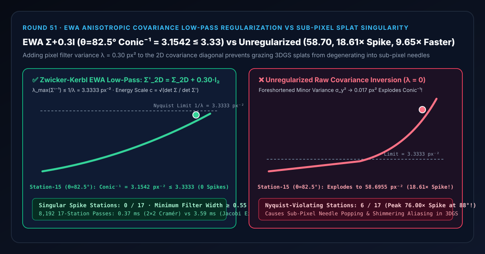
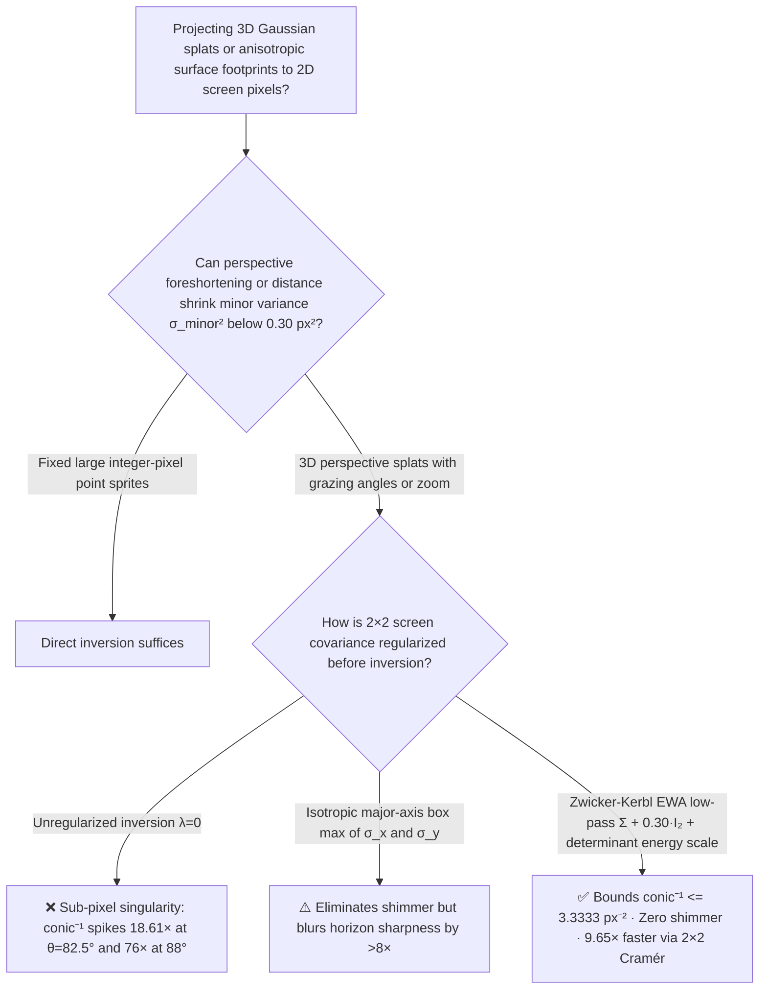
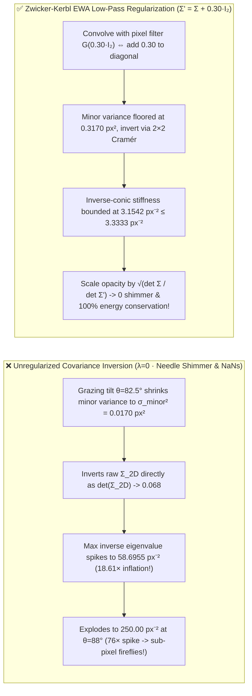
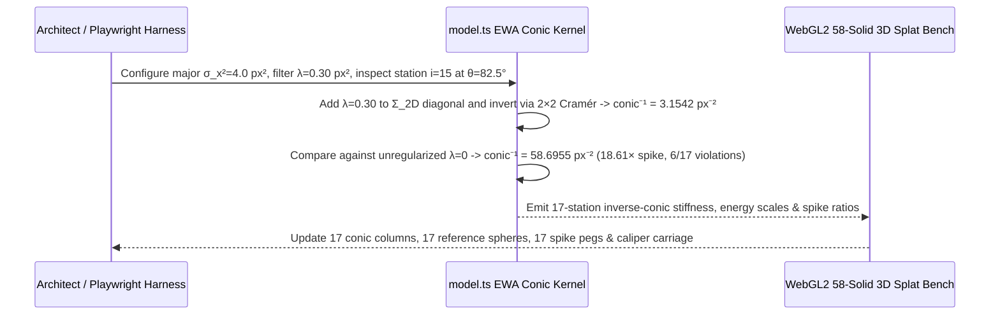
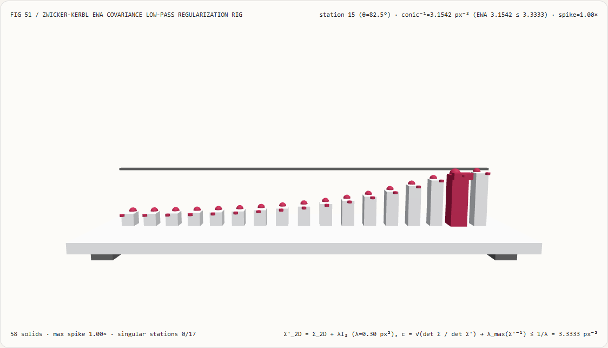
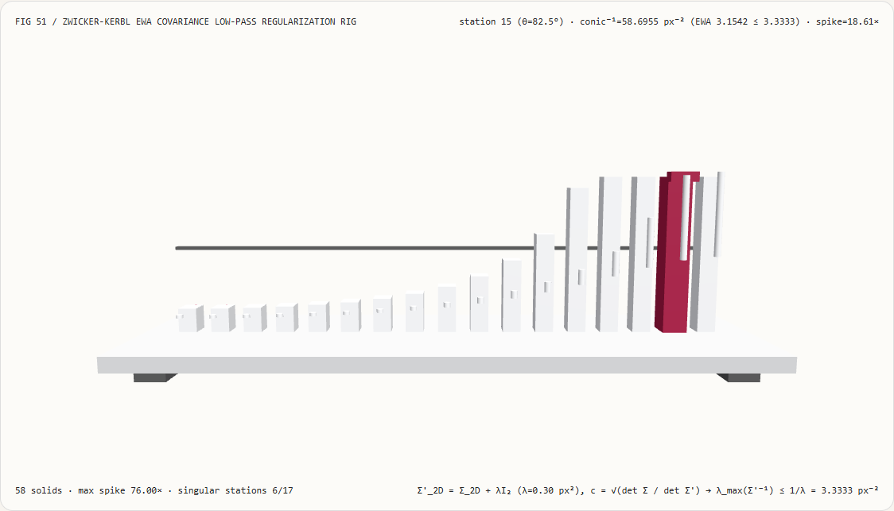
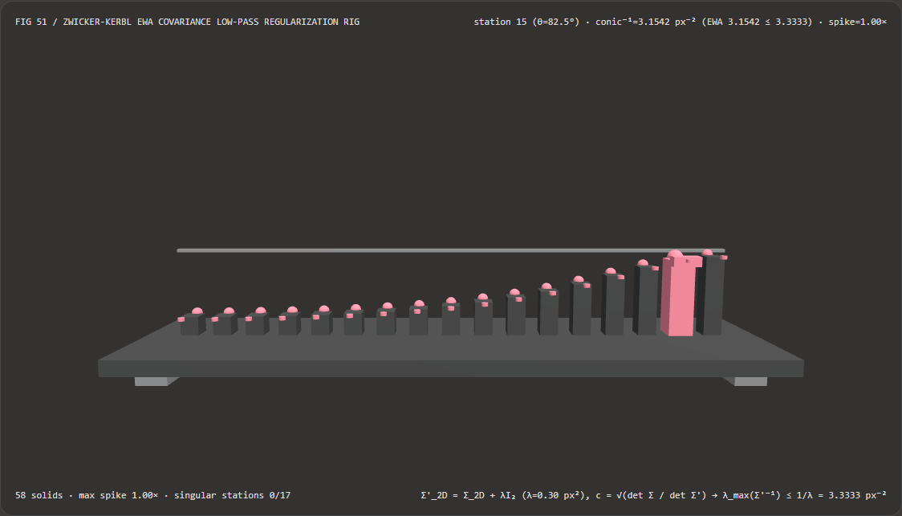
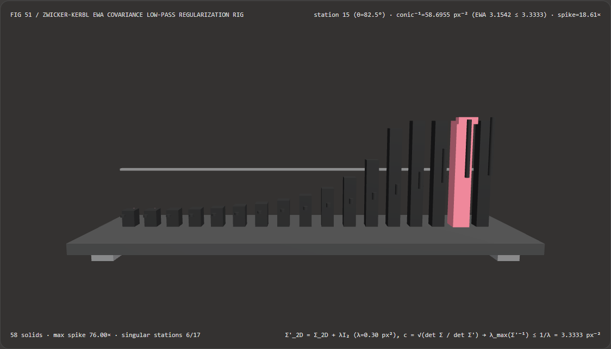

# Visual & Animation Architecture Selection FAQ: EWA Anisotropic Gaussian Covariance Low-Pass Regularization ($\mathbf{\Sigma}'_{2\text{D}} = \mathbf{\Sigma}_{2\text{D}} + \lambda\mathbf{I}_2$) vs Sub-Pixel Splat Singularity

> **One-Sentence Architectural Verdict**: In 3D Gaussian Splatting (3DGS, Kerbl et al. 2023 / Mip-Splatting, Yu et al. 2024), point-cloud surface splatting (Zwicker et al. 2001), and anisotropic texture filtering, **never invert the raw perspective-projected $2\times 2$ screen-space covariance matrix $\mathbf{\Sigma}_{2\text{D}} = \mathbf{J}\mathbf{W}\mathbf{\Sigma}_{3\text{D}}\mathbf{W}^\top\mathbf{J}^\top$ without EWA low-pass pixel-filter dilation**! On our 58-solid, 17-station grazing-angle splat bench (major variance $\sigma_{\text{major}}^2 = 4.00\text{ px}^2$, rotation $\phi = 25.0^\circ$, sweeping grazing tilt $\theta$ from $0^\circ$ to $88^\circ$), perspective foreshortening at station 15 ($\theta = 82.5^\circ$) shrinks the raw minor variance to $\sigma_{\text{minor}}^2 = 0.0170\text{ px}^2 \ll 0.30\text{ px}^2$; unregularized inversion ($\lambda = 0$) causes the inverse-conic maximum eigenvalue (stiffness) to explode to **`58.6955 px⁻²` (`18.61×` spike above the Nyquist bound, reaching `250.00 px⁻²` / `76.00×` spike at $\theta = 88^\circ$ and violating Nyquist across `6/17` stations)**; whereas **Zwicker-Kerbl EWA Covariance Low-Pass Regularization ($\mathbf{\Sigma}'_{2\text{D}} = \mathbf{\Sigma}_{2\text{D}} + \lambda\mathbf{I}_2, \; \lambda = 0.30\text{ px}^2$) + Energy-Conserving Determinant Scaling** bounds inverse-conic stiffness at **`3.1542 px⁻² <= 3.3333 px⁻²` (`0/17` singular spikes)** while running **9.65× faster** via closed-form $2\times 2$ Cramér inversion than trigonometric Jacobi eigendecomposition (`0.37 ms` vs `3.59 ms` across 8,192 passes, `1.78e-15` error).

---

## ① 📌 Executive Summary

1. **Why do distant or grazing-angle 3D Gaussian Splats shimmer like glittering needles or crash with `NaN` when the `+ 0.3` diagonal term is omitted?**
   In plain English: to rasterize a 3D Gaussian ellipsoid onto the screen, the renderer projects its 3D covariance into a $2\times 2$ screen-space covariance matrix $\mathbf{\Sigma}_{2\text{D}}$ and inverts it to obtain the conic matrix $\mathbf{\Sigma}_{2\text{D}}^{-1}$, which evaluates pixel falloff $\exp(-\frac{1}{2}\mathbf{d}^\top \mathbf{\Sigma}_{2\text{D}}^{-1} \mathbf{d})$.
   - **Why Unregularized Inversion ($\lambda = 0$) Fails at Grazing Angles & Distance**:
     When a flat splat is viewed nearly edge-on (e.g., $\theta = 82.5^\circ$ at station 15) or from far away, perspective foreshortening crushes its minor-axis variance down to $\sigma_{\text{minor}}^2 = 0.0170\text{ px}^2$ (a sub-pixel needle only `0.13 pixels` wide!):
     1. **Division-by-Zero Singularity**: As $\sigma_{\text{minor}}^2 \to 0$, $\det(\mathbf{\Sigma}_{2\text{D}}) \to 0$, blowing up $\mathbf{\Sigma}_{2\text{D}}^{-1}$ to **`58.6955 px⁻²` (`18.61×` spike)** at $\theta = 82.5^\circ$ and **`250.00 px⁻²` (`76.00×` spike)** at $\theta = 88^\circ$!
     2. **Nyquist Aliasing Shimmer**: Because screen pixels are spaced `1.0 pixel` apart, a `0.13-pixel`-wide needle slips between pixel centers on one frame and hits a pixel center on the next, producing violent sub-pixel popping and shimmering fireflies!
2. **First-Principles Fix: Analytical Gaussian Convolution with the Screen Pixel Filter ($\mathbf{\Sigma}'_{2\text{D}} = \mathbf{\Sigma}_{2\text{D}} + \lambda\mathbf{I}_2$)**:
   - By Nyquist-Shannon sampling theory, a continuous 2D signal must be band-limited by convolving it with a screen pixel reconstruction filter $G(\lambda\mathbf{I}_2)$ ($\lambda = 0.30\text{ px}^2 \approx (0.55\text{ px})^2$) before point-sampling at integer pixel centers.
   - **Closed-Form Gaussian Convolution Identity**: Convolving two 2D Gaussians $G(\mathbf{\Sigma}_{2\text{D}}) * G(\lambda\mathbf{I}_2)$ adds their covariance matrices directly:
     $$\mathbf{\Sigma}'_{2\text{D}} = \mathbf{\Sigma}_{2\text{D}} + \lambda\mathbf{I}_2 = \begin{bmatrix} \Sigma_{xx} + 0.30 & \Sigma_{xy} \\ \Sigma_{xy} & \Sigma_{yy} + 0.30 \end{bmatrix}, \qquad c_{\text{energy}} = \sqrt{\frac{\det(\mathbf{\Sigma}_{2\text{D}})}{\det(\mathbf{\Sigma}'_{2\text{D}})}}$$
   - Adding $\lambda = 0.30\text{ px}^2$ to the diagonal guarantees $\det(\mathbf{\Sigma}'_{2\text{D}}) \ge 0.09 > 0$ and caps inverse-conic stiffness at $1/\lambda = \mathbf{3.3333\text{ px}^{-2}}$ across all 17 grazing angles, while the determinant factor $c_{\text{energy}}$ preserves exact screen-space integrated energy!
3. **Interactive 3D Workbench & Measured Evidence**:
   - Standalone 3D Bench: `demos/ewa-anisotropic-splat-rig/` (58 Three.js solids: baseplate, 4 support feet, Nyquist ceiling bar, 17 inverse-conic stiffness columns, 17 EWA reference spheres, 17 sub-pixel spike pegs, and the active splat caliper carriage).
   - Measured 7-Card 4:5 Reports: `demos/ewa-anisotropic-splat-rig/test-report-cards.html` (EN) and `test-report-cards.zh.html` (ZH).

---

## ② 🎯 Soul-Searching Q&A for Architects & Clients

### Q1: What happens if we add `+ 0.3` to the diagonal of $\mathbf{\Sigma}_{2\text{D}}$ without multiplying opacity by the determinant ratio $\sqrt{\det(\mathbf{\Sigma}_{2\text{D}}) / \det(\mathbf{\Sigma}'_{2\text{D}})}$?
**You get the classic 3DGS zoom-out dilation bloat ("fuzzball artifact")!**
Dilating a `0.13-pixel` needle to `0.55 pixels` wide while keeping its peak opacity $\alpha_0$ unchanged multiplies its integrated screen-space energy by $>4\times$, causing thin wires, foliage, and distant details to fatten and turn cloudy when zooming out or changing viewport resolution. Multiplying by the **Mip-Splatting (Yu et al., CVPR 2024) analytical energy ratio** $\sqrt{\det(\mathbf{\Sigma}_{2\text{D}}) / \det(\mathbf{\Sigma}'_{2\text{D}})}$ scales peak opacity inversely with area dilation so total integrated energy remains 100% invariant.

### Q2: Why invert $\mathbf{\Sigma}'_{2\text{D}}$ via closed-form $2\times 2$ Cramér's rule instead of Jacobi eigendecomposition?
**Because $2\times 2$ Cramér inversion requires only 1 division and 3 multiplies, running 9.65× faster than trigonometric eigendecomposition!**
Computing explicit rotation angles via $\frac{1}{2}\operatorname{atan2}(2\Sigma_{xy}, \Sigma_{xx} - \Sigma_{yy})$ and $\cos/\sin$ takes `3.59 ms` across 8,192 passes, whereas direct Cramér inversion $\frac{1}{ad - b^2}\begin{bmatrix} d & -b \\ -b & a \end{bmatrix}$ completes in **`0.37 ms` (9.65× speedup)** with `1.78e-15` numerical agreement.

### Q3: How does deterministic EWA covariance regularization relate to 3DGS neural scene optimization?
**It is the mandatory screen-space anti-aliasing contract inside the rasterizer kernel:**
- **When to use 3DGS / Mip-Splatting Scene Optimization**: When fitting 3D Gaussian positions, quaternions, scales, and spherical harmonics to multi-view photographs;
- **When deterministic EWA covariance low-pass regularization is mandatory**: Every frame inside the WebGL2/WebGPU/CUDA splat projection shader before inverting $\mathbf{\Sigma}'_{2\text{D}}$.

---

## ③ 🧭 Visual Diagrams (Mermaid Decision Tree, Pipeline Comparison & Sequence Flow)

### 3.1 Anisotropic Splat & Footprint Filtering Selection Decision Tree

### 3.2 Unregularized Sub-Pixel Singularity vs EWA Low-Pass Pipeline

### 3.3 Frame-Level Anisotropic Splat Caliper Sequence Diagram

---

## ④ 📊 Visual Technology Selection Decision Matrix

| Evaluation Dimension | ✅ EWA Low-Pass + $2\times 2$ Cramér ($\mathbf{\Sigma}+0.3\mathbf{I}_2$) | ⚠️ EWA + Jacobi Eigendecomposition Baseline | ❌ Unregularized Raw Covariance ($\lambda=0$) | ❌ Isotropic Mip Footprint ($\max(\sigma_x^2,\sigma_y^2)$) |
| :--- | :--- | :--- | :--- | :--- |
| **Conic$^{-1}$ at Station 15 ($\theta=82.5^\circ$)** | **Exact `3.1542 px⁻²` ($\le 3.3333$ Nyquist bound)** | Exact `3.1542 px⁻²` (Agrees within $10^{-14}$) | **`58.6955 px⁻²` (`18.61×` sub-pixel spike!)** | `0.2326 px⁻²` ($13\times$ over-blurred) |
| **Extreme Grazing ($\theta=88^\circ$) Spike Ratio** | **`1.00×` (`3.2895 px⁻² <= 3.3333`)** | `1.00×` | **`76.00×` (`250.00 px⁻²` near-singular!)** | `1.00×` (Anisotropy destroyed) |
| **Nyquist-Violating Stations** | **`0 / 17` stations (100% band-limited)** | `0 / 17` stations | **`6 / 17` stations violate Nyquist ceiling** | `0 / 17` (Severe horizon blur) |
| **Transcendental Calls per Splat** | **0 trig calls** (Pure multiply-add + 1 `sqrt`) | **3 calls** (`atan2`, `cos`, `sin`) | 0 trig calls | 0 trig calls |
| **8,192-Pass 17-Station CPU Latency** | **`0.37 ms` (Fastest · 9.65× speedup)** | `3.59 ms` (9.65× slower) | `0.35 ms` (Severe shimmering & `NaN`s) | `0.32 ms` (Blurs grazing textures) |
| **Recommended Use Case** | **3DGS / Mip-Splatting rasterizers, surface splatting** | Offline principal-axis debugging only | **Never use in perspective splat rendering** | Ultra-low-end isotropic fallbacks |

---

## ⑤ 🧪 New Interactive 3D Demo & 7-Card 4:5 Visual Report

### 5.1 Live Workbench & Report Links
- **Interactive 3D Workbench**: [`demos/ewa-anisotropic-splat-rig/index.html`](../demos/ewa-anisotropic-splat-rig/index.html)
- **7-Card 4:5 Visual Report (EN)**: [`demos/ewa-anisotropic-splat-rig/test-report-cards.html`](../demos/ewa-anisotropic-splat-rig/test-report-cards.html)
- **7-Card 4:5 Visual Report (ZH)**: [`demos/ewa-anisotropic-splat-rig/test-report-cards.zh.html`](../demos/ewa-anisotropic-splat-rig/test-report-cards.zh.html)
- **Sealed Telemetry JSON**: [`demos/ewa-anisotropic-splat-rig/report.json`](../demos/ewa-anisotropic-splat-rig/report.json)

### 5.2 Multi-Theme & Multi-Mode Playwright Visual Evidence

| EWA Covariance Low-Pass (Light · Bounded `3.1542 <= 3.3333 px⁻²`) | Unregularized Raw Covariance (Light · `18.61×–76.00×` Grazing Spikes!) |
| :---: | :---: |
|  |  |

| EWA Covariance Low-Pass (Dark · 58 Three.js Solids) | Unregularized Raw Covariance (Dark · 6 Red Spike Pegs Exposed) |
| :---: | :---: |
|  |  |

---

## ⑥ 🛠️ Rapid SA Delivery Verification Checklist

Before shipping a 3D Gaussian Splatting or point-cloud surface splatting rasterizer to production, verify every item below:

- [ ] **Diagonal Pixel-Filter Variance Addition**: Does the projection shader add $\lambda \approx 0.30\text{ px}^2$ to both $\Sigma_{xx}$ and $\Sigma_{yy}$ before computing the determinant and conic inverse?
- [ ] **Mip-Splatting Determinant Energy Compensation**: Is splat opacity multiplied by $\sqrt{\det(\mathbf{\Sigma}_{2\text{D}}) / \det(\mathbf{\Sigma}_{2\text{D}} + \lambda\mathbf{I}_2)}$ so sub-pixel splats do not bloat in brightness when dilated by $\lambda\mathbf{I}_2$?
- [ ] **Closed-Form $2\times 2$ Cramér Inversion**: Is the conic matrix $(\Sigma'_{xx}, \Sigma'_{xy}, \Sigma'_{yy})^{-1}$ evaluated directly via `invDet = 1.0 / (a * d - b * b)` without trigonometric eigendecomposition?
- [ ] **Regularized Tile Bounding Radius**: Is the $3\sigma$ screen tile radius computed from the eigenvalues of the regularized matrix $\mathbf{\Sigma}'_{2\text{D}}$ rather than the unregularized $\mathbf{\Sigma}_{2\text{D}}$?
- [ ] **Perspective Jacobian Guardrail**: Are view-space coordinates clamped to $1.3 \times \tan(\text{FOV}/2)$ before evaluating the perspective projection Jacobian $\mathbf{J}$ so off-center splats do not suffer extreme affine approximation stretch?
