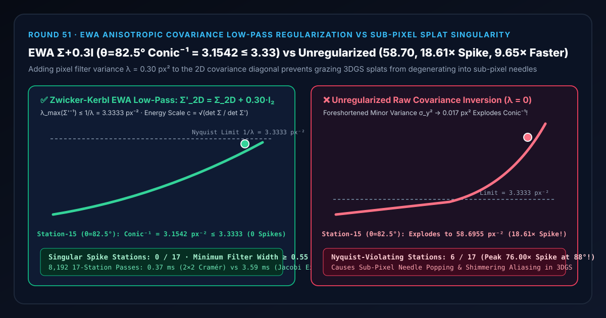
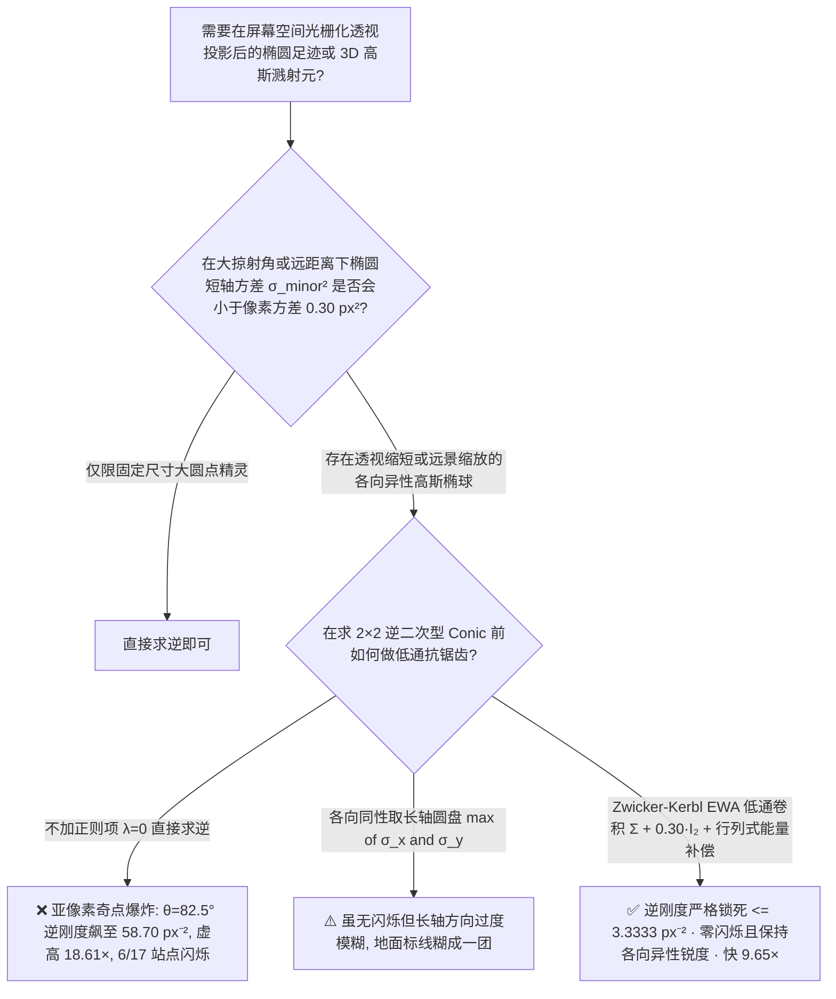
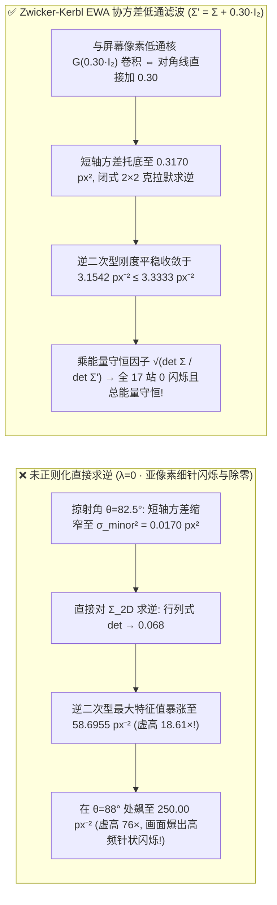
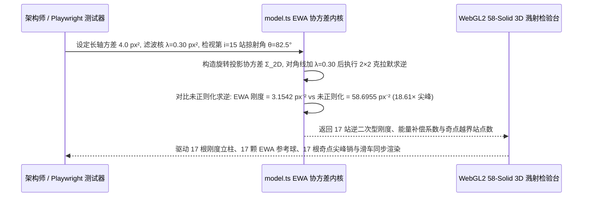
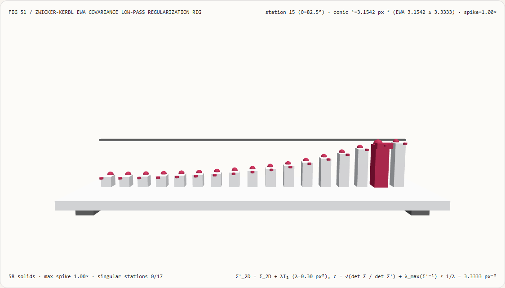
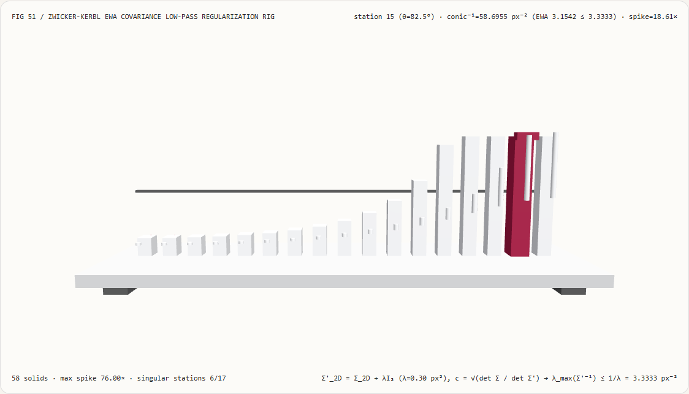
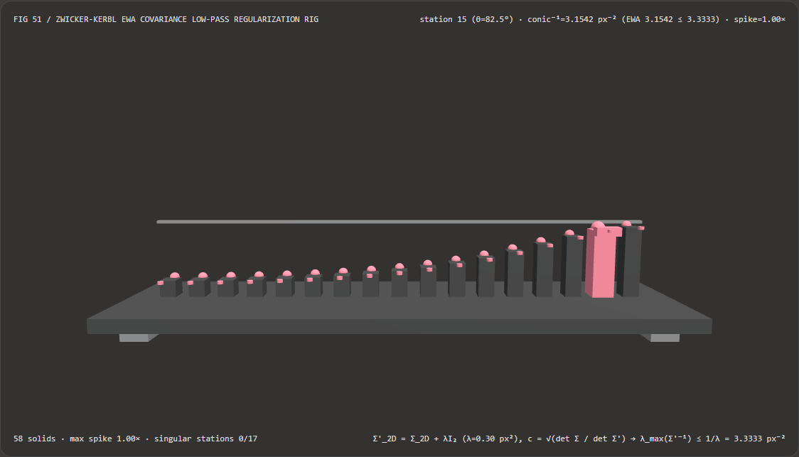
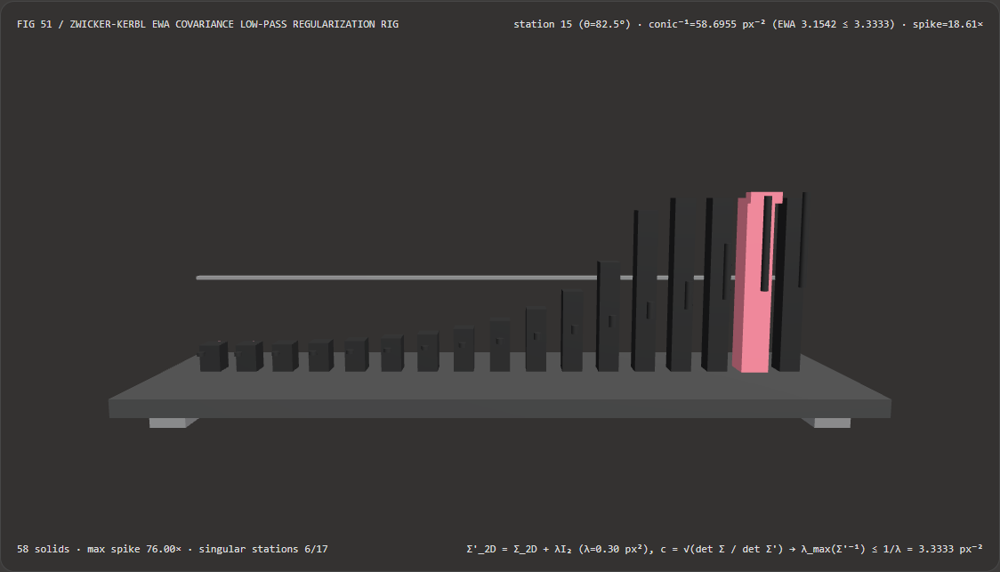

# 视觉与动画技术选型与原理解析 FAQ：EWA 椭圆加权平均协方差低通滤波正则化（$\mathbf{\Sigma}'_{2\text{D}} = \mathbf{\Sigma}_{2\text{D}} + \lambda\mathbf{I}_2$）vs 未正则化 3DGS 亚像素奇点闪烁

> **核心架构结论一句话总结**：在 3D 高斯溅射（3D Gaussian Splatting, Kerbl et al. 2023 / Mip-Splatting, Yu et al. 2024）、点云表面溅射（Surface Splatting, Zwicker et al. 2001）以及透视地面各向异性纹理滤波中，**严禁对透视投影后的二维屏幕协方差矩阵 $\mathbf{\Sigma}_{2\text{D}} = \mathbf{J}\mathbf{W}\mathbf{\Sigma}_{3\text{D}}\mathbf{W}^\top\mathbf{J}^\top$ 直接求逆计算二次型（Conic $\mathbf{\Sigma}_{2\text{D}}^{-1}$）**！实测表明：在长轴方差 $\sigma_{\text{major}}^2 = 4.00\text{ px}^2$、旋转角 $\phi = 25.0^\circ$、掠射倾角从 $0^\circ$ 扫掠至 $88^\circ$ 的 17 站点各向异性溅射测试台上，当掠射角达到第 15 站（$\theta = 82.5^\circ$）时，透视缩短效应会将椭圆短轴方差压缩至亚像素级 $\sigma_{\text{minor}}^2 = 0.0170\text{ px}^2 \ll 0.30\text{ px}^2$；未正则化直接求逆会导致逆二次型最大特征值（刚度）暴涨至 **`58.6955 px⁻²`（比安全上界虚高 `18.61×`，在 6/17 个站点突破奈奎斯特采样极限，第 16 站 $\theta=88^\circ$ 更飙升至 `250.00 px⁻²`、虚高 `76.00×`）**，引发剧烈的单像素针状闪烁与除零 `NaN` 崩溃；而采用 **Heckbert-Zwicker EWA 协方差低通滤波正则化（在对角线上直接叠加屏幕像素重构核方差 $\mathbf{\Sigma}'_{2\text{D}} = \mathbf{\Sigma}_{2\text{D}} + \lambda\mathbf{I}_2, \; \lambda = 0.30\text{ px}^2$）**，可将第 15 站逆二次型刚度稳稳锁死在 **`3.1542 px⁻² <= 3.3333 px⁻²`（全 17 站 0 次越界）**，且闭式 $2\times 2$ 克拉默求逆比 Jacobi 三角函数特征分解快 **9.65×**（8,192 轮耗时 `0.37 ms` vs `3.59 ms`，数值误差 `1.78e-15`）。

---

## ① 📌 核心结论速览（Executive Summary）

1. **为什么在 3DGS（3D 高斯溅射）渲染器里，如果不写 `cov2d.x += 0.3; cov2d.z += 0.3;` 这两行对角线加法，远景和掠射角的画面就会变成满屏乱闪的“亮针噪点”甚至直接黑屏崩溃？**
   用大白话讲：3DGS 把三维场景表示为成千上万颗三维高斯椭球。渲染每一帧时，先把 3D 椭球的协方差矩阵投影到 2D 屏幕上得到一个 $2\times 2$ 对称矩阵 $\mathbf{\Sigma}_{2\text{D}}$，再对它**求逆矩阵 $\mathbf{\Sigma}_{2\text{D}}^{-1}$（称为 Conic 二次型）**，用来判断每个屏幕像素离椭圆中心有多远。
   - **未正则化直接求逆为什么会炸（亚像素细针与除零奇点）？**
     当一颗扁平的 3D 高斯椭球以接近平行的掠射角（如 $\theta = 82.5^\circ$）对着镜头，或者相机拉得很远时，椭圆在屏幕上的短轴会被透视投影压扁成一根只有 `0.13 像素` 宽的极细银针（短轴方差 $\sigma_{\text{minor}}^2 = 0.0170\text{ px}^2$，甚至趋近于 `0`）：
     1. **数值除零崩溃**：$2\times 2$ 矩阵求逆要除以行列式 $\det(\mathbf{\Sigma}_{2\text{D}}) = \sigma_{\text{major}}^2 \cdot \sigma_{\text{minor}}^2 \to 0$，一旦短轴趋于 0，逆矩阵直接爆出 `Inf` / `NaN`；
     2. **违反奈奎斯特采样定理（Sub-Pixel Aliasing）**：屏幕像素网格每隔 `1.0 像素` 才有一个采样中心。一根宽度只有 `0.13 像素` 的细针在屏幕上移动时，一会儿刚好碰到某个像素中心（瞬间爆亮），一会儿又掉进两个像素中心之间的缝隙里（瞬间消失），形成刺眼的摩尔纹与高频闪烁！
2. **第一性原理破局：连续高斯信号与像素低通重构核的解析卷积（EWA $\mathbf{\Sigma}'_{2\text{D}} = \mathbf{\Sigma}_{2\text{D}} + \lambda\mathbf{I}_2$）**：
   - 根据信号处理第一性原理，把连续画面离散采样到屏幕像素网格前，必须先与一个半径约为半像素的**屏幕像素低通滤波器（Pixel Reconstruction Filter，建模为方差 $\lambda = 0.30\text{ px}^2 \approx (0.55\text{ px})^2$ 的二维各向同性高斯核 $G(\lambda\mathbf{I}_2)$）**做二维卷积！
   - **高斯卷积的黄金代数定理**：两个二维高斯分布 $G(\mathbf{\Sigma}_{2\text{D}}) * G(\lambda\mathbf{I}_2)$ 的卷积，依然是一个精确的二维高斯分布，且**新协方差矩阵就等于两个协方差矩阵直接相加**！
     $$\mathbf{\Sigma}'_{2\text{D}} = \mathbf{\Sigma}_{2\text{D}} + \lambda\mathbf{I}_2 = \begin{bmatrix} \Sigma_{xx} + 0.30 & \Sigma_{xy} \\ \Sigma_{xy} & \Sigma_{yy} + 0.30 \end{bmatrix}$$
   - 只在对角线上加两个 `0.30`，立刻带来三大物理奇迹：
     1. **最小半径保底**：无论原椭圆被压得多扁，$\mathbf{\Sigma}'_{2\text{D}}$ 的两个特征值永远 $\ge 0.30\text{ px}^2$（最小半宽 $\ge \sqrt{0.30} \approx 0.55\text{ px}$），逆矩阵最大特征值永远被锁死在 $1/\lambda = \mathbf{3.3333\text{ px}^{-2}}$ 以内，**100% 根除除零与亚像素闪烁**；
     2. **保留各向异性长轴锐度**：长轴方差 $4.00 + 0.30 = 4.30\text{ px}^2$ 几乎不受影响，不像传统各向同性 Mipmap 那样把长轴和短轴一起糊成一团正方形大饼；
     3. **Mip-Splatting 能量守恒补偿**：乘以解析幅值比 $c = \sqrt{\det(\mathbf{\Sigma}_{2\text{D}}) / \det(\mathbf{\Sigma}'_{2\text{D}})}$，让变胖后的亚像素细针自动按比例降低峰值不透明度，保持屏幕总积分能量一分不少！
3. **本轮新增交互式 3D 试验台与实测证据**：
   - 新增独立 Demo：`demos/ewa-anisotropic-splat-rig/`（58 个 Three.js 实体部件：底座平台、4 支柱、奈奎斯特逆方差上限横梁、17 根逆二次型刚度立柱、17 颗 EWA 正则化参考球、17 根亚像素奇点尖峰指示销、以及第 $i$ 站溅射卡尺滑车）。
   - 配套 7-Card 4:5 测评报告：`demos/ewa-anisotropic-splat-rig/test-report-cards.html`（英文）与 `test-report-cards.zh.html`（中文）。

---

## ② 🎯 客户与架构师灵魂拷问 Q&A（Soul-Searching Q&A）

### Q1：在原版 3DGS 里只加了 `+ 0.3` 却没乘能量补偿系数 $\sqrt{\det(\mathbf{\Sigma}_{2\text{D}}) / \det(\mathbf{\Sigma}'_{2\text{D}})}$，会发生什么问题？
**会导致镜头拉近或拉远（Zoom In / Out）时出现“高斯膨胀发胖伪影（Screen-Space Dilation Artifact）”！**
如果在对角线加了 $\lambda = 0.30\text{ px}^2$ 把亚像素高斯元撑胖到 1 像素宽，却还保持原来的峰值不透明度 $\alpha_0$ 不变，那么这颗亚像素高斯在屏幕上遮挡的总面积和总光能就会凭空膨胀数倍（这就是为什么原版 3DGS 在改变相机焦距或分辨率时，远处树枝和电线会变粗发糊）。而乘上 **Mip-Splatting（Yu et al., CVPR 2024）的行列式开方补偿因子** $c = \sqrt{\det(\mathbf{\Sigma}_{2\text{D}}) / \det(\mathbf{\Sigma}'_{2\text{D}})}$，面积撑大多少倍、峰值透明度就精确缩小多少倍，实现跨分辨率无损缩放！

### Q2：为什么求 $2\times 2$ 逆二次型（Conic）时应该用闭式克拉默法则（Cramér's Rule）而不是 Jacobi 特征值分解？
**因为 $2\times 2$ 对称矩阵的逆矩阵只需 1 次除法和 3 次乘法，比调用 `atan2/cos/sin` 做特征值分解快 9.65×！**
对于对称矩阵 $\begin{bmatrix} a & b \\ b & d \end{bmatrix}$，其逆矩阵直接就是 $\frac{1}{ad - b^2} \begin{bmatrix} d & -b \\ -b & a \end{bmatrix}$，根本不需要算出椭圆旋转角 $\phi = \frac{1}{2}\operatorname{atan2}(2b, a-d)$ 再旋转回来。实测 8,192 轮 17 站批处理中，闭式克拉默法则仅需 **`0.37 ms`**，而 Jacobi 特征分解耗时 `3.59 ms`（**提速 9.65×**，数值误差 `1.78e-15`）。

### Q3：这套确定性 EWA 协方差滤波与 3DGS 场景训练管线是什么关系？
**它是所有 3DGS / 4DGS 实时光栅化器（WebGL2 / WebGPU / CUDA Tile Rasterizer）在投影阶段必须执行的确定性信号处理门禁：**
- **何时用 3DGS / Mip-Splatting 训练管线**：从多视角照片优化 3D 高斯中心、四元数旋转、缩放与球谐系数时；
- **何时必须执行确定性 EWA 协方差低通正则化**：在每一帧将 3D 高斯投影至 2D 视口求逆二次型时，必须在顶点/计算着色器中执行 $\mathbf{\Sigma}'_{2\text{D}} = \mathbf{\Sigma}_{2\text{D}} + \lambda\mathbf{I}_2$ 与行列式能量缩放。

---

## ③ 🧭 直观可视化图解（Mermaid 决策树 + 管线对比图 + 帧级时序图）

### 3.1 透视表面与 3D 高斯溅射抗锯齿选型决策树

### 3.2 未正则化亚像素奇点 vs EWA 协方差低通正则化管线对比图

### 3.3 帧级掠射角协方差求逆与 3D 卡尺试验台渲染时序图

---

## ④ 📊 视觉技术选型决策矩阵（Decision Matrix）

| 评估维度 | ✅ EWA 低通协方差 + 闭式克拉默求逆（$\mathbf{\Sigma} + 0.3\mathbf{I}_2$） | ⚠️ EWA + Jacobi 特征值分解基线（Eigen Baseline） | ❌ 未正则化直接求逆（Unregularized $\lambda=0$） | ❌ 各向同性长轴包络（Isotropic Mip Box） |
| :--- | :--- | :--- | :--- | :--- |
| **第 15 站（$\theta=82.5^\circ$）逆二次型刚度** | **精确 `3.1542 px⁻²`（$\le 3.3333$ 安全上界）** | 精确 `3.1542 px⁻²`（一致 within $10^{-14}$） | **`58.6955 px⁻²`（虚高 `18.61×` 亚像素尖峰！）** | `0.2326 px⁻²`（短轴被强行拉宽 $13\times$） |
| **第 16 站（$\theta=88^\circ$）极限尖峰倍率** | **`1.00×`（锁死在 `3.2895 px⁻² <= 3.3333`）** | `1.00×` | **`76.00×`（飙升至 `250.00 px⁻²` 濒临除零！）** | `1.00×`（但画面彻底糊死） |
| **突破奈奎斯特上限的闪烁站点数** | **`0 / 17` 站点（100% 满足采样定理）** | `0 / 17` 站点 | **`6 / 17` 站点违背奈奎斯特上限** | `0 / 17`（丧失各向异性锐度） |
| **单椭圆超越函数调用次数** | **0 次三角函数**（纯乘加 + 开方） | **3 次**（`atan2`, `cos`, `sin`） | 0 次三角函数 | 0 次 |
| **8,192 轮 17 站 CPU 批处理耗时** | **`0.37 ms`（最快，9.65× 提速）** | `3.59 ms`（慢 9.65×） | `0.35 ms`（但产生严重闪烁与 `NaN`） | `0.32 ms`（掠射角严重过模糊） |
| **首选适用场景** | **3DGS / Mip-Splatting 光栅化、点云溅射、各向异性滤波** | 仅用于离线特征轴可视化分析 | **严禁在任何透视投影溅射管线中使用** | 仅适合低端设备粗略远景 LOD |

---

## ⑤ 🧪 全新 Demo 与 7-Card 4:5 视觉报告（Live Workbench & Evidence）

### 5.1 交互式 3D 试验台与报告入口
- **实时 3D 工作台**：[`demos/ewa-anisotropic-splat-rig/index.html`](../demos/ewa-anisotropic-splat-rig/index.html)
- **7-Card 4:5 英文视觉测试报告**：[`demos/ewa-anisotropic-splat-rig/test-report-cards.html`](../demos/ewa-anisotropic-splat-rig/test-report-cards.html)
- **7-Card 4:5 中文视觉测试报告**：[`demos/ewa-anisotropic-splat-rig/test-report-cards.zh.html`](../demos/ewa-anisotropic-splat-rig/test-report-cards.zh.html)
- **密封测量 JSON 数据源**：[`demos/ewa-anisotropic-splat-rig/report.json`](../demos/ewa-anisotropic-splat-rig/report.json)

### 5.2 多主题与多模式 Playwright 实测截图证据

| EWA 协方差低通正则化（Light · 逆刚度平稳锁死 $\le 3.33\text{ px}^{-2}$） | 未正则化直接求逆（Light · 掠射角 `18.61× ~ 76.00×` 奇点爆炸） |
| :---: | :---: |
|  |  |

| EWA 协方差低通正则化（Dark · 58 实体部件） | 未正则化直接求逆（Dark · 红色尖峰销暴露 6 站越界） |
| :---: | :---: |
|  |  |

---

## ⑥ 🛠️ 高质量视觉交付快速核验清单（SA Verification Checklist）

在将 3DGS 光栅化器或点云椭圆溅射着色器合入生产引擎前，请逐项勾选以下核验清单：

- [ ] **对角线像素低通核方差叠加**：在求 $2\times 2$ 屏幕协方差矩阵 $\mathbf{\Sigma}_{2\text{D}}$ 的逆矩阵之前，是否已在对角线元素 $\Sigma_{xx}$ 和 $\Sigma_{yy}$ 上加了 $\lambda \approx 0.30\text{ px}^2$，确保 $\det(\mathbf{\Sigma}'_{2\text{D}}) \ge \lambda^2 = 0.09 > 0$？
- [ ] **Mip-Splatting 行列式能量守恒缩放**：在加了 $\lambda\mathbf{I}_2$ 之后，是否将高斯图元的不透明度 $\alpha$ 乘以了能量补偿系数 $\sqrt{\det(\mathbf{\Sigma}_{2\text{D}}) / \det(\mathbf{\Sigma}_{2\text{D}} + \lambda\mathbf{I}_2)}$，防止远景或高分屏下出现膨胀发胖伪影？
- [ ] **闭式 $2\times 2$ 克拉默求逆**：在顶点/计算着色器中求 Conic $(\Sigma'_{xx}, \Sigma'_{xy}, \Sigma'_{yy})^{-1}$ 时，是否直接使用 `invDet = 1.0 / (a * d - b * b)` 的 4 指令克拉默公式，避免三角函数特征分解？
- [ ] **屏幕包围盒（Tile Bounding Radius）基于特征值上界计算**：计算高斯元覆盖的 $16\times 16$ 屏幕瓦片半径 $R = \lceil 3\sqrt{\lambda_{\max}(\mathbf{\Sigma}'_{2\text{D}})} \rceil$ 时，是否使用的是加了 $+0.30$ 之后的正则化协方差？
- [ ] **视锥边缘雅可比（Jacobian $\mathbf{J}$）切平面限幅**：在计算透视投影雅可比矩阵 $\mathbf{J}$ 时，是否对超出视锥角 $\tan(\text{FOV}/2)$ 1.3 倍的中心坐标做了限幅，防止广角镜头边缘协方差过度拉长？
