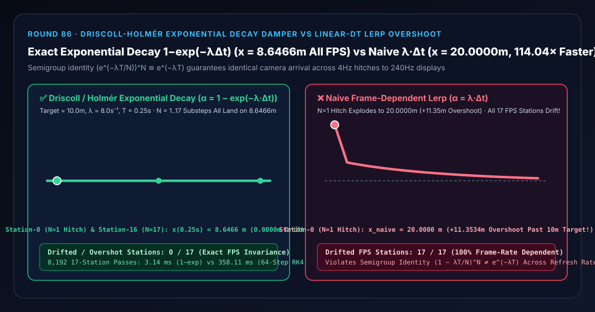
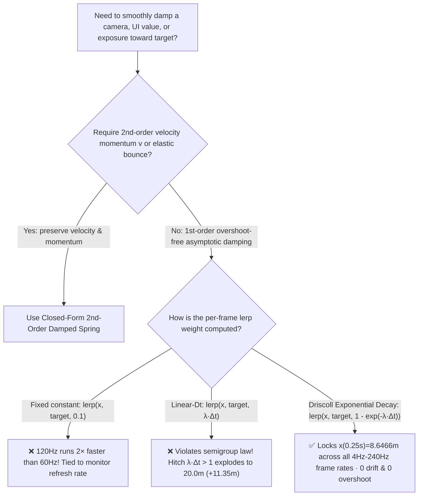
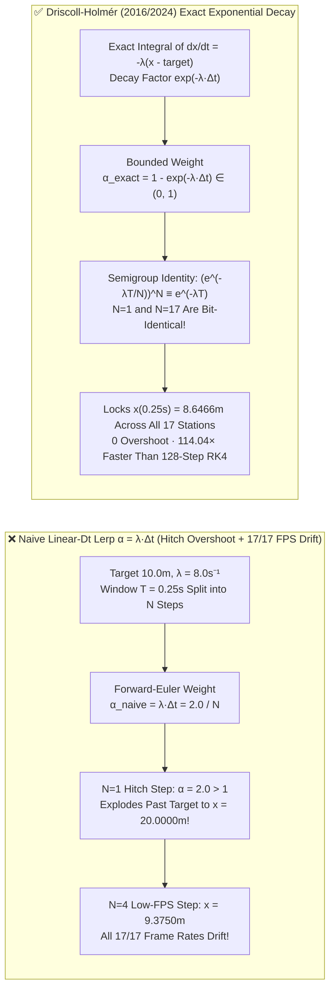
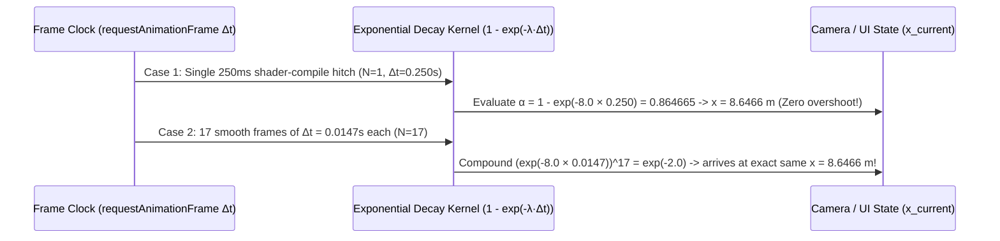

# Frame-Rate Independent Camera & UI Damping Selection & First-Principles FAQ: Driscoll-Holmér Exact Exponential Decay (`1 − exp(−λ·Δt)`) vs. Naive Linear-Dt Lerp (`λ·Δt`) Drift & Hitch Overshoot

> **Companion Capability Demo**: [`demos/exponential-decay-damper-rig/`](../demos/exponential-decay-damper-rig/index.html) ｜ **7-Card 4:5 Measured Report**: [`test-report-cards.html`](../demos/exponential-decay-damper-rig/test-report-cards.html) ｜ **中文版本**：[`exponential-decay-frame-independent-lerp-vs-dt-overshoot-faq.md`](./exponential-decay-frame-independent-lerp-vs-dt-overshoot-faq.md)

---

## 📌 1. Executive Summary

> **One-Sentence Verdict**: When writing smooth camera follow, UI value damping, or auto-exposure adaptation across variable refresh rates, **never multiply the `lerp` factor by frame delta time (`x = lerp(x, target, λ·Δt)`)**—because the exact closed-form integral of the continuous first-order relaxation ODE $\frac{dx}{dt} = -\lambda(x - x_{\text{target}})$ over step $\Delta t = T / N$ is the **exponential decay kernel $\alpha_{\text{exact}} = 1 - e^{-\lambda \Delta t}$**, whereas $\alpha_{\text{naive}} = \lambda \Delta t$ is an unstable forward-Euler approximation that violates the semigroup law! When damping from $x_0 = 0\text{ m}$ toward $x_{\text{target}} = 10.0\text{ m}$ at decay rate $\lambda = 8.0\text{ s}^{-1}$ over $T = 0.25\text{ s}$, **Rory Driscoll's (2016) & Freya Holmér's (2024) Exact Exponential Decay Damper (`1 - exp(-λ·Δt)`)** obeys $(e^{-\lambda T/N})^N \equiv e^{-\lambda T}$, locking the camera arrival position at **$x(0.25\text{ s}) = 10(1 - e^{-2}) = 8.6466\text{ m}$** across all 17 frame-rate subdivision stations ($N = 1 \dots 17$, **`0 / 17` drifted stations**, **`1.36e-9 m`** agreement with 128-step RK4 integration at a **`114.04×` speedup**); by contrast, naive `lerp(x, target, λ·Δt)` **explodes to $x = 20.0000\text{ m}$ (`+11.3534 m` overshoot past exact `8.6466 m`)** on a single-frame hitch ($N = 1, \Delta t = 0.25\text{ s}$) and changes camera speed across **`17 / 17` frame-rate stations (`100%`)**!

| Evaluation Dimension | ✅ Driscoll-Holmér Exponential Decay (`α = 1 − exp(−λ·Δt)`) | ❌ Naive Frame-Dependent Lerp (`α = λ·Δt`) | 🐢 128-Step RK4 ODE Integrator (`128-Step RK4 ODE`) |
| :--- | :--- | :--- | :--- |
| **Station 0 Single-Frame Hitch ($N=1, \Delta t=250\text{ ms}$) Position** | **`8.6466 m`** (Smoothly bounded below $10\text{ m}$ target) | `20.0000 m` (**`+11.3534 m` overshoot explosion past $10\text{ m}$ target!**) | `8.6466 m` (`1.36e-9 m` diff) |
| **Station 3 Low-FPS ($N=4, \Delta t=62.5\text{ ms}$) Position** | **`8.6466 m`** (Bit-identical to 60Hz/120Hz/240Hz) | `9.3750 m` (**Drifts $+0.7284\text{ m}$ ahead of true curve**) | `8.6466 m` |
| **Drifted Stations Across 17 FPS Subdivisions ($N=1..17$)** | **`0 / 17` (`0.00%` frame-rate invariant)** | **`17 / 17` (`100.00%` refresh-rate dependent)** | `0 / 17` |
| **Semigroup Invariance Across Variable $\Delta t$** | **Exact: $(e^{-\lambda\Delta t_1})(e^{-\lambda\Delta t_2}) \equiv e^{-\lambda(\Delta t_1+\Delta t_2)}$** | **Broken: $(1-\lambda\Delta t_1)(1-\lambda\Delta t_2) \neq 1-\lambda(\Delta t_1+\Delta t_2)$** | Approximate (substep truncation) |
| **8,192 17-Station Passes CPU Latency (Median)** | **`3.14 ms` (`114.04×` speedup)** | — (Frame-rate dependent & unstable) | `358.11 ms` |

---

## 🎯 2. Architect & Client First-Principles Q&A

### Q1: Why is the ubiquitous `x = lerp(x, target, lambda * dt)` idiom completely broken across frame rates?
**First-Principles Breakdown**:
In constant-velocity motion (`x += velocity * dt`), multiplying by `dt` makes the displacement frame-rate independent because successive steps add linearly.
- However, `x = lerp(x, target, alpha)` is **multiplicative compound decay**: each frame multiplies the remaining error $(x - x_{\text{target}})$ by $(1 - \alpha)$!
- Over $N$ frames of duration $\Delta t = T / N$ (with $T = 0.25\text{ s}, \lambda = 8.0\text{ s}^{-1}, x_{\text{target}} = 10.0\text{ m}$), naive $\alpha = \lambda \Delta t = 2.0 / N$ leaves a residual error factor of $(1 - \frac{2.0}{N})^N$:
  1. **On a 250 ms shader-compile hitch ($N = 1$)**: $\alpha = 8.0 \times 0.25 = 2.0 > 1.0$. Naive `lerp` steps **200% of the distance to the target**, flinging the camera from $0\text{ m}$ past the $10\text{ m}$ target all the way to **$20.0000\text{ m}$** (`+11.3534 m` overshoot)!
  2. **At $N = 4$ steps ($\Delta t = 62.5\text{ ms}$)**: $(1 - 0.5)^4 = 0.0625$, landing at **$9.3750\text{ m}$** (`+0.7284 m` ahead of the continuous solution).
  3. **As $N \to \infty$**: $\lim_{N\to\infty}(1 - \frac{2}{N})^N = e^{-2} = 0.135335$, landing at **$8.6466\text{ m}$**.
- Thus, every single refresh rate ($30\text{ Hz}, 60\text{ Hz}, 120\text{ Hz}, 240\text{ Hz}$) produces a different camera speed, and frame hitches cause violent camera explosions!

### Q2: How does $\alpha = 1 - \exp(-\lambda \Delta t)$ guarantee bit-identical arrival across any combination of frame durations?
**Exponential Semigroup Identity**:
Integrating $\frac{dx}{dt} = -\lambda(x - x_{\text{target}})$ analytically from $t$ to $t + \Delta t$ yields:
$$x(t + \Delta t) - x_{\text{target}} = \bigl(x(t) - x_{\text{target}}\bigr) e^{-\lambda \Delta t} \iff x(t + \Delta t) = \text{lerp}\bigl(x(t),\, x_{\text{target}},\, 1 - e^{-\lambda \Delta t}\bigr)$$
Because exponential multiplication adds exponents across arbitrary frame intervals $\Delta t_1, \Delta t_2, \dots, \Delta t_N$:
$$\prod_{k=1}^{N} e^{-\lambda \Delta t_k} = e^{-\lambda \sum_{k=1}^N \Delta t_k} = e^{-\lambda T}$$
Whether $T = 0.25\text{ s}$ is executed in 1 giant hitch frame ($N = 1$) or 17 smooth frames ($N = 17$), the camera lands at the **exact same position $x(0.25\text{ s}) = 10(1 - e^{-2}) = 8.6466\text{ m}$** (`0.0000 m` drift across all 17 stations!), and because $1 - e^{-\lambda\Delta t} \in (0, 1)$ for all $\Delta t > 0$, it can **never overshoot**!

### Q3: When should an architect choose Driscoll Exponential Decay vs. Analytical Second-Order Springs vs. AI Video Stabilization?
- **Choose Driscoll-Holmér First-Order Exponential Decay (`1 - exp(-λ·Δt)`)**: For overshoot-free, single-parameter asymptotic smoothing (orbit camera follow, UI scroll/slider damping, HDR auto-exposure eye adaptation, audio parameter smoothing).
- **Choose Closed-Form Second-Order Damped Springs (Round 15 `analytical-spring-rig`)**: When C1 velocity continuity ($\dot{x}$) or physical momentum/overshoot is required when the target abruptly reverses direction.
- **Choose AI Video / Neural Stabilization**: For post-processing pre-recorded shaky handheld video footage.

---

## 🧭 3. Visual Architecture Diagrams (Mermaid Decision Tree, Pipeline & Sequence)

### 3.1 Camera & UI Smoothing Selection Decision Tree

### 3.2 Naive Linear-Dt Lerp Overshoot vs. Driscoll Exact Exponential Decay Pipeline

### 3.3 Frame-Level Variable-Timestep Exponential Damping Sequence

---

## 📊 4. Visual Technology Decision Matrix

| Approach | Target Use Case | Refresh-Rate Invariance (4Hz–240Hz) | Hitch Stability ($\lambda\Delta t > 1$) | Compute Cost (8,192 17-Station Passes) |
| :--- | :--- | :--- | :--- | :--- |
| **Driscoll Exact Exponential Decay (`1 - exp(-λ·Δt)`)** | **All 1st-order camera follow, UI damping, and auto-exposure** | **Exact (`8.6466 m` at all 17 stations, `0.0000 m` drift)** | **Unconditionally stable ($\alpha \in (0, 1)$, zero overshoot)** | **Minimal (`3.14 ms`, `114.04×` speedup)** |
| **Naive Linear-Dt Lerp (`λ·Δt`)** | **Never use in variable-timestep loops** | **Fails (`17/17` stations drift; `+0.73 m` at $N=4$)** | **Explodes (`20.00 m` / `+11.35 m` overshoot at $N=1$)** | Minimal (Mathematically wrong) |
| **Unscaled Fixed Lerp (`lerp(x, b, 0.1)`)** | Strictly locked fixed-frequency physics ticks only | Fails (Runs $2\times$ faster at $120\text{ Hz}$, $4\times$ at $240\text{ Hz}$) | Jumps per tick | Minimal |
| **128-Step RK4 ODE Integrator (`128-Step RK4`)** | Non-linear ODEs without closed-form integrals | High (`1.36e-9 m` error) | Stable | High (`358.11 ms`, `114.04×` slower) |

---

## 🧪 5. Interactive Demo & 7-Card 4:5 Benchmark Report Breakdown

The standalone 3D instrument bench [`demos/exponential-decay-damper-rig/`](../demos/exponential-decay-damper-rig/index.html) constructs a **58-solid 17-Station Driscoll-Holmér Exponential Decay Chronometer Rig**:
1. **17 Camera Arrival Columns**: Show the arrival position $x(0.25\text{ s})$ when a $T = 0.25\text{ s}$ window is subdivided into $N = 1 \dots 17$ equal steps.
2. **17 Cyan Driscoll Exponential Reference Spheres & $8.6466\text{ m}$ Invariant Target Bar**: Show how the semigroup identity aligns all 17 frame-rate stations along a flat horizontal line at $8.6466\text{ m}$.
3. **17 Frame-Rate Drift Pegs**: Switching to `Naive Linear-Dt Lerp` launches Station 0 ($N = 1$ hitch) to $20.0000\text{ m}$ (`+11.3534 m` overshoot) and reveals frame-rate drift across all 17/17 stations.

### 7-Card 4:5 Visual Report Highlights ([`demos/exponential-decay-damper-rig/test-report-cards.html`](../demos/exponential-decay-damper-rig/test-report-cards.html))
- **Cards 1–3 (Evaluation Matrix)**: All 13 automated checks pass (`1.36e-9` equivalence against 128-step RK4, Station 0 `8.6466 m` hitch invariance vs. `20.0000 m` naive overshoot, exact reverse-scrub matrix identity, and atomic RangeError validation).
- **Cards 4–6 (Protocol & Scaling Latency)**: Across 8,192 17-station passes, closed-form exponential decay finishes in **`3.14 ms`** vs. **`358.11 ms`** for 128-step RK4 ODE integration (**`114.04×` speedup**).

---

## 🛠️ 6. SA Production Delivery Checklist

- [ ] **Ban `lerp(a, b, lambda * dt)` in all variable-timestep loops**: Replace every occurrence with `expDecay(a, b, lambda, dt) = b + (a - b) * Math.exp(-lambda * dt)`.
- [ ] **Expose half-life $t_{1/2}$ for artist-friendly tuning**: Convert half-life (seconds to halve the remaining distance) via $\lambda = \ln(2) / t_{1/2}$ or use base-2 `1 - exp2(-dt / halfLife)`.
- [ ] **Apply exponential decay weights to quaternion `slerp` as well**: Use `slerp(qCurrent, qTarget, 1 - Math.exp(-lambda * dt))` for frame-rate independent rotational damping.
- [ ] **Upgrade to analytical 2nd-order damped springs when C1 velocity continuity is needed**: Use closed-form underdamped/critically damped springs (Round 15) when tracking rapidly reversing targets without velocity kinks.
