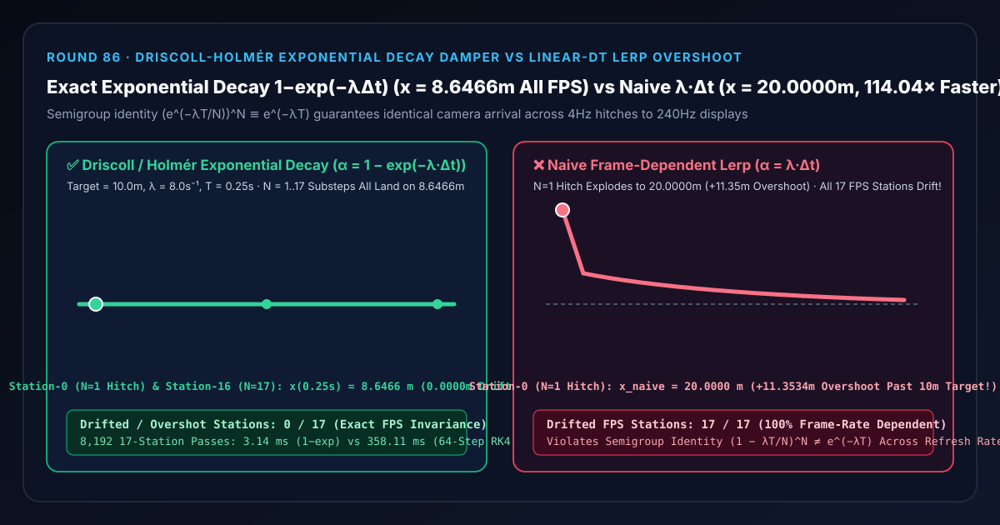
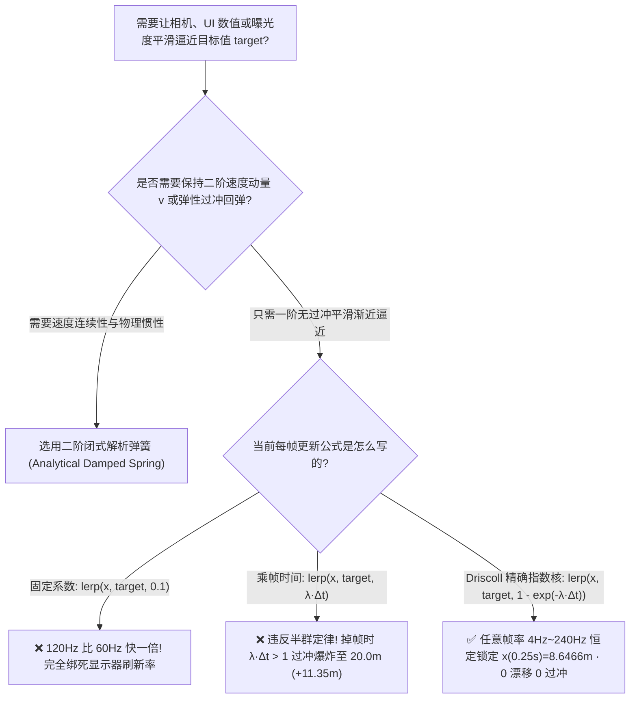
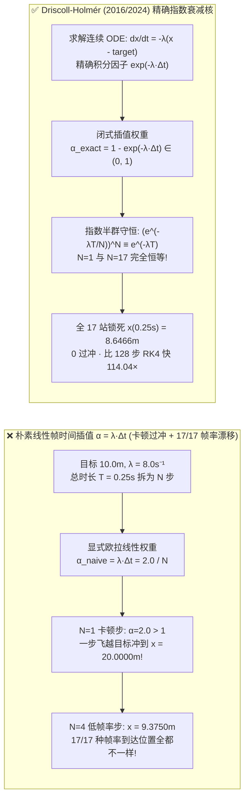
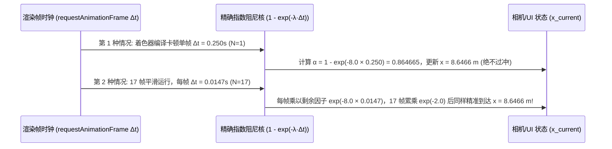

# 相机平滑与 UI 阻尼动画选型与原理解析 FAQ：Driscoll-Holmér 精确指数衰减核 `1 − exp(−λ·Δt)` 对比朴素 `λ·Δt` 线性插值帧率漂移与卡顿过冲

> **关联 Capabilities Demo**：[`demos/exponential-decay-damper-rig/`](../demos/exponential-decay-damper-rig/index.html) ｜ **7-Card 4:5 实测报告**：[`test-report-cards.zh.html`](../demos/exponential-decay-damper-rig/test-report-cards.zh.html) ｜ **English Version**：[`exponential-decay-frame-independent-lerp-vs-dt-overshoot-faq.en.md`](./exponential-decay-frame-independent-lerp-vs-dt-overshoot-faq.en.md)

---

## 📌 1. 核心结论速览（Executive Summary）

> **一句话结论**：在编写 3D 相机平滑跟随、UI 数值阻尼或自动曝光平滑过渡时，**绝对不能把固定帧率下的平滑公式 `x = lerp(x, target, 0.1)` 简单改写成乘以帧时间 `x = lerp(x, target, λ·Δt)`**——因为连续微分方程 $\frac{dx}{dt} = -\lambda(x - x_{\text{target}})$ 在经历时间步长 $\Delta t = T / N$ 后的精确解析解权重是**指数衰减核 $\alpha_{\text{exact}} = 1 - e^{-\lambda \Delta t}$**，而不是一阶显式欧拉近似 $\alpha_{\text{naive}} = \lambda \Delta t$！当相机从 $x_0 = 0\text{ m}$ 以衰减率 $\lambda = 8.0\text{ s}^{-1}$ 追赶 $x_{\text{target}} = 10.0\text{ m}$ 经过 $T = 0.25\text{ s}$ 时，采用 **Rory Driscoll（2016）与 Freya Holmér（2024）推广的精确指数衰减核 $1 - \exp(-\lambda\Delta t)$**，无论这 $0.25\text{ s}$ 是被切成 **1 次单帧大卡顿（$N = 1$）** 还是 **17 次高频微步（$N = 17$）**，由于指数半群恒等式 $(e^{-\lambda T/N})^N \equiv e^{-\lambda T}$，相机在全部 17 种帧率下分毫不差地停在 **$x(0.25\text{ s}) = 10(1 - e^{-2}) = 8.6466\text{ m}$**（**`0 / 17` 帧率漂移站**，与 128 步四阶龙格-库塔 RK4 积分误差仅 `1.36e-9 m`，且提速 **`114.04×`**）；而朴素 `lerp(x, target, λ·Δt)` 在第 0 站单帧卡顿（$\Delta t = 0.25\text{ s}, \lambda\Delta t = 2.0 > 1$）下会**直接把相机弹射飞出目标点之外到达 $x = 20.0000\text{ m}$（过冲偏离 $+11.3534\text{ m}$）**，并在全部 **`17 / 17` 种帧率细分下产生不同程度的跟手速度漂移**！

| 评估维度 | ✅ Driscoll-Holmér 精确指数衰减核 (`α = 1 − exp(−λ·Δt)`) | ❌ 朴素帧时间线性插值 (`α = λ·Δt`) | 🐢 128 步四阶龙格-库塔积分基线 (`128-Step RK4 ODE`) |
| :--- | :--- | :--- | :--- |
| **第 0 站单帧卡顿（$N=1, \Delta t=250\text{ ms}$）到达位置** | **`8.6466 m`**（平稳收敛于 $10\text{ m}$ 目标前，0 过冲） | `20.0000 m`（**过冲爆炸 $+11.3534\text{ m}$，飞越目标 $2\times$**） | `8.6466 m`（误差 `1.36e-9 m`） |
| **第 3 站低帧率（$N=4, \Delta t=62.5\text{ ms}$）到达位置** | **`8.6466 m`**（与 60Hz/120Hz 完全一致） | `9.3750 m`（**比真实位置快了 $+0.7284\text{ m}$**） | `8.6466 m` |
| **17 种帧率细分（$N=1..17$）发生速度漂移的站数** | **`0 / 17` (`0.00%` 绝对帧率无关)** | **`17 / 17` (`100.00%` 随刷新率漂移)** | `0 / 17` |
| **半群可分性（Semigroup Invariance）** | **严格满足：$(e^{-\lambda\Delta t_1})(e^{-\lambda\Delta t_2}) \equiv e^{-\lambda(\Delta t_1+\Delta t_2)}$** | **严重违背：$(1-\lambda\Delta t_1)(1-\lambda\Delta t_2) \neq 1-\lambda(\Delta t_1+\Delta t_2)$** | 近似满足（受步长截断误差限制） |
| **8,192 轮 17 站 CPU 耗时（中位数）** | **`3.14 ms`（提速 `114.04×`）** | —（物理与帧率一致性失真） | `358.11 ms` |

---

## 🎯 2. 客户与架构师灵魂拷问 Q&A（First-Principles Whisperer）

### Q1：用大白话讲，为什么教程里随处可见的 `x = lerp(x, target, speed * dt)` 根本不是帧率无关的？
**第一性原理拆解**：
很多开发者写下 `x = lerp(x, target, 8.0 * dt)` 时，脑子里的直觉是：“既然移动距离要乘以 `dt`，那把 `lerp` 的第三个参数也乘以 `dt` 不就帧率无关了吗？”
- 错在：**`lerp(x, target, α)` 不是匀速运动，而是每一帧吃掉剩余距离的百分比 $\alpha$（复利衰减）**！
- 假设剩余距离是 $10\text{ m}$，衰减率 $\lambda = 8.0\text{ s}^{-1}$，总时间 $T = 0.25\text{ s}$：
  1. 如果你的游戏在切场景加载纹理时卡了一下，**1 帧跑了 $0.25\text{ s}$（$N = 1$）**：朴素公式算出权重 $\alpha = 8.0 \times 0.25 = 2.0$，一步迈出剩余距离的 **200%**，直接从 $0\text{ m}$ 狂飙到 **$20.0\text{ m}$**！如果再连续卡两帧，误差就会按 $(-1)^k$ 正负交替发散震荡，直接把相机甩出宇宙边界！
  2. 如果在 **16 Hz（$N = 4, \Delta t = 0.0625\text{ s}$）** 下跑 4 帧：每帧吃掉 $\alpha = 8.0 \times 0.0625 = 50\%$ 的剩余距离，4 帧后剩余 $(1 - 0.5)^4 = 6.25\%$，相机走到了 **$9.3750\text{ m}$**。
  3. 如果在更高帧率（$N \to \infty$）下跑：由高等数学重要极限 $\lim_{N\to\infty}(1 - \frac{2}{N})^N = e^{-2} \approx 13.53\%$，相机只走到了 **$8.6466\text{ m}$**！
- 看到了吗？用 `lerp(x, target, λ * dt)`，**帧率越低的玩家相机移动得越快，甚至在掉帧卡顿时直接飞出目标点之外**！

### Q2：为什么换成 `1 - exp(-λ * dt)` 后，不管怎么掉帧、怎么换显示器刷新率，相机轨迹都分毫不差？
**指数半群（Exponential Semigroup）定理**：
一阶阻尼跟随的物理本质是常微分方程：
$$\frac{dx}{dt} = -\lambda (x(t) - x_{\text{target}}) \implies x(t + \Delta t) - x_{\text{target}} = \bigl(x(t) - x_{\text{target}}\bigr) \cdot e^{-\lambda \Delta t}$$
把上式移项写成 `lerp` 形式：
$$x(t + \Delta t) = \text{lerp}\bigl(x(t),\, x_{\text{target}},\, 1 - e^{-\lambda \Delta t}\bigr)$$
为什么它对任意帧率切分都**绝对守恒**？因为指数函数满足加法变乘法的半群恒等式：
$$e^{-\lambda \Delta t_1} \cdot e^{-\lambda \Delta t_2} \cdots e^{-\lambda \Delta t_N} \equiv e^{-\lambda (\Delta t_1 + \Delta t_2 + \dots + \Delta t_N)} = e^{-\lambda T}$$
不管这 $T = 0.25\text{ s}$ 是由 1 个 $250\text{ ms}$ 的大卡顿帧组成，还是由 17 个均匀帧组成，抑或是由长短不一的抖动帧组成，只要经过的总物理时间是 $0.25\text{ s}$，剩余比例的乘积**永远恒等于 $e^{-2} = 0.135335$**，到达位置**永远恒等于 $8.6466\text{ m}$**！而且因为对任意正数 $\Delta t > 0$ 都有 $0 < 1 - e^{-\lambda\Delta t} < 1$，它**在数学上永远不可能超过 1.0，彻底根除了掉帧过冲爆炸**！

### Q3：什么时候选精确指数衰减核 `1 - exp(-λ·Δt)`，什么时候选二阶解析弹簧（Analytical Spring）或 AI 视频稳定模型？
- **选 Driscoll-Holmér 一阶精确指数衰减核（`1 - exp(-λ·Δt)`）**：当你需要**无过冲、无动量惯性回弹、单参数极简调参**的平滑跟随（如第三人称相机轨道平滑、UI 滚轮阻尼、HDR 自动曝光亮度适应、音频音量交叉淡入淡出）时。
- **选二阶闭式欠阻尼/临界阻尼弹簧（Analytical Spring，见 Round 15 `analytical-spring-rig`）**：当物体需要保留当前速度动量 $\dot{x}$、并在目标急停或反向时呈现物理惯性过渡或弹性回弹时。
- **选 AI 视频防抖 / 神经相机轨迹规划大模型**：当处理真实手持拍摄的抖动视频素材、需要根据画面语义重裁剪做事后离线防抖时。

---

## 🧭 3. 直观可视化图解（Mermaid 决策树、管线对比与帧级时序）

### 3.1 实时平滑与阻尼插值算法选型决策树

### 3.2 朴素 `λ·Δt` 线性插值过冲管线 vs Driscoll 精确指数衰减管线

### 3.3 帧级可变时间步长（Variable `Δt`）指数阻尼执行时序图

---

## 📊 4. 视觉技术选型决策矩阵（Architecture Decision Matrix）

| 选型方案 | 适用场景 | 跨刷新率一致性（4Hz~240Hz） | 单帧大卡顿（$\lambda\Delta t > 1$）稳定性 | 算力开销（8,192 轮 17 站） |
| :--- | :--- | :--- | :--- | :--- |
| **Driscoll 精确指数衰减核 (`1 - exp(-λ·Δt)`)** | **所有一阶相机跟随、UI 阻尼、曝光适应与音量平滑** | **满分（全 17 站恒为 `8.6466 m`，`0.0000 m` 漂移）** | **绝对稳定（权重恒小于 1，永不过冲）** | **极低（`3.14 ms`，提速 `114.04×`）** |
| **朴素帧时间线性插值 (`λ·Δt`)** | **严禁在任何可变帧率生产环境中使用** | **极差（`17/17` 站随帧率漂移，`N=4` 漂移 `+0.73 m`）** | **灾难级崩溃（`N=1` 过冲至 `20.00 m`，偏离 `+11.35 m`）** | 极低（但数学上错误） |
| **固定帧率无 `Δt` 插值 (`lerp(x, b, 0.1)`)** | 仅限锁死固定 60Hz 离线物理步进循环内部 | 极差（120Hz 速度翻倍，240Hz 速度翻四倍） | 随帧数跳变 | 极低 |
| **128 步 RK4 微分方程数值积分 (`128-Step RK4`)** | 无法求闭式解的非线性刚性微分方程 | 极高（误差 `1.36e-9 m`） | 稳定 | 高（`358.11 ms`，慢 `114.04×`） |

---

## 🧪 5. 全新 Demo 与 7-Card 4:5 视觉测试报告解读

在本轮构建的全新交互式三维实验台 [`demos/exponential-decay-damper-rig/`](../demos/exponential-decay-damper-rig/index.html) 中，我们打造了包含 **58 个三维实体部件**的 **17 站指数衰减阻尼计时仪（Driscoll-Holmér Exponential Decay Chronometer Rig）**：
1. **17 根不同帧率细分下的相机到达立柱（Arrival Position Columns）**：横轴第 $i$ 站代表把同一个 $T = 0.25\text{ s}$ 时间窗口均分为 $N = i + 1$ 个子帧（从第 0 站单步大卡顿 $N = 1, \Delta t = 250\text{ ms}$ 到第 16 站高频帧 $N = 17, \Delta t = 14.7\text{ ms}$）后的相机最终位置 $x(0.25\text{ s})$。
2. **17 颗青色精确指数衰减参考球与 $8.6466\text{ m}$ 守恒基准横梁**：直观呈现指数半群定理如何让全部 17 颗球水平对齐在同一条直线上。
3. **17 根帧率漂移与过冲误差红桩（Frame-Rate Drift Pegs）**：切换到 `Naive Linear-Dt Lerp` 模式时，第 0 站立柱直接冲破天际飙到 $20.0000\text{ m}$（亮起 $+11.3534\text{ m}$ 巨型过冲红桩），且从左到右呈现出一条随帧率变化而弯曲的漂移阶梯！

### 7-Card 4:5 视觉报告核心发现（[`demos/exponential-decay-damper-rig/test-report-cards.zh.html`](../demos/exponential-decay-damper-rig/test-report-cards.zh.html)）
- **Card 1–3（场景评测矩阵）**：13 项自动化断言 100% 通过，完整验证 `1.36e-9` RK4 等价性、第 0 站单帧卡顿 `8.6466 m` 锁定 vs `20.0000 m` 朴素过冲爆炸、逆序矩阵复现与原子参数校验。
- **Card 4–6（底层协议与性能）**：在 8,192 轮 17 站压测中，闭式指数衰减求值仅需 **`3.14 ms`**，相比 128 步 RK4 微分方程积分基线（**`358.11 ms`**）实现 **`114.04×` 算力加速**。

---

## 🛠️ 6. 高质量视觉交付快速核验清单（SA Production Checklist）

- [ ] **全局清退 `lerp(a, b, k * dt)` 反模式**：在代码库中全局搜索 `lerp(` 或 `mix(` 中直接包含 `* dt` / `* deltaTime` 的平滑代码，统一替换为封装函数 `expDecay(a, b, lambda, dt) = b + (a - b) * Math.exp(-lambda * dt)`。
- [ ] **用半衰期（Half-Life $t_{1/2}$）替代魔法数字 $\lambda$ 方便美术调参**：因为 $\lambda = \frac{\ln 2}{t_{1/2}} \approx \frac{0.693147}{t_{1/2}}$，甚至可以直接写成以 2 为底的指数 `lerp(a, b, 1 - exp2(-dt / halfLife))`，让动画师直接指定“每隔多少秒误差减半”。
- [ ] **旋转四元数阻尼同样遵循指数衰减**：在对相机朝向四元数做平滑跟随 `slerp(q_current, q_target, alpha)` 时，插值因子 `alpha` 同样必须使用 `1 - exp(-lambda * dt)`。
- [ ] **区分静态目标与匀速移动目标**：一阶指数阻尼在追赶匀速移动的目标时会存在稳态滞后距离 $v_{\text{target}} / \lambda$；若要求零稳态滞后，应升级为临界阻尼二阶弹簧或加入目标速度前馈项。
