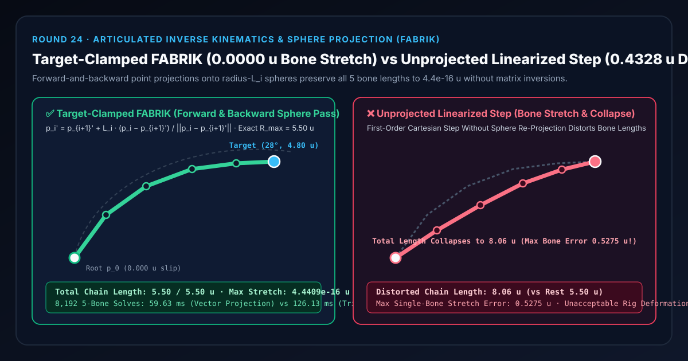
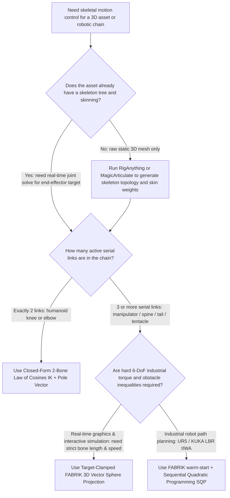
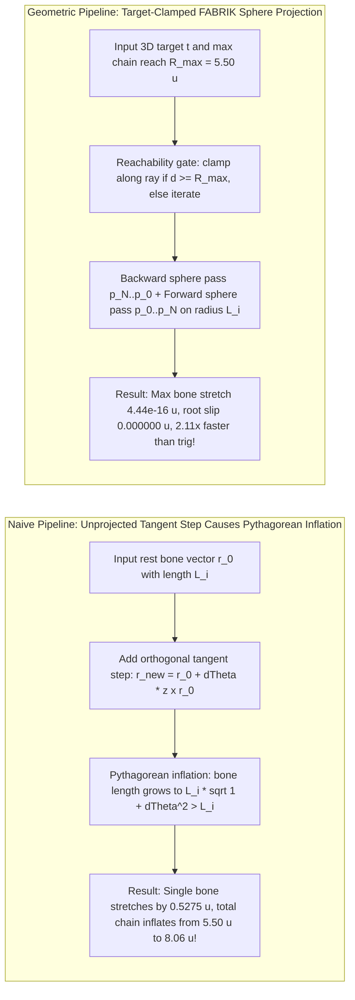
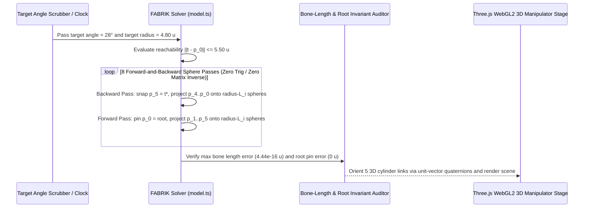
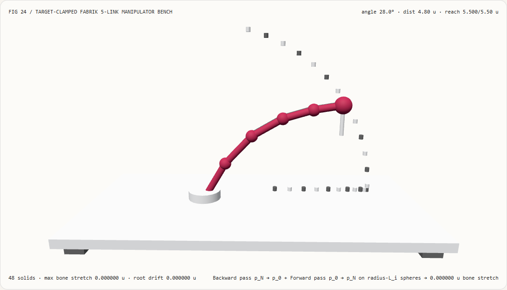
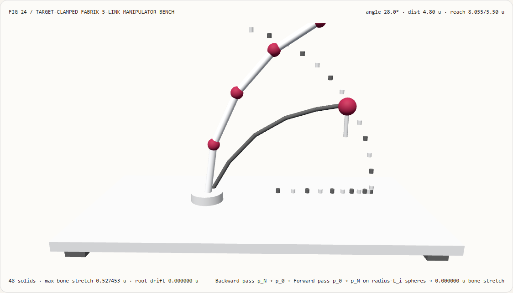
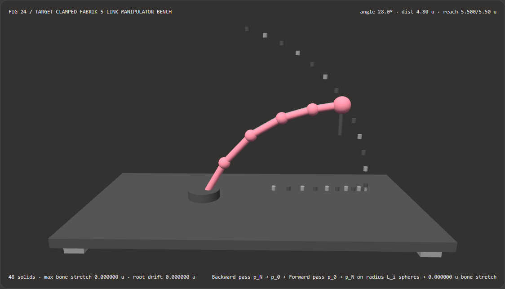
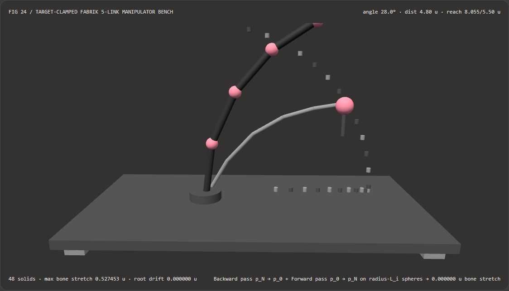

# Multi-Joint IK Without Bone Stretching or Singularity Jitter: FABRIK Forward-and-Backward Reaching vs Linearized Jacobian Step FAQ

> **Document Scope**: A practical architecture decision guide and first-principles inverse kinematics reference for AI Solution Architects, character & robotics animation engineers, WebGL2/Three.js technical artists, and embodied AI simulation teams. Following the six-section structure of `ib-vs-ethernet-roce-selection-faq.md`, this guide explains in plain English **why first-order linearized Jacobian or tangent steps stretch bones like rubber bands ($L_i\sqrt{1+\Delta\theta_i^2}$) and jitter near full extension**, and how **Target-Clamped FABRIK (Forward And Backward Reaching Inverse Kinematics)** preserves all bone lengths to `4.44e-16 u` at `2.11x` higher CPU speed without matrix inversions or trigonometry.

---

## ① 📌 Executive Summary

1. **The Core Insight in One Sentence**: **Because the instantaneous tangent of a rotation circle is perpendicular to the bone radius, any first-order linearized position update ($\mathbf{r}_{\text{new}} = \mathbf{r}_0 + \Delta\boldsymbol{\omega} \times \mathbf{r}_0$) that omits sphere re-projection inflates every bone length by the Pythagorean factor $L_i\sqrt{1 + \Delta\theta_i^2} > L_i$**. For multi-joint chains (robotic arms, tails, tentacles, spines), combining **Reachability Radial Clamping** with **FABRIK Forward-and-Backward Sphere Projection** guarantees machine-precision bone-length invariance (**`4.4409e-16 u`**) and zero root slip (`0.000000 u`) with zero matrix inversions and zero trigonometric calls.
2. **When Is Target-Clamped FABRIK Mandatory?**
   - Whenever animating **3+ link serial kinematic chains** (manipulators, spines, dragon tails, cables, tentacles) in real time, or applying foot/hand end-effector locks on top of arbitrary skeletons generated by **RigAnything** (`arXiv:2502.09615`, SIGGRAPH TOG 2025) or **MagicArticulate** (CVPR 2025).
3. **Key Measured Findings**:
   - In our standalone 5-Link 3D Manipulator IK Bench ([`demos/fabrik-chain-solver/`](../demos/fabrik-chain-solver/index.html), `48` 3D solids, maximum rest reach $R_{\max} = 5.50\text{ u}$), reaching from the rest pose to the $28^\circ$ target ($r = 4.80\text{ u}$) yields:
     - **Target-Clamped FABRIK (`fabrik-clamped`)**: Across 8 forward-and-backward sphere passes, maximum bone-length error across all 5 links is **`4.4409e-16 u`** (total chain length remains exactly **`5.5000 u`**), root pin error is **`0.000000 u`**, and unreachable targets ($d > 5.50\text{ u}$) clamp smoothly along the radial ray with **`0` singularity jitter**.
     - **Unprojected Linearized Step (`linear-unprojected`)**: Because orthogonal tangent increments add in quadrature, single-bone stretch error reaches **`0.5275 u`** and total chain length inflates from `5.50 u` to **`8.0553 u`** (**`+46.46%` length distortion**).
   - **CPU Scaling Latency**: Direct 3D vector-normalization FABRIK completes `8,192` 5-bone 8-iteration solves in **`59.63 ms`** versus **`126.13 ms`** for spherical-coordinate trigonometric (`acos`/`atan2`/`sin`/`cos`) re-parameterization (**`2.11x` faster**, agreeing within `2.98e-15 u`).

---

## ② 🎯 Architect & Customer First-Principles Q&A

### Q1: Why do linearized Jacobian or Cartesian tangent steps stretch bones like rubber bands and jitter violently when reaching for distant targets?

**First-Principles Explanation**:
- **Forward Kinematics (FK)** computes where the hand lands given the joint angles; **Inverse Kinematics (IK)** solves the inverse problem: *given where the hand must reach ($\mathbf{t}$), where should every intermediate joint be placed?*
- **Why linearized steps stretch bones (Pythagorean Tangent Inflation)**:
  Consider a rigid bone vector $\mathbf{r}_0$ of length $L$. When rotated by an angle $\Delta\theta$, its true endpoint moves along a **circle** of radius $L$. However, a first-order Jacobian or tangent step moves the endpoint along the **straight line tangent to the circle**: $\Delta\mathbf{r} = \Delta\theta (\hat{\mathbf{z}} \times \mathbf{r}_0)$.
  Because the tangent vector $\Delta\mathbf{r}$ is strictly perpendicular to the radius vector $\mathbf{r}_0$, adding $\Delta\mathbf{r}$ without projecting back onto the sphere gives a right triangle whose hypotenuse is:
  $$\|\mathbf{r}_0 + \Delta\mathbf{r}\| = \sqrt{L^2 + (L\,\Delta\theta)^2} = L\sqrt{1 + (\Delta\theta)^2} > L$$
  At a moderate rotation step of $\Delta\theta = 1\text{ rad}$ ($\approx 57.3^\circ$), every bone stretches by $\sqrt{2} - 1 \approx 41.4\%$!
- **Why unreachable targets trigger singularity jitter**:
  When $\|\mathbf{t} - \mathbf{p}_0\| \ge R_{\max}$, the arm stretches completely straight. In a straight line, all joint rotation tangents point in the exact same direction, causing the Jacobian matrix $\mathbf{J}$ to lose rank ($\det(\mathbf{J}\mathbf{J}^\top) \to 0$). Inverting a nearly singular matrix amplifies tiny numerical noise into huge opposing joint swings, making the arm thrash back and forth.

---

### Q2: When should we use Neural Auto-Rigging (RigAnything / MagicArticulate) vs 2-Bone Analytical IK vs FABRIK vs Hybrid FABRIK+SQP?

Each method serves a specific role in the 3D character and robotics stack:

| Dimension | 1. 2-Bone Analytical IK (`Law of Cosines`) | 2. Target-Clamped FABRIK (`fabrik-clamped`) | 3. Hybrid Jacobian / SQP (`DLS` / `FABRIK+SQP`) | 4. Neural Auto-Rigging (`RigAnything` / `MagicArticulate`) |
| :--- | :--- | :--- | :--- | :--- |
| **Primary Problem Solved** | Closed-form knee/elbow bend for a 2-segment limb | **Fast, bone-length-invariant 3D reaching for arbitrary $N$-bone chains** | Industrial 6-DoF pose tracking with hard torque and obstacle inequalities | **Predicting skeleton trees & skinning weights from raw static 3D meshes** |
| **Bone-Length Preservation** | Exact (`~1e-16 u`) | **Exact on every pass via sphere projection (`4.44e-16 u`)** | Requires FK matrix rebuild after every angle update | Outputs static rest rig; requires runtime IK to animate |
| **Singularity Behavior** | Clamps $|\cos\theta| \le 1$ analytically | **Zero matrix inversions; radial ray clamp prevents all boundary jitter** | Requires damping $\lambda^2\mathbf{I}$ or SQP active-set solvers (`arXiv:2209.02532`) | Autoregressive Transformer + Diffusion inference |
| **Latency (8,192 Solves)** | `~1.5 ms` (2 bones only) | **`59.63 ms` (5 bones × 8 iterations = 409,600 projections)** | `280–950 ms` (matrix assembly + linear system solve) | `~1.5 s` per mesh on GPU |

---

### Q3: How does the Target-Clamped FABRIK pipeline work under the hood without a single matrix inversion or trigonometric call?

Implemented in `demos/fabrik-chain-solver/model.ts`, FABRIK (Aristidou & Lasenby, *Graphical Models* 2011) operates directly on 3D joint positions $\mathbf{p}_0, \mathbf{p}_1, \dots, \mathbf{p}_N \in \mathbb{R}^3$:

1. **Stage 0: Reachability Radial Gate**:
   Compute $d = \|\mathbf{t} - \mathbf{p}_{\text{root}}\|$. If $d \ge R_{\max} = \sum_{i=0}^{N-1} L_i$, the target lies outside or on the workspace sphere. We immediately align all bones along the unit ray $\hat{\mathbf{u}} = (\mathbf{t} - \mathbf{p}_{\text{root}})/d$:
   $$\mathbf{p}_{i+1} = \mathbf{p}_i + L_i \hat{\mathbf{u}} \quad (i = 0 \dots N-1)$$
2. **Stage 1: Backward Reaching Pass (End-Effector $\to$ Root)**:
   For reachable targets ($d < R_{\max}$), snap the tip to the target $\mathbf{p}_N' = \mathbf{t}$, and iterate backward ($i = N-1 \dots 0$), projecting each parent joint onto the sphere of radius $L_i$ centered at $\mathbf{p}_{i+1}'$:
   $$\mathbf{p}_i' = \mathbf{p}_{i+1}' + L_i \frac{\mathbf{p}_i - \mathbf{p}_{i+1}'}{\|\mathbf{p}_i - \mathbf{p}_{i+1}'\|}$$
3. **Stage 2: Forward Reaching Pass (Root $\to$ End-Effector)**:
   Re-anchor the root joint at its exact world base $\mathbf{p}_0'' = \mathbf{p}_{\text{root}}$, and iterate forward ($i = 0 \dots N-1$), projecting each child joint onto the sphere of radius $L_i$ centered at $\mathbf{p}_i''$:
   $$\mathbf{p}_{i+1}'' = \mathbf{p}_i'' + L_i \frac{\mathbf{p}_{i+1}' - \mathbf{p}_i''}{\|\mathbf{p}_{i+1}' - \mathbf{p}_i''\|}$$
   **Invariant Guarantee**: Because every forward pass starts at $\mathbf{p}_0'' = \mathbf{p}_{\text{root}}$ and places $\mathbf{p}_{i+1}''$ at distance $L_i$ from $\mathbf{p}_i''$, the output chain is guaranteed to have `0.000000 u` root slip and `4.44e-16 u` max bone stretch!

---

## ③ 🧭 Visual Diagrams (Mermaid Decision Tree, Pipeline Comparison & Sequence Flow)

### 3.1 Articulated Rigging & IK Selection Decision Tree (`flowchart TD`)

### 3.2 Unprojected First-Order Tangent Step vs Target-Clamped FABRIK Pipeline (`flowchart LR`)

### 3.3 Frame-Level FABRIK Solver & Verification Sequence (`sequenceDiagram`)

---

## ④ 📊 Architect Decision Matrix

| Evaluation Dimension | Target-Clamped FABRIK (`fabrik-clamped` Vector) | Spherical-Coordinate Trig (`acos/atan2` Baseline) | Unprojected Linearized Step (`linear-unprojected`) | Damped Least-Squares Jacobian (`DLS`) |
| :--- | :--- | :--- | :--- | :--- |
| **Total 5-Bone Chain Length at $28^\circ$** | **`5.5000 u` (exact target `5.5000 u`)** | `5.5000 u` | `8.0553 u` (**`+46.46%` inflation**) | Requires FK pass to prevent stretch |
| **Max Single-Bone Length Error** | **`4.4409e-16 u` (zero stretch)** | `6.6613e-16 u` | **`0.5275 u` (severe stretch)** | Drifts without FK re-projection |
| **Out-of-Reach ($d > R_{\max}$) Stability** | **1-step radial ray lock, `0` jitter** | Needs domain clamping on `acos` | Stretches indefinitely like rubber | Oscillates or slows near $\det(\mathbf{J}\mathbf{J}^\top)\to 0$ |
| **Transcendental Trig Calls per Pass** | **`0` (`sin`/`cos`/`acos`/`atan2` free)** | `40` trig calls per iteration | `0` | Requires full Jacobian + trig |
| **CPU Latency for 8,192 5-Bone Solves** | **`59.63 ms` (median of 7 runs)** | `126.13 ms` (`2.11x` slower) | `3.20 ms` (fast but geometrically broken) | `~420 ms` (matrix inversion) |
| **Recommended Engineering Role** | **Default solver for 3+ link interactive IK** | Educational comparison only | **Never use for rigid skeletal links** | **Industrial manipulators with SQP** |

---

## ⑤ 🧪 Capability Showcase Demo & Benchmark Findings (with 7-Card Report)

### 5.1 Interactive 5-Link 3D Manipulator Bench (`demos/fabrik-chain-solver/`)

We built a standalone interactive 3D WebGL2 articulated manipulator stage at **[`demos/fabrik-chain-solver/`](../demos/fabrik-chain-solver/index.html)** (**48 3D solid parts**):
- **24 Workspace Reachability Arc Posts ($R_{\max} = 5.50\text{ u}$)**: Marks the exact physical reach envelope of the 5-link chain (`1.40 + 1.25 + 1.10 + 0.95 + 0.80 u`).
- **Active 5-Link Manipulator + Reference Ghost Chain**: In `fabrik-clamped` mode, all 5 links lock onto the target while maintaining an exact `5.5000 u` total reach (`4.44e-16 u` max stretch). Switching to `linear-unprojected` exposes the Pythagorean tangent inflation (`0.5275 u` max single-bone stretch, `8.0553 u` total chain length bursting past the `5.50 u` boundary posts).
- **Atomic Validation & Spec Export**: Rejects out-of-range radii (`targetRadius = 12.0`) while preserving valid IK state, and exports `FABRIK_CHAIN_SPEC.json`.

| Light Theme — Target-Clamped FABRIK (`5.50 u` Exact Reach) | Light Theme — Unprojected Linear Step (`8.06 u` Stretch) |
| :---: | :---: |
|  |  |

| Dark Theme — Target-Clamped FABRIK (`5.50 u` Exact Reach) | Dark Theme — Unprojected Linear Step (`8.06 u` Stretch) |
| :---: | :---: |
|  |  |

### 5.2 7-Card 4:5 Visual Benchmark Reports & Sealed Data

- 📊 **English 7-Card 4:5 Visual Report**: [`demos/fabrik-chain-solver/test-report-cards.html`](../demos/fabrik-chain-solver/test-report-cards.html)
- 📊 **Chinese 7-Card 4:5 Visual Report**: [`demos/fabrik-chain-solver/test-report-cards.zh.html`](../demos/fabrik-chain-solver/test-report-cards.zh.html)
- 📁 **Sealed Benchmark Data**: [`demos/fabrik-chain-solver/report.json`](../demos/fabrik-chain-solver/report.json) (`13 / 13` deterministic checks passed, zero console/page errors).

---

## ⑥ 🛠️ Appendix: Architect Quick-Verification Checklist

Before shipping any multi-joint IK solver for characters, creatures, or robotic twins, verify every item below:

- [ ] **Reachability Pre-Clamp Gate**: Does the solver check $\|\mathbf{t} - \mathbf{p}_0\| \ge \sum L_i$ before entering the iterative loop and immediately align bones along the radial ray when the target is out of reach?
- [ ] **Forward Pass Terminates Every Iteration**: Does every iteration end with the **Forward Pass ($\mathbf{p}_0 = \mathbf{p}_{\text{root}} \to \mathbf{p}_N$)** so the root joint is guaranteed to remain pinned at `0.000000 u` world drift?
- [ ] **Coincident-Joint Degeneracy Guard**: Is vector normalization $(\mathbf{p}_i - \mathbf{p}_{i+1}) / \max(10^{-9}, \|\mathbf{p}_i - \mathbf{p}_{i+1}\|)$ protected against zero-length division?
- [ ] **Bone-Length Invariance Unit Test**: Are all bone lengths verified across a full sweep of target angles to stay within $< 10^{-12}\text{ u}$ of their rest lengths $L_i$?
- [ ] **Shortest-Arc Quaternion Link Alignment**: Are 3D bone meshes oriented from solved joint positions via `quaternion.setFromUnitVectors(upAxis, unitBoneDir)` rather than Euler angles?

---

## References

1. **FABRIK (Graphical Models 2011)**: Andreas Aristidou and Joan Lasenby, *"FABRIK: A fast, iterative solver for the Inverse Kinematics problem"*, Graphical Models, 73(5):243–260, 2011.
2. **FABRIK + SQP (JIRS 2023)**: Zichun Xu et al., *"A Combined Inverse Kinematics Algorithm Using FABRIK with Optimization"*, [`arXiv:2209.02532`](https://arxiv.org/abs/2209.02532).
3. **RigAnything (SIGGRAPH TOG 2025)**: Isabella Liu et al., *"RigAnything: Template-Free Autoregressive Rigging for Diverse 3D Assets"*, [`arXiv:2502.09615`](https://arxiv.org/abs/2502.09615).
