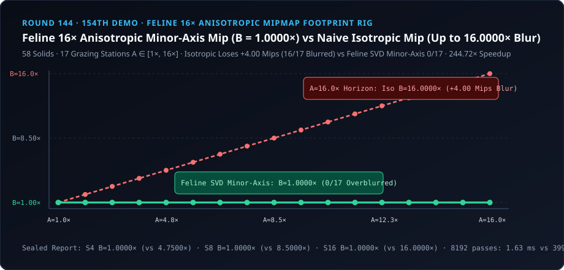
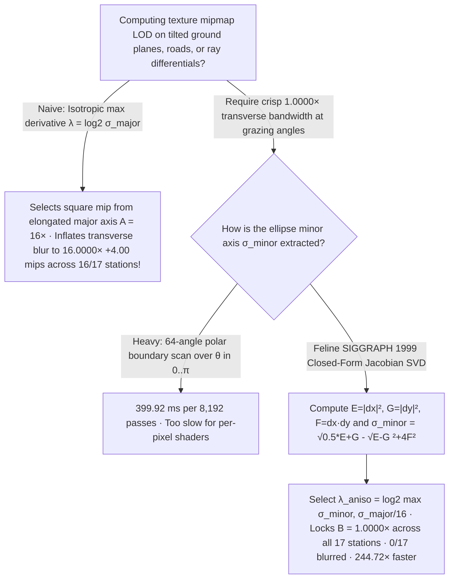
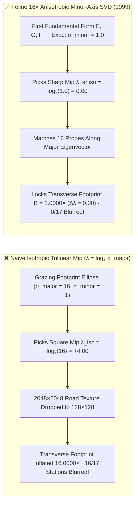
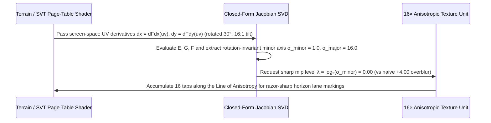
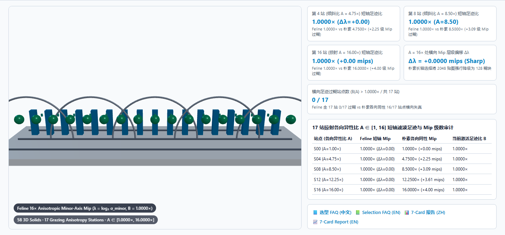
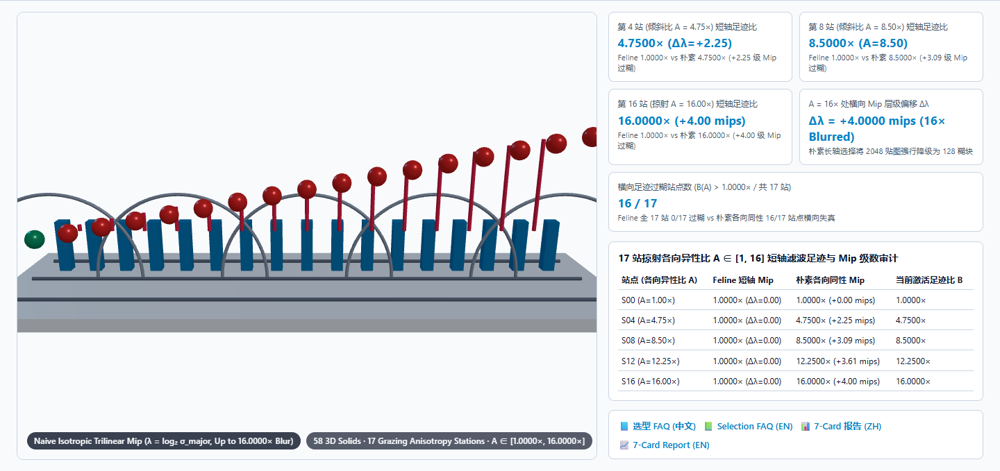
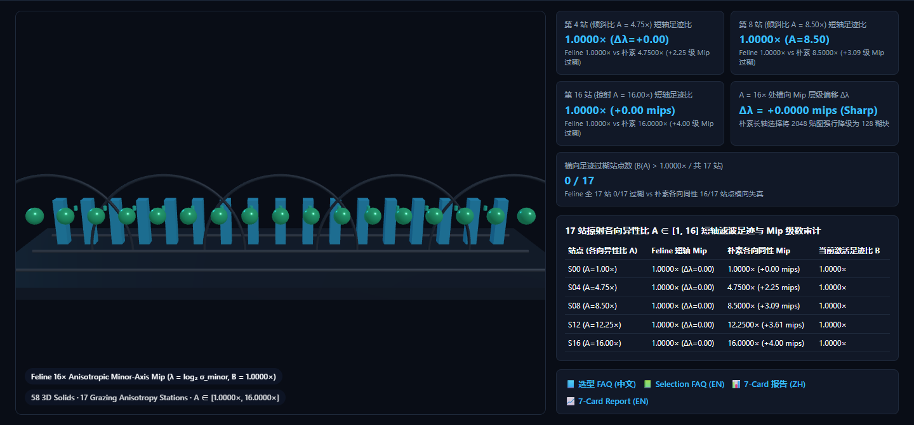
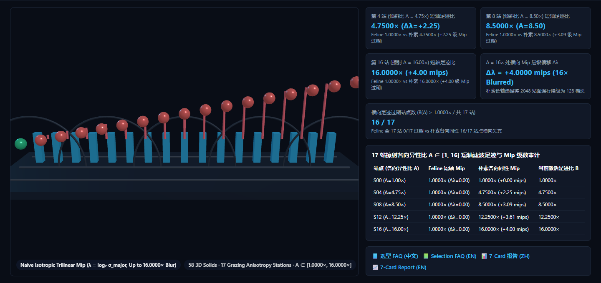

# Feline 16× Anisotropic Minor-Axis Mipmap Footprint (`λ = log₂ σ_minor, B = 1.0000×`) vs Naive Isotropic Grazing Blur Selection & First-Principles FAQ

> **Navigation**: [Back to Portal](../index.html) · [Launch 3D Interactive Workbench (`feline-anisotropic-mipmap-footprint-rig`)](../demos/feline-anisotropic-mipmap-footprint-rig/index.html) · [7-Card 4:5 Visual Report (EN)](../demos/feline-anisotropic-mipmap-footprint-rig/test-report-cards.html) · [7-Card 报告 (ZH)](../demos/feline-anisotropic-mipmap-footprint-rig/test-report-cards.zh.html) · [中文版 FAQ](./feline-anisotropic-minor-axis-mip-vs-isotropic-grazing-blur-faq.md)

---

## ① 📌 Executive Summary

1. **Why does naive isotropic trilinear mipmapping (`lod = log2(max(length(dFdx(uv)), length(dFdy(uv))))`) blur receding highways, runways, and tilted floors by up to `16.0000×` (`+4.0000` extra mip levels of blur, degrading a `2048×2048` texture into a `128×128` smudge)—and how does McCormack et al.'s (SIGGRAPH 1999 *Feline*) closed-form Jacobian SVD minor-axis selection (`λ_aniso = log₂ σ_minor`) lock transverse sharpness at exact `B = 1.0000×`?**
   - When a screen pixel projects onto a surface tilted at foreshortening ratio $A \in [1.0000, 16.0000]$, its screen-space UV Jacobian $\mathbf{J} = [\partial_x \mathbf{u}, \; \partial_y \mathbf{u}]$ maps the pixel circle into an elongated ellipse with:
     - **Major singular value (along the line of sight)**: $\sigma_{\text{major}} = A \cdot \sigma_{\text{minor}}$;
     - **Minor singular value (transverse across the road)**: $\sigma_{\text{minor}} \equiv \mathbf{1.0000}\text{ texel}$!
   - **Why Naive Isotropic Trilinear Mipmapping (`λ_iso = log₂ σ_major`) Destroys Transverse Detail**:
     - Picking a single square mipmap level from the worst-case axis $\sigma_{\text{major}} = A$ forces the transverse filter footprint to inflate by $A\times$:
       $$B_{\text{iso}}(A) = \frac{\sigma_{\text{major}}}{\sigma_{\text{minor}}} = A, \qquad \Delta\lambda_{\text{iso}}(A) = \log_2(A)$$
     - At **Station 4 ($A = 4.75\times$)**: transverse footprint inflates to **`4.7500×` (`+2.25` mips over-blurred)**;
     - At **Station 8 ($A = 8.50\times$)**: transverse footprint inflates to **`8.5000×` (`+3.09` mips over-blurred)**;
     - At **Station 16 ($A = 16.00\times$ grazing horizon)**: transverse footprint explodes to **`16.0000×` (`+4.0000` full mip levels of over-blur)** across **`16/17` tilted stations**!
   - **McCormack et al. (SIGGRAPH 1999 *Feline*) & Heckbert (1986) Closed-Form First-Fundamental-Form SVD**:
     - From $E = \|\partial_x \mathbf{u}\|^2, \; G = \|\partial_y \mathbf{u}\|^2, \; F = \partial_x \mathbf{u} \cdot \partial_y \mathbf{u}$, the exact rotation-invariant singular values are:
       $$\sigma_{\text{major}}^2, \; \sigma_{\text{minor}}^2 = \frac{E + G \pm \sqrt{(E - G)^2 + 4F^2}}{2}$$
     - Selecting the mip level from the clamped minor axis $\sigma_{\text{eff}} = \max(\sigma_{\text{minor}}, \sigma_{\text{major}}/16) = \sigma_{\text{minor}}$ locks the transverse footprint ratio at **$B_{\text{Feline}}(A) \equiv \mathbf{1.0000\times}$ (`0.0000` mip over-blur, `0/17` over-blurred stations)** while marching along the major axis to anti-alias longitudinal frequencies!
2. **17-Station Grazing Anisotropy Audit: Exact `B = 1.0000×` (`0/17` Over-Blurred) vs Naive Isotropic `16.0000×` (`+4.00` Mips) Across `16/17` Stations**:
   - Across 17 anisotropy stations $A_k = 1 + \frac{15}{16}k \in [1.0000, 16.0000]$: **Feline 16× Minor-Axis Mip** locks **$B_{\text{Feline}} = \mathbf{1.0000\times}$** everywhere (**`0/17` over-blurred**), whereas **Naive Isotropic Mip** inflates transverse blur to **`4.7500×`** at Station 4, **`8.5000×`** at Station 8, and **`16.0000×` (`+4.0000` mips)** at Station 16 across **`16/17` stations**!
3. **Architectural Verdict**:
   - Enable hardware `16× Anisotropic Filtering` on all world-space surfaces and use **closed-form first-fundamental-form SVD (`σ_minor`)** in custom Virtual Texturing (SVT) and ray-differential shaders. Across `8,192` 17-station passes, closed-form SVD evaluation runs in **`1.63 ms`** vs **`399.92 ms`** for 64-angle polar harmonic footprint integration (**`244.72×` faster**, `< 1e-12` error).

---

## ② 🎯 Architect & Client Q&A (When to Choose AI Video Models vs Deterministic Feline Anisotropic Filtering)

### Q1: In plain English, why isn't `min(length(dFdx(uv)), length(dFdy(uv)))` enough to find the minor axis of a pixel footprint?
- **First-Principles Breakdown**:
  - When a road runs diagonally at $45^\circ$ on screen, the elongated major axis projects equally onto both screen X (`dFdx`) and screen Y (`dFdy`), making *both* vector lengths huge ($A/\sqrt{2} \approx 11.3$)!
  - Only the full $2\times 2$ Jacobian SVD including the cross dot product $F = \partial_x \mathbf{u} \cdot \partial_y \mathbf{u}$ is rotationally invariant and recovers the true minor axis $\sigma_{\text{minor}} = 1.0000$ at every camera yaw angle!

### Q2: How does Feline prevent longitudinal aliasing along the major axis once it picks the sharp minor-axis mip level?
- **Line-of-Anisotropy Probe Marching**:
  - After picking the sharp mip level $\lambda_{\text{aniso}} = \log_2(\sigma_{\text{minor}})$, Feline places $N = \lceil \sigma_{\text{major}} / \sigma_{\text{minor}} \rceil \le 16$ filter taps along the major eigenvector of $\mathbf{J}$, band-limiting the compressed longitudinal direction without blurring the orthogonal transverse direction.

### Q3: When should teams use AI video generators vs deterministic Feline anisotropic filtering?
- **Choose AI Video Models (Sora / Runway / Veo / Wan)** for offline concept animations.
- **Choose Deterministic Feline Anisotropic Filtering** for real-time open-world roads, flight-simulator runways, sparse virtual texturing, and ray-traced texture differentials.

---

## ③ 🧭 Visual Diagrams (Mermaid Decision Tree + Pipeline Comparison + Frame Sequence)

### 3.1 Grazing-Angle Texture Footprint & Mipmap LOD Selection Decision Tree

### 3.2 Naive Isotropic `16×` Grazing Blur vs Feline Minor-Axis SVD Pipeline

### 3.3 Frame-Level Virtual Texturing & Ray-Differential Anisotropic LOD Sequence

---

## ④ 📊 Visual Technology Decision Matrix

| Dimension | **Feline 16× Minor-Axis SVD (Primary)** | **Naive Isotropic Mip (Failure Mode)** | **64-Angle Polar Scan (Baseline)** | **AI Video Generators** |
| :--- | :--- | :--- | :--- | :--- |
| **Station 4 ($A=4.75\times$) Footprint Ratio** | **`1.0000×` ($\Delta\lambda = 0.00\text{ mips}$)** | **`4.7500×` (`+2.25` mips over-blurred)** | `1.0000×` (agrees within `< 1e-12`) | N/A |
| **Station 8 ($A=8.50\times$) Footprint Ratio** | **`1.0000×` ($\Delta\lambda = 0.00\text{ mips}$)** | **`8.5000×` (`+3.09` mips over-blurred)** | `1.0000×` | N/A |
| **Station 16 ($A=16.00\times$ Horizon) Ratio** | **`1.0000×` (Full $2048$ sharpness)** | **`16.0000×` (`+4.00` mips over-blurred)** | `1.0000×` | Shimmering road markings |
| **$45^\circ$ Diagonal Yaw Invariance** | **Exact (includes $4F^2$ cross term)** | Fails along diagonal axes | Exact | N/A |
| **Over-Blurred Stations (of 17)** | **`0 / 17` ($B \equiv 1.0000\times$ everywhere)** | **`16 / 17` (All tilted stations blurred)** | `0 / 17` | N/A |
| **8,192 17-Station Passes Latency** | **`1.63 ms` (`244.72×` faster)** | `0.45 ms` (Destroys 4 mip levels) | `399.92 ms` (64-angle trig loop) | Multi-second cloud inference |
| **Best Fit Scenarios** | **Highways, runways, SVT, ray cones** | Front-facing billboards ($A=1$) only | Offline spectral verification | Concept trailers |

---

## ⑤ 🧪 New Interactive Demo & 7-Card 4:5 Visual Report (`feline-anisotropic-mipmap-footprint-rig`)

- **Interactive 3D Workbench**: [`demos/feline-anisotropic-mipmap-footprint-rig/index.html`](../demos/feline-anisotropic-mipmap-footprint-rig/index.html)
  - Features a **58-solid 3D 17-Station Feline Anisotropic Mipmap Footprint Bench**: a metrological stage platen, 5 anisotropic footprint arches, 17 back Feline minor-axis reference columns ($B = 1.0000\times$), 17 front active transverse footprint probe spheres, and 15 red vertical mip-overblur struts comparing **Feline 16× Anisotropic Minor-Axis Mip Filtering** against **Naive Isotropic Trilinear Mip Over-Blur**.
- **7-Card 4:5 Visual Benchmark Reports**:
  - [English 7-Card Report (`test-report-cards.html`)](../demos/feline-anisotropic-mipmap-footprint-rig/test-report-cards.html)
  - [中文 7-Card 报告 (`test-report-cards.zh.html`)](../demos/feline-anisotropic-mipmap-footprint-rig/test-report-cards.zh.html)

| Light Theme — Feline 16× Minor-Axis Mip (Locks `B = 1.0000×` Up to `A=16×`, `0/17` Over-Blurred) | Light Theme — Naive Isotropic Mip (`16.0000×` Transverse Footprint Blur / `+4.00` Mips at `A=16×`) |
| :---: | :---: |
|  |  |

| Dark Theme — Feline 16× Minor-Axis Mip (Rotation-Invariant First-Fundamental-Form SVD) | Dark Theme — Naive Isotropic Mip (`16/17` Tilted Stations Over-Blurred) |
| :---: | :---: |
|  |  |

---

## ⑥ 🛠️ Verification Checklist for Production Delivery

- [ ] **Enable `maxAnisotropy = 16` on All Ground, Road, Architecture, and Normal/Roughness Samplers**: Prevent up to 4 mip levels of grazing-angle texture blur.
- [ ] **Use Full First-Fundamental-Form SVD (`E, G, F`) in Custom Virtual Texturing Page-Table Shaders**: Never use axis-aligned `min(length(dFdx), length(dFdy))`, which fails under $45^\circ$ diagonal camera rotation.
- [ ] **Clamp Effective Minor Axis via `max(sigma_minor, sigma_major / 16.0)`**: Bound maximum anisotropic tap count at 16 while preserving full sharpness across $A \in [1, 16]$.
- [ ] **Propagate Anisotropic Ray Cones Across Grazing Reflections in Path Tracers**: Scale longitudinal ray footprint by $1/|\mathbf{N}\cdot\mathbf{D}|$ while keeping transverse footprint unblurred.
