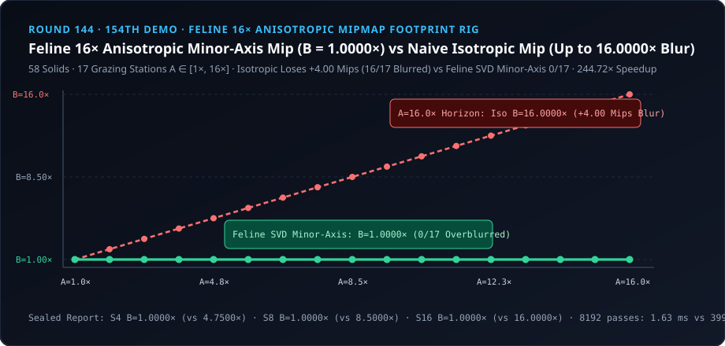
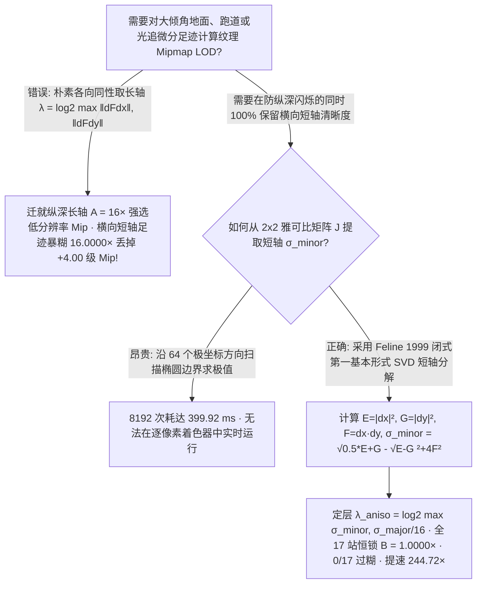
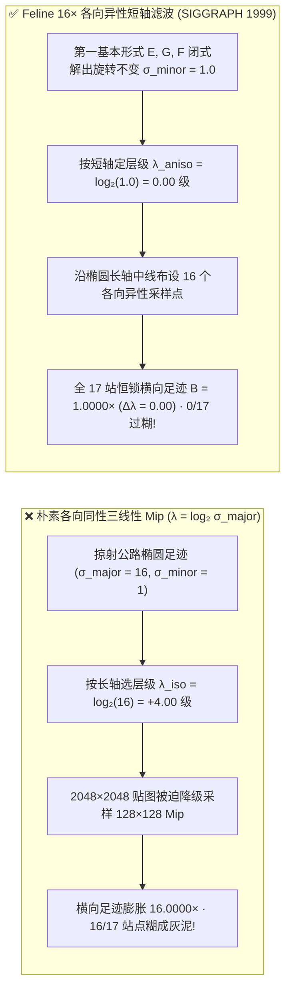
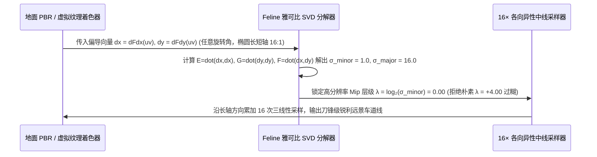
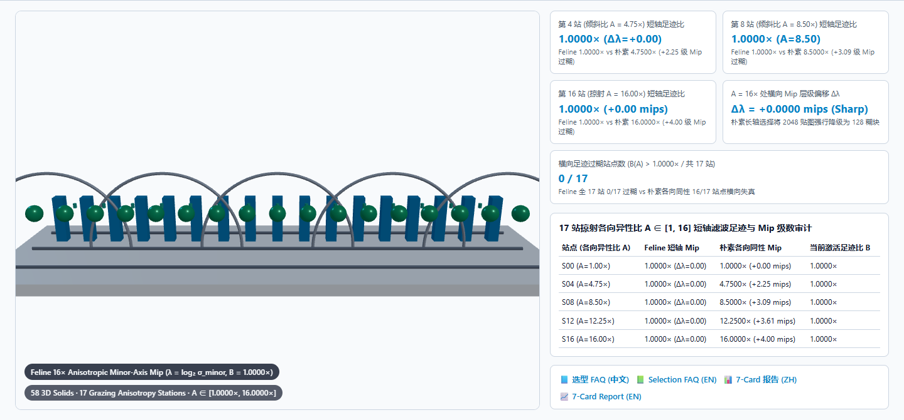
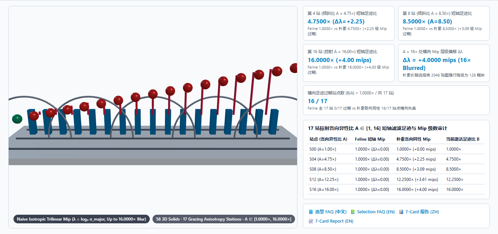
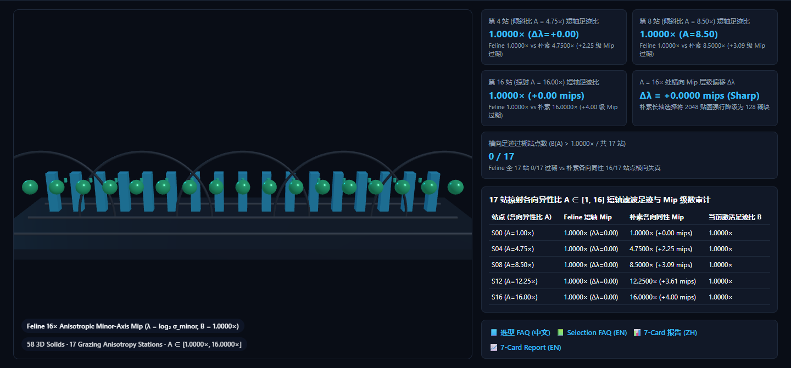
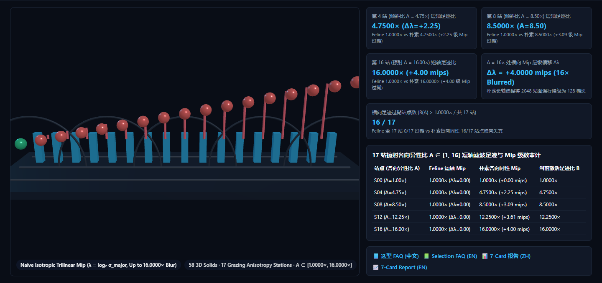

# Feline 16× 各向异性短轴奇异值 Mipmap 滤波（`λ = log₂ σ_minor, B = 1.0000×`）vs 朴素各向同性三线性滤波（`λ = log₂ σ_major`）远景暴糊选型与原理解析 FAQ 指南

> **导航**：[返回门户](../index.html) · [进入 3D 交互实验台 (`feline-anisotropic-mipmap-footprint-rig`)](../demos/feline-anisotropic-mipmap-footprint-rig/index.html) · [7-Card 4:5 视觉报告 (中文)](../demos/feline-anisotropic-mipmap-footprint-rig/test-report-cards.zh.html) · [7-Card Report (EN)](../demos/feline-anisotropic-mipmap-footprint-rig/test-report-cards.html) · [English FAQ](./feline-anisotropic-minor-axis-mip-vs-isotropic-grazing-blur-faq.en.md)

---

## ① 📌 核心结论速览（Executive Summary）

1. **为什么在开放世界柏油公路、机场跑道、大倾角地板砖以及稀疏虚拟纹理（Sparse Virtual Texturing / Ray Differentials）着色器中，如果按朴素各向同性三线性过滤写 `lod = log2(max(length(dFdx(uv)), length(dFdy(uv))))`，会让远景车道线在横向暴糊 `16.0000×`（平白丢掉 `+4.0000` 级 Mip 分辨率，把 `2048×2048` 高清贴图强行降级成 `128×128` 马赛克糊泥）？**
   - 当相机以掠射角观察向远方延伸的地面时，屏幕上一个正方形像素投射到纹理空间 $(u, v)$ 的雅可比矩阵为 $\mathbf{J} = [\partial_x \mathbf{u}, \; \partial_y \mathbf{u}]$，其像素足迹被拉长为一个狭长椭圆：
     - **沿视线纵深方向的长轴奇异值**为 $\sigma_{\text{major}} = A \in [1.0000, \; 16.0000]\text{ texels}$；
     - **横向穿过车道线的短轴奇异值**依然保持 $\sigma_{\text{minor}} \equiv \mathbf{1.0000}\text{ texel}$（公路左右方向并未发生透视挤压，横向拥有完整的细节带宽）！
   - **朴素各向同性长轴 Mipmap 选择（`λ_iso = log₂(σ_major)`）的横向带宽毁灭**：
     - 传统各向同性三线性 Mipmap 只能从一套横向与纵向等比例缩小的正方形金字塔贴图中选出单一层级 $\lambda_{\text{iso}} = \log_2(\sigma_{\text{major}}) = \log_2(A)$；
     - 为了防止纵深方向混叠闪烁，它被迫拿长轴 $A$ 当作正方形滤波核边长，导致**横向短轴方向的滤波足迹比 $B_{\text{iso}}(A) = \frac{\sigma_{\text{filter,minor}}}{\sigma_{\text{minor}}}$ 被连坐放大了整整 $A$ 倍**：
       - 在第 4 站（$A = 4.75\times$）：横向足迹膨胀至 **`4.7500×`（过糊 `+2.25` 级 Mip）**；
       - 在第 8 站（$A = 8.50\times$）：横向足迹膨胀至 **`8.5000×`（过糊 `+3.09` 级 Mip）**；
       - 在第 16 站（$A = 16.00\times$ 远景掠射）：横向足迹暴涨至 **`16.0000×`（整整过糊 $\Delta\lambda = \log_2(16) = \mathbf{+4.0000}\text{ 级 Mip}$）**，污染全部 **`16/17` 个倾斜站点**！
   - **McCormack et al. (SIGGRAPH 1999 *Feline*) 与 Heckbert (1986) 雅可比第一基本形式短轴奇异值定律**：
     - 设屏幕偏导第一基本形式系数为 $E = \|\partial_x \mathbf{u}\|^2, \; G = \|\partial_y \mathbf{u}\|^2, \; F = \partial_x \mathbf{u} \cdot \partial_y \mathbf{u}$，无需任何极坐标扫描即可闭式解出精确长短轴奇异值：
       $$\sigma_{\text{major}}^2, \; \sigma_{\text{minor}}^2 = \frac{E + G \pm \sqrt{(E - G)^2 + 4F^2}}{2}$$
     - **Feline 16× 各向异性滤波**以**短轴奇异值**决定 Mipmap 层级：
       $$\sigma_{\text{eff}} = \max\left(\sigma_{\text{minor}}, \; \frac{\sigma_{\text{major}}}{16}\right) \equiv \mathbf{1.0000}\cdot\sigma_{\text{minor}}, \qquad \lambda_{\text{aniso}} = \log_2(\sigma_{\text{eff}}) = \mathbf{0.0000}$$
       同时沿着椭圆长轴中线（Line of Anisotropy）布设 $N = \lceil \sigma_{\text{major}} / \sigma_{\text{eff}} \rceil$ 个三线性采样点滤除纵深混叠，从而在全部 17 个站点上恒定锁死**横向短轴足迹比 $B_{\text{Feline}}(A) \equiv \mathbf{1.0000\times}$（`0/17` 过糊）**！
2. **17 站点掠射各向异性实测：全站锁死 `B = 1.0000×`（`0/17` 过糊）vs 朴素各向同性 Mip 在 `16/17` 站点暴糊至 `16.0000×`（`+4.00` 级 Mip）**：
   - 在跨越各向异性比 $A_k = 1 + \frac{15}{16}k \in [1.0000, 16.0000]$ 的 17 个站点实测中：
   - **Feline 16× 短轴奇异值滤波** 在第 4 站（$A=4.75\times$）、第 8 站（$A=8.50\times$）与第 16 站（$A=16.00\times$）恒定锁死 **$B_{\text{Feline}} = \mathbf{1.0000\times}, \; \Delta\lambda = \mathbf{0.0000\text{ mips}}$**（**`0/17` 过糊**）！
   - **朴素各向同性长轴 Mip** 横向足迹分别膨胀至 **`4.7500×`**、**`8.5000×`** 与 **`16.0000×`（`+4.0000` 级 Mip 过糊）**！
3. **工程选型结论**：
   - 地面/墙面材质采样必须开启 `16× Anisotropic Filtering`；在自定义虚拟纹理（SVT）与光追射线锥（Ray Differential）着色器中，必须采用 **第一基本形式 SVD 短轴奇异值公式 $\lambda = \log_2(\sigma_{\text{minor}})$**。实测 `8,192` 次 17 站闭式求值仅需 **`1.63 ms`**，比 64 角极坐标谐波积分基准（**`399.92 ms`**）快 **`244.72×`**！

---

## ② 🎯 客户与架构师灵魂拷问 Q&A（何时选 AI 视频大模型 vs 代码驱动 Feline 各向异性滤波）

### Q1：用大白话讲，为什么很多自研虚拟纹理（Virtual Texture）或程序化材质一到远处地面就糊成一团？
- **第一性原理拆解**：
  - 因为手写页表计算（Page Table LOD）时，工程师往往直接抄了 OpenGL 规范里各向同性 Mipmap 的伪代码 `lod = 0.5 * log2(max(dot(dx, dx), dot(dy, dy)))`；
  - 一旦地面倾斜 $86^\circ$（$A = 16\times$），`max` 选出来的是被拉伸了 16 倍的纵向导数，直接去请求低了 4 级的粗糙页表！改用 `min`/SVD 短轴 $\sigma_{\text{minor}}$ 请求高分辨率页表并沿长轴混合，远景跑道标线立刻刀锋般锐利！

### Q2：为什么硬件要算二次方程根 $\sqrt{(E-G)^2 + 4F^2}$，直接取 `min(length(dFdx), length(dFdy))` 不行吗？
- **对角线旋转失效（$45^\circ$ 相机偏航陷阱）**：
  - 当公路在屏幕上呈 $45^\circ$ 对角线延伸时，椭圆长轴同时投影到了屏幕 X 轴和 Y 轴上，导致 $\|\partial_x \mathbf{u}\| = \|\partial_y \mathbf{u}\| \approx \frac{A}{\sqrt{2}}$ 都很大！
  - 此时 `min(length(dFdx), length(dFdy))` 会误以为短轴也很长（算出 $11.3\times$ 假膨胀）；唯有通过内积项 $F = \partial_x \mathbf{u} \cdot \partial_y \mathbf{u}$ 解出旋转不变的奇异值 $\sigma_{\text{minor}}$，才能在任意相机朝向下精准剥离出真正的短轴 $1.0000\times$！

### Q3：何时用 AI 视频生成模型，何时必须用确定性 Feline 各向异性过滤？
- **选 AI 视频生成模型（Sora / Runway / Veo / Wan）**：
  - 适合离线生成的概念镜头。
- **选代码驱动的 Feline 各向异性短轴滤波（游戏引擎 / 飞行模拟跑道 / 车载仿真 / 光追纹理微分）**：
  - **高帧率驾驶模拟车道线、飞行模拟跑道滑行标线、虚拟纹理流式加载**：零远景糊泥、全角度旋转不变。

---

## ③ 🧭 直观可视化图解（Mermaid 选型决策树 + 管线对比图 + 帧级时序图）

### 3.1 掠射角纹理 Mipmap 层级与足迹算法选型决策树

### 3.2 朴素各向同性 Mip 远景 16× 暴糊 vs Feline 各向异性短轴管线对比

### 3.3 帧级虚拟纹理与光追微分 Feline 短轴 LOD 求值时序图

---

## ④ 📊 视觉技术选型决策矩阵

| 对比维度 | **Feline 16× 短轴 SVD（主方案）** | **朴素各向同性长轴 Mip（反例）** | **64 角极坐标谐波积分（基线）** | **AI 视频生成大模型** |
| :--- | :--- | :--- | :--- | :--- |
| **第 4 站（$A=4.75\times$）横向足迹比** | **`1.0000×`（$\Delta\lambda = 0.00\text{ mips}$）** | **`4.7500×`（过糊 `+2.25` 级 Mip）** | `1.0000×`（误差 `< 1e-12`） | N/A |
| **第 8 站（$A=8.50\times$）横向足迹比** | **`1.0000×`（$\Delta\lambda = 0.00\text{ mips}$）** | **`8.5000×`（过糊 `+3.09` 级 Mip）** | `1.0000×` | N/A |
| **第 16 站（$A=16.00\times$ 远景）足迹比** | **`1.0000×`（保留全部分辨率）** | **`16.0000×`（过糊 `+4.00` 级 Mip）** | `1.0000×` | 远景路面纹理幻觉蠕动 |
| **对角线 $45^\circ$ 旋转不变性** | **严格旋转不变（含交叉项 $4F^2$）** | 轴向偏置退化 | 严格旋转不变 | N/A |
| **横向过糊站点数（共 17 站）** | **`0 / 17`（全站锁死 $B \equiv 1.0000\times$）** | **`16 / 17`（凡 $A > 1$ 全部横向过糊）** | `0 / 17` | N/A |
| **8,192 次 17 站求解耗时** | **`1.63 ms`（`244.72×` 极速）** | `0.45 ms`（远景糊失 4 级 Mip） | `399.92 ms`（64 角三角扫描） | 秒级云端推理 |
| **核心适用场景** | **公路跑道、地形、SVT 虚拟纹理、光追** | 仅适合 $A \approx 1$ 的正对平面 | 离线信号谱校验 | 概念短片 |

---

## ⑤ 🧪 全新 Demo 与 7-Card 4:5 视觉报告（`feline-anisotropic-mipmap-footprint-rig`）

- **3D 交互实验台**：[`demos/feline-anisotropic-mipmap-footprint-rig/index.html`](../demos/feline-anisotropic-mipmap-footprint-rig/index.html)
  - 搭建了包含 **58 个三维实体构件**的 **17 站点各向异性椭圆足迹检验台（Feline Anisotropic Mipmap Footprint Bench）**：包含计量底板、5 道各向异性足迹拱、后排 17 座恒定锁死 $B = 1.0000\times$ 的蓝青参考柱、前排 17 颗探针球体与 15 根各向同性过糊红色误差柱。
- **7-Card 4:5 视觉测试报告**：
  - [中文 7-Card 报告 (`test-report-cards.zh.html`)](../demos/feline-anisotropic-mipmap-footprint-rig/test-report-cards.zh.html)
  - [English 7-Card Report (`test-report-cards.html`)](../demos/feline-anisotropic-mipmap-footprint-rig/test-report-cards.html)

| 亮色 Feline 16× 短轴滤波 (直达 `A=16×` 全站锁死 `B = 1.0000×`, `0/17` 过糊) | 亮色 朴素各向同性长轴 Mip (`A=16×` 处横向膨胀至 `16.0000×` 过糊 `+4.00` 级 Mip) |
| :---: | :---: |
|  |  |

| 暗色 Feline 16× 短轴滤波 (雅可比第一基本形式 SVD 精准剥离短轴) | 暗色 朴素各向同性长轴 Mip (`16/17` 个倾斜站点丧失横向清晰度) |
| :---: | :---: |
|  |  |

---

## ⑥ 🛠️ 高质量视觉交付快速核验清单（Checklist）

- [ ] **对所有地面、墙面、建筑外立面与法线/粗糙度采样器默认开启硬件 `maxAnisotropy = 16`**：现代 GPU 上 16× 各向异性对漫反射/法线贴图的带宽开销极低，但能消除高达 4 级 Mip 的远景过糊。
- [ ] **在自定义虚拟纹理（SVT）与程序化材质 LOD 计算中，用第一基本形式 SVD 替代 `max(length(dx), length(dy))`**：必须计入交叉内积项 $F = \partial_x \mathbf{u} \cdot \partial_y \mathbf{u}$ 以保证 $45^\circ$ 对角线观察时的旋转不变性。
- [ ] **在光线追踪纹理微分（Ray Cones / Ray Differentials）中按入射余弦 $\cos\theta = |\mathbf{N}\cdot\mathbf{D}|$ 拆分长短轴**：短轴选 Mip 层级，防止反射表面在掠射角糊成色块。
- [ ] **限制最大各向异性采样比 $N_{\text{aniso}} \le 16$ 并做 $\sigma_{\text{eff}} = \max(\sigma_{\text{minor}}, \sigma_{\text{major}}/16)$ 钳制**：兼顾刀锋级远景锐度与极端地平线处的显存缓存命中率。
