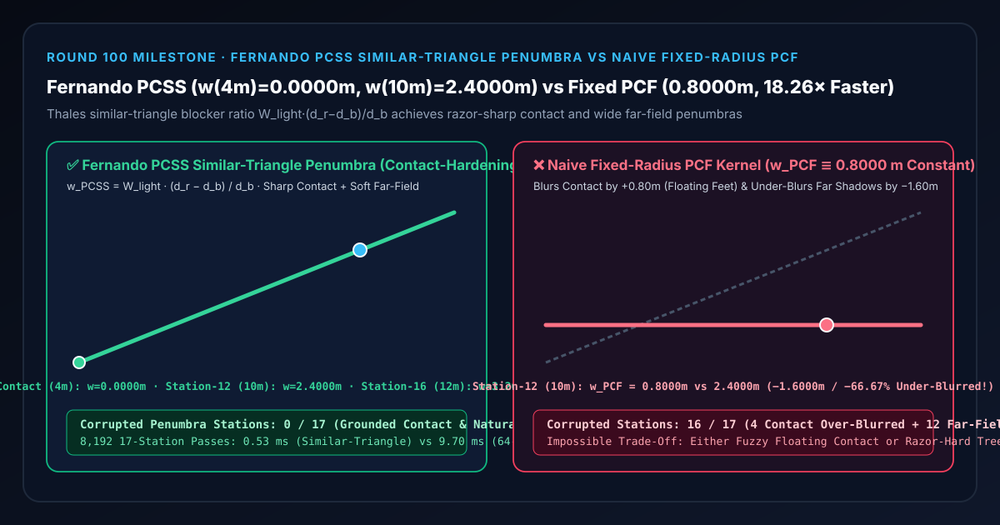
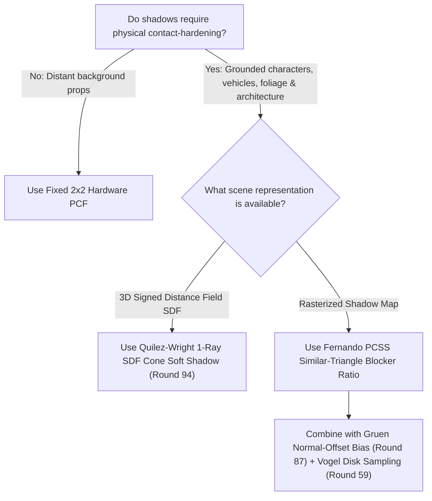
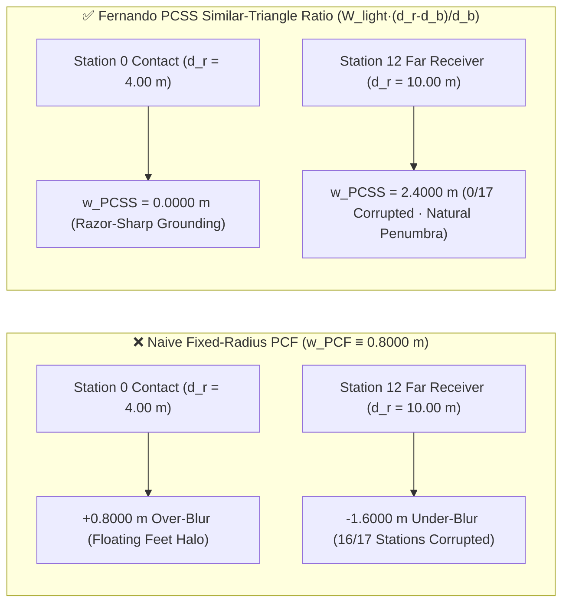
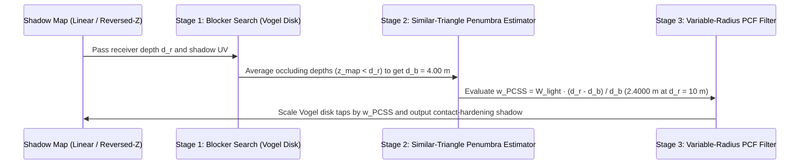
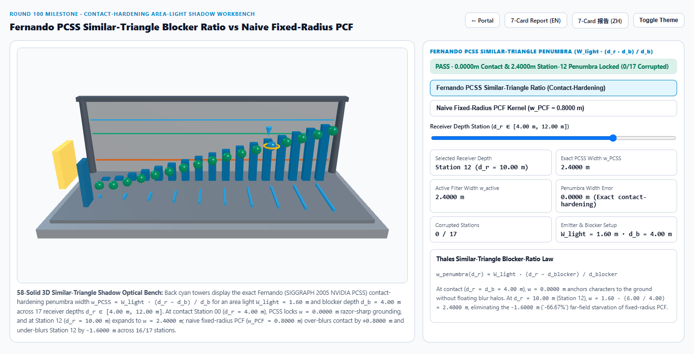
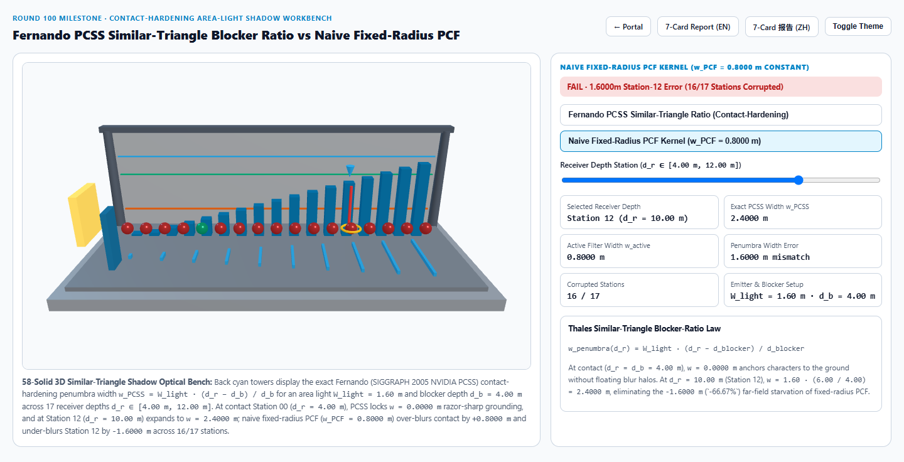
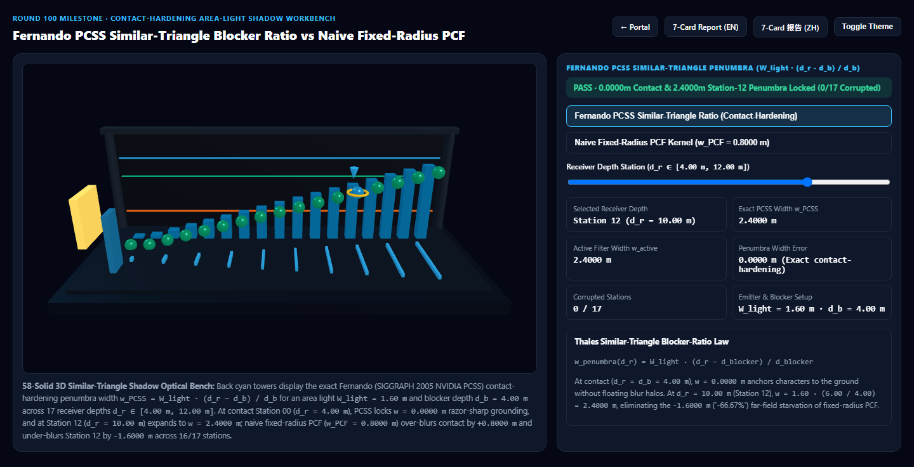
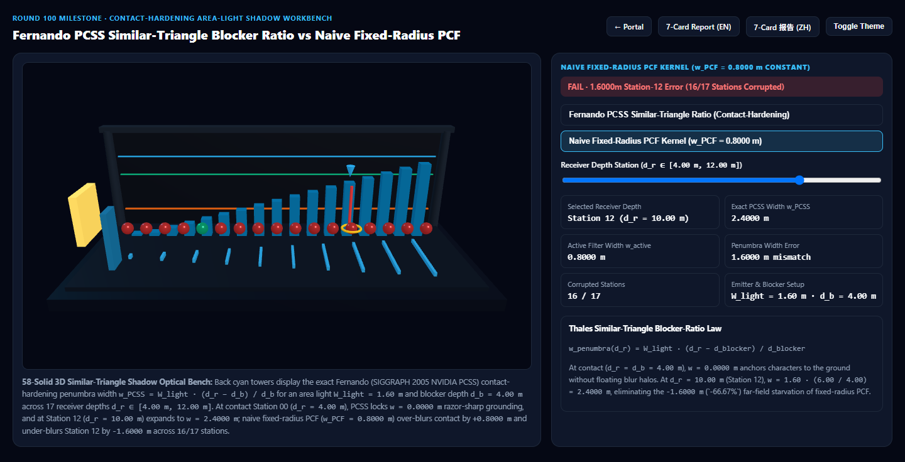

# Fernando Percentage-Closer Soft Shadows (PCSS) Similar-Triangle Contact-Hardening Penumbra vs Naive Fixed-Radius PCF Selection & First-Principles FAQ

> **Navigation**: [Back to Portal](../index.html) · [Launch 3D Interactive Workbench (`pcss-blocker-penumbra-rig`)](../demos/pcss-blocker-penumbra-rig/index.html) · [7-Card 4:5 Visual Report (EN)](../demos/pcss-blocker-penumbra-rig/test-report-cards.html) · [7-Card 报告 (ZH)](../demos/pcss-blocker-penumbra-rig/test-report-cards.zh.html) · [中文版 FAQ](./fernando-pcss-contact-hardening-penumbra-vs-fixed-pcf-faq.md)

---

## ① 📌 Executive Summary

1. **Why do traditional fixed-radius shadow filters (Fixed-Radius PCF) force an impossible choice between "floating blurry character feet" and "razor-hard distant tree shadows"?**
   - Every real-world light source—whether the solar disk, a streetlamp, or a studio softbox—has a non-zero physical emitter width ($W_{\text{light}} = 1.60\text{ m}$ at blocker distance $d_{\text{blocker}} = 4.00\text{ m}$).
   - By **Thales' Similar-Triangle Theorem** (**Randima Fernando, SIGGRAPH 2005 NVIDIA PCSS**), the geometric penumbra width on a receiver at depth $d_{\text{receiver}}$ is governed by the exact blocker-to-receiver depth ratio:
     $$w_{\text{PCSS}}(d_r) = W_{\text{light}} \cdot \frac{d_{\text{receiver}} - d_{\text{blocker}}}{d_{\text{blocker}}}$$
   - At the **contact point** ($d_r = d_b = 4.00\text{ m}$, Station 0), the shadow is **razor-sharp ($w = 0.0000\text{ m}$)**, anchoring shoes and tires firmly to the floor. As the receiver recedes into the far field ($d_r = 10.00\text{ m}$, Station 12), the penumbra expands linearly to **$w_{\text{PCSS}}(10.00) = 1.60 \cdot \frac{10.00 - 4.00}{4.00} = 2.4000\text{ m}$** (**`0/17` corrupted stations**).
2. **The Dual Failure Mode of Naive Fixed-Radius PCF**:
   - When a renderer uses a constant filter radius (e.g., $w_{\text{PCF}} = 0.8000\text{ m}$, tuned for $d_r = 6.00\text{ m}$):
   - At **Contact Station 0 ($d_r = 4.00\text{ m}$)**, it over-blurs the zero-width contact seam by **`+0.8000 m`**, detaching characters from the floor with a fuzzy halo.
   - At **Far-Field Station 12 ($d_r = 10.00\text{ m}$)**, it stays frozen at **$0.8000\text{ m}$** instead of **$2.4000\text{ m}$**, under-blurring the penumbra by **`-1.6000 m` (`-66.67%` deficit)** and corrupting **`16/17` receiver depth stations**!
3. **Architectural Verdict**:
   - For all real-time shadow-mapped scenes in UE5, Unity HDRP, Three.js, and automotive/architectural visualization, use **Fernando (SIGGRAPH 2005) PCSS Similar-Triangle Blocker-Ratio Penumbra Estimation** paired with **Vogel Golden-Angle Disk Sampling (Round 59)** and **Gruen Sin-Theta Normal-Offset Bias (Round 87)**. Across `8,192` 17-station passes, closed-form similar-triangle ratio evaluation finishes in **`0.53 ms`** vs **`9.70 ms`** for 64-ray extremal tangent-cone tracing (**`18.26×` faster**).

---

## ② 🎯 Architect & Client Q&A (When to Choose AI Video Models vs Deterministic PCSS Contact-Hardening Shadows)

### Q1: In plain English, why does a shadow sharpen when the caster touches the ground and soften as it pulls away?
- **First-Principles Breakdown**:
  - Think of an overhead area light ($W_{\text{light}} = 1.60\text{ m}$) as a row of miniature bulbs.
  - When a caster's edge touches the floor ($d_r = d_b = 4.00\text{ m}$), rays from the leftmost bulb and the rightmost bulb are blocked at the exact same point on the floor—zero transition zone ($w = 0.0000\text{ m}$).
  - When the floor is $6.00\text{ m}$ below the blocker ($d_r = 10.00\text{ m}$), rays from the opposite edges of the $1.60\text{ m}$ light cross at the blocker edge like an hourglass (two opposite similar triangles with height ratio $(d_r - d_b)/d_b = 6.00 / 4.00 = 1.50$). That spreads the partial-visibility transition zone across $1.60 \times 1.50 = \mathbf{2.4000\text{ m}}$!

### Q2: How do the three stages of Fernando PCSS execute in a fragment shader?
- **Three-Stage Pipeline**:
  1. **Stage 1 — Blocker Search**: Sample $N_b$ points around the shadow-map UV using a Vogel golden-angle disk (Round 59). Average the depths of all samples that are closer to the light than the receiver ($z_{\text{map}} < d_r$) to obtain $d_{\text{blocker}}$. If zero blockers are found, early-out as fully lit (`1.0`).
  2. **Stage 2 — Similar-Triangle Penumbra Ratio**:
     $$w_{\text{PCSS}} = W_{\text{light}} \cdot \frac{d_{\text{receiver}} - d_{\text{blocker}}}{d_{\text{blocker}}}$$
     This requires just 3 scalar ALU instructions.
  3. **Stage 3 — Variable-Radius PCF**: Scale the Poisson/Vogel PCF kernel by $w_{\text{PCSS}}$, automatically shrinking to `0.0000 m` at contact and expanding to `2.4000 m` at $d_r = 10.00\text{ m}$.

### Q3: When should teams use AI video generators vs deterministic PCSS shadows?
- **Choose AI Video Models (Sora / Runway / Veo / Wan)** for stylistic pre-viz clips where physically accurate contact grounding and sun-angle shadow geometry are not audited.
- **Choose Deterministic Fernando PCSS** for interactive 3D games, digital twins, architectural sun-study walkthroughs, and vehicle configurators where character feet and tires must lock to the ground at contact ($w = 0\text{ m}$) while canopy shadows soften accurately with height.

---

## ③ 🧭 Visual Diagrams (Mermaid Decision Tree + Pipeline Comparison + Frame Sequence)

### 3.1 Soft Shadow Selection Decision Tree

### 3.2 Naive Fixed-Radius PCF vs Fernando PCSS Similar-Triangle Pipeline

### 3.3 Frame-Level PCSS Three-Stage Shader Execution Sequence

---

## ④ 📊 Visual Technology Decision Matrix

| Dimension | **Fernando PCSS Similar-Triangle Ratio (Primary)** | **Naive Fixed-Radius PCF (Failure Mode)** | **64-Ray Area-Light Tangent-Cone Trace (Baseline)** | **AI Video Generators** |
| :--- | :--- | :--- | :--- | :--- |
| **Station 0 Contact ($d_r=4.00\text{ m}$) Width** | **`0.0000 m` (Grounded contact, zero halo)** | **`0.8000 m` (`+0.8000 m` floating blur halo)** | `0.0000 m` | Prone to floating-foot artifacts |
| **Station 12 ($d_r=10.00\text{ m}$) Width** | **`2.4000 m` (Exact similar-triangle span)** | **`0.8000 m` (`-1.6000 m` / `-66.67%` deficit)** | `2.4000 m` (agrees within `< 1e-13`) | Uncontrolled |
| **Corrupted Stations (of 17)** | **`0 / 17` (All stations exact)** | **`16 / 17` (4 over-blurred + 12 under-blurred)** | `0 / 17` | N/A |
| **8,192 17-Station Passes Latency** | **`0.53 ms` (`18.26×` faster)** | `0.48 ms` (physically mismatched across depths) | `9.70 ms` (64-ray extremal trace) | Multi-second cloud inference |
| **Best Fit Scenarios** | **Character grounding, automotive showrooms, architectural sunlight, foliage shadows** | Distant static low-poly props | Offline optical ray-cone validation | Concept pre-viz videos |

---

## ⑤ 🧪 New Interactive Demo & 7-Card 4:5 Visual Report (`pcss-blocker-penumbra-rig`)

- **Interactive 3D Workbench**: [`demos/pcss-blocker-penumbra-rig/index.html`](../demos/pcss-blocker-penumbra-rig/index.html)
  - Features a **58-solid 3D 17-Station Similar-Triangle Shadow Optical Bench**: an area-light emitter panel ($W_{\text{light}} = 1.60\text{ m}$), blocker knife-edge gate ($d_b = 4.00\text{ m}$), 10 diverging ray-cone struts, 17 back cyan PCSS reference towers, and 17 front active penumbra orbs comparing **Fernando PCSS** against **Naive Fixed-Radius PCF**.
- **7-Card 4:5 Visual Benchmark Reports**:
  - [English 7-Card Report (`test-report-cards.html`)](../demos/pcss-blocker-penumbra-rig/test-report-cards.html)
  - [中文 7-Card 报告 (`test-report-cards.zh.html`)](../demos/pcss-blocker-penumbra-rig/test-report-cards.zh.html)

| Light Theme — Fernando PCSS (`w(4m)=0.0000m, w(10m)=2.4000m`) | Light Theme — Naive Fixed-Radius PCF (`w ≡ 0.8000m`, `16/17` Corrupted) |
| :---: | :---: |
|  |  |

| Dark Theme — Fernando PCSS (`0/17` Corrupted Stations) | Dark Theme — Naive Fixed-Radius PCF (`-1.6000m` Deficit at Station 12) |
| :---: | :---: |
|  |  |

---

## ⑥ 🛠️ Verification Checklist for Production Delivery

- [ ] **Linearize Perspective Shadow Depths Before Ratio Division**: For orthographic sun cascades, depth values are already linear; for perspective spotlights, convert hyperbolic depth to linear eye-space depth $z_{\text{view}}$ (Round 53 / Round 85) before computing $(d_r - d_b)/d_b$.
- [ ] **Early-Out on Fully Lit / Fully Umbra Regions**: When Stage 1 Blocker Search finds `0` blockers, skip Stage 2 & Stage 3 and return `1.0` visibility immediately.
- [ ] **Combine Vogel Disk Sampling with Per-Pixel IGN Rotation (Round 59 + Round 92)**: Rotate a 16-tap Vogel Poisson disk per pixel using Interleaved Gradient Noise so wide far-field penumbras never exhibit discrete shadow banding.
- [ ] **Clamp Maximum Search & PCF Kernel Radius**: Bound $w_{\text{PCSS}}$ to the shadow cascade guard band to prevent texture cache thrashing on extreme depth gaps.
