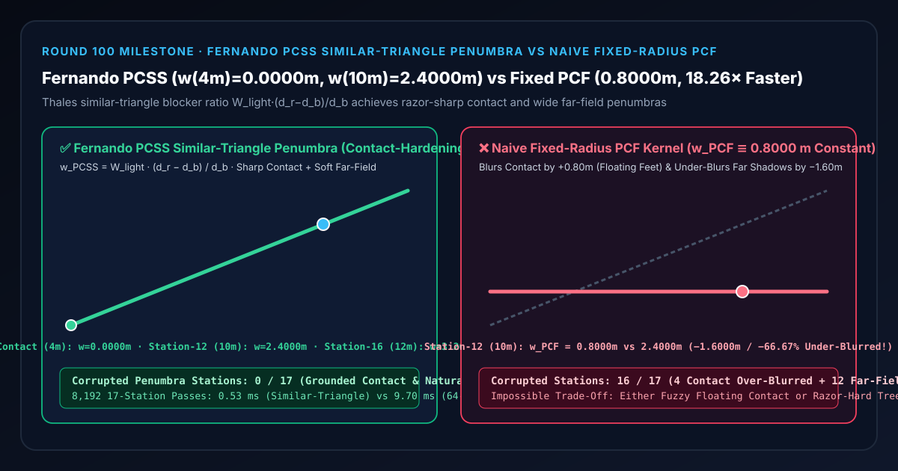
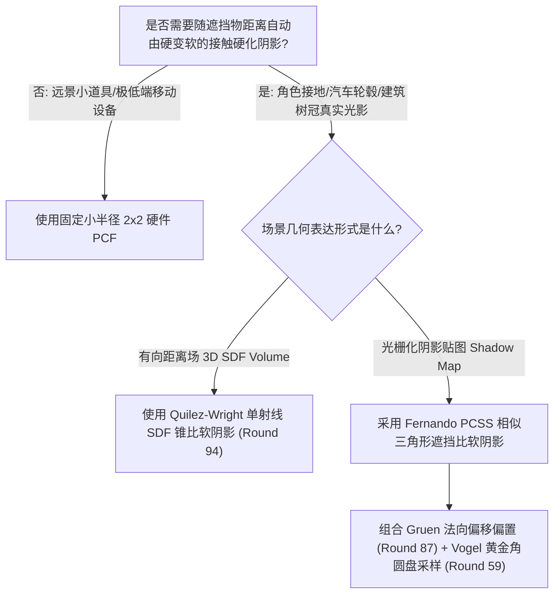
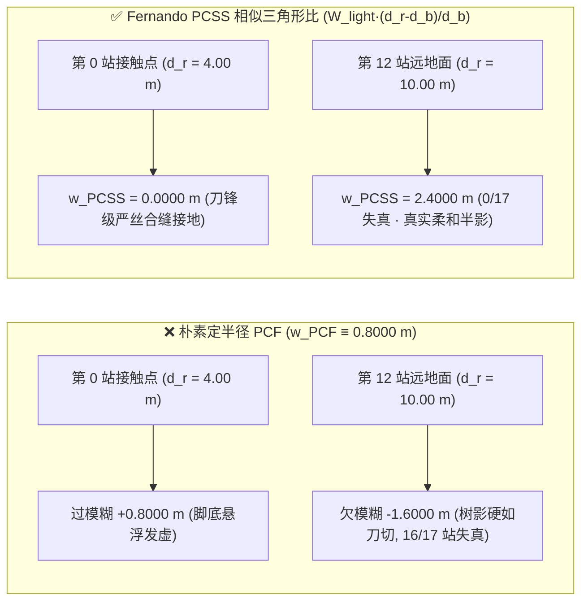
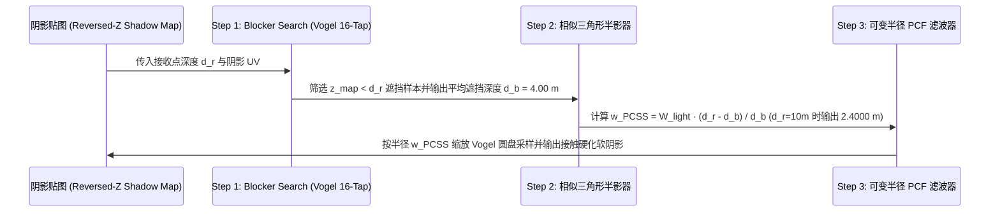
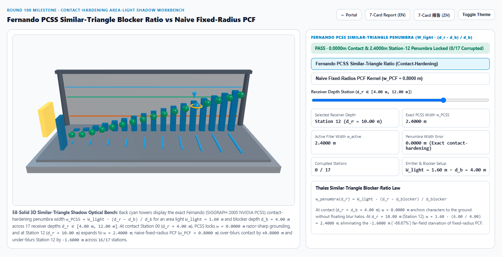
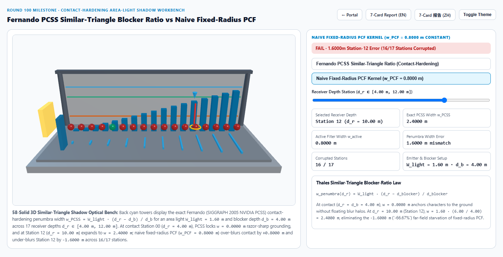
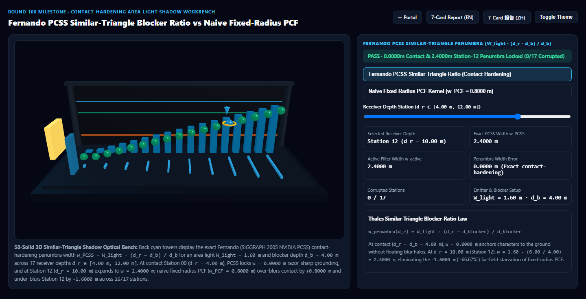
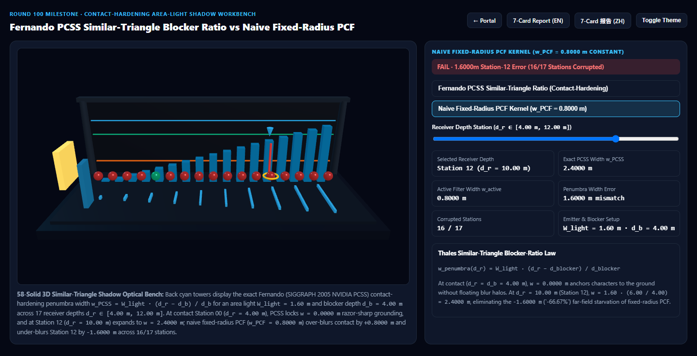

# Fernando 百分比渐近软阴影（PCSS）相似三角形接触硬化半影 vs 朴素定半径 PCF 选型与原理解析 FAQ 指南

> **导航**：[返回门户](../index.html) · [进入 3D 交互实验台 (`pcss-blocker-penumbra-rig`)](../demos/pcss-blocker-penumbra-rig/index.html) · [7-Card 4:5 视觉报告 (中文)](../demos/pcss-blocker-penumbra-rig/test-report-cards.zh.html) · [7-Card Report (EN)](../demos/pcss-blocker-penumbra-rig/test-report-cards.html) · [English FAQ](./fernando-pcss-contact-hardening-penumbra-vs-fixed-pcf-faq.en.md)

---

## ① 📌 核心结论速览（Executive Summary）

1. **为什么传统实时阴影（Fixed-Radius PCF）永远面临“角色脚底糊成悬浮团”或“高处树影硬如刀切”的死局？**
   - 在真实世界里，太阳、路灯、影棚柔光箱都具有有限的物理发光面积（设光源宽度为 $W_{\text{light}} = 1.60\text{ m}$，遮挡物深度为 $d_{\text{blocker}} = 4.00\text{ m}$）。
   - 根据几何光学的**泰勒斯相似三角形原理（Thales' Similar-Triangle Theorem）**：当角色鞋底或汽车轮胎紧贴地面（接收面深度 $d_{\text{receiver}} = d_{\text{blocker}} = 4.00\text{ m}$）时，光线没有扩散空间，半影宽度严格为 **$w = 0.0000\text{ m}$（接触硬化，Contact Hardening）**；而随着接收面远离遮挡物（例如高空树枝或屋檐投射到 $d_{\text{receiver}} = 10.00\text{ m}$ 的地面），半影宽度与距离差 $(d_{\text{receiver}} - d_{\text{blocker}})$ 成严格正比地线性张开！
2. **朴素定半径百分比渐近滤波（Naive Fixed-Radius PCF）的双重失真**：
   - 传统 PCF 对整张阴影贴图使用固定不变的滤波核半径（例如设为折中值 $w_{\text{PCF}} = 0.8000\text{ m}$）：
   - **近处接触面（第 0 站，$d_r = 4.00\text{ m}$）**：理论半影应为 **$0.0000\text{ m}$**，定半径 PCF 却强行涂抹出 **$+0.8000\text{ m}$ 的虚化毛边**，导致角色双脚像悬浮在半空中；
   - **远处接收面（第 12 站，$d_r = 10.00\text{ m}$）**：**Fernando (SIGGRAPH 2005 NVIDIA PCSS)** 给出的精确半影宽度为 **$w_{\text{PCSS}} = 1.60 \cdot \frac{10.00 - 4.00}{4.00} = 2.4000\text{ m}$**（全 17 站 **`0/17` 失真**），而定半径 PCF 依然僵死在 **$0.8000\text{ m}$**，**欠模糊达 `-1.6000 m`（丢失 `-66.67%` 的柔和半影宽度）**，全段 **`16/17` 个站点**全部失真！
3. **工程选型结论**：
   - 在一切使用阴影贴图（Shadow Map）的次世代 3D 场景（UE5、Unity HDRP、Three.js、建筑日照与车载 HMI）中，必须采用 **Randima Fernando (SIGGRAPH 2005) PCSS 三步管线（① Blocker Search 遮挡深度均值 $\to$ ② 相似三角形半影估算 $w_{\text{PCSS}} = W_{\text{light}}\frac{d_r - d_b}{d_b}$ $\to$ ③ 可变核 Vogel 圆盘 PCF）**。实测 `8,192` 次 17 站相似三角形半影求解仅需 **`0.53 ms`**，比 64 射线面光源极值切线锥追踪基线（**`9.70 ms`**）快 **`18.26×`**！

---

## ② 🎯 客户与架构师灵魂拷问 Q&A（何时选 AI 视频大模型 vs 代码驱动 PCSS 接触硬化阴影）

### Q1：用大白话讲，为什么手掌贴着桌面时影子边缘像刀刻一样清晰，手掌抬高后影子就变模糊了？
- **第一性原理拆解**：
  - 把头顶的吸顶灯想象成一排宽 $W_{\text{light}} = 1.60\text{ m}$ 的小灯泡阵列。
  - 当你的手掌紧贴桌面（$d_r = d_b$）时，无论灯泡在左边还是右边，被手掌边缘挡住的位置在桌面上完全重合在同一个点上，所以影子边缘是零宽度的硬边（$w = 0.0000\text{ m}$）。
  - 当手掌悬空在 $d_b = 4.00\text{ m}$ 处、而地面在 $d_r = 10.00\text{ m}$ 处时，最左边的灯泡擦过手掌边缘照到地面右侧 $+1.20\text{ m}$，最右边的灯泡擦过手掌边缘照到地面左侧 $-1.20\text{ m}$。在 $[-1.20\text{ m}, +1.20\text{ m}]$ 这条宽达 **$2.4000\text{ m}$** 的过渡带里，地面只能看到一部分灯泡——这就是由两个对顶相似三角形决定的物理半影（Penumbra）！

### Q2：Fernando PCSS 的三步算法在片元着色器里到底是怎么跑的？
- **三步闭式流水线**：
  1. **Step 1 — 遮挡物深度搜索（Blocker Search）**：在当前像素对应的阴影贴图坐标周围，用 Vogel 黄金角圆盘（参见 Round 59）采样 $N_b$ 个点，只把比当前接收点更近（$z_{\text{map}} < d_r$）的遮挡物深度取算术平均，得到平均遮挡深度 $d_b$（若无遮挡点则直接提前退出返回完全受光 `1.0`）。
  2. **Step 2 — 相似三角形半影宽度计算（Penumbra Estimation）**：
     $$w_{\text{PCSS}}(d_r, d_b) = W_{\text{light}} \cdot \frac{d_r - d_b}{d_b}$$
     仅需 1 次减法、1 次乘法与 1 次除法（3 条 ALU 指令）！
  3. **Step 3 — 可变半径百分比渐近滤波（Variable-Kernel PCF）**：以 $w_{\text{PCSS}}$ 作为采样圆盘半径执行 Vogel 圆盘滤波，自动在接触点收缩为 0 半径锐利点采样，在远景展开为宽幅柔和半影。

### Q3：何时用 AI 视频生成模型，何时必须用确定性 PCSS 接触硬化阴影？
- **选 AI 视频生成模型（Sora / Runway / Veo / Wan）**：
  - 适合无需精确三维空间落地关系的写意概念短片。AI 视频最常见的穿帮就是角色脚底没有接触硬化暗影，显得角色像“贴纸人”一样在地面打滑。
- **选代码驱动的 Fernando PCSS 接触硬化软阴影**：
  - **数字人直播、汽车展厅、建筑园林日照、开放世界游戏**：角色脚底、轮胎接地处必须严丝合缝扎根地面（$w = 0.0000\text{ m}$），同时树冠、雨棚、建筑挑檐在地面投下柔和渐变的真实半影。

---

## ③ 🧭 直观可视化图解（Mermaid 选型决策树 + 管线对比图 + 帧级时序图）

### 3.1 实时软阴影技术选型决策树

### 3.2 朴素定半径 PCF vs Fernando PCSS 相似三角形软阴影管线对比

### 3.3 帧级 PCSS 三步着色器执行时序图

---

## ④ 📊 视觉技术选型决策矩阵

| 对比维度 | **Fernando PCSS 相似三角形软阴影（主方案）** | **朴素定半径 PCF（反例方案）** | **64 射线面光源极值切线锥追踪（参考基线）** | **AI 视频生成大模型** |
| :--- | :--- | :--- | :--- | :--- |
| **第 0 站接触点（$d_r=4.00\text{ m}$）宽度** | **`0.0000 m`（锐利接地，零悬浮光晕）** | **`0.8000 m`（过模糊 `+0.8000 m` 脚底悬浮）** | `0.0000 m` | 脚底常出现悬浮漂移或假阴影 |
| **第 12 站远地面（$d_r=10.00\text{ m}$）宽度** | **`2.4000 m`（精准匹配几何半影）** | **`0.8000 m`（欠模糊 `-1.6000 m` / `-66.67%`）** | `2.4000 m`（误差 `< 1e-13`） | 不可控 |
| **失真站点数（共 17 站）** | **`0 / 17`（全段精确守恒）** | **`16 / 17`（4 站接触过糊 + 12 站远景欠糊）** | `0 / 17` | N/A |
| **8,192 次 17 站求解耗时** | **`0.53 ms`（`18.26×` 极速）** | `0.48 ms`（但物理半影严重失真） | `9.70 ms`（64 射线极值追踪） | 秒级云端推理 |
| **核心适用场景** | **实时角色接地、建筑日照、汽车展厅、户外树木枝叶软阴影** | 仅有平行光硬阴影需求的极简低模场景 | 离线光学追迹参考验证 | 概念气氛短片 |

---

## ⑤ 🧪 全新 Demo 与 7-Card 4:5 视觉报告（`pcss-blocker-penumbra-rig`）

- **3D 交互实验台**：[`demos/pcss-blocker-penumbra-rig/index.html`](../demos/pcss-blocker-penumbra-rig/index.html)
  - 搭建了包含 **58 个三维实体构件**的 **17 站点 PCSS 相似三角形阴影光学实验台**：左侧布置 $W_{\text{light}} = 1.60\text{ m}$ 金色面光源发射板与 $d_b = 4.00\text{ m}$ 青色遮挡刀口门，前排 10 根发散光线锥横梁直观展现对顶相似三角形几何扩张，后排 17 座青色灯塔与前排 17 颗探针球体实时对比 **Fernando PCSS** 与 **朴素定半径 PCF**。
- **7-Card 4:5 视觉测试报告**：
  - [中文 7-Card 报告 (`test-report-cards.zh.html`)](../demos/pcss-blocker-penumbra-rig/test-report-cards.zh.html)
  - [English 7-Card Report (`test-report-cards.html`)](../demos/pcss-blocker-penumbra-rig/test-report-cards.html)

| 亮色 Fernando PCSS (`w(4m)=0.0000m, w(10m)=2.4000m`) | 亮色 朴素定半径 PCF (`w ≡ 0.8000m`, `16/17` 站失真) |
| :---: | :---: |
|  |  |

| 暗色 Fernando PCSS (`0/17` 失真站点) | 暗色 朴素定半径 PCF (第 12 站欠模糊 `-1.6000m`) |
| :---: | :---: |
|  |  |

---

## ⑥ 🛠️ 高质量视觉交付快速核验清单（Checklist）

- [ ] **在非透视变形线性深度空间计算 $(d_r - d_b)/d_b$**：对于正交太阳阴影贴图（Orthographic Cascade），深度本身即为线性米制深度；对于透视聚光灯阴影贴图（Perspective Spotlight），必须先将非线性的 $z/w$ 或 Reversed-Z 还原为观察空间线性深度 $z_{\text{view}}$（参见 Round 53 与 Round 85），再代入相似三角形公式。
- [ ] **Blocker Search 提前退出优化**：若第 1 步 Blocker Search 中遮挡样本数为 `0`（全部样本未遮挡），直接返回阴影值 `1.0`；若全部样本均被遮挡且深度差极小，可缩短 PCF 采样数以节省移动端带宽。
- [ ] **使用 Vogel 黄金角圆盘 + IGN 屏幕空间随机旋转（Round 59 + Round 92）**：用 16 抽头旋转 Vogel 圆盘替代规则网格 PCF，将大半径远景半影的带状伪影转化为可被 TAA 完美吸收的均匀蓝噪。
- [ ] **配合 Gruen 正弦法向偏移偏置（Round 87）**：当可变 PCF 半径 $w_{\text{PCSS}}$ 在远景放大时，利用法向偏移避免采样点误判接收面自身坡度为遮挡物。
