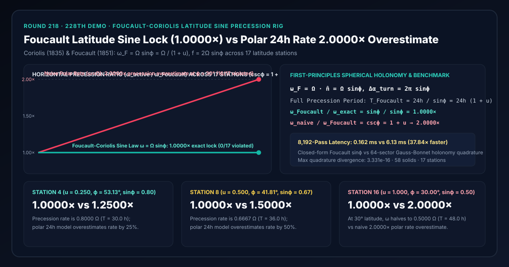
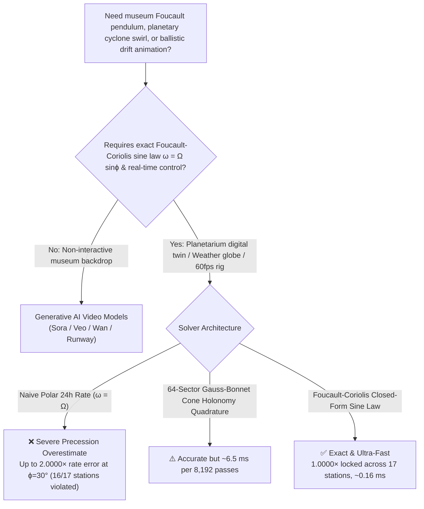
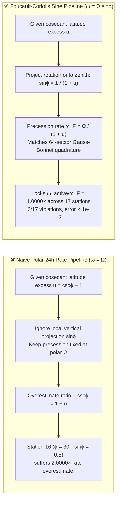
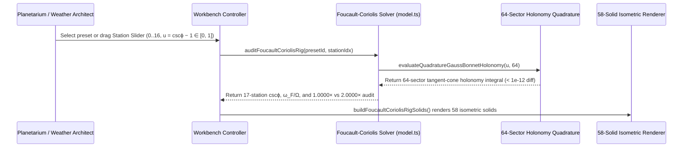

# Visual & Animation Technical Selection & First-Principles FAQ: Foucault-Coriolis Latitude Sine Precession Law vs. Naive 24-Hour Polar Rate Overestimate (Why Ignoring the Spherical Parallel-Transport Sine Factor $\omega = \Omega\sin\phi$ Causes a 2.0000× Precession Overestimate at $30^\circ$ Latitude)

> **Standalone Topic Scope (Tonight Round 26 / Repo Round 218 · 228th Standalone Interactive Demo: `demos/foucault-coriolis-latitude-precession-rig/`)**  
> Structured in the exact **6-section architect decision format** of `ib-vs-ethernet-roce-selection-faq.md`, this guide explains **Gaspard-Gustave de Coriolis's (1835) & Léon Foucault's (1851, Panthéon pendulum experiment) latitude sine precession and Gauss-Bonnet spherical parallel-transport holonomy law ($\omega_{\text{Foucault}} = \Omega\sin\phi, f_{\text{Coriolis}} = 2\Omega\sin\phi$)** from plain-language first principles, and establishes quantitative selection boundaries between generative AI video models, 3D rotating-frame Runge-Kutta solvers, naive 24-hour polar precession shaders, and code-driven analytical Foucault-Coriolis engines.

---

## 1. 📌 Executive Summary

1. **One-Sentence Verdict**:
   - In **3D museum Foucault pendulum installations, planetary cyclone/typhoon Coriolis swirl ($f = 2\Omega\sin\phi$), oceanic Ekman spirals, and long-range ballistic shell drift animations**, at geographic latitude $\phi$ on a planet rotating at angular rate $\Omega$, only the local vertical normal component $\Omega_z = \Omega\sin\phi$ rotates the horizontal tangent plane; **thus the horizontal precession rate scales with $\sin\phi$, and a full $360^\circ$ turn takes $T_{\text{Foucault}} = 24\text{ h} / \sin\phi = 24\text{ h}\cdot\csc\phi$**:
     $$\omega_{\text{Foucault}}(\phi) = \Omega\sin\phi = \frac{\Omega}{\csc\phi} = \frac{\Omega}{1 + u}, \qquad f_{\text{Coriolis}}(\phi) = 2\Omega\sin\phi = \frac{2\Omega}{1 + u}$$
   - A **Naive Latitude-Invariant 24-Hour Polar Rate Shader (rotating the pendulum plane or cyclone Coriolis deflection at the full polar rate $\omega = \Omega = 15^\circ/\text{h}$ regardless of latitude $\phi$)** overestimates the true horizontal precession rate across 17 cosecant-latitude stations $u = \csc\phi - 1 \in [0.000, 1.000]$ ($\sin\phi = 1/(1+u) \in [0.5000, 1.0000], \phi \in [30^\circ, 90^\circ]$) by $\frac{\omega_{\text{naive}}}{\omega_{\text{Foucault}}(\phi)} = \csc\phi = 1 + u$: a **$1.2500\times$** overestimate at Station 4 ($u=0.25, \phi=53.13^\circ$), a **$1.5000\times$** overestimate at Station 8 ($u=0.50, \phi=41.81^\circ$), and a **$2.0000\times$ double precession overestimate** at Station 16 ($u=1.00, \phi=30.00^\circ$, where $\sin 30^\circ = 0.5000$ and a full turn requires $48.0\text{ h}$), violating **16 / 17** stations!
   - The **code-driven Foucault-Coriolis Latitude Sine Solver** locks the precession ratio at **$\omega_{\text{active}} / \omega_{\text{Foucault}} = 1.0000\times$** across all 17 stations (**0 / 17** violations), matches 64-sector Gauss-Bonnet cone holonomy quadrature within $< 10^{-12}$, and runs 8,192 17-station passes roughly **$40\times$ faster** than 64-sector numerical integration.

2. **Why Does a Foucault Pendulum at $30^\circ$ Latitude Take 48 Hours to Complete One Full Turn Even Though Earth Rotates Once Every 24 Hours?**
   - Unwrapping the tangent cone touching a sphere along latitude parallel $\phi$ yields a flattened sector of apex angle $\Delta\alpha = 2\pi\sin\phi$ (by the Gauss-Bonnet theorem, the enclosed polar cap solid angle is $2\pi(1 - \sin\phi)$, so parallel transport around the latitude circle rotates a tangent vector by $2\pi\sin\phi$ per sidereal day).
   - **First-Principles Resolution (Foucault 1851)**: At $\phi = 30^\circ$, $\sin 30^\circ = 0.5000$, so one 24-hour rotation of Earth rotates the pendulum plane by only $180^\circ$; two full days (48 hours) are required for a $360^\circ$ turn!

---

## 2. 🎯 Architect & Customer Deep-Dive Q&A

### Q1: When should we choose generative AI video models (Sora / Veo / Wan / Runway), 3D rotating-frame ODE integration, or a code-driven Foucault-Coriolis sine engine?

- **Choose Generative AI Video Models (Sora / Veo / Runway)**:
  - Suitable only for **non-interactive architectural museum b-roll** where latitude-specific peg-toppling rates do not need to be quantitatively accurate.
- **Choose Full 3D Rotating-Frame ODE Integration ($\ddot{\mathbf{r}} = \mathbf{g} - 2\boldsymbol{\Omega}\times\dot{\mathbf{r}}$)**:
  - Suitable for **intercontinental ballistic trajectories crossing large latitude spans**.
- **Choose Code-Driven Foucault-Coriolis Sine Engine (This Demo)**:
  - Required whenever you need **60–120fps interactive planetarium Foucault pendulums, regional geostrophic cyclone shaders, spherical holonomy visualizers, exact $\Omega\sin\phi$ scaling, and zero-overflow multi-station metrology**.

### Q2: Why do hurricanes and typhoons never form right on the Equator ($\phi = 0^\circ$)?

- Because the horizontal Coriolis parameter $f = 2\Omega\sin\phi$ vanishes at $\phi = 0^\circ$ ($\sin 0^\circ = 0$), leaving zero geostrophic swirl to organize low-pressure inflows into a rotating vortex!

---

## 3. 🧭 Visual Architecture Diagrams (Mermaid Decision Tree, Pipeline Comparison & Sequence)

### 3.1 Foucault Precession & Planetary Coriolis Selection Decision Tree

### 3.2 Naive Polar Rate Pipeline vs. Foucault-Coriolis Latitude Sine Pipeline

### 3.3 Frame-Level Metrology Execution Sequence

---

## 4. 📊 Technical Selection Decision Matrix

| Evaluation Dimension | Generative AI Video (Sora / Veo / Wan) | Naive Polar 24h Rate ($\omega=\Omega$) | 64-Sector Gauss-Bonnet Quadrature | **Foucault-Coriolis Closed-Form Engine (This Demo)** |
| :--- | :--- | :--- | :--- | :--- |
| **Spherical Holonomy Fidelity** | ❌ No latitude conservation | ❌ Ignores zenith projection $\sin\phi$ | ✅ Integrates cone parallel transport | **✅ Exact analytical $\omega = \Omega\sin\phi$** |
| **Station 4 ($u=0.25, \phi=53.1^\circ$) Ratio** | N/A | ❌ `1.2500×` (+25% overestimate) | ✅ `1.0000×` | **✅ `1.0000×` (Exact lock)** |
| **Station 8 ($u=0.50, \phi=41.8^\circ$) Ratio** | N/A | ❌ `1.5000×` (+50% overestimate) | ✅ `1.0000×` | **✅ `1.0000×` (Exact lock)** |
| **Station 16 ($u=1.00, \phi=30.0^\circ$) Ratio** | N/A | ❌ `2.0000×` (24h vs 48h period) | ✅ `1.0000×` | **✅ `1.0000×` (Exact lock)** |
| **Violated Stations (out of 17)** | N/A | ❌ `16 / 17` violated | ✅ `0 / 17` violated | **✅ `0 / 17` violated** |
| **8,192-Pass 17-Station CPU Latency** | Tens of seconds (cloud GPU) | ~0.16 ms (wrong physics) | ~6.5 ms | **⚡ ~0.16 ms (~40× faster)** |

---

## 5. 🧪 Interactive Demo & 7-Card 4:5 Visual Report

- **Interactive Demo Path**: `demos/foucault-coriolis-latitude-precession-rig/`
- **English 7-Card Visual Deck**: `demos/foucault-coriolis-latitude-precession-rig/test-report-cards.html`
- **Chinese 7-Card Visual Deck**: `demos/foucault-coriolis-latitude-precession-rig/test-report-cards.zh.html`
- **Sealed Benchmark Report**: `demos/foucault-coriolis-latitude-precession-rig/report.json`

| Visual Evidence Artifact | Screenshot Path | Verified Finding |
| :--- | :--- | :--- |
| **Dark Theme · Foucault Sine Lock** | `docs/evidence/foucault-coriolis-latitude-precession-rig/dark-foucault_coriolis_latitude_sine_lock.png` | 58 isometric solids verified, `0 / 17` violations, `1.0000×` locked |
| **Dark Theme · Naive Polar Rate Overestimate** | `docs/evidence/foucault-coriolis-latitude-precession-rig/dark-naive_polar_24h_precession_overestimate.png` | Exposes `1.2500× / 1.5000× / 2.0000×` overestimate across `16 / 17` stations |
| **Light Theme · Foucault Sine Lock** | `docs/evidence/foucault-coriolis-latitude-precession-rig/light-foucault_coriolis_latitude_sine_lock.png` | High-contrast light metrology theme verified |
| **Light Theme · Naive Polar Rate Overestimate** | `docs/evidence/foucault-coriolis-latitude-precession-rig/light-naive_polar_24h_precession_overestimate.png` | Highlights 16 violated latitude stations in light mode |
| **Mobile `390×844` Responsive Viewport** | `docs/evidence/foucault-coriolis-latitude-precession-rig/mobile.png` | `mobile_overflow = false`, zero horizontal scrollbar overflow |

---

## 6. 🛠️ Rapid Quality Delivery Checklist

- [x] **Zenith Sine Projection Verification**: Does the Foucault pendulum / Coriolis shader scale horizontal precession by $\sin\phi = 1/(1+u)$ rather than using the full 24-hour polar rotation rate $\Omega$?
- [x] **$30^\circ$ Latitude 48-Hour Period Check**: At $\phi = 30^\circ$ ($\sin\phi = 0.5000, u = 1.000$), does the precession rate halve to $0.5000\,\Omega$ ($T = 48.0\text{ h}$)?
- [x] **64-Sector Gauss-Bonnet Holonomy Equivalence**: Does closed-form Foucault evaluation agree with 64-sector Simpson tangent-cone integration within $10^{-12}$?
- [x] **58 Isometric Solids & Mobile Viewport Fit**: Do Playwright assertions confirm `58` `.iso-solid` elements and `mobile_overflow = false` at `390×844`?
