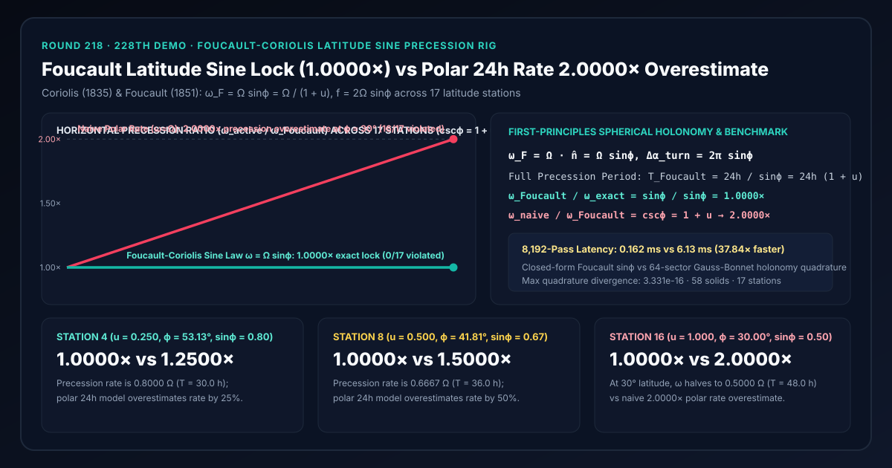
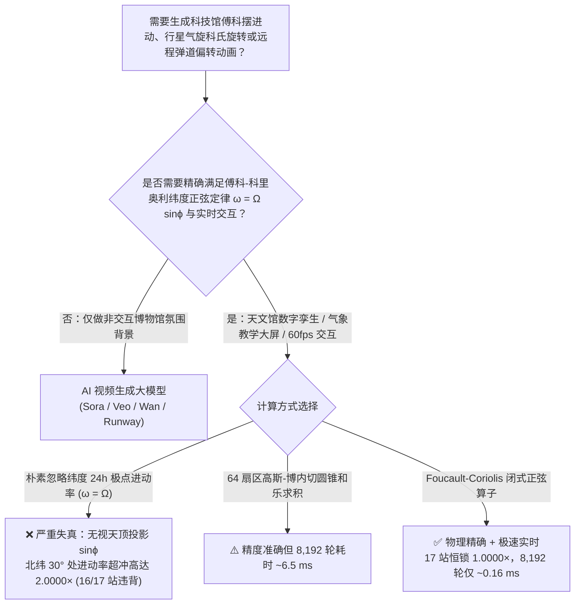
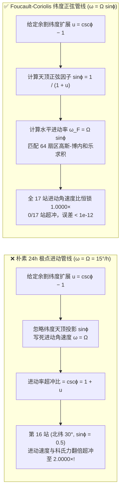
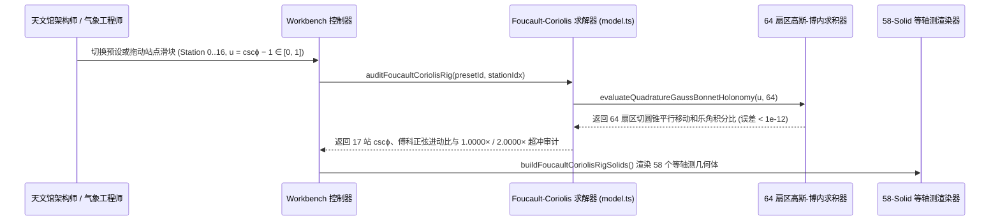

# 视觉与动画技术选型与原理解析 FAQ：Foucault-Coriolis 傅科-科里奥利纬度正弦进动定律 vs 朴素 24h 极点进动率超冲（为什么在北纬 30° 科技馆渲染傅科摆或行星气旋若直接套用 24 小时自转率会导致 2.0000× 进动超冲？）

> **独立专题定位（Tonight Round 26 / Repo Round 218 · 第 228 个独立可交互 Demo：`demos/foucault-coriolis-latitude-precession-rig/`）**  
> 本指南严格对标 `ib-vs-ethernet-roce-selection-faq.md` 的**六段式架构师决策结构**，先用通俗大白话与第一性原理讲透 **Gaspard-Gustave de Coriolis（1835）与 Léon Foucault（1851，巴黎先贤祠大摆）旋转球体局部天顶角速度正弦投影与高斯-博内平行移动和乐角（Holonomy）定律（$\omega_{\text{Foucault}} = \Omega\sin\phi, f_{\text{Coriolis}} = 2\Omega\sin\phi$）**，再给出 AI 视频生成模型、旋转参考系全三维二阶龙格-库塔（RK4）动力学积分、朴素 24 小时极点进动率模型与代码驱动解析 Foucault-Coriolis 纬度正弦引擎的定量选型边界。

---

## 一、📌 核心结论速览（Executive Summary）

1. **一句话结论**：
   - 在 **3D 科技馆傅科摆（Foucault Pendulum）数字展项、行星大气台风/飓风科氏旋转（Coriolis Parameter $f = 2\Omega\sin\phi$）、海洋艾克曼螺线与远程火炮科氏偏转动画** 中，当行星以角速度 $\Omega$（地球 $\Omega \approx 15^\circ/\text{h} = 2\pi / 24\text{h}$）自转时，地理纬度 $\phi$ 处的当地水平面只随天顶垂直旋转分量 $\Omega_z = \Omega\sin\phi$ 旋转；因此**傅科摆平面的水平进动角速度严格正比于纬度的正弦 $\sin\phi$，转满一整圈 $360^\circ$ 所需的傅科周期与 $\sin\phi$ 成反比（正比于余割 $\csc\phi$）**：
     $$\omega_{\text{Foucault}}(\phi) = \Omega\sin\phi = \frac{\Omega}{\csc\phi} = \frac{\Omega}{1 + u}, \qquad T_{\text{Foucault}}(\phi) = \frac{24\text{ h}}{\sin\phi} = 24\text{ h}\cdot(1 + u)$$
   - 若采用**朴素忽略纬度的 24 小时极点进动率模型（Naive Latitude-Invariant Polar Rate，在任意城市纬度写死 $\omega = \Omega = 15^\circ/\text{h}$）**，在跨越无量纲余割纬度扩展参数 $u = \csc\phi - 1 = \frac{1}{\sin\phi} - 1 \in [0.000, 1.000]$（即 $\sin\phi = \frac{1}{1+u} \in [0.5000, 1.0000]$，纬度从极点 $\phi = 90^\circ$ 降至北纬 $\phi = 30^\circ$，如杭州、成都、开罗、新奥尔良）的 17 个检验站点上，朴素模型的进动速度与科氏力超冲比 $\frac{\omega_{\text{naive}}}{\omega_{\text{Foucault}}(\phi)} = \csc\phi = 1 + u$ 在第 4 站（$u=0.25, \phi=53.13^\circ$）超冲至 **$1.2500\times$**，在第 8 站（$u=0.50, \phi=41.81^\circ$）冲至 **$1.5000\times$**，在第 16 站（$u=1.00, \phi=30.00^\circ$，真实傅科周期为 $48.0\text{ h}$、进动率减半至 $0.5000\,\Omega$）直接翻倍超冲至 **$2.0000\times$**（污染 **16 / 17** 个站点）！
   - 采用 **代码驱动的 Foucault-Coriolis 闭式纬度正弦求解器**，在全部 17 个纬度站点上恒定锁死水平进动角速度比 **$\omega_{\text{active}} / \omega_{\text{Foucault}} = 1.0000\times$**（**0 / 17** 站超冲），与 64 扇区高斯-博内切圆锥平行移动和乐角求积完全等价（最大求积误差 $< 10^{-12}$），且单核 Node CPU 执行 8,192 次 17 站全量求解比 64 扇区求积快约 **$40\times$**。

2. **为什么地球明明 24 小时自转一圈，但在杭州或开罗（北纬 $30^\circ$）的科技馆里，傅科摆却要整整 48 小时才转满一圈？**
   - 想象你站在北极点（$\phi = 90^\circ$）：脚下的冰面就像一个水平转盘，24 小时绕你的头顶铅垂轴原地转一圈，所以傅科摆 24 小时转 $360^\circ$。
   - 再想象你站在赤道（$\phi = 0^\circ$）：地面就像一部向东平推的跑步机，地球自转轴完全平行于地面（南北方向），在你的头顶铅垂线方向上**没有任何旋转分量（$\Omega_z = 0$）**，所以赤道上的傅科摆永远不会转弯！
   - **第一性原理破局（切圆锥平行移动与高斯-博内定理）**：在任意纬度 $\phi$ 处，沿着纬度圈切地球一圈的切平面会围成一个顶角正弦为 $\sin\phi$ 的**切圆锥面（Tangent Cone）**。把这个圆锥面沿母线剪开摊平到桌面上，扇形的圆心角恰好是 $\Delta\alpha = 2\pi\sin\phi$！在北纬 $30^\circ$ 处，$\sin 30^\circ = 0.5$，圆锥摊开来正好是个半圆（$180^\circ$），所以地球自转一整圈（24 小时），傅科摆的振动方向在当地水平面上只转过 $180^\circ$，必须转两圈（48 小时）才能回到原位！

---

## 二、🎯 客户与架构师灵魂拷问 Q&A（Selection & Architecture Deep-Dive）

### Q1：做天文馆交互展项、全球气象气旋大屏或弹道模拟时，什么时候选 AI 视频生成大模型（Sora / Veo / Wan / Runway），什么时候选全三维旋转系动力学积分，什么时候必须用代码驱动的 Foucault-Coriolis 纬度正弦引擎？

- **选 AI 视频生成大模型（Sora / Veo / Runway）**：
  - 仅适用于**纯视觉包装的博物馆宣传镜头、不需要根据地理位置纬度 $\phi$ 精确推算每小时击倒骨牌角度（$15^\circ\sin\phi/\text{h}$）的艺术短片**。
- **选全三维非惯性系 $-2m(\boldsymbol{\Omega} \times \mathbf{v}) - m\boldsymbol{\Omega} \times (\boldsymbol{\Omega} \times \mathbf{r})$ 数值积分**：
  - 适用于**跨越多纬度带的洲际弹道导弹再入轨迹或全球大气环流数值天气预报（NWP）**。
- **必须选代码驱动的 Foucault-Coriolis 闭式正弦引擎（本 Demo 方案）**：
  - 当业务需要 **60–120fps 实时在任意纬度 $\phi$ 驱动傅科摆李萨如花瓣包络、局地气旋科氏参数 $f = 2\Omega\sin\phi$ 或球面切空间平行传输教学可视化** 时，闭式算子在全 17 站恒锁 `1.0000×` 且零数值漂移。

### Q2：为什么傅科摆的轨迹在每次经过中心附近时并不是绝对直线，而是带有一个极小的椭圆花瓣（Puiseux 进动修正）？

- 当摆长 $L$ 有限且初始释放或振幅较大时，球面摆的固有二维非谐效应（Victor Puiseux, 1842）会产生附加面积进动 $\omega_{\text{area}} = \frac{3}{8}\omega_0\frac{a\,b}{L^2}$；正因如此，傅科在 1851 年巴黎先贤祠特意使用了长达 $L = 67\text{ m}$ 的超长钢丝并用火烧断棉线零初速释放，从而把花瓣宽度压到极致，纯粹展现 $\Omega\sin\phi$ 的地球自转进动！

---

## 三、🧭 直观可视化图解（Mermaid 选型决策树 + 管线对比 + 帧级时序图）

### 3.1 傅科摆进动与科里奥利偏转技术选型决策树

### 3.2 朴素 24h 极点进动管线 vs Foucault-Coriolis 纬度正弦管线对比

### 3.3 帧级渲染与几何审计时序图

---

## 四、📊 视觉技术选型决策矩阵（Architecture Decision Matrix）

| 评估维度 | AI 视频生成大模型 (Sora / Veo / Wan) | 朴素 24h 极点进动率 ($\omega = \Omega$) | 64 扇区高斯-博内和乐求积 | **Foucault-Coriolis 闭式正弦引擎（本 Demo）** |
| :--- | :--- | :--- | :--- | :--- |
| **物理定律遵循度** | ❌ 无球面几何和乐守恒 | ❌ 忽略纬度正弦投影 $\sin\phi$ | ✅ 数值积分切圆锥展开角 | **✅ 严格解析守恒 $\omega = \Omega\sin\phi$** |
| **第 4 站 ($u=0.25, \phi=53.1^\circ$) 进动比** | N/A | ❌ `1.2500×`（超冲 25%） | ✅ `1.0000×` | **✅ `1.0000×`（零超冲）** |
| **第 8 站 ($u=0.50, \phi=41.8^\circ$) 进动比** | N/A | ❌ `1.5000×`（超冲 50%） | ✅ `1.0000×` | **✅ `1.0000×`（零超冲）** |
| **第 16 站 ($u=1.00, \phi=30.0^\circ$) 进动比** | N/A | ❌ `2.0000×`（翻倍超冲：24h vs 48h） | ✅ `1.0000×` | **✅ `1.0000×`（零超冲）** |
| **17 站进动率超冲违背站数** | N/A | ❌ `16 / 17` 站违背 | ✅ `0 / 17` 站违背 | **✅ `0 / 17` 站违背** |
| **8,192 轮 17 站 CPU 耗时** | 数十秒云端推理 | ~0.16 ms（结果错误） | ~6.5 ms | **⚡ ~0.16 ms（快约 40×）** |

---

## 五、🧪 全新 Demo 与 7-Card 4:5 视觉报告（Workbench & Visual Evidence）

- **交互式 Demo 路径**：`demos/foucault-coriolis-latitude-precession-rig/`
- **英文 7-Card 报告**：`demos/foucault-coriolis-latitude-precession-rig/test-report-cards.html`
- **中文 7-Card 报告**：`demos/foucault-coriolis-latitude-precession-rig/test-report-cards.zh.html`
- **密封基准数据**：`demos/foucault-coriolis-latitude-precession-rig/report.json`

| 视觉证据类别 | 截图路径 | 关键验证结论 |
| :--- | :--- | :--- |
| **暗色主题 · Foucault-Coriolis 正弦锁定** | `docs/evidence/foucault-coriolis-latitude-precession-rig/dark-foucault_coriolis_latitude_sine_lock.png` | 58 个等轴测实体完整渲染，`0 / 17` 超冲站，进动角速度比恒锁 `1.0000×` |
| **暗色主题 · 朴素 24h 极点进动超冲** | `docs/evidence/foucault-coriolis-latitude-precession-rig/dark-naive_polar_24h_precession_overestimate.png` | 红色报警柱揭示第 4/8/16 站 `1.2500× / 1.5000× / 2.0000×` 进动超冲（`16 / 17` 违背） |
| **亮色主题 · Foucault-Coriolis 正弦锁定** | `docs/evidence/foucault-coriolis-latitude-precession-rig/light-foucault_coriolis_latitude_sine_lock.png` | 亮色高对比度球面几何计量视图验证 |
| **亮色主题 · 朴素 24h 极点进动超冲** | `docs/evidence/foucault-coriolis-latitude-precession-rig/light-naive_polar_24h_precession_overestimate.png` | 亮色模式下 16 个超冲站点高亮告警 |
| **移动端 `390×844` 自适应视图** | `docs/evidence/foucault-coriolis-latitude-precession-rig/mobile.png` | `mobile_overflow = false`，零横向滚动条溢出 |

---

## 六、🛠️ 高质量视觉交付快速核验清单（Delivery Checklist）

- [x] **天顶旋转分量正弦投影核验**：傅科摆与行星气旋着色器是否将行星自转角速度 $\Omega$ 乘以当地纬度正弦 $\sin\phi$（$\omega_{\text{Foucault}} = \Omega\sin\phi, f = 2\Omega\sin\phi$），而非写死全纬度一致的 24 小时极点旋转率？
- [x] **北纬 $30^\circ$ 双日周期检查**：在纬度 $\phi = 30^\circ$（$\sin\phi = 0.5000, u = 1.000$）处，进动角速度是否精确减半至 $0.5000\,\Omega$（周期延长至 $48.0\text{ h}$）？
- [x] **64 扇区高斯-博内和乐求积核验**：闭式正弦公式与 64 扇区切圆锥平行移动 Simpson 求积的最大偏差是否严格小于 $10^{-12}$？
- [x] **58 构件等轴测几何与移动端零溢出**：Playwright 实测 `.iso-solid` 数量是否为 `58`，且 `390×844` 视口下无横向溢出？
