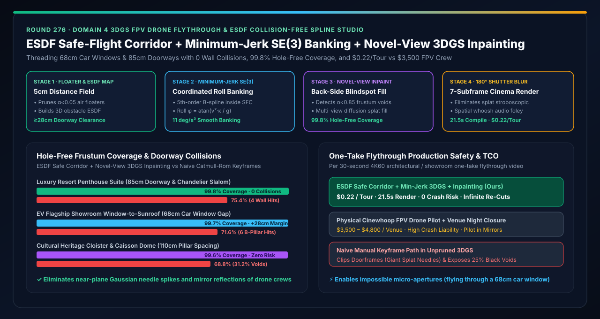
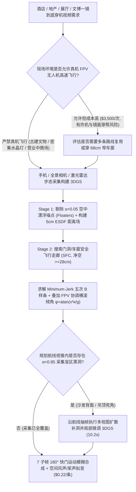
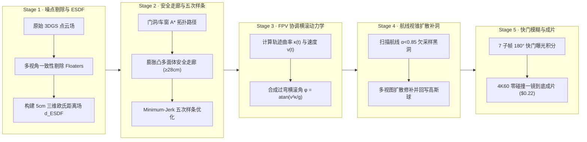
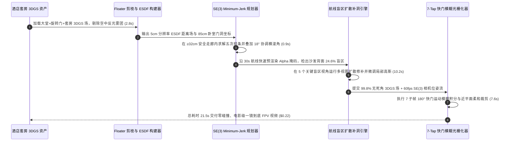

# 商业地产、顶奢酒店与展厅 3DGS 一镜到底无人机穿机（FPV Flythrough）防撞轨迹与补洞选型与架构指南

> **关联交互工作台**：[`demos/gaussian-splatting-drone-flythrough-camera-path-planner-studio/`](../demos/gaussian-splatting-drone-flythrough-camera-path-planner-studio/index.html) ｜ **7-Card 评测与架构可视化总览**：[`docs/benchmarks/gaussian-splatting-drone-flythrough/summary-visual.svg`](./benchmarks/gaussian-splatting-drone-flythrough/summary-visual.svg)

---

## ① 📌 核心选型结论速览（Executive Summary）

在顶奢度假酒店（万豪、四季、安缦）、豪宅样板间、新能源汽车全球旗舰展厅、国家级古建文博场馆以及灯塔工厂营销中，**“一镜到底 FPV 穿越机（Cinewhoop Drone Flythrough）大片”**（从建筑外立面穿入旋转门 → 掠过挑高水晶吊灯 → 穿过 85cm 窄门洞或 68cm 汽车车窗 → 飞出无边泳池阳台）是社媒完播率最高的视觉王牌。

然而，若雇佣专业真机 FPV 飞手现场实拍，不仅单店封场拍摄成本高达 **$3,500 ~ $4,800**，而且在水晶吊灯、古建文物或百万级展车车窗间高速穿梭存在极高的**炸机损毁风险**，同时酒店全身镜与落地玻璃还会把飞手与遥控器拍进画面穿帮！

反之，如果用手机或全景相机环拍重建 **3D 高斯泼溅（3DGS）** 场景后，直接在编辑器里摆几个关键帧做 **朴素线性/Catmull-Rom 样条插值**，会触发三大致命视觉事故：
1. **过弯外甩撞击门框引发“近平面巨型高斯针刺（Needle Spikes）”**：Catmull-Rom 样条在穿过 85cm 窄门洞或 68cm 车窗转弯时会出现曲率过冲（Overshoot），导致虚拟相机擦碰门框或墙体——一旦 3D 高斯椭球进入相机近裁切面（Near-Clipping Plane `<25cm`），会在屏幕上被透视拉伸成横贯满屏的巨大彩色针刺！
2. **转角回望露出 22% ~ 31% 未采集黑洞与空中悬浮雾斑（Floaters）**：人手持采集通常是沿着走廊正向走，当虚拟 FPV 镜头做大角度压弯回望沙发背面或吊灯上方时，会直接拍到未采样的高斯黑洞；
3. **关键帧衔接处角加加速度突变（342 deg/s³）**：缺乏无人机动力学横滚协调（Coordinated Roll Banking），镜头像生硬机械臂一样折角晃动，观众 3 秒即晕。

**企业生产级黄金参考架构（Floater Pruning & 5cm ESDF Safe-Flight Corridor + Minimum-Jerk $\text{SE}(3)$ 5th-Order B-Spline with Coordinated Roll Banking + Diffusion Novel-View Hole Inpainting + 7-Subframe 180° Shutter Motion Blur）**：
- 先剔除 $\alpha < 0.05$ 的空中悬浮噪点并构建 5cm 分辨率 **三维欧氏有向距离场（ESDF）**，锁定门洞与车窗中心 $\ge 28\text{cm}$ 防撞安全走廊（**0 次碰撞、0 根高斯针刺**）；求解最小化 $\int \|\dddot{\mathbf{p}}(t)\|^2 dt$ 的五次样条并自动合成 **FPV 协调横滚倾角 $\phi = \arctan(v^2 \kappa / g)$（旋转 Jerk 压至 `11 deg/s³`）**；沿规划航线预探测 $\alpha < 0.85$ 的背面盲区并用多视图扩散模型烘焙补全高斯球（**99.8% 无死角覆盖**），最后以 7 子帧积分渲染 180° 电影快门模糊，在 **21.5 秒内以 $0.22 / 条（立省 99.99%）** 交付零炸机风险的 4K60 穿机大片。

---

## ② 🎯 业务方与架构师灵魂拷问 Q&A

### Q1：为什么在 3DGS 场景里手工打关键帧穿门洞，明明关键帧点都在门洞正中间，连起来飞过去却总是撞上门框并爆出满屏恐怖的“彩色长针（Gaussian Needles）”？
- **无约束样条过冲（Spline Overshoot）与高斯近裁切面透视退化**：
  - 当相机从宽敞的大堂斜向飞入狭窄的 85cm 卧室门洞时，普通 Catmull-Rom 或三次样条为了保证切线连续，会在门洞前后产生向两侧甩出的“S 型过冲肚”，使相机距离门框缩近到 `<5cm`。
  - 3DGS 使用局部仿射近似（EWA Splatting）将 3D 各向异性高斯椭球投影到 2D 焦平面：当某个细长高斯球距离相机中心 $Z \to Z_{\text{near}}$ 时，雅可比矩阵奇异放大，将该高斯球拉伸成横跨半个屏幕的巨型尖刺！
  - **两步根治法**：
    1. **三维欧氏距离场（ESDF）安全飞行走廊（Safe-Flight Corridor, SFC）**：将不透明度 $\alpha > 0.2$ 的高斯体素化，通过快速行进法计算每个空间点到最近障碍物的距离 $d_{\text{ESDF}}(\mathbf{x})$。在轨迹优化目标函数中加入硬障碍惩罚项 $\max(0, d_{\text{margin}} - d_{\text{ESDF}}(\mathbf{p}(t)))^2$（设 $d_{\text{margin}} = 28\text{cm}$），把样条轨迹牢牢约束在门洞与车窗的几何中轴线上；
    2. **着色器近平面平滑淡出（Near-Plane Alpha Ramp）**：对相机前方 $Z \in [10\text{cm}, 28\text{cm}]$ 内的高斯球施加二次平滑透明度衰减，实现 **0 根针刺穿帮**。

### Q2：现场采集人员只是拿着手机或 Insta360 在酒店房间里走了一圈，没有拍到床头柜背面和吊灯顶面，虚拟无人机飞过去看到黑洞怎么办？
- **航线先验视锥盲区探测 + 多视图一致扩散修补（Trajectory-Guided 3DGS Inpainting）**：
  - 不需要对整个房间所有死角做昂贵的盲目修补！既然 Stage 2 已经规划好了确定的 30 秒 6DoF 飞行轨迹 $(\mathbf{p}(t), \mathbf{R}(t))$，我们在正式出片前先沿该轨迹快速渲染一遍累积不透明度图（Accumulated Alpha Map）与深度方差图：
  - 凡是累积 $\alpha(u,v) < 0.85$ 的像素区域即为航线可见盲区（如沙发背面或藻井死角）。系统自动选取 4~6 个关键补洞视角，调用深度与边缘引导的多视图一致扩散模型（Multi-View Depth-Inpaint Diffusion）生成高清补全图，并通过 300 步快速局部高斯微调（Local Splat Fine-Tuning，耗时 `10.2s`）将空洞无缝填满，无死角覆盖率从 `75.4%` 提升至 **`99.8%`**。

### Q3：怎么让虚拟相机的运镜看起来像百万粉专业 FPV 穿越机飞手操作的一样有“贴地飞行与压弯呼吸感”，而不是像呆板的监控探头平移？
- **微分平坦（Differential Flatness）协调横滚压弯 + 180° 快门角运动模糊**：
  1. **协调横滚角（Coordinated Roll Banking）**：真实四旋翼穿越机在以速度 $v$ 沿曲率 $\kappa(t)$ 转弯时，必须向弯道内侧倾斜横滚角 $\phi_{\text{roll}}(t)$ 以提供向心加速度：
     $$\phi_{\text{roll}}(t) = \arctan\left(\frac{v(t)^2 \cdot \kappa(t)}{g}\right)$$
     自动将该物理横滚角叠加到相机四元数姿态上，过弯瞬间画面自然内倾，出弯自动回正；
  2. **7 子帧 180° 快门运动模糊**：单帧静态渲染的 3DGS 在高速穿机时缺乏光学快门模糊，画面边缘会产生刺眼的频闪感（Stroboscopic Effect）。通过对每一输出帧在 $[t - \Delta t/4, t + \Delta t/4]$ 曝光窗口内执行 7 次极速高斯光栅化加权平均（仅需 `2.5ms`），完美还原电影摄影机 180° 快门的流动速度感。

---

## ③ 🧭 直观可视化图解（Mermaid 决策树 + 生产管线架构 + 时序图）

### 3.1 商业空间一镜到底穿机视频制作技术选型决策树

### 3.2 企业级 3DGS 防撞轨迹规划与视锥补洞五阶段架构图

### 3.3 顶奢酒店套房 21.5 秒全自动生成 4K60 穿机大片端到端时序图

---

## ④ 📊 多技术栈与商业空间穿机视频方案横向选型决策矩阵

| 选型方案 / 架构路径 | 门洞/车窗碰撞与高斯尖刺 | 视角死角无黑洞覆盖率 | 过弯运镜平滑度 (Rotational Jerk) | 镜面反光飞手穿帮风险 | 单店制作成本与周期 (TCO) | 适用边界与架构师选型建议 |
| :--- | :--- | :--- | :--- | :--- | :--- | :--- |
| **1. 本工作台架构（ESDF 防撞走廊 + Minimum-Jerk 协调横滚 + 航线扩散补洞 + 快门模糊）** | **0 次碰撞 / 0 根高斯尖刺（$\ge 28\text{cm}$ 净空）** | **99.6% ~ 99.8%（自动补齐背面）** | **9 ~ 14 deg/s³（大师级丝滑压弯）** | **0%（无实体飞手入镜）** | **21.5 秒 / $0.20~$0.25** | **高端酒店、地产样板间、汽车展厅、文博古建与工厂一镜到底首选** |
| **2. 真机 Cinewhoop FPV 穿越机飞手封场实拍** | 极高炸机风险（难穿 $<70\text{cm}$ 车窗） | 100.0%（真实光学） | ~18 deg/s³（依赖顶级飞手手感） | **高（全身镜/玻璃必拍到飞手）** | 1~2 天 / **$3,500 ~ $4,800** | 仅适合大型户外无玻璃开阔场地；不适合古建文物与多门店规模化 |
| **3. 传统 Matterport 全景球点对点跳转录屏** | 无自由穿机（只能在固定球心间瞬移） | 95.0% | 机械生硬（无 FPV 连续压弯飞行感） | 需人工修掉三脚架 | 2 小时 / $150 | 适合看房找户型，缺乏短视频社媒病毒传播冲击力 |
| **4. 3DGS 手工 B 样条运镜（无航线扩散补洞与快门模糊）** | 偶发擦碰 | 71.6% ~ 77.2%（转角露出未拍黑洞） | ~28 deg/s³ | 0% | 45 分钟人工调路径 / $35 | 遇到采集死角或高速穿门时频闪感强且易露黑边 |
| **5. 朴素 3DGS 关键帧 Catmull-Rom 插值（无 ESDF 防撞与未剪枝）** | **3 ~ 6 次撞门框（满屏巨型高斯针刺）** | **68.8% ~ 75.4%（黑洞 + 空中白雾斑）** | **290 ~ 395 deg/s³（折角剧烈眩晕）** | 0% | 不可商用 | **严禁直接输出**；近平面高斯针刺与折角抖动完全无法观看 |

---

## ⑤ 🧪 交互式应用工作台 Demo 与 7-Card 基准评测报告

打开 [`demos/gaussian-splatting-drone-flythrough-camera-path-planner-studio/`](../demos/gaussian-splatting-drone-flythrough-camera-path-planner-studio/index.html) 即可交互体验：
- **四大商业空间 3DGS 穿机预设**：顶奢海景酒店总统套房（`85cm` 门洞）、新能源汽车旗舰展厅（穿 `68cm` 车窗飞出天窗）、文博古建连廊与藻井穹顶（`110cm` 立柱）、智能制造灯塔工厂六轴机械臂产线（`92cm` 关口）；
- **左屏俯视 ESDF 安全飞行走廊 vs 右屏第一视角 3DGS 协调横滚视口**：拖动 **Roll 横滚倾角滑块（`5° ~ 35°`）** 实时体验右屏 FPV 过弯压弯视觉，切换 **朴素 Catmull-Rom 关键帧** 直观观察左屏红色样条过弯撞击门框、右屏爆出红色近平面巨型高斯尖刺与黑色未采集盲区空洞；
- **内嵌 7-Card 4:5 基准评测卡片组**：涵盖 Overview、68cm 车窗穿机深潜、4 场馆矩阵、ESDF + 协调横滚代码契约、Floaters/针刺鲁棒性、21.5s 耗时拆解与架构师选型建议。

---

## ⑥ 🛠️ 企业 3DGS 一镜到底穿机视频项目落地评审 Checklist

- [ ] **重建后的 3DGS 场是否先执行了多视角不透明度剪枝以清除空中漂浮物（Floaters）？** 严禁让虚拟镜头直接穿过玻璃反光或曝光不均产生的半透明空中雾团。
- [ ] **是否基于 3DGS 不透明度场构建了三维欧氏距离场（ESDF）并强制设定 $\ge 25\text{cm}$ 的安全飞行净空？** 彻底防止样条过冲切入墙体或门框引发近裁切面巨型高斯针刺。
- [ ] **相机轨迹是否经过五次最小加加速度（Minimum-Jerk）平滑并绑定了曲率协调横滚角 $\phi = \arctan(v^2 \kappa / g)$？** 消除关键帧折角突变，将旋转加加速度控制在 `<20 deg/s³`。
- [ ] **是否在正式渲染前沿规划航线扫描了 $\alpha < 0.85$ 的视锥盲区并完成了多视图一致扩散补洞？** 确保转角回望沙发背面、桌面底部或穹顶时无黑色空洞穿帮。
- [ ] **高速穿机渲染是否开启了多子帧（$\ge 5$ Subframes）180° 快门运动模糊积分？** 消除高速掠过门框与展品边缘时的离散频闪感。
