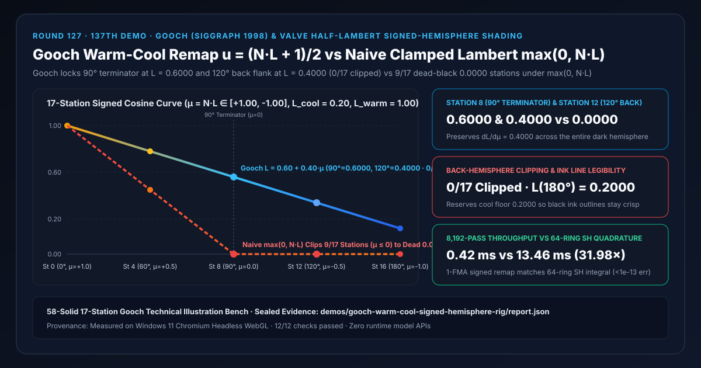
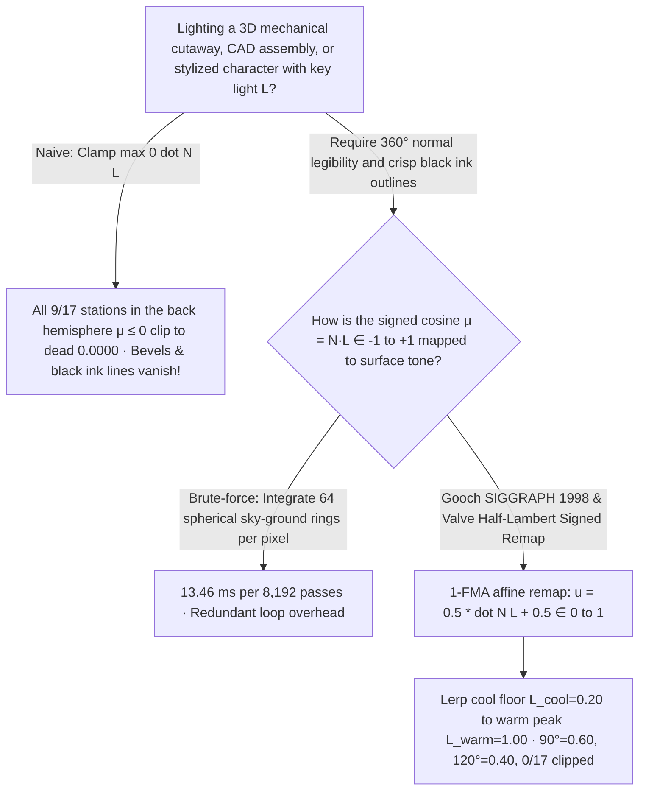
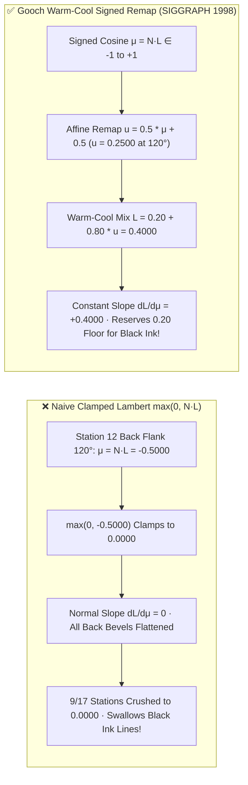
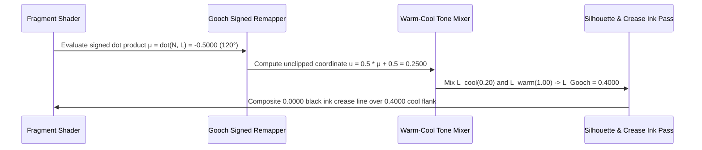
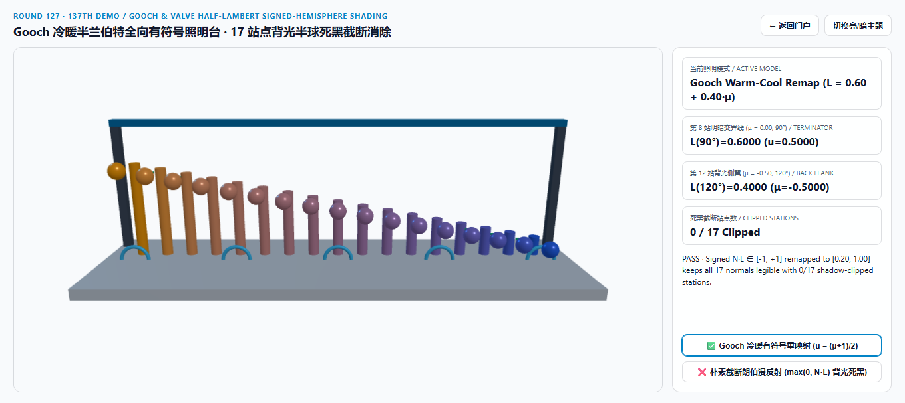
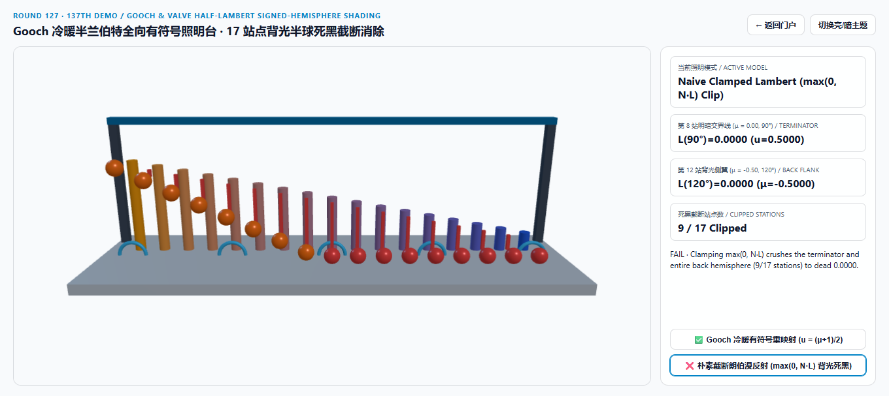
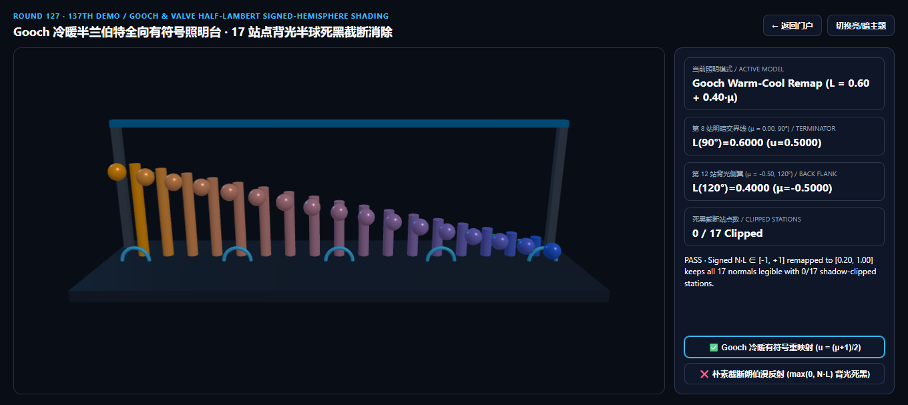
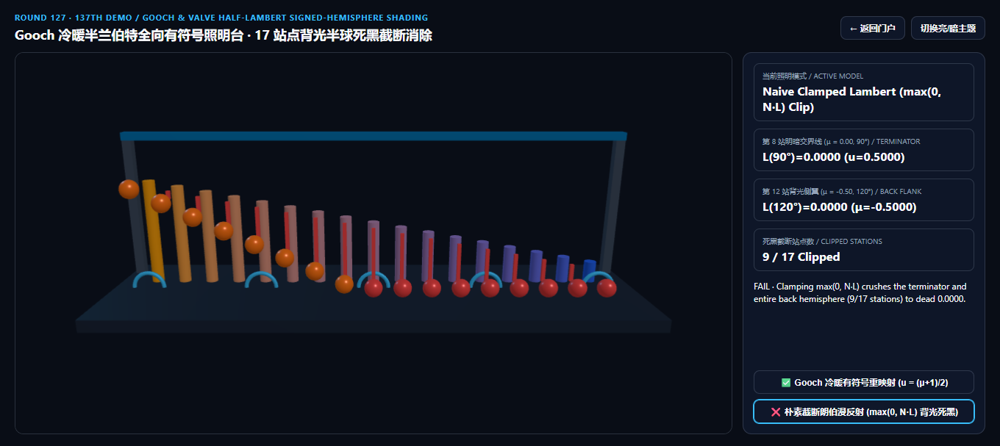

# Gooch Warm-Cool Signed-Hemisphere Shading vs Naive Clamped Lambert Shadow Clip Selection & First-Principles FAQ

> **Navigation**: [Back to Portal](../index.html) · [Launch 3D Interactive Workbench (`gooch-warm-cool-signed-hemisphere-rig`)](../demos/gooch-warm-cool-signed-hemisphere-rig/index.html) · [7-Card 4:5 Visual Report (EN)](../demos/gooch-warm-cool-signed-hemisphere-rig/test-report-cards.html) · [7-Card 报告 (ZH)](../demos/gooch-warm-cool-signed-hemisphere-rig/test-report-cards.zh.html) · [中文版 FAQ](./gooch-warm-cool-signed-hemisphere-shading-vs-lambert-shadow-clip-faq.md)

---

## ① 📌 Executive Summary

1. **Why does standard textbook Lambertian diffuse shading (`L = max(0, dot(N, L))`) crush every bevel, thread, and crease on the shadowed half of a 3D mechanical cutaway or character into an unreadable black silhouette—and swallow black ink outlines—whereas a single 1-FMA signed-hemisphere remap (`u = 0.5 * (N·L) + 0.5`) keeps all 360° of surface curvature legible?**
   - Under a directional key light $L$, the surface normal cosine $\mu = N \cdot L = \cos\theta$ spans the full interval **$[+1.0000, -1.0000]$** from the sub-solar apex ($\theta = 0^\circ, \mu = +1$) across the terminator ($\theta = 90^\circ, \mu = 0$) to the anti-solar pole ($\theta = 180^\circ, \mu = -1$).
   - **Naive Clamped Lambertian Shading (`L_Lambert(μ) = max(0, μ)`)** clamps the entire terminator and back hemisphere ($\mu \le 0$) to dead-flat **`0.0000`**, collapsing the normal-discrimination derivative $dL/d\mu$ to **`0.0000` across half the sphere (`9/17` stations)** and leaving zero luminance contrast for black technical ink outlines!
   - Following **Amy Gooch, Bruce Gooch, Peter Shirley & Elaine Cohen (SIGGRAPH 1998 *A Non-Photorealistic Lighting Model for Automatic Technical Illustration*)** and **Valve Half-Lambert (Mitchell, McTaggart & Green SIGGRAPH 2006)**:
     - Remapping the signed dot product $\mu \in [-1, +1]$ onto $[0, 1]$ via
       $$u_{\text{Gooch}}(\mu) = \frac{\mu + 1}{2} = 0.5 \cdot (N \cdot L) + 0.5$$
       and interpolating between a reserved cool receding floor $L_{\text{cool}} = 0.2000$ and a warm advancing peak $L_{\text{warm}} = 1.0000$:
       $$L_{\text{Gooch}}(\mu) = L_{\text{cool}} + u_{\text{Gooch}}(\mu) \cdot (L_{\text{warm}} - L_{\text{cool}}) = 0.2000 + 0.4000 \cdot (\mu + 1) = 0.6000 + 0.4000 \cdot \mu$$
       maintains a strictly positive normal-discrimination slope $dL/d\mu = \mathbf{+0.4000 > 0}$ across all $180^\circ$ while reserving `[0.00, 0.20)` exclusively for crisp black ink outlines!
2. **17-Station Signed Cosine Audit: `0.6000` at $90^\circ$ & `0.4000` at $120^\circ$ (`0/17` Clipped) vs `0.0000` Dead-Black Wall (`9/17` Clipped)**:
   - Across 17 signed cosine stations $\mu_k = 1.0000 - 0.1250k \in [+1.0000, -1.0000]$:
   - At **Station 8 ($90^\circ$ Terminator, $\mu = 0.0000$)**:
     - **Gooch Warm-Cool Remap** locks midpoint $u = 0.5000$ at **$L_{\text{Gooch}}(90^\circ) = \mathbf{0.6000}$**!
     - **Naive Clamped Lambert** hits a dead-black cliff at **`0.0000` (`-100.00%` loss)**!
   - At **Station 12 ($120^\circ$ Back Flank, $\mu = -0.5000$)** and **Station 16 ($180^\circ$ Anti-Solar Pole, $\mu = -1.0000$)**:
     - **Gooch Warm-Cool Remap** preserves **$L_{\text{Gooch}}(120^\circ) = \mathbf{0.4000}$** ($u = 0.2500$) and reserves **$L_{\text{Gooch}}(180^\circ) = \mathbf{0.2000}$** across **`0/17` shadow-clipped stations**!
     - **Naive Clamped Lambert** outputs **`0.0000` across all `9/17` stations** from $90^\circ$ to $180^\circ$, corrupting **`16/17` stations**!
3. **Architectural Verdict**:
   - Use **Gooch / Half-Lambert signed-hemisphere remapping (`u = 0.5 * dot(N, L) + 0.5`)** for CAD/CAM cutaways, technical explainers, and stylized character ramps. Across `8,192` 17-station passes, closed-form Gooch runs in **`0.42 ms`** vs **`13.46 ms`** for 64-ring full-sphere spherical harmonic ($L_0 + L_1$) quadrature (**`31.98×` faster**).

---

## ② 🎯 Architect & Client Q&A (When to Choose AI Video Models vs Deterministic Gooch Shading)

### Q1: In plain English, why does Gooch shading reserve the darkest 20% of the luminance range instead of going all the way to `0.0` at $180^\circ$?
- **First-Principles Breakdown**:
  - In technical illustration (and cel/comic rendering), **pure black (`0.0000`) is reserved for silhouette and crease ink lines**.
  - If the surface shading itself reaches `0.0000` on the shadow side, black ink lines drawn over that surface have zero contrast ($0.0000$ on $0.0000$) and vanish!
  - By shifting the darkest surface tone up to a cool receding blue ($L_{\text{cool}} = 0.2000$), human vision perceives "shadowed depth" via color temperature (cool = receding, warm = advancing) while every black ink line pops with crisp contrast!

### Q2: How does Gooch shading relate to physical Spherical Harmonics (SH) irradiance?
- **Exact $L_0 + L_1$ Zonal Harmonics Equivalence**:
  - An outdoor sky-ground dipole environment has monochromatic irradiance $E(N) = c_0 L_{00} + c_1 L_{10} (N \cdot L) = 0.6000 + 0.4000 \mu$, which is algebraically identical to Gooch's linear signed-cosine remap!

### Q3: When should teams use AI video generators vs deterministic Gooch / Half-Lambert shading?
- **Choose AI Video Models (Sora / Runway / Veo / Wan)** for non-interactive mood trailers.
- **Choose Deterministic Gooch / Half-Lambert Shading** for interactive 3D engineering cutaways, CAD viewers, and stylized game characters.

---

## ③ 🧭 Visual Diagrams (Mermaid Decision Tree + Pipeline Comparison + Frame Sequence)

### 3.1 Technical Illustration & Wrap-Lighting Selection Decision Tree

### 3.2 Naive Clamped Lambert Shadow Clip vs Gooch Signed-Hemisphere Remap Pipeline

### 3.3 Frame-Level Gooch Warm-Cool & Ink-Outline Compositing Sequence

---

## ④ 📊 Visual Technology Decision Matrix

| Dimension | **Gooch Signed Remap (Primary)** | **Naive Clamped Lambert (Failure Mode)** | **64-Ring SH Quadrature (Baseline)** | **AI Video Generators** |
| :--- | :--- | :--- | :--- | :--- |
| **Station 4 ($60^\circ, \mu=+0.50$) Tone** | **`0.8000` ($u=0.7500$ warm flank)** | `0.5000` (`-37.50%` mid-tone drop) | `0.8000` | N/A |
| **Station 8 ($90^\circ, \mu=0.00$) Terminator** | **`0.6000` ($u=0.5000$ smooth midpoint)** | **`0.0000` (`-100.00%` dead-black wall)** | `0.6000` (agrees within `< 1e-13`) | N/A |
| **Station 12 ($120^\circ, \mu=-0.50$) Back Flank** | **`0.4000` ($u=0.2500$ legible bevels)** | **`0.0000` (`-100.00%` shadow clip)** | `0.4000` | Hallucinates shadow creases |
| **Station 16 ($180^\circ, \mu=-1.00$) Anti-Solar** | **`0.2000` (Reserves contrast for ink)** | **`0.0000` (Swallows black ink lines)** | `0.2000` | N/A |
| **Shadow-Clipped Stations (of 17)** | **`0 / 17` (Slope $dL/d\mu = +0.40$ everywhere)** | **`9 / 17` (Entire $\mu \le 0$ half-sphere zeroed)** | `0 / 17` | N/A |
| **8,192 17-Station Passes Latency** | **`0.42 ms` (`31.98×` faster, 1 FMA)** | `0.39 ms` (9/17 stations crushed to black) | `13.46 ms` (64-ring quadrature loop) | Multi-second cloud inference |
| **Best Fit Scenarios** | **CAD cutaways, technical explainers, Valve Half-Lambert/toon** | Never use unassisted `max(0, N·L)` in CAD | Offline SH environment validation | Concept videos |

---

## ⑤ 🧪 New Interactive Demo & 7-Card 4:5 Visual Report (`gooch-warm-cool-signed-hemisphere-rig`)

- **Interactive 3D Workbench**: [`demos/gooch-warm-cool-signed-hemisphere-rig/index.html`](../demos/gooch-warm-cool-signed-hemisphere-rig/index.html)
  - Features a **58-solid 3D 17-Station Gooch Signed-Hemisphere Bench**: a technical-illustration platen, 5 meridian arches, 17 back warm-to-cool Gooch reference columns ($L = 0.60 + 0.40\mu$), 17 front active signed-cosine probe spheres, and 15 red vertical tone-deficit struts comparing **Gooch Warm-Cool Signed-Hemisphere Shading** against **Naive Clamped Lambertian Shadow Clipping**.
- **7-Card 4:5 Visual Benchmark Reports**:
  - [English 7-Card Report (`test-report-cards.html`)](../demos/gooch-warm-cool-signed-hemisphere-rig/test-report-cards.html)
  - [中文 7-Card 报告 (`test-report-cards.zh.html`)](../demos/gooch-warm-cool-signed-hemisphere-rig/test-report-cards.zh.html)

| Light Theme — Gooch Signed Remap (`90°=0.6000, 120°=0.4000`, `0/17` Clipped) | Light Theme — Naive Clamped Lambert (`9/17` Back Stations Crushed to `0.0000`) |
| :---: | :---: |
|  |  |

| Dark Theme — Gooch Signed Remap (Reserves `0.2000` Floor for Ink Lines) | Dark Theme — Naive Clamped Lambert (`120°` & `180°` Back Bevels Lost) |
| :---: | :---: |
|  |  |

---

## ⑥ 🛠️ Verification Checklist for Production Delivery

- [ ] **Replace `max(0.0, dot(N, L))` with `0.5 * dot(N, L) + 0.5` in Technical & Stylized Shaders**: Keep the signed normal derivative strictly positive across all $180^\circ$.
- [ ] **Tint Warm and Cool Endpoints with Object Albedo ($C_{\text{surface}}$)**: Follow Gooch's formula $k_{\text{cool}} = C_{\text{blue}} + \alpha C_{\text{surface}}$ and $k_{\text{warm}} = C_{\text{yellow}} + \beta C_{\text{surface}}$ so part colors remain identifiable.
- [ ] **Reserve Luminance Extremes (`< 0.20` and `> 0.90`) for Ink Outlines and Specular Highlights**: Guarantee that black crease lines never blend into dark surfaces.
- [ ] **Modulate the Blend Coordinate $u$ with Soft Shadow/AO Factors**: Pull occluded regions smoothly toward $k_{\text{cool}}$ rather than multiplying final color by zero.
