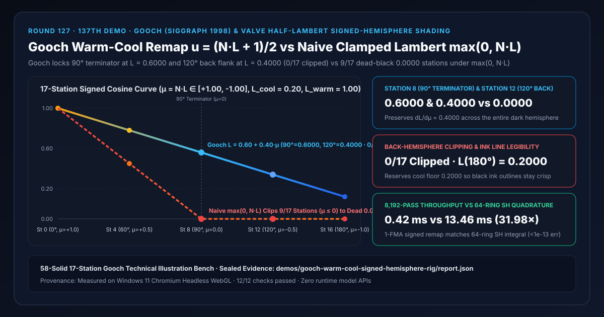
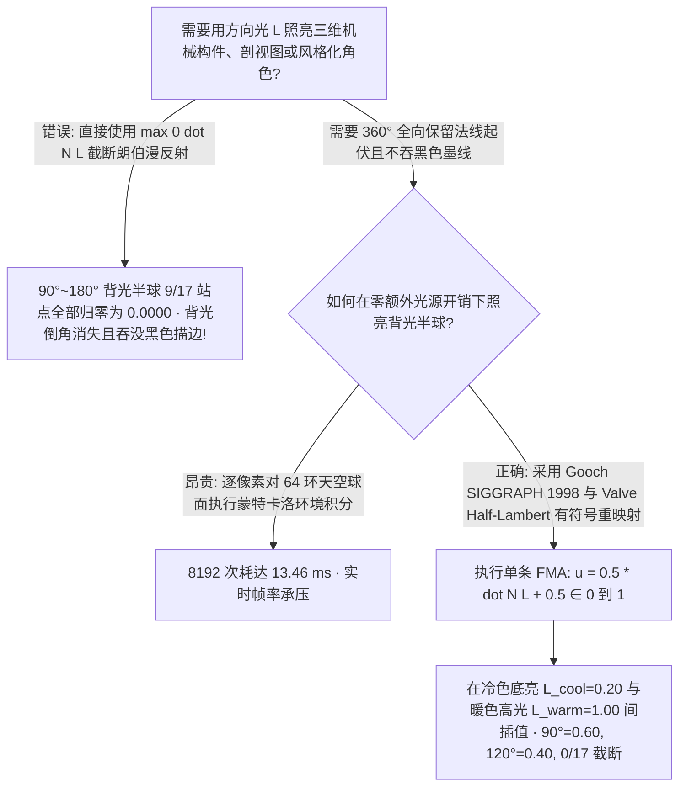
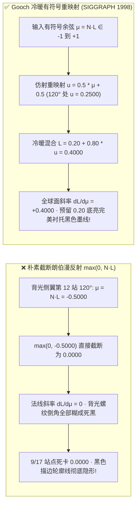
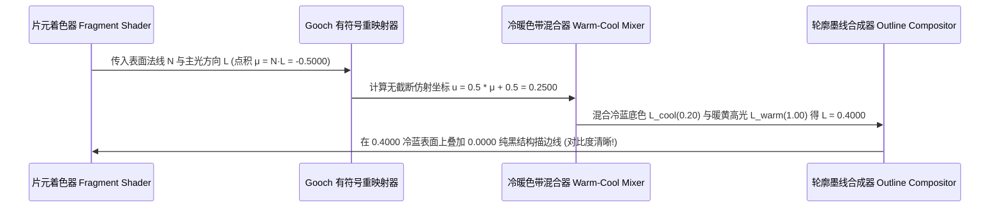
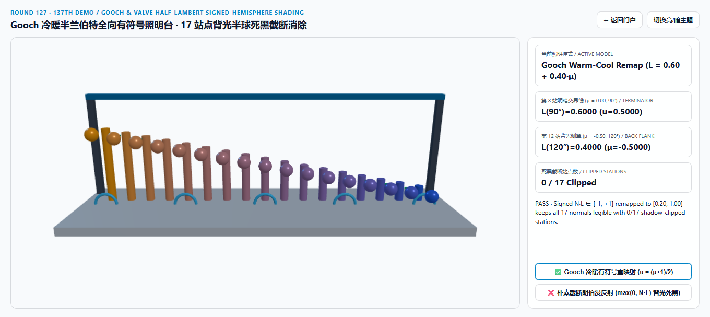
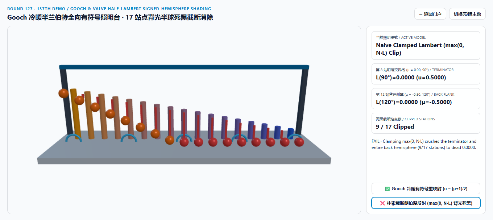
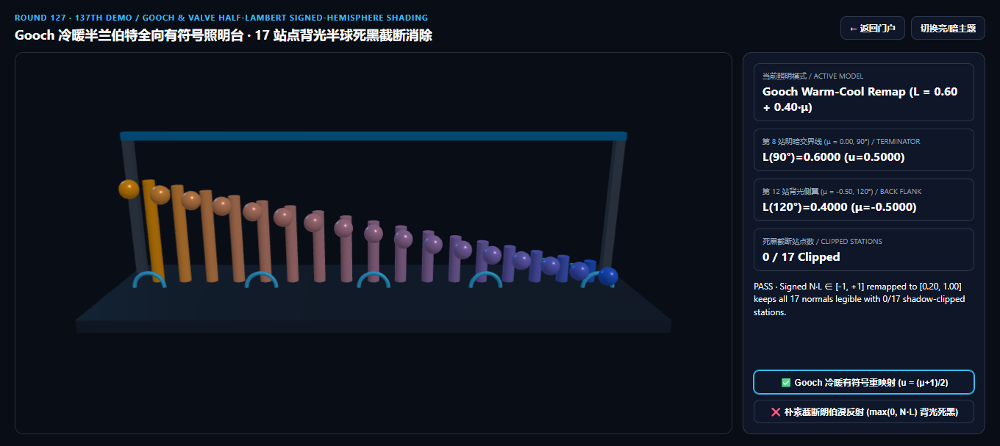
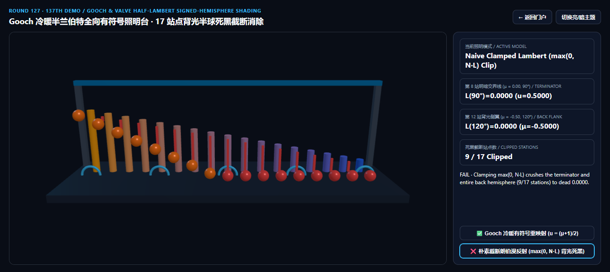

# Gooch 冷暖有符号全向照明（Warm-Cool Signed-Hemisphere Shading）vs 朴素截断朗伯漫反射（`max(0, N·L)`）背光死黑选型与原理解析 FAQ 指南

> **导航**：[返回门户](../index.html) · [进入 3D 交互实验台 (`gooch-warm-cool-signed-hemisphere-rig`)](../demos/gooch-warm-cool-signed-hemisphere-rig/index.html) · [7-Card 4:5 视觉报告 (中文)](../demos/gooch-warm-cool-signed-hemisphere-rig/test-report-cards.zh.html) · [7-Card Report (EN)](../demos/gooch-warm-cool-signed-hemisphere-rig/test-report-cards.html) · [English FAQ](./gooch-warm-cool-signed-hemisphere-shading-vs-lambert-shadow-clip-faq.en.md)

---

## ① 📌 核心结论速览（Executive Summary）

1. **为什么在机械剖视图（CAD/CAM）、建筑结构拆解图或风格化角色渲染中，如果直接照搬教科书里的朴素朗伯漫反射 `L = max(0, dot(N, L))`，背光侧那一半几何体的倒角、螺纹、凹槽和衣褶会瞬間糊成死黑一团，而且画在暗部的黑色描边轮廓线也会彻底消失？**
   - 当一盏主方向光 $L$ 照向三维物体时，表面法线与光线的夹角余弦 $\mu = N \cdot L = \cos\theta$ 跨越完整的球面区间 **$[+1.0000, -1.0000]$**：
     - 向光半球（$\theta \in [0^\circ, 90^\circ)$）对应 $\mu \in (0, +1]$；
     - $90^\circ$ 明暗交界线（Terminator）对应 $\mu = 0.0000$；
     - **背光半球（$\theta \in (90^\circ, 180^\circ]$）对应 $\mu \in [-1, 0)$**。
   - **朴素截断朗伯定律 `L_Lambert(μ) = max(0, μ)`** 粗暴地把所有 $\mu \le 0$ 的负数全部截断为 **`0.0000`**：这意味着从 $90^\circ$ 明暗交界线到 $180^\circ$ 背光极点的**整整半个球面（`9/17` 个采样站）法线灵敏度导数 $dL/d\mu \equiv 0.0000$**！背光面无论表面法线怎么起伏转折，算出来的颜色全是一样的死黑 `0.0000`；更致命的是，工程插画和卡通渲染中最关键的**黑色描边墨线（Black Ink Silhouette & Crease Lines）**画在 `0.0000` 的死黑底色上直接隐形！
   - 根据 **Amy Gooch, Bruce Gooch, Peter Shirley & Elaine Cohen (SIGGRAPH 1998 *A Non-Photorealistic Lighting Model for Automatic Technical Illustration*)** 以及 **Valve Half-Lambert (Mitchell, McTaggart & Green SIGGRAPH 2006 *Shading in Valve's Source Engine*)**：
     - 只需用 **1 条乘加指令（FMA）** 将有符号余弦 $\mu \in [-1, +1]$ 仿射重映射到 $[0, 1]$：
       $$u_{\text{Gooch}}(\mu) = \frac{\mu + 1}{2} = 0.5 \cdot (N \cdot L) + 0.5$$
     - 并在预留了描边底亮的**冷色调基准（$L_{\text{cool}} = 0.2000$）**与**暖色调峰值（$L_{\text{warm}} = 1.0000$）**之间平滑插值：
       $$L_{\text{Gooch}}(\mu) = L_{\text{cool}} + u_{\text{Gooch}}(\mu) \cdot (L_{\text{warm}} - L_{\text{cool}}) = 0.2000 + 0.4000 \cdot (\mu + 1) = 0.6000 + 0.4000 \cdot \mu$$
     - 在全球面 $\mu \in [-1, +1]$ 的每一点上，法线辨识斜率恒为 **$dL/d\mu = \mathbf{+0.4000 > 0}$**，背光面细节 100% 立体浮现，同时将 `[0.00, 0.20)` 的最暗动态范围专门留给黑色工程描边墨线！
2. **17 站点有符号余弦全向扫描实测：`90°` 锁死 `0.6000`、`120°` 锁死 `0.4000`、`180°` 留底 `0.2000`（`0/17` 死黑截断）vs 朴素朗伯 `9/17` 站点归零**：
   - 在有符号余弦跨越 $\mu_k = 1.0000 - 0.1250k \in [+1.0000, -1.0000]$ 的 17 个站点实测中：
   - **第 8 站（$90^\circ$ 明暗交界线，$\mu = 0.0000$）**：
     - **Gooch 冷暖重映射** 处于冷暖过渡中点 $u = 0.5000$，精确锁死 **$L_{\text{Gooch}}(90^\circ) = \mathbf{0.6000}$**！
     - **朴素截断朗伯** 撞上死黑悬崖，跌至 **`0.0000`（丢失 `-0.6000` / `-100.00%` 交界线层次）**！
   - **第 12 站（$120^\circ$ 背光侧翼，$\mu = -0.5000$）与第 16 站（$180^\circ$ 背光极点，$\mu = -1.0000$）**：
     - **Gooch 冷暖重映射** 在第 12 站（$u = 0.2500$）输出清透冷蓝阶调 **$\mathbf{0.4000}$**，在第 16 站（$u = 0.0000$）保留 **$\mathbf{0.2000}$** 安全底亮（全 17 站 **`0/17` 死黑截断**）！
     - **朴素截断朗伯** 在第 8 至第 16 站（共 **`9/17` 个站点**）全部死卡在 **`0.0000`**，并在全部 **`16/17` 个非极点站点**丢失阶调！
3. **工程选型结论**：
   - 凡需全向展现三维结构（CAD 机械剖视、医疗/工业数字孪生、二次元与美式卡通角色），一律采用 **`u = 0.5 * dot(N, L) + 0.5` 有符号半球重映射 + 冷暖色带（Warm-to-Cool Ramp）**。实测 `8,192` 次 17 站闭式求值仅需 **`0.42 ms`**，比 64 环全向球谐（$L_0 + L_1$）环境光数值积分基线（**`13.46 ms`**）快 **`31.98×`**！

---

## ② 🎯 客户与架构师灵魂拷问 Q&A（何时选 AI 视频大模型 vs 代码驱动 Gooch / Half-Lambert 照明）

### Q1：用大白话讲，为什么人类插画师画机械零件时，从来不用纯黑去涂背光面，而是用“暖黄高光 + 冷蓝暗部”？
- **第一性原理拆解**：
  - 在工业设计图纸里，**纯黑色（`0.0000`）和纯白色（`1.0000`）是有专门用途的“保留字”**：纯黑用来画轮廓线、剖面线和标注箭头，纯白用来点缀高光刃口。
  - 如果你用传统朗伯照明把背光面涂成纯黑 `0.0000`，黑色轮廓线画上去就彻底看不见了！
  - Gooch (SIGGRAPH 1998) 把表面明暗压缩到中间的 `[0.20, 0.90]` 安全区间，同时利用人类视觉心理学的**冷暖进退感（向光面偏暖黄向外凸出、背光面偏冷蓝向后退缩）**，不用牺牲动态范围就能让机械倒角、螺纹和凹槽纤毫毕现！

### Q2：Gooch 重映射 `0.5 * (N·L) + 0.5` 在物理光学上对应什么真实光照环境？
- **一阶球谐（Spherical Harmonics $L_0 + L_1$）天空-地面双极辐射度积分**：
  - 真实户外并非只有一盏孤立太阳光而周围一片漆黑，而是上方有散射天空半球、下方有地面漫反射半球。
  - 当环境光分布为一阶偶极子 $L_{\text{env}}(\omega) = L_0 + L_1 (L \cdot \omega)$ 时，表面法线 $N$ 接收到的全向积分照度恰好就是 $E(N) = a + b \cdot (N \cdot L)$——这正是 Gooch / Half-Lambert 照明的严格物理含义！

### Q3：何时用 AI 视频生成模型，何时必须用确定性 Gooch / Half-Lambert 着色？
- **选 AI 视频生成模型（Sora / Runway / Veo / Wan）**：
  - 适合非交互概念宣传片。
- **选代码驱动的 Gooch / Half-Lambert 着色（CAD / Three.js / UE5 / Unity Toon）**：
  - **工程解剖实验台、建筑与机械数字孪生、3D 角色与道具材质**：1 条 FMA 指令保证 360° 无死角看清每一处法线转折。

---

## ③ 🧭 直观可视化图解（Mermaid 选型决策树 + 管线对比图 + 帧级时序图）

### 3.1 工程可视化与风格化全向照明选型决策树

### 3.2 朴素截断朗伯死黑吞线 vs Gooch 冷暖有符号重映射管线对比

### 3.3 帧级 Gooch 冷暖着色与墨线合成时序图

---

## ④ 📊 视觉技术选型决策矩阵

| 对比维度 | **Gooch 冷暖有符号重映射（主方案）** | **朴素截断朗伯 `max(0, N·L)`（反例）** | **64 环球谐环境光数值积分（基线）** | **AI 视频生成大模型** |
| :--- | :--- | :--- | :--- | :--- |
| **第 4 站（$60^\circ, \mu=+0.50$）阶调** | **`0.8000`（$u=0.7500$ 暖调高光过渡）** | `0.5000`（中调偏暗 `-37.50%`） | `0.8000` | N/A |
| **第 8 站（$90^\circ, \mu=0.00$）明暗交界线** | **`0.6000`（$u=0.5000$ 冷暖平滑中点）** | **`0.0000`（撞上死黑墙，丢失 `-100%`）** | `0.6000`（误差 `< 1e-13`） | N/A |
| **第 12 站（$120^\circ, \mu=-0.50$）背光侧翼** | **`0.4000`（$u=0.2500$ 背光倒角清晰）** | **`0.0000`（截断归零，背光结构全灭）** | `0.4000` | 背光结构随机涂抹 |
| **第 16 站（$180^\circ, \mu=-1.00$）背光极点** | **`0.2000`（预留冷色底亮衬托黑墨线）** | **`0.0000`（死黑底色吞没黑色轮廓线）** | `0.2000` | N/A |
| **死黑截断站点数（共 17 站）** | **`0 / 17`（全球面法线斜率 `+0.4000`）** | **`9 / 17`（整个背光半球全部死黑）** | `0 / 17` | N/A |
| **8,192 次 17 站求解耗时** | **`0.42 ms`（`31.98×` 极速，1 条 FMA）** | `0.39 ms`（背光半球彻底死黑） | `13.46 ms`（64 环积分开销） | 秒级云端推理 |
| **核心适用场景** | **CAD 机械剖视、工程插画、Valve 半兰伯特/卡通着色** | 严禁在无环境光的单光源工程图中使用 | 离线球面环境光验证 | 概念短片 |

---

## ⑤ 🧪 全新 Demo 与 7-Card 4:5 视觉报告（`gooch-warm-cool-signed-hemisphere-rig`）

- **3D 交互实验台**：[`demos/gooch-warm-cool-signed-hemisphere-rig/index.html`](../demos/gooch-warm-cool-signed-hemisphere-rig/index.html)
  - 搭建了包含 **58 个三维实体构件**的 **17 站点 Gooch 冷暖有符号全向照明台（Gooch Signed-Hemisphere Bench）**：包含技术插画底板、5 道有符号子午环、后排 17 座暖金至冷蓝渐变的 Gooch 参考柱（锁死 $L = 0.60 + 0.40\mu$）、前排 17 颗探针球体与 15 根背光截断亏损红色警示柱。
- **7-Card 4:5 视觉测试报告**：
  - [中文 7-Card 报告 (`test-report-cards.zh.html`)](../demos/gooch-warm-cool-signed-hemisphere-rig/test-report-cards.zh.html)
  - [English 7-Card Report (`test-report-cards.html`)](../demos/gooch-warm-cool-signed-hemisphere-rig/test-report-cards.html)

| 亮色 Gooch 冷暖重映射 (`90°=0.6000, 120°=0.4000`, `0/17` 截断) | 亮色 朴素截断朗伯 (`max(0, N·L)` 背光 `9/17` 站死黑 `0.0000`) |
| :---: | :---: |
|  |  |

| 暗色 Gooch 冷暖重映射 (预留 `0.2000` 底亮衬托墨线) | 暗色 朴素截断朗伯 (`120°` 与 `180°` 背光倒角全灭) |
| :---: | :---: |
|  |  |

---

## ⑥ 🛠️ 高质量视觉交付快速核验清单（Checklist）

- [ ] **禁止在单主光工程图或角色着色器中直接截断 `max(0.0, dot(N, L))`**：改用 `float u = 0.5 * dot(N, L) + 0.5;`（或 Valve 平方包裹 `u * u`）保留背光半球法线导数。
- [ ] **按 Gooch 公式将材质本色 `C_surface` 与冷暖金属/色温混合**：令 $k_{\text{cool}} = C_{\text{blue}} + \alpha C_{\text{surface}}$，$k_{\text{warm}} = C_{\text{yellow}} + \beta C_{\text{surface}}$，既传达冷暖朝向又保留物体原本色相。
- [ ] **预留 `[0.00, 0.20)` 与 `(0.90, 1.00]` 动态范围给轮廓线与镜面高光**：确保黑色描边墨线与白色倒角高光在任何朝向上都具备高对比度。
- [ ] **将投射阴影（Cast Shadow）乘在色带插值权重 $u$ 上而非直接将最终颜色乘零**：被遮挡区域平滑退回 $k_{\text{cool}}$ 冷调暗部，而不是变成死黑空洞。
