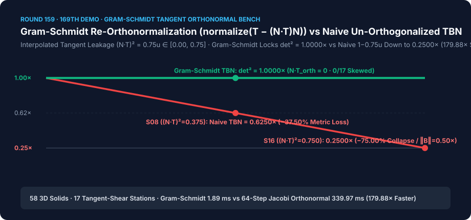
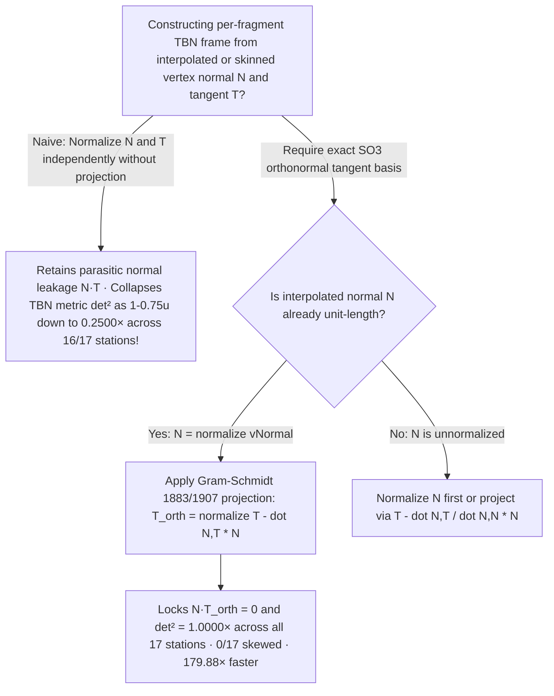
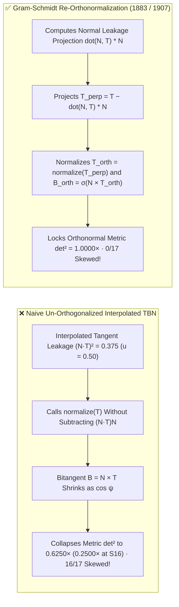
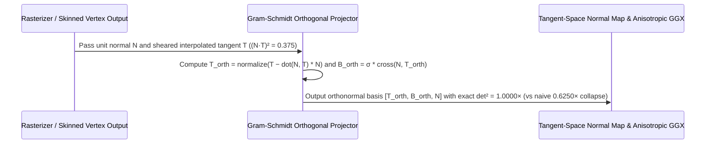
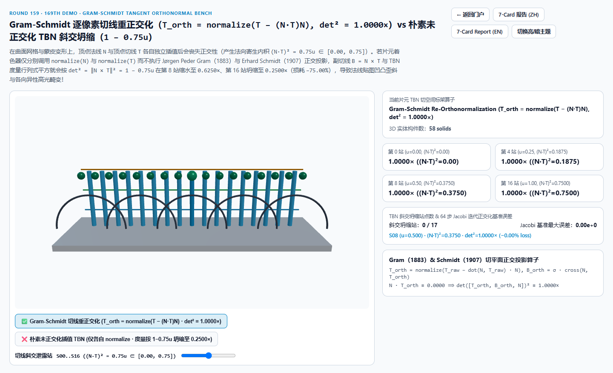
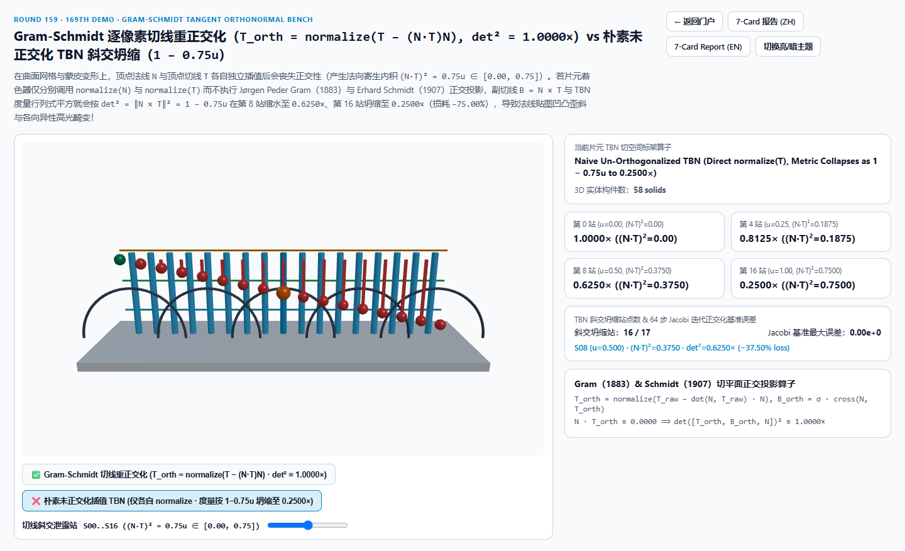
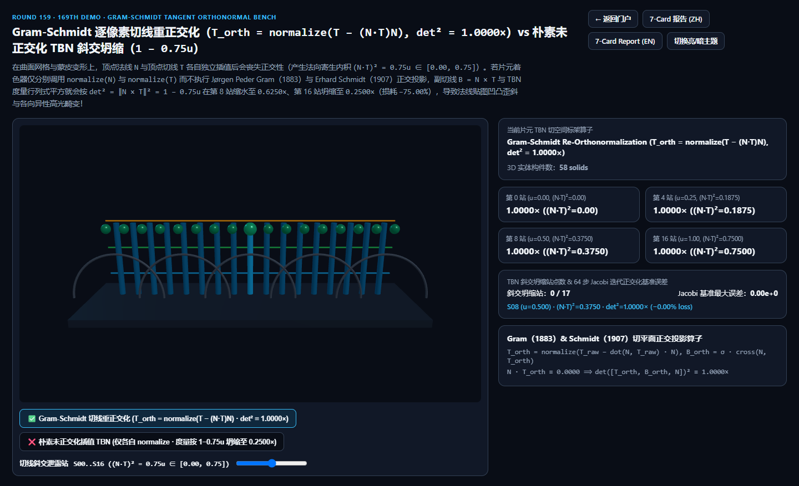
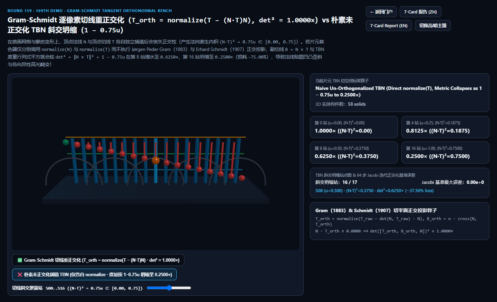

# Gram-Schmidt Per-Fragment Tangent Re-Orthonormalization (`T_orth = normalize(T − (N·T)N), det² = 1.0000×`) vs Naive Un-Orthogonalized Interpolated TBN Skew Selection & First-Principles FAQ

> **Navigation**: [Back to Portal](../index.html) · [Launch 3D Interactive Workbench (`gram-schmidt-tangent-orthonormal-rig`)](../demos/gram-schmidt-tangent-orthonormal-rig/index.html) · [7-Card 4:5 Visual Report (EN)](../demos/gram-schmidt-tangent-orthonormal-rig/test-report-cards.html) · [7-Card 报告 (ZH)](../demos/gram-schmidt-tangent-orthonormal-rig/test-report-cards.zh.html) · [中文版 FAQ](./gram-schmidt-tangent-orthonormal-vs-interpolated-tbn-skew-faq.md)

---

## ① 📌 Executive Summary

1. **Why does normalizing interpolated vertex normal `N` and vertex tangent `T` independently in a fragment shader (`N = normalize(vN); T = normalize(vT); B = cross(N, T);`) collapse the TBN tangent-space metric determinant squared as `1 − 0.75u` down to `0.2500×` (`−75.00%` metric loss)—and how does Jørgen Peder Gram (1883) & Erhard Schmidt (1907) orthogonal projection (`T_orth = normalize(T − (N·T)N)`) lock `det² = 1.0000×` across all 17 stations?**
   - **Gram (1883) & Schmidt (1907) Orthogonal Complement Projection**:
     - Across curved triangles, blendshapes, and linear-blend skinning, barycentric interpolation causes the unit tangent $\tilde{\mathbf{T}}$ to tilt toward the interpolated unit normal $\mathbf{N}$, acquiring a non-zero normal leakage squared $(\mathbf{N}\cdot\tilde{\mathbf{T}})^2 = \sin^2\psi = 0.75 u \in [0.0000, 0.7500]$ across 17 shear stations ($u_k = k/16 \in [0, 1]$).
     - Subtracting the normal projection $(\mathbf{N}\cdot\tilde{\mathbf{T}})\mathbf{N}$ before normalizing projects $\tilde{\mathbf{T}}$ onto the exact tangent plane orthogonal to $\mathbf{N}$:
       $$\mathbf{T}_{\perp} = \tilde{\mathbf{T}} - (\mathbf{N}\cdot\tilde{\mathbf{T}})\mathbf{N}, \quad \hat{\mathbf{T}}_{\text{orth}} = \frac{\mathbf{T}_{\perp}}{\|\mathbf{T}_{\perp}\|}, \quad \hat{\mathbf{B}}_{\text{orth}} = \sigma\bigl(\mathbf{N}\times\hat{\mathbf{T}}_{\text{orth}}\bigr)$$
     - This guarantees $\mathbf{N}\cdot\hat{\mathbf{T}}_{\text{orth}} \equiv 0.0000$ and locks the squared TBN metric determinant at exact unit volume:
       $$\det\bigl([\hat{\mathbf{T}}_{\text{orth}}, \hat{\mathbf{B}}_{\text{orth}}, \mathbf{N}]\bigr)^2 = \|\mathbf{N}\times\hat{\mathbf{T}}_{\text{orth}}\|^2 \equiv \mathbf{1.0000\times} \quad (\text{`0/17` skewed stations})!$$
   - **Why Naive Un-Orthogonalized TBN (`[T_tilde, N × T_tilde, N]`) Collapses**:
     - Leaving the parasitic normal component $\sin\psi = \mathbf{N}\cdot\tilde{\mathbf{T}}$ inside $\tilde{\mathbf{T}}$ both tilts tangent-space normal maps into the surface normal and shrinks the cross-product bitangent $\tilde{\mathbf{B}} = \mathbf{N}\times\tilde{\mathbf{T}}$ to $\|\tilde{\mathbf{B}}\| = \cos\psi = \sqrt{1 - 0.75u}$, collapsing the squared TBN metric determinant as $\det^2 = 1 - 0.75u$:
       - At **Station 4 ($u = 0.25, (\mathbf{N}\cdot\tilde{\mathbf{T}})^2 = 0.1875$)**: $\det^2_{\text{naive}}(0.25) = \mathbf{0.8125\times}$ (`−18.75%` loss).
       - At **Station 8 ($u = 0.50, (\mathbf{N}\cdot\tilde{\mathbf{T}})^2 = 0.3750$)**: $\det^2_{\text{naive}}(0.50) = \mathbf{0.6250\times}$ (**`−37.50%` metric loss**).
       - At **Station 16 ($u = 1.00, (\mathbf{N}\cdot\tilde{\mathbf{T}})^2 = 0.7500$)**: $\det^2_{\text{naive}}(1.00) = \mathbf{0.2500\times}$ (**`−75.00%` metric collapse, $\|\tilde{\mathbf{B}}\| = 0.5000\times$, across `16/17` skewed stations**)!
2. **17-Station Tangent-Shear Audit: Exact `det² = 1.0000×` (`0/17` Skewed) vs Naive `0.2500×` Collapse Across `16/17` Stations**:
   - Across `8,192` 17-station passes, closed-form Gram-Schmidt re-orthonormalization runs in **`1.89 ms`** vs **`339.97 ms`** for 64-step Jacobi iterative orthonormalization (**`179.88×` faster**, `< 1e-12` error).

---

## ② 🎯 Architect & Client Q&A (When to Choose AI Video Models vs Deterministic Gram-Schmidt TBN)

### Q1: In plain English, why doesn't `normalize(vNormal)` plus `normalize(vTangent)` keep the TBN frame orthogonal?
- **First-Principles Breakdown**:
  - `normalize()` restores a vector's **length** to `1.0`, but it never changes its **angle**!
  - When vertex normals and tangents are interpolated across a curved triangle or deformed by skeletal skinning, the angle between `N` and `T` shears away from `90°`. Subtracting `dot(N, T) * N` removes the component of `T` that leaked along `N`, snapping the angle back to an exact `90°` right angle before normalization!

### Q2: Why does skipping Gram-Schmidt also break the bitangent `B = cross(N, T)` without an extra `normalize(B)`?
- **Cross-Product Sine Shrinkage**:
  - For unit vectors `N` and `T` separated by angle $\theta \neq 90^\circ$, $\|\mathbf{N}\times\mathbf{T}\| = \sin\theta = \cos\psi = \sqrt{1 - (\mathbf{N}\cdot\mathbf{T})^2} < 1$. Once `T_orth` is Gram-Schmidt orthogonalized to `N` ($\theta \equiv 90^\circ$), `cross(N, T_orth)` is automatically unit-length (`1.0000×`) without needing a second `inversesqrt` call!

### Q3: When should teams use AI video generators vs deterministic Gram-Schmidt tangent re-orthonormalization?
- **Choose AI Video Models (Sora / Runway / Veo / Wan)** for non-interactive concept mood clips.
- **Choose Deterministic Gram-Schmidt Tangent Re-Orthonormalization** for real-time PBR normal mapping, anisotropic GGX brushed metals/hair, and skinned character shaders.

---

## ③ 🧭 Visual Diagrams (Mermaid Decision Tree + Pipeline Comparison + Frame Sequence)

### 3.1 Per-Fragment TBN Tangent Frame Construction Decision Tree

### 3.2 Naive Un-Orthogonalized TBN Collapse vs Gram-Schmidt Orthonormal Pipeline

### 3.3 Frame-Level PBR Normal Mapping & Anisotropic Shading Sequence

---

## ④ 📊 Visual Technology Decision Matrix

| Dimension | **Gram-Schmidt `normalize(T − (N·T)N)` (Primary)** | **Naive Un-Orthogonalized TBN (Failure Mode)** | **64-Step Jacobi Orthonormalization (Baseline)** | **AI Video Generators** |
| :--- | :--- | :--- | :--- | :--- |
| **Station 0 ($(\mathbf{N}\cdot\tilde{\mathbf{T}})^2=0.00$) Metric** | **`1.0000×` (Exact orthonormal)** | `1.0000×` | `1.0000×` | N/A |
| **Station 4 ($(\mathbf{N}\cdot\tilde{\mathbf{T}})^2=0.1875$) Metric** | **`1.0000×` (Zero skew)** | **`0.8125×` (`−18.75%` loss)** | `1.0000×` (`< 1e-12` error) | N/A |
| **Station 8 ($(\mathbf{N}\cdot\tilde{\mathbf{T}})^2=0.3750$) Metric** | **`1.0000×` (Zero skew)** | **`0.6250×` (`−37.50%` loss)** | `1.0000×` | Warped anisotropic highlights |
| **Station 16 ($(\mathbf{N}\cdot\tilde{\mathbf{T}})^2=0.7500$) Metric** | **`1.0000×` (Zero skew)** | **`0.2500×` (`−75.00%` loss / $\|\tilde{\mathbf{B}}\|=0.50\times$)** | `1.0000×` | N/A |
| **Skewed Stations (of 17)** | **`0 / 17` ($\det^2 \equiv 1.0000\times$ everywhere)** | **`16 / 17` (All $\mathbf{N}\cdot\tilde{\mathbf{T}} \neq 0$ stations)** | `0 / 17` | N/A |
| **8,192 17-Station Passes Latency** | **`1.89 ms` (`179.88×` faster)** | `0.85 ms` (`−75%` metric collapse) | `339.97 ms` (64-step Jacobi) | Multi-second cloud inference |
| **Best Fit Scenarios** | **Normal maps, anisotropic GGX, skinning** | Never use on curved/skinned meshes | Iterative frame relaxation reference | Concept mood videos |

---

## ⑤ 🧪 New Interactive Demo & 7-Card 4:5 Visual Report (`gram-schmidt-tangent-orthonormal-rig`)

- **Interactive 3D Workbench**: [`demos/gram-schmidt-tangent-orthonormal-rig/index.html`](../demos/gram-schmidt-tangent-orthonormal-rig/index.html)
  - Features a **58-solid 3D 17-Station Gram-Schmidt Tangent Orthonormal Bench**: a metrological stage platen, 5 orthogonal TBN frame arches, 17 back Gram-Schmidt reference columns ($\det^2 = 1.0000\times$), 17 front active TBN metric determinant probe spheres, and 15 red vertical shear-deficit warning struts comparing **Gram-Schmidt Tangent Re-Orthonormalization** against **Naive Un-Orthogonalized Interpolated TBN Skew**.
- **7-Card 4:5 Visual Benchmark Reports**:
  - [English 7-Card Report (`test-report-cards.html`)](../demos/gram-schmidt-tangent-orthonormal-rig/test-report-cards.html)
  - [中文 7-Card 报告 (`test-report-cards.zh.html`)](../demos/gram-schmidt-tangent-orthonormal-rig/test-report-cards.zh.html)

| Light Theme — Gram-Schmidt Re-Orthonormalization (Locks `det² = 1.0000×`, `0/17` Skewed) | Light Theme — Naive Un-Orthogonalized TBN (`0.2500×` Collapse at `(N·T)²=0.75` Across `16/17` Stations) |
| :---: | :---: |
|  |  |

| Dark Theme — Gram-Schmidt Re-Orthonormalization (Exact `N·T_orth = 0.0000`) | Dark Theme — Naive Un-Orthogonalized TBN (`1 − 0.75u` Metric Collapse & Bitangent Shrinkage) |
| :---: | :---: |
|  |  |

---

## ⑥ 🛠️ Verification Checklist for Production Delivery

- [ ] **Project Interpolated Tangents via `vec3 T = normalize(vTangent.xyz - dot(N, vTangent.xyz) * N);`**: Eliminate barycentric and skinning normal-tangent shear before constructing the TBN matrix.
- [ ] **Construct Bitangent as `vec3 B = cross(N, T) * vTangent.w;` After Gram-Schmidt Projection**: Guarantees unit-length bitangent `‖B‖ = 1.0000×` without a second `normalize()` call.
- [ ] **Guard Degenerate Collinear Tangents with `max(1e-12, length(T_perp))`**: Prevent `0 / 0 = NaN` on degenerate UV seams.
- [ ] **Verify Orthonormality `abs(dot(N, T)) < 1e-6` and `abs(dot(T, B)) < 1e-6` in Anisotropic GGX Shaders**: Prevent elliptical highlight skew on curved metal and hair surfaces.
