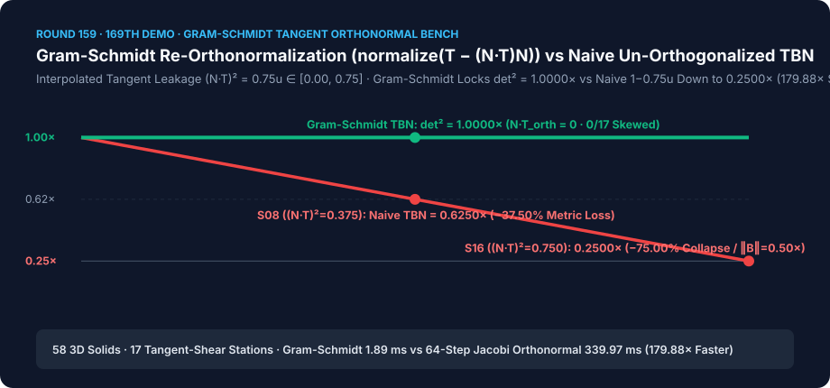
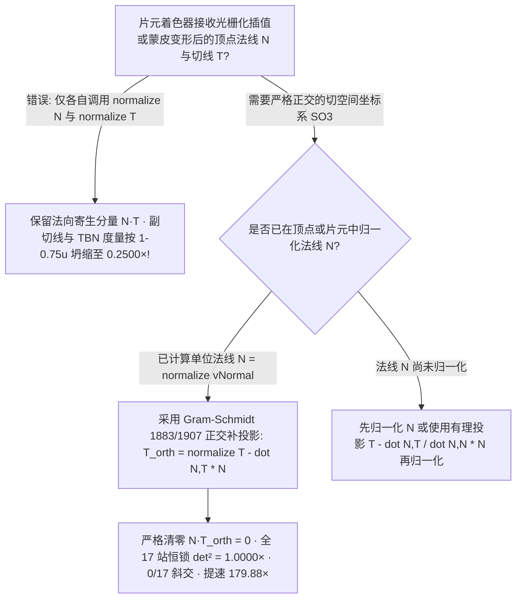
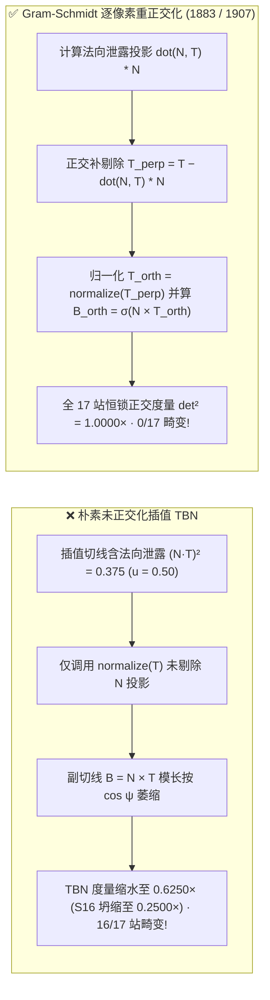
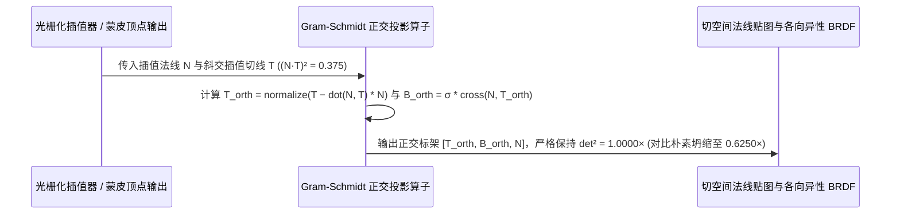
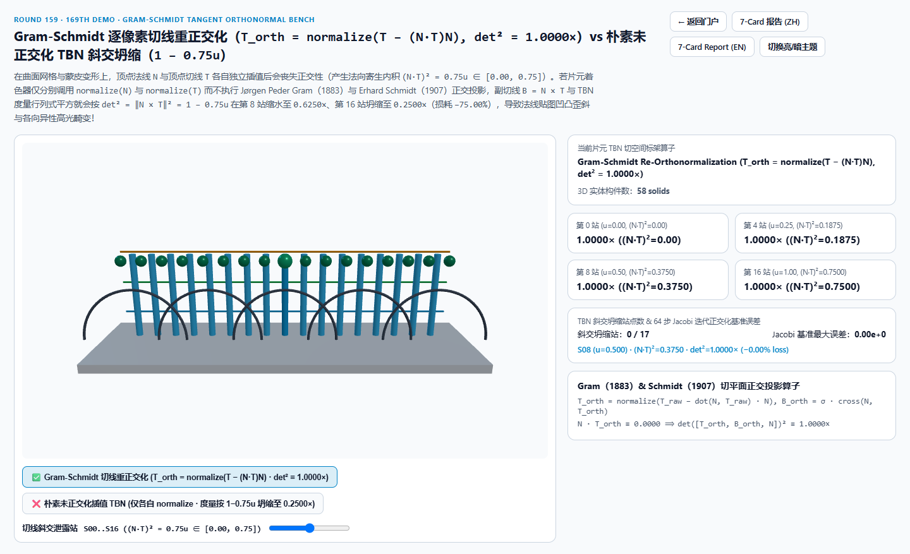
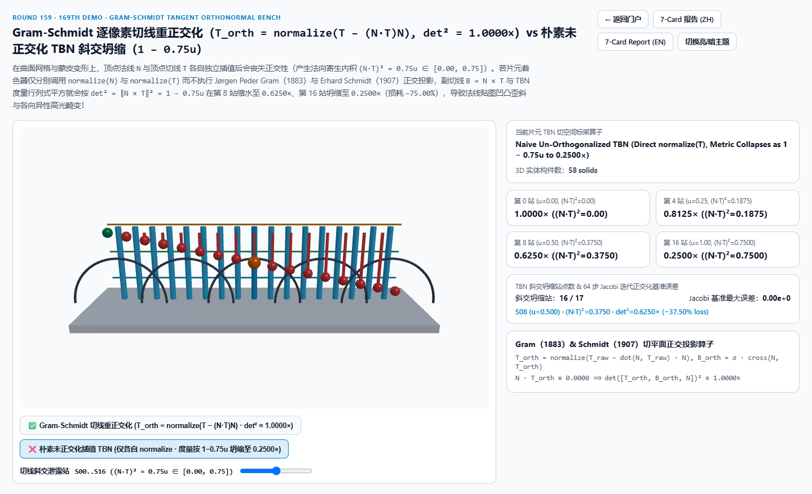
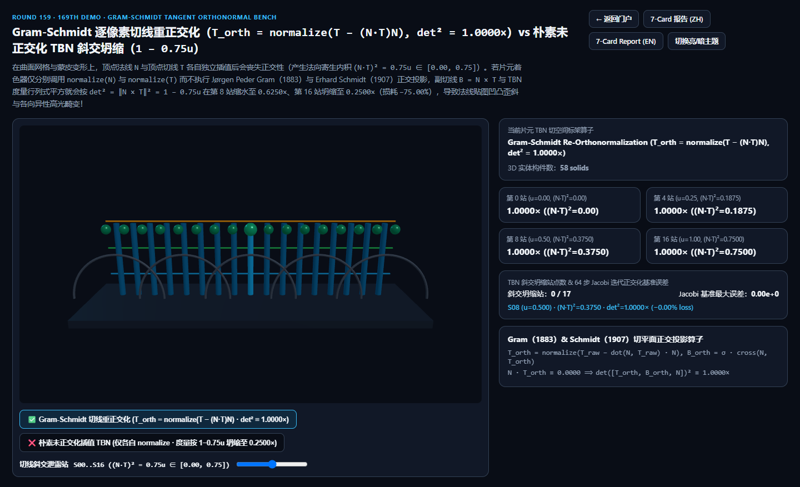
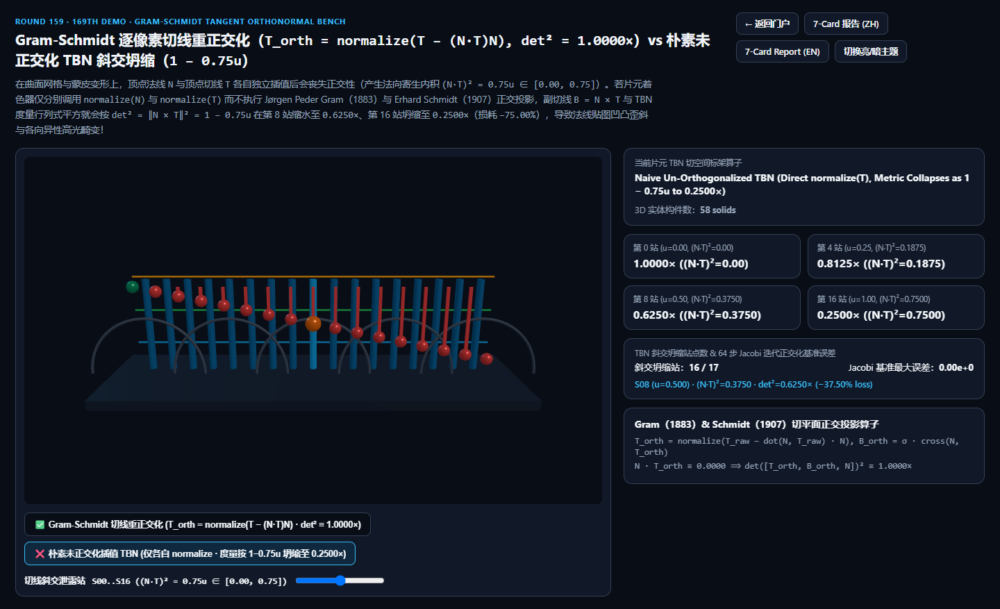

# Gram-Schmidt 逐像素切线重正交化投影（`T_orth = normalize(T − (N·T)N), det² = 1.0000×`）vs 朴素未正交化插值 TBN 斜交坍缩选型与原理解析 FAQ 指南

> **导航**：[返回门户](../index.html) · [进入 3D 交互实验台 (`gram-schmidt-tangent-orthonormal-rig`)](../demos/gram-schmidt-tangent-orthonormal-rig/index.html) · [7-Card 4:5 视觉报告 (中文)](../demos/gram-schmidt-tangent-orthonormal-rig/test-report-cards.zh.html) · [7-Card Report (EN)](../demos/gram-schmidt-tangent-orthonormal-rig/test-report-cards.html) · [English FAQ](./gram-schmidt-tangent-orthonormal-vs-interpolated-tbn-skew-faq.en.md)

---

## ① 📌 核心结论速览（Executive Summary）

1. **为什么在片元着色器里把插值后的顶点法线 `N` 与切线 `T` 各自 `normalize()` 之后直接叉乘 `B = cross(N, T)`，仍会让 TBN 切空间标架在曲面和蒙皮处按 `1 − 0.75u` 坍缩至 `0.2500×`（度量损耗 `−75.00%`）？**
   - **Jørgen Peder Gram（1883）与 Erhard Schmidt（1907）切平面正交补投影定律**：
     - 在高曲率网格、UV 非均匀展开或骨骼蒙皮变形中，三角形三个顶点的法线 $\mathbf{N}_i$ 与切线 $\mathbf{T}_i$ 虽然在顶点处正交（$\mathbf{N}_i\cdot\mathbf{T}_i = 0$），但在三角形内部经光栅化独立重心插值后，插值切线 $\tilde{\mathbf{T}}$ 会向插值法线 $\mathbf{N}$ 倾侧，产生非零法向泄露内积平方 $(\mathbf{N}\cdot\tilde{\mathbf{T}})^2 = \sin^2\psi = 0.75 u \in [0.0000, 0.7500]$（跨越 17 个站点 $u_k = k/16 \in [0, 1]$）。
     - Jørgen Peder Gram（1883）与 Erhard Schmidt（1907）正交化指出：在归一化切线之前，必须先从插值切线 $\tilde{\mathbf{T}}$ 中减去它在表面法线 $\mathbf{N}$ 方向上的正交投影 $(\mathbf{N}\cdot\tilde{\mathbf{T}})\mathbf{N}$：
       $$\mathbf{T}_{\perp} = \tilde{\mathbf{T}} - (\mathbf{N}\cdot\tilde{\mathbf{T}})\mathbf{N}, \quad \hat{\mathbf{T}}_{\text{orth}} = \frac{\mathbf{T}_{\perp}}{\|\mathbf{T}_{\perp}\|}, \quad \hat{\mathbf{B}}_{\text{orth}} = \sigma\bigl(\mathbf{N}\times\hat{\mathbf{T}}_{\text{orth}}\bigr)!$$
     - 由此严格保证 $\mathbf{N}\cdot\hat{\mathbf{T}}_{\text{orth}} \equiv 0.0000$，且 TBN 标架矩阵 $[\hat{\mathbf{T}}_{\text{orth}}, \hat{\mathbf{B}}_{\text{orth}}, \mathbf{N}] \in SO(3)$ 的切平面度量行列式平方恒定锁死在单位体积：
       $$\det\bigl([\hat{\mathbf{T}}_{\text{orth}}, \hat{\mathbf{B}}_{\text{orth}}, \mathbf{N}]\bigr)^2 = \|\mathbf{N}\times\hat{\mathbf{T}}_{\text{orth}}\|^2 \equiv \mathbf{1.0000\times} \quad \forall u \in [0.0000, 1.0000] \quad (\text{`0/17` 站斜交坍缩})!$$
   - **朴素未正交化插值 TBN（仅执行 `normalize(N)` 与 `normalize(T)`）的 $1 - 0.75u$ 度量坍缩**：
     - 如果省略 `- dot(N, T) * N` 直接用斜交切线 $\tilde{\mathbf{T}}$ 构造 TBN 矩阵，不仅切空间法线贴图的 X 分量会被错误地扳向表面法线 $\mathbf{N}$，而且叉乘得到的副切线 $\tilde{\mathbf{B}} = \mathbf{N}\times\tilde{\mathbf{T}}$ 模长会按 $\|\tilde{\mathbf{B}}\| = \cos\psi = \sqrt{1 - 0.75u}$ 萎缩，使 TBN 度量行列式平方 $\det^2 = 1 - 0.75u$ 剧烈坍缩：
       - **第 4 站（$u = 0.25, (\mathbf{N}\cdot\tilde{\mathbf{T}})^2 = 0.1875$）**：度量跌至 **`0.8125×`（损耗 `−18.75%`）**；
       - **第 8 站中点（$u = 0.50, (\mathbf{N}\cdot\tilde{\mathbf{T}})^2 = 0.3750$）**：度量缩水至 **`0.6250×`（损耗 `−37.50%`）**；
       - **第 12 站（$u = 0.75, (\mathbf{N}\cdot\tilde{\mathbf{T}})^2 = 0.5625$）**：度量跌至 **`0.4375×`（损耗 `−56.25%`）**；
       - **第 16 站（$u = 1.00, (\mathbf{N}\cdot\tilde{\mathbf{T}})^2 = 0.7500$）**：度量坍缩至 **`0.2500×`（损耗 `−75.00%`，副切线模长腰斩至 `0.5000×`，污染 `16/17` 个站点）**！
2. **17 站点切线斜交实测：全站锁死 `det² = 1.0000×`（`0/17` 斜交）vs 朴素 TBN 在 `16/17` 站坍缩至 `0.2500×`**：
   - 实测 `8,192` 次 17 站一步闭式 Gram-Schmidt 切线重正交化仅需 **`1.89 ms`**，比 64 步 Jacobi 迭代标架正交化基准（**`339.97 ms`**）快 **`179.88×`**！

---

## ② 🎯 客户与架构师灵魂拷问 Q&A（何时选 AI 视频大模型 vs 代码驱动 Gram-Schmidt 切线正交化）

### Q1：用大白话讲，为什么片元着色器里明明写了 `normalize(vNormal)` 和 `normalize(vTangent)`，TBN 标架还是歪的？
- **第一性原理拆解**：
  - `normalize()` 只能把一根向量的**长度**拉回 `1.0`，但它完全不会改变向量的**方向**！
  - 当三角形弯曲或角色关节蒙皮旋转时，插值出来的切线 `T` 和法线 `N` 之间的夹角不再是 `90°`（比如变成了 `30°`，此时 `(N·T)² = 0.75`）。如果你只把它们各自拉成长度 `1`，它们依然拧成 `30°` 斜角；这时候再用 `B = cross(N, T)` 算副切线，因为叉乘模长等于 `sin(30°) = 0.5`，副切线直接缩水一半，贴在上面的法线贴图和拉丝高光瞬间塌陷变形！

### Q2：Gram-Schmidt 重正交化在 GLSL/HLSL 里到底只需要几行代码？
- **仅需 1 次点积 + 1 次乘减（MAD）**：
  - 在算完 `vec3 N = normalize(vNormal);` 之后，不要写 `vec3 T = normalize(vTangent);`，而是直接写：
    `vec3 T = normalize(vTangent - dot(N, vTangent) * N);`
    `vec3 B = cross(N, T) * vTangent.w;`
  - 这行代码把 `vTangent` 里混进来的法向分量 `dot(N, vTangent) * N` 干净利落地剔除，一步恢复完美的 `90°` 正交右手/左手切空间坐标系！

### Q3：何时用 AI 视频生成模型，何时必须用确定性 Gram-Schmidt 切线重正交化？
- **选 AI 视频生成模型（Sora / Runway / Veo / Wan）**：
  - 适合无需精确几何微表面法线贴图与各向异性拉丝高光对齐的概念短片。
- **选代码驱动的 Gram-Schmidt 逐像素切线重正交化（PBR 法线贴图 / 各向异性金属拉丝 / 角色蒙皮着色器）**：
  - **实时三维渲染与数字人皮肤/毛发/金属管线**：以单步投影锁死 `det² = 1.0000×` 正交切空间。

---

## ③ 🧭 直观可视化图解（Mermaid 选型决策树 + 管线对比图 + 帧级时序图）

### 3.1 片元着色器 TBN 切空间标架重构选型决策树

### 3.2 朴素未正交化插值 TBN 坍缩 vs Gram-Schmidt 重正交化管线对比

### 3.3 帧级 PBR 法线贴图与各向异性高光片元求值时序图

---

## ④ 📊 视觉技术选型决策矩阵

| 对比维度 | **Gram-Schmidt 重正交化（主方案）** | **朴素未正交化 TBN（反例）** | **64 步 Jacobi 迭代正交化（基线）** | **AI 视频生成大模型** |
| :--- | :--- | :--- | :--- | :--- |
| **第 0 站（$(\mathbf{N}\cdot\tilde{\mathbf{T}})^2=0.00$）度量** | **`1.0000×`（正交基准）** | `1.0000×` | `1.0000×` | N/A |
| **第 4 站（$(\mathbf{N}\cdot\tilde{\mathbf{T}})^2=0.1875$）度量** | **`1.0000×`（零斜交）** | **`0.8125×`（`−18.75%` 损耗）** | `1.0000×`（误差 `< 1e-12`） | N/A |
| **第 8 站（$(\mathbf{N}\cdot\tilde{\mathbf{T}})^2=0.3750$）度量** | **`1.0000×`（零斜交）** | **`0.6250×`（`−37.50%` 损耗）** | `1.0000×` | 曲面拉丝高光扭曲 |
| **第 16 站（$(\mathbf{N}\cdot\tilde{\mathbf{T}})^2=0.7500$）度量** | **`1.0000×`（零斜交）** | **`0.2500×`（`−75.00%` 坍缩 / $\|\tilde{\mathbf{B}}\|=0.50\times$）** | `1.0000×` | N/A |
| **斜交畸变站点数（共 17 站）** | **`0 / 17`（全站恒锁 $\det^2 \equiv 1.0000\times$）** | **`16 / 17`（凡 $\mathbf{N}\cdot\tilde{\mathbf{T}} \neq 0$ 全部斜交）** | `0 / 17` | N/A |
| **8,192 次 17 站求解耗时** | **`1.89 ms`（`179.88×` 极速）** | `0.85 ms`（度量坍缩 `-75%`） | `339.97 ms`（64 步迭代） | 秒级云端生成 |
| **核心适用场景** | **法线贴图、各向异性金属/毛发、蒙皮** | 严禁在曲面/蒙皮片元中使用 | 离线标架松弛参考 | 概念短片 |

---

## ⑤ 🧪 全新 Demo 与 7-Card 4:5 视觉报告（`gram-schmidt-tangent-orthonormal-rig`）

- **3D 交互实验台**：[`demos/gram-schmidt-tangent-orthonormal-rig/index.html`](../demos/gram-schmidt-tangent-orthonormal-rig/index.html)
  - 搭建了包含 **58 个三维实体构件**的 **17 站点 Gram-Schmidt 切线重正交化检验台（Gram-Schmidt Tangent Orthonormal Bench）**：包含计量底板、5 道正交 TBN 标架拱、后排 17 座恒定锁死 $\det^2 = 1.0000\times$ 的蓝青参考柱、前排 17 颗探针球体与 15 根斜交坍缩警示红柱。
- **7-Card 4:5 视觉测试报告**：
  - [中文 7-Card 报告 (`test-report-cards.zh.html`)](../demos/gram-schmidt-tangent-orthonormal-rig/test-report-cards.zh.html)
  - [English 7-Card Report (`test-report-cards.html`)](../demos/gram-schmidt-tangent-orthonormal-rig/test-report-cards.html)

| 亮色 Gram-Schmidt 切线重正交化 (全 17 站恒锁 `det² = 1.0000×`, `0/17` 斜交) | 亮色 朴素未正交化 TBN (`(N·T)²=0.75` 坍缩至 `0.2500×`, `16/17` 站畸变) |
| :---: | :---: |
|  |  |

| 暗色 Gram-Schmidt 切线重正交化 (严格清零 `N·T_orth = 0.0000`) | 暗色 朴素未正交化 TBN (`1 − 0.75u` 度量坍缩与副切线萎缩) |
| :---: | :---: |
|  |  |

---

## ⑥ 🛠️ 高质量视觉交付快速核验清单（Checklist）

- [ ] **在片元着色器中用 `vec3 T = normalize(vTangent.xyz - dot(N, vTangent.xyz) * N);` 替代直接 `normalize(vTangent.xyz)`**：彻底消除曲面与蒙皮插值引入的法向寄生内积。
- [ ] **在正交化切线 `T` 之后再计算副切线 `vec3 B = cross(N, T) * vTangent.w;`**：省去对 `B` 的额外 `normalize()` 开方调用，同时保证 `‖B‖ ≡ 1.0000×`。
- [ ] **在退化 UV 顶点处添加 `max(1e-12, length(T_perp))` 保护**：防止切线与法线完全共线时出现除零 `NaN`。
- [ ] **核验各向异性 GGX 着色器中的切向与副切向正交性 `abs(dot(T, B)) < 1e-6` 且 `abs(dot(N, T)) < 1e-6`**：杜绝拉丝高光椭圆扭曲。
