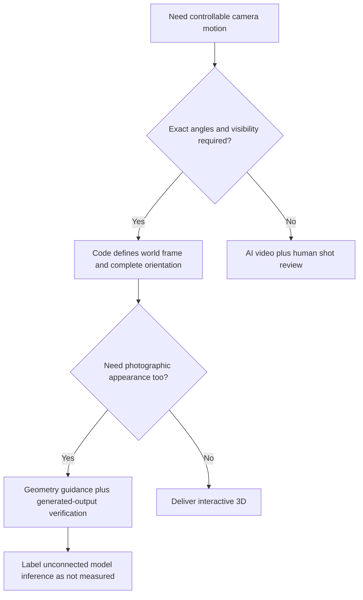
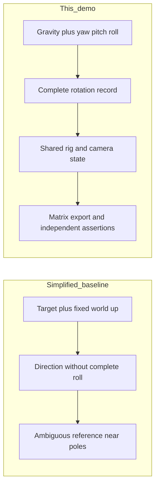
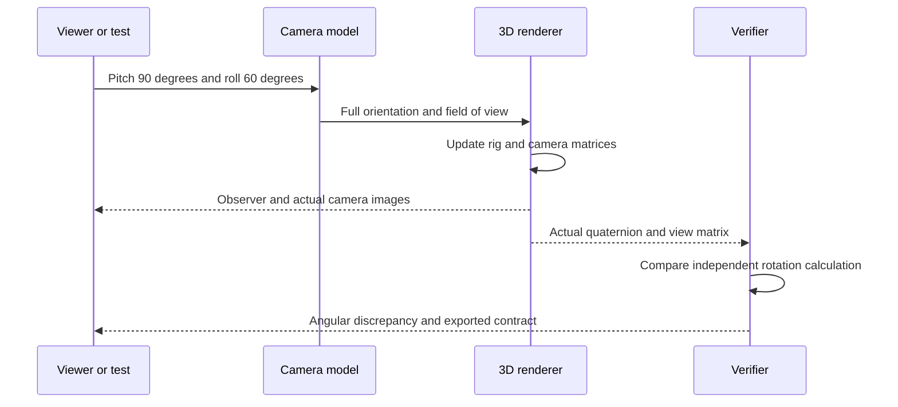

# Stable pitch, poles and roll: a gravity-referenced camera selection FAQ

**Three minutes for the decision; ten minutes for the hands-on steps.**

[中文](gravity-aware-camera-faq.md) · [Interactive demo](https://turbo998.github.io/animation/demos/gravity-gimbal-lab/) · [Seven measured cards](../demos/gravity-gimbal-lab/test-report-cards.html)

## ① 📌 Executive Summary

- **Pointing is not a complete orientation.** A camera aimed at the ceiling can still rotate around its lens. A target point plus a permanently upright world reference omits that requested roll.
- **Define the world's up direction, then the camera's own rotation.** This demo fixes gravity to world `−Y` and composes yaw, pitch and roll. Its actual 3D rig, camera image and exported matrix share one state.
- **127 rig solids, two views and 12 local checks.** This is a new original interactive camera-control substrate, not GimbalDiffusion inference disguised as a browser animation.
- **Verified recent research is not an invented daily ranking.** GimbalDiffusion's first preprint dates to December 9, 2025; the latest verified revision is August 2, 2026, with ECCV 2026 acceptance. Adobe's conference coverage highlights gravity, extreme angles and prompt-control conflict. Retrieved November 9, 2026; not claimed as a same-day launch or popularity winner.

## ② 🎯 Customer and architect Q&A

### Q1 When should I choose an AI video model versus interactive code?

Generative video is valuable for natural performances, rich materials and cinematic appearance. Code gives a more directly inspectable answer to “did the camera really reach this orientation?” Advertising may tolerate another sample; inspection training, VR camera exercises and reproducible simulation viewpoints often treat angles as requirements, not suggestions.

Combine them when useful: code authors trajectories and geometric guidance, then a model creates appearance. **Correct control input does not guarantee correct generated output.** This demo implements the control layer only. Model inference, cost and video quality remain unmeasured.

### Q2 Under which explicit requirements is code the better choice?

If acceptance says “look up exactly 90° and roll 60°,” “revisit a timestamp,” “export the real view matrix,” or “no runtime networking,” deterministic control directly supplies those surfaces. This is a constraint-specific conclusion, not a universal claim that hand-authored 3D looks better than generated imagery.

For remote equipment-inspection training, a virtual scene can explain how a lens sees an overhead interface. Actual optics, safe motion and mechanical tolerances need separate calibration; the illustrative rig cannot certify them.

### Q3 How does the pipeline work, and why can simplified camera motion fail?

Point a phone at the same ceiling lamp, then hold it horizontally or vertically. The direction stayed the same, but the image changed. **The target direction omitted a piece of information: where the camera's top edge lies.**

A common simplification calls `lookAt(target)` while fixing `up` to world-up. That suits a horizon-preserving observer but supplies no complete roll input. At straight-up or straight-down views, the target direction becomes nearly parallel to up, making the reference ambiguous. The demo's baseline deliberately implements that incomplete contract.

**lookAt is not inherently defective.** Supplying the correctly rolled up-vector can represent the full orientation too. The missing contract, not the API's name, is the problem.

A quaternion stores a full orientation. In plain language, it is a four-number rotation record that avoids repeatedly converting orientation back into a different set of three angles near a pole. Viewers still edit familiar angles; the program composes them into one record used by both rig and camera.

This **does not eliminate physical gimbal lock**. Mechanical axes may coincide near a pole. Stable software orientation storage does not add a mechanical degree of freedom.

GimbalDiffusion extends gravity-referenced control into a generative model and uses panoramic training coverage for extreme viewpoints. Its null-pitch conditioning aims to reduce prompt-camera entanglement, such as a “grass” cue wrongly overriding an upward-looking camera. This demo marks such a conflict but does not execute the neural method.

### Q4 How can I reproduce it in ten minutes?

1. Run `npm run dev`, then open `/demos/gravity-gimbal-lab/`. The left view shows the rig; the right is the actual camera image.
2. Select “Look up + roll 60°.” A marked ceiling target makes roll observable, rather than requiring a guess from a flat color.
3. Switch to the world-up lookAt baseline and inspect the orientation discrepancy; then restore the full contract.
4. Choose pole crossing or ceiling-and-roll, and seek any timestamp. Reduced motion starts still while preserving manual controls.
5. Export `GRAVITY_CAMERA.json`: inspect requested angles, actual quaternion, gravity and the 16-entry view matrix—not just a prompt.
6. Run `npx vitest run tests\gravity-gimbal.test.ts`. After building and starting the repository preview on port 4335, run `node scripts\benchmark-gimbal.mjs`.

**Why Three.js rather than the previous SVG path?** This subject needs genuine perspective, depth and different camera viewpoints. Reusing the repository's Three.js avoids presenting a fixed isometric projection as a complete camera. SVG remains the lighter choice for the previous cutaway explanation.

## ③ 🧭 Visual explanations

## ④ 📊 Architect Decision Matrix

| Requirement | Target + fixed up | Full code orientation | Camera-conditioned video model |
| --- | --- | --- | --- |
| Horizon-preserving observation | Simple and suitable | Suitable | Review outputs |
| Explicit roll and pole views | Incomplete simplified contract | Directly expressible here | Research supports the direction; unmeasured here |
| Timestamp revisit and matrix export | Possible after completing the contract | Explicit state and interface | Inputs can be saved; output consistency needs testing |
| Photographic environments and natural motion | Requires assets and animation | Requires assets and animation | Often a good fit, with evaluation |
| Mechanical safety and optical calibration | Insufficient | Not certified by this demo | Pixel appearance is not certification |

**Capacity example:** twelve seconds at a target thirty pose samples per second implies 360 queries. Each needs a complete orientation, not merely a target. This is design arithmetic, not measured FPS or model throughput.

## ⑤ 🧪 New demo and benchmark findings, including seven cards

The 127 rig solids are `synthetic`. The sealed [report.json](../demos/gravity-gimbal-lab/report.json) holds `measured` local assertions, discrepancies and JavaScript submission timings. GimbalDiffusion inference, generated appearance, mechanical tolerances and display latency are `not_measured`.

The key geometric finding: for an east-facing camera with a requested 60° roll, the complete contract matches within the tested tolerance, while the fixed-up baseline leaves about a 60° full-orientation discrepancy. The downward pole case also exposes reference ambiguity. All four actual inputs and raw values are recorded; they cannot become a neural control-accuracy percentage.

Timing compares updating existing rig entities with reconstructing entity objects per frame. Both paths reuse the same geometry and submit the same two views. This is a local implementation comparison, not a Three.js-versus-other-engines leaderboard or a universal speedup guarantee. Seven raw repetitions retain variability and outliers.

[English cards](../demos/gravity-gimbal-lab/test-report-cards.html) · [中文七卡](../demos/gravity-gimbal-lab/test-report-cards.zh.html). A recorded zero quaternion discrepancy means the tested floating-point result and tolerance; it is not continuous-time, optical or mechanical zero-error certification.

## ⑥ 🛠️ Architect Checklist

- [ ] Define world frame, up direction, positive angle conventions and matrix layout.
- [ ] Preserve both direction and roll, not just a target point.
- [ ] Exercise ±90° pitch, ±180° yaw and substantial roll.
- [ ] Drive rig, camera, readout and export from shared state.
- [ ] Provide visible ceiling/floor orientation targets.
- [ ] Start reduced motion still and freeze offscreen/background advancement.
- [ ] Separate GPU object counts from measured memory bytes.
- [ ] Keep unconnected inference `not_measured`; never borrow paper numbers for local bars.
- [ ] Verify model licenses, data rights, optics and mechanical constraints before commercial delivery.
- [ ] Publish bilingual FAQ, H5, visual summary, raw evidence and bilingual seven-card reports.

**Verified primary sources:** [GimbalDiffusion arXiv: December 9, 2025 / v4 August 2, 2026](https://arxiv.org/abs/2512.09112) · [Project control examples and method](https://lvsn.github.io/GimbalDiffusion/) · [Adobe ECCV 2026 institutional coverage](https://research.adobe.com/news/eccv-2026/). Research direction cited; no project video, image or code copied. Retrieved November 9, 2026.
