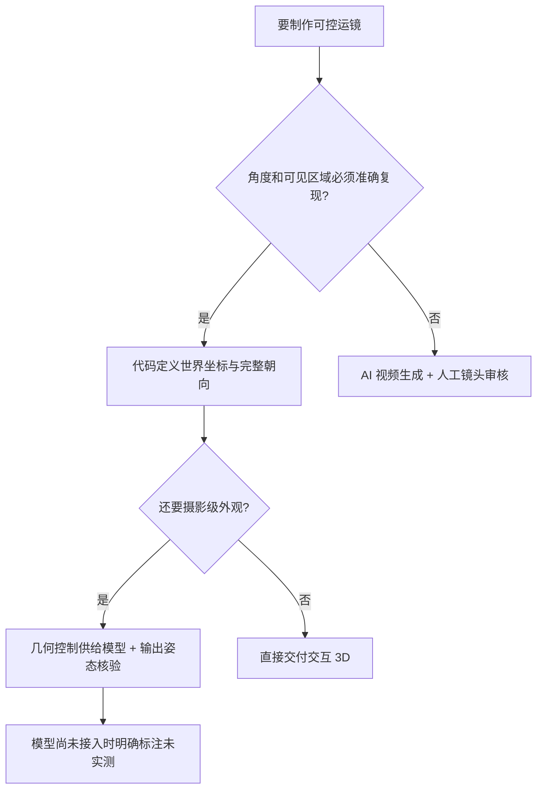
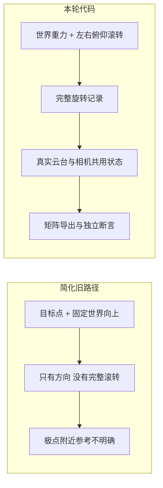
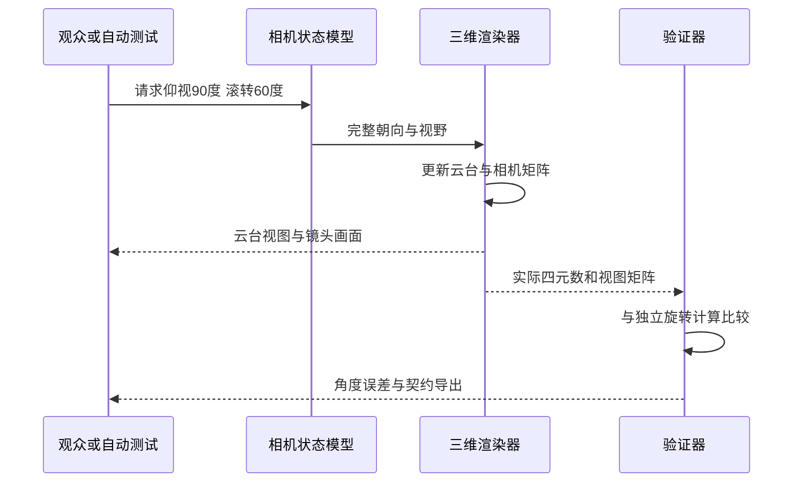

# 仰视、俯视与滚转不乱跳：重力参考相机选型与原理 FAQ

**3 分钟：读结论与矩阵；10 分钟：按 Q4 操作云台。**

[English](gravity-aware-camera-faq.en.md) · [交互 Demo](https://turbo998.github.io/animation/demos/gravity-gimbal-lab/) · [中文七卡](../demos/gravity-gimbal-lab/test-report-cards.zh.html)

## ① 📌 核心结论速览（Executive Summary）

- **“朝哪里看”不等于“完整朝向”。** 相机朝天空看，还能绕自身镜头转动。只给一个目标点、始终把世界向上当画面向上，会丢掉这项滚转要求。
- **先定义世界里的上，再定义相机自身的转。** 本例把重力固定为世界 `−Y`，用左右、俯仰、滚转三个明确控制生成完整朝向；真实 3D 云台、相机画面与导出矩阵使用同一个状态。
- **127 个云台实体、双视图、12 项本机检查。** 新 Demo 同时显示机械云台与镜头真正看到的画面。它没有运行 GimbalDiffusion 权重；不是把代码动画包装成 AI 视频推理。
- **今日追踪的是已核验方向，不是捏造日热度榜。** GimbalDiffusion 首稿为 2025-12-09，最新可核验修订为 2026-08-02，获 ECCV 2026 接收。Adobe 的 ECCV 2026 报道强调重力参考、极端俯仰/滚转与文字提示冲突控制；检索日期为 2026-11-09，不宣称当日首发或热度第一。

## ② 🎯 客户与架构师灵魂拷问 Q&A

### Q1 何时选 AI 视频大模型 vs 何时选代码驱动交互式动画？

要自然人物、真实材质和电影感，生成视频很有价值；要检查“相机真的转到指定角度了吗”，代码更容易给出可核验答案。营销片可以容忍适度重新采样，设备检查、VR 运镜练习与仿真视角复现常不能把角度当成建议。

两者可以分工：代码先产生相机轨迹与几何控制图，视频模型再生成外观。**轨迹输入正确，不代表模型输出一定正确。** 本 Demo 只交付前一层控制与可检查画面，后端模型、推理费用和视频质量都未实测。

### Q2 什么场景下代码驱动动画严格更优？

当验收明确要求“正上方 90°、再滚转 60°”“同一时间返回同一朝向”“导出真实视图矩阵”“无运行时联网”时，确定性控制直接符合这些条件。这里的“更优”指这组约束，不是说手写 3D 在摄影质感上普遍超过生成模型。

客户方案示例：制造设备的远程检查培训，先在虚拟场景练习镜头如何观察上方接口；镜头偏转、滚转与可见区域由状态模型解释。真实设备的光学参数、碰撞安全和机械公差仍需另外标定，不可由本例认证。

### Q3 底层管线怎么工作？为什么旧的运镜容易假或失控？

想象拿着手机：指向同一盏吊灯，手机横着拿与竖着拿，画面并不一样。**目标方向少了一条信息：相机的“上边”在哪里。**

常见简化代码用 `lookAt(目标)`，再固定 `up = 世界向上`。它适合保持水平的观察相机，却没有输入完整滚转。到正上方或正下方时，目标方向与世界向上几乎平行，参考方向变得不够清楚。本例的“旧路径”正是这个刻意简化的版本。

**lookAt 本身不是坏 API。** 提供正确的、随相机滚转的 up 向量，也可以表达完整朝向。缺陷在控制契约不完整，而不是函数名字。

新路径用“四元数”保存朝向。先用大白话理解：它是四个数的一份旋转记录，避免反复把朝向倒算成三个角度时，在极点附近突然换一套角度描述。观众仍调三个熟悉角度，程序把它们组合成完整旋转，机械云台与相机使用同一记录。

这也**不消除真实机械云台的锁轴问题**。极点处某些轴在机械上可能重合；我们的工作是让软件朝向表达稳定，不是增加机械自由度。

GimbalDiffusion 的研究进一步把重力作为生成模型的全局坐标参考，并用全景视频覆盖极端视角。它的 null-pitch 条件试图降低文字与几何控制纠缠，例如“草地”提示不应让仰视镜头错误看向地面。本例提供一个提示冲突标记，但没有执行该神经模型。

### Q4 10 分钟怎么复刻到自己的方案？

1. 运行 `npm run dev`，打开 `/demos/gravity-gimbal-lab/`；左边是云台，右边是相机画面。
2. 点击“Look up + roll 60°”。天花板的方向箭头提供可见滚转参照，不靠一块纯色板猜旋转。
3. 切换 `World-up lookAt baseline`。观察画面与请求的完整朝向误差，再切回完整契约。
4. 选择“穿越俯仰极点”或“仰视与滚转”，用时间轴跳到任意一帧；减少动态时默认静止，手动控制仍有效。
5. 导出 `GRAVITY_CAMERA.json`，检查请求角度、实际四元数、世界重力与 16 项视图矩阵，不只保存一句文字提示。
6. 运行 `npx vitest run tests\gravity-gimbal.test.ts`。生产构建后，启动本仓库预览端口 4335，再执行 `node scripts\benchmark-gimbal.mjs`。

**为什么用 Three.js 而不是上一轮的 SVG？** 本轮真正需要相机看到不同方向的三维场景、正确深度与透视。复用仓库已有 Three.js，避免把固定等轴测投影假装成完整相机。SVG 更适合上一轮的轻量拆解讲解。

## ③ 🧭 直观可视化图解

## ④ 📊 视觉技术选型决策矩阵（Architect Decision Matrix）

| 需求 | 目标点 + 固定 up | 完整代码朝向 | 带相机条件的视频模型 |
| --- | --- | --- | --- |
| 保持水平的普通观察镜头 | 简单、适合 | 适合 | 输出仍需审核 |
| 指定滚转、正上/下方视角 | 此简化契约不完整 | 本例可直接表达 | 研究方向支持；这里未实测 |
| 任意时间复现、矩阵导出 | 补足契约后可实现 | 明确的状态与接口 | 输入可保存，输出一致性另测 |
| 摄影级环境与自然动作 | 需要资产与动画 | 需要资产与动画 | 通常更合适，但需评测 |
| 机械安全与真实光学校准 | 不足 | 本例不足 | 像素外观不能认证 |

**选型算例：** 一段 12 秒、目标每秒取 30 个姿态的镜头是 360 次状态查询。每次需保留完整朝向，而非只保留目标点。360 是容量算例，不是本机 FPS 或模型吞吐量。

## ⑤ 🧪 全新能力 Demo 与 Benchmark 核心发现（含 7-Card）

新 Demo 的 127 个云台实体为 `synthetic`；[本机 report.json](../demos/gravity-gimbal-lab/report.json) 的 12 项断言、误差和 JavaScript 提交耗时为 `measured`。GimbalDiffusion 推理、生成画质、真实机械公差与屏幕出光延迟为 `not_measured`。

关键几何发现：朝东并要求滚转 60°时，完整契约在所测精度内符合请求；固定世界 up 的简化 lookAt 留下约 60°完整朝向误差。正下方测试还暴露了极点参考问题。原始数值与四个具体输入都保存在 JSON，不能把它们外推成神经模型控制准确率。

性能条形图比较“更新已有云台实体”与“每帧重建实体对象”，两条路径都复用相同几何并提交相同两视图；这是本机实现路径比较，不是 Three.js 对其他引擎的排行榜，也不承诺所有负载都有相同加速。原始 7 次重复保留波动与异常值，不只挑最快一次。

[中文七卡](../demos/gravity-gimbal-lab/test-report-cards.zh.html) · [English cards](../demos/gravity-gimbal-lab/test-report-cards.html)。四元数数值“0 误差”指所记录的浮点比较结果与容差，不是连续时间、真实镜头或机械系统的零误差认证。

## ⑥ 🛠️ 附录：Architect Checklist

- [ ] 明确世界坐标、向上方向、正向角度与视图矩阵排列。
- [ ] 同时保存相机方向与画面滚转，不只保存目标点。
- [ ] 检查 ±90°俯仰、±180°左右与大滚转。
- [ ] 让物理云台、相机、读数和导出来自同一状态。
- [ ] 天花板/地面有可见方向标记，不靠纯色判断旋转。
- [ ] 减少动态默认静止；离屏和后台不继续推进。
- [ ] 资源计数与真实显存字节分开，不从对象数量推断 GB。
- [ ] 模型未接入就写 `not_measured`，不能借论文数字填条形图。
- [ ] 商业部署前另验模型许可、数据权利、机械和光学约束。
- [ ] 中英 FAQ、可交互 H5、视觉总结、原始数据与双语七卡都可访问。

**核验来源：** [GimbalDiffusion arXiv，首稿 2025-12-09 / v4 2026-08-02](https://arxiv.org/abs/2512.09112) · [项目控制演示与方法说明](https://lvsn.github.io/GimbalDiffusion/) · [Adobe ECCV 2026 机构报道](https://research.adobe.com/news/eccv-2026/)。引用研究方向，不转载其视频、图片或代码；检索于 2026-11-09。
