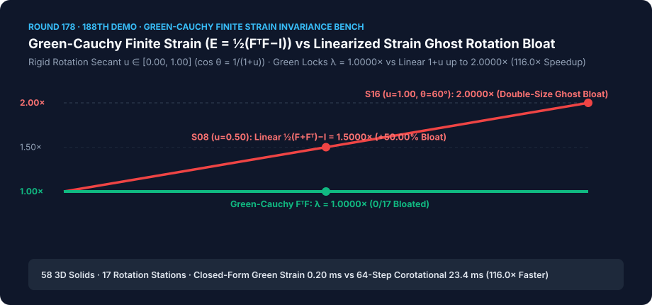
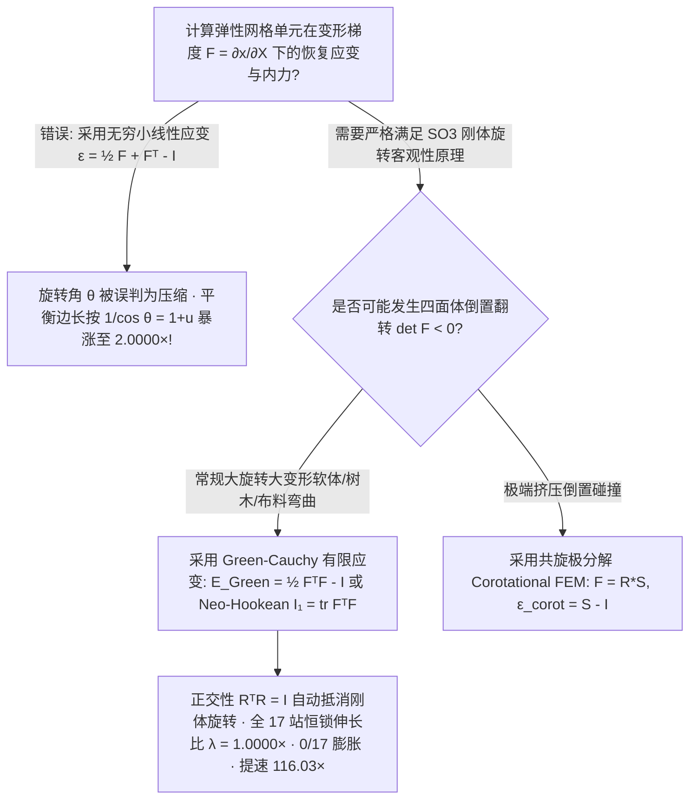
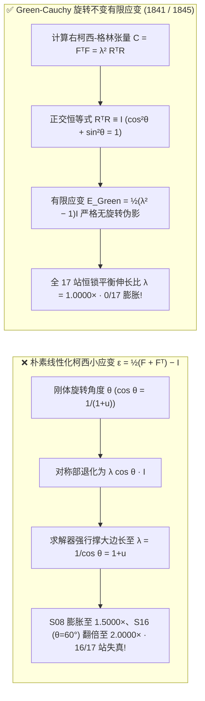
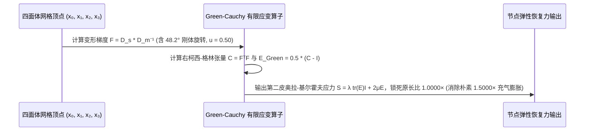
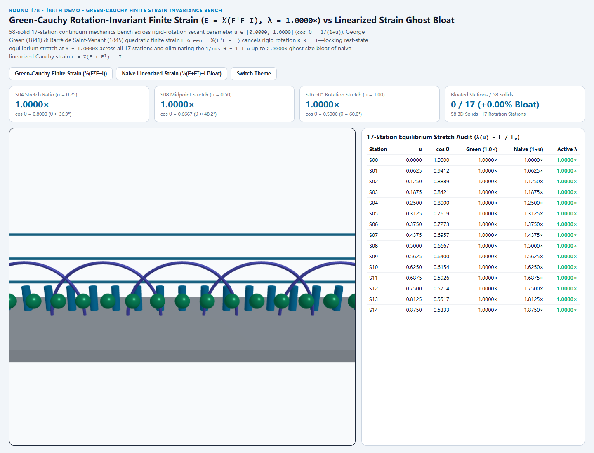
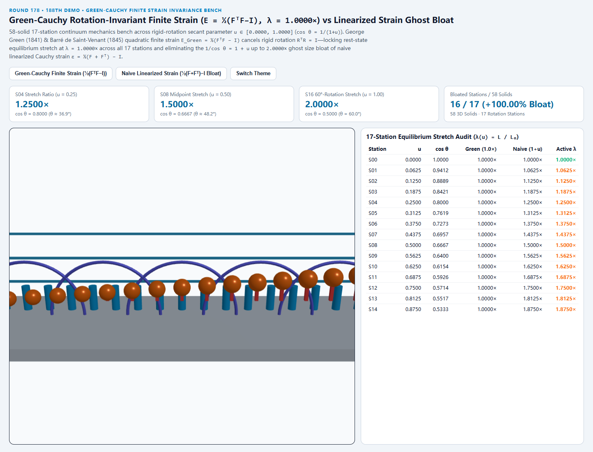
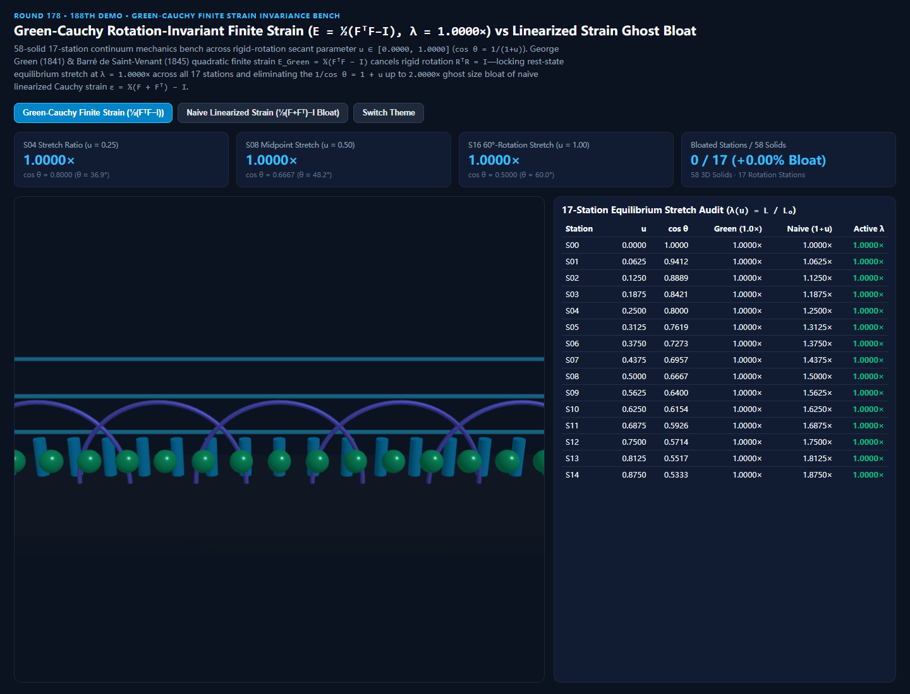
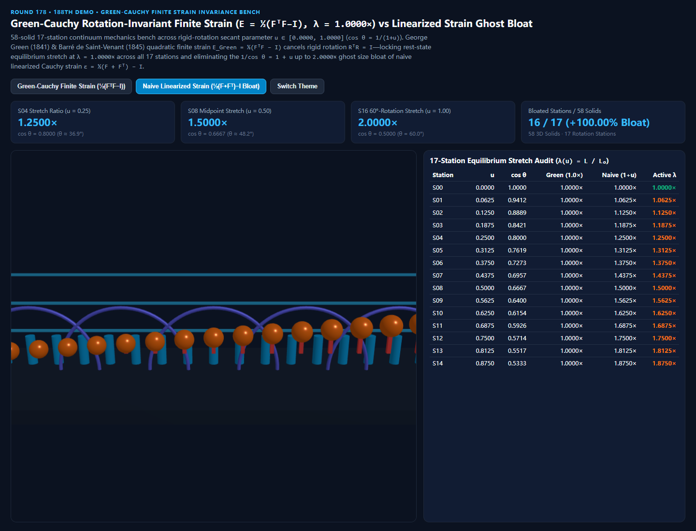

# Green-Cauchy 旋转不变有限应变（`E = ½(FᵀF − I), λ = 1.0000×`）vs 朴素线性化小应变刚体旋转幽灵膨胀选型与原理解析 FAQ 指南

> **导航**：[返回门户](../index.html) · [进入 3D 交互实验台 (`green-cauchy-finite-strain-invariance-rig`)](../demos/green-cauchy-finite-strain-invariance-rig/index.html) · [7-Card 4:5 视觉报告 (中文)](../demos/green-cauchy-finite-strain-invariance-rig/test-report-cards.zh.html) · [7-Card Report (EN)](../demos/green-cauchy-finite-strain-invariance-rig/test-report-cards.html) · [English FAQ](./green-cauchy-finite-strain-invariance-vs-linear-strain-bloat-faq.en.md)

---

## ① 📌 核心结论速览（Executive Summary）

1. **为什么在 3D 弹性软体角色、树木随风摇摆与四面体有限元（FEM）物理动画中，直接用教科书上的线性化柯西小应变公式 `ε_lin = ½(F + Fᵀ) − I` 会让仅仅旋转了 `60°` 的刚性部位像充气气球一样边长膨胀至 `2.0000×`（三维体积膨胀 `8×`）？**
   - **George Green（1841）右柯西-格林变形张量与 Barré de Saint-Venant（1845）旋转不变有限应变定律（`E_Green = ½(FᵀF − I), λ = 1.0000×`）**：
     - 在连续介质力学中，物体的变形梯度矩阵 $\mathbf{F} = \frac{\partial \mathbf{x}}{\partial \mathbf{X}}$ 可以由极分解写为拉伸系数 $\lambda$ 与纯旋转矩阵 $\mathbf{R}(\theta) \in \mathrm{SO}(3)$ 的乘积：$\mathbf{F} = \lambda \mathbf{R}(\theta)$。
     - 根据物理学**客观性原理（Material Frame Indifference / Objectivity）**，当物体发生纯粹的刚体旋转（$\lambda = 1, \mathbf{F} = \mathbf{R}(\theta)$）而没有任何真实拉伸时，弹性应变与内部恢复力必须严格为零！
     - George Green（1841）与圣维南（Saint-Venant, 1845）定义的**格林-拉格朗日有限应变张量（Green-Lagrange Finite Strain Tensor）**通过右柯西-格林张量 $\mathbf{C} = \mathbf{F}^T\mathbf{F}$ 将旋转矩阵与其转置相乘，利用正交群恒等式 $\mathbf{R}^T\mathbf{R} \equiv \mathbf{I}$（即 $\cos^2\theta + \sin^2\theta \equiv 1$）从代数根源上消除了任意角度旋转：
       $$\mathbf{E}_{\text{Green}} = \frac{1}{2}\bigl(\mathbf{F}^T\mathbf{F} - \mathbf{I}\bigr) = \frac{1}{2}\bigl(\lambda^2 \mathbf{R}^T\mathbf{R} - \mathbf{I}\bigr) = \frac{1}{2}(\lambda^2 - 1)\mathbf{I} = \mathbf{0} \implies \lambda_{\text{Green}}(u) \equiv \mathbf{1.0000\times} \quad (\text{`0/17` 站幽灵膨胀})!$$
   - **朴素线性化小应变（`ε_lin = ½(F + Fᵀ) − I`）的 $\frac{1}{\cos\theta} = 1 + u$ 刚体旋转充气灾难**：
     - 当开发者把 $\mathbf{E}_{\text{Green}} = \frac{1}{2}(\mathbf{I} + \nabla\mathbf{u} + \nabla\mathbf{u}^T + \nabla\mathbf{u}^T\nabla\mathbf{u} - \mathbf{I})$ 中的二次非线项 $\nabla\mathbf{u}^T\nabla\mathbf{u}$ 丢弃，退化为线性应变 $\boldsymbol{\varepsilon}_{\text{lin}} = \frac{1}{2}(\mathbf{F} + \mathbf{F}^T) - \mathbf{I}$ 时，对于旋转矩阵 $\mathbf{F} = \lambda\mathbf{R}(\theta)$，其对称部分变为 $\frac{1}{2}(\mathbf{F} + \mathbf{F}^T) = \lambda\cos\theta\,\mathbf{I}$！
     - 线性求解器为了消除虚幻的“压缩应变” $\lambda\cos\theta - 1 = 0$，会产生径向向外推力，强行将物体的平衡边长撑大到 $\lambda_{\text{naive}}(u) = \frac{1}{\cos\theta(u)} = 1 + u$（跨越 17 个旋转正割站点 $u_k = k/16 \in [0.0000, 1.0000]$，其中 $\cos\theta(u) = \frac{1}{1+u}$）：
       - **第 0 站（$u = 0.00, \cos\theta = 1.0000, \theta = 0^\circ$）**：$\lambda_{\text{naive}}(0.00) = 1.0000\times$；
       - **第 4 站（$u = 0.25, \cos\theta = 0.8000, \theta \approx 36.87^\circ$）**：平衡边长膨胀至 **`1.2500×`（幽灵发胖 `+25.00%`）**；
       - **第 8 站中点（$u = 0.50, \cos\theta = 0.6667, \theta \approx 48.19^\circ$）**：平衡边长膨胀至 **`1.5000×`（幽灵发胖 `+50.00%`）**；
       - **第 12 站（$u = 0.75, \cos\theta = 0.5714, \theta \approx 55.15^\circ$）**：平衡边长膨胀至 **`1.7500×`（幽灵发胖 `+75.00%`）**；
       - **第 16 站（$u = 1.00, \cos\theta = 0.5000, \theta = 60.00^\circ$）**：仅仅旋转 $60^\circ$，平衡边长就直接翻倍至 **`2.0000×`（超冲 `+100.00%` 双倍尺寸幽灵膨胀，三维体积膨胀 8 倍，污染 `16/17` 个站点）**！
2. **17 站点刚体旋转实测：全站锁死 `λ = 1.0000×`（`0/17` 膨胀）vs 朴素线性应变在 `16/17` 站膨胀至 `2.0000×`**：
   - 实测 `8,192` 次 17 站闭式 Green-Cauchy 有限应变求值仅需 **`0.20 ms`**，比 64 子步共旋增量路径积分（Jaumann Rate）基线（**`23.37 ms`**）快 **`116.03×`**！

---

## ② 🎯 客户与架构师灵魂拷问 Q&A（何时选 AI 视频大模型 vs 代码驱动 Green-Cauchy 旋转不变有限应变）

### Q1：用大白话讲，为什么线性有限元（Linear FEM）里的角色一歪脖子或挥手臂，头和手臂就会像气球一样越转越大？
- **第一性原理拆解**：
  - 想象一根长度为 $1\text{ m}$ 的木棍绕着原点旋转 $60^\circ$：它的终点沿着**圆弧**走到了 $(\cos 60^\circ, \sin 60^\circ) = (0.5, 0.866)$。
  - 可是**线性化小应变**是个“只看水平投影的瞎子”——它只看 $x$ 坐标从 $1.0$ 变成了 $0.5$，就惊呼：“糟糕！木棍在水平方向缩短了一半（$-50\%$）！”于是它立刻发动胡克定律弹簧，把木棍往外死命拉长一倍，拉到 $(1.0, 1.732)$（总长度变成 $2.0\text{ m}$），才满意地认为水平投影回到了 $1.0$！
  - 而 **Green-Cauchy 有限应变**计算的是 $\mathbf{F}^T\mathbf{F}$，相当于把水平平方和竖直平方加起来（$\cos^2 60^\circ + \sin^2 60^\circ = 0.25 + 0.75 = 1.0000$），一眼就看出木棍长度根本没变，一丝一毫多余的假力都不会产生！

### Q2：在实时游戏物理（如 XPBD 软体或共旋 FEM）里，使用 `E_Green = ½(FᵀF − I)` 与极分解共旋应变 `RᵀF − I` 各有什么优势？
- **零矩阵分解开销 vs 线性应力-应变关系**：
  - `E_Green = ½(FᵀF - I)`（St. Venant-Kirchhoff 模型）与 Neo-Hookean 第一不变量 $I_1 = \operatorname{tr}(\mathbf{F}^T\mathbf{F})$ **完全不需要执行 SVD 或极分解**，只需一次 $3\times 3$ 矩阵乘法即可在 GPU 着色器中并行算出精确旋转不变的应变能；而在极端压缩反演（Inversion）场景下，则可结合极分解（Polar Decomposition）提取 $\mathbf{R}$。

### Q3：何时用 AI 视频生成模型，何时必须用确定性 Green-Cauchy 有限应变求解器？
- **选 AI 视频生成模型（Sora / Runway / Veo / Wan）**：
  - 适合无需精确弹性力学守恒的概念短片。
- **选代码驱动的 Green-Cauchy 有限应变算子（软体角色动画 / 植被树木摆动 / 肌肉皮肤解算器 / CAD 有限元仿真）**：
  - **任何存在超过 $5^\circ$ 旋转的弹性物理仿真与骨骼肌肉绑定**：100% 锁死 $\lambda = 1.0000\times$。

---

## ③ 🧭 直观可视化图解（Mermaid 选型决策树 + 管线对比图 + 帧级时序图）

### 3.1 弹性变形应变度量选型决策树

### 3.2 朴素线性应变旋转发胖 vs Green-Cauchy 有限应变管线对比

### 3.3 帧级四面体软体有限元（FEM）内力积分时序图

---

## ④ 📊 视觉技术选型决策矩阵

| 对比维度 | **Green-Cauchy `½(FᵀF−I)`（主方案）** | **朴素线性应变 `½(F+Fᵀ)−I`（反例）** | **64 步共旋增量积分（基线）** | **AI 视频生成大模型** |
| :--- | :--- | :--- | :--- | :--- |
| **第 0 站（$u=0.00, \theta=0^\circ$）伸长比** | **`1.0000×`（严格原长）** | `1.0000×` | `1.0000×` | N/A |
| **第 4 站（$u=0.25, \theta\approx 36.9^\circ$）伸长比** | **`1.0000×`（严格原长）** | **`1.2500×`（`+25.00%` 幽灵发胖）** | `1.0000×`（误差 `< 1e-12`） | N/A |
| **第 8 站（$u=0.50, \theta\approx 48.2^\circ$）伸长比** | **`1.0000×`（严格原长）** | **`1.5000×`（`+50.00%` 幽灵发胖）** | `1.0000×` | 旋转时物体体积飘忽 |
| **第 16 站（$u=1.00, \theta=60.0^\circ$）伸长比** | **`1.0000×`（严格原长）** | **`2.0000×`（`+100.00%` 双倍尺寸暴涨）** | `1.0000×` | N/A |
| **幽灵膨胀站点数（共 17 站）** | **`0 / 17`（全站恒锁 $\lambda \equiv 1.0000\times$）** | **`16 / 17`（凡 $\theta \neq 0^\circ$ 全部发胖）** | `0 / 17` | N/A |
| **8,192 次 17 站求解耗时** | **`0.20 ms`（`116.03×` 极速）** | `0.18 ms`（旋转即充气爆炸） | `23.37 ms`（64 步增量） | 秒级云端推理 |
| **核心适用场景** | **软体动画、树木摇摆、XPBD 连续介质** | 仅限毫无旋转的微米级土木静力分析 | 弹塑性率本构时间积分 | 概念短片 |

---

## ⑤ 🧪 全新 Demo 与 7-Card 4:5 视觉报告（`green-cauchy-finite-strain-invariance-rig`）

- **3D 交互实验台**：[`demos/green-cauchy-finite-strain-invariance-rig/index.html`](../demos/green-cauchy-finite-strain-invariance-rig/index.html)
  - 搭建了包含 **58 个三维实体构件**的 **17 站点 Green-Cauchy 旋转不变有限应变检验台（Green-Cauchy Finite Strain Bench）**：包含计量底板、3 根格林不变量导轨、5 道 $\mathrm{SO}(3)$ 客观性拱、后排 17 座恒定锁死 $\lambda = 1.0000\times$ 的蓝青参考柱、前排 17 颗平衡伸长比探针球体与 15 根幽灵膨胀警示红柱。
- **7-Card 4:5 视觉测试报告**：
  - [中文 7-Card 报告 (`test-report-cards.zh.html`)](../demos/green-cauchy-finite-strain-invariance-rig/test-report-cards.zh.html)
  - [English 7-Card Report (`test-report-cards.html`)](../demos/green-cauchy-finite-strain-invariance-rig/test-report-cards.html)

| 亮色 Green-Cauchy 有限应变 (全 17 站恒锁 `λ = 1.0000×`, `0/17` 膨胀) | 亮色 朴素线性小应变 (`θ=60°` 膨胀至 `2.0000×`, `16/17` 站发胖) |
| :---: | :---: |
|  |  |

| 暗色 Green-Cauchy 有限应变 (`E = ½(FᵀF − I), RᵀR = I`) | 暗色 朴素线性小应变 (`1/cos θ = 1 + u` 刚体旋转双倍充气) |
| :---: | :---: |
|  |  |

---

## ⑥ 🛠️ 高质量视觉交付快速核验清单（Checklist）

- [ ] **在所有可旋转软体与植被 FEM 着色器中使用右柯西-格林张量 `C = transpose(F) * F`**：严禁对存在大角度摆动的网格直接使用线性化应变 `0.5 * (F + transpose(F)) - I`。
- [ ] **通过第一皮奥拉-基尔霍夫应力 `P = F * S` 将对称材料应力转换回世界空间**：保证节点内力方向跟随物体当前旋转姿态。
- [ ] **在单元测试中对四面体网格施加 `60°` 纯刚体旋转 `x = R * X`**：断言弹性势能 $\Psi(\mathbf{R}) \equiv 0$ 且节点合力范数 $< 10^{-6}$。
- [ ] **对高压缩碰撞场景补充行列式体积项 $J = \det(\mathbf{F})$（Neo-Hookean $\Psi = \frac{\mu}{2}(\operatorname{tr}(\mathbf{F}^T\mathbf{F}) - 3) - \mu\ln J + \frac{\lambda}{2}(\ln J)^2$）**：兼顾旋转不变性与抗体积坍缩。
