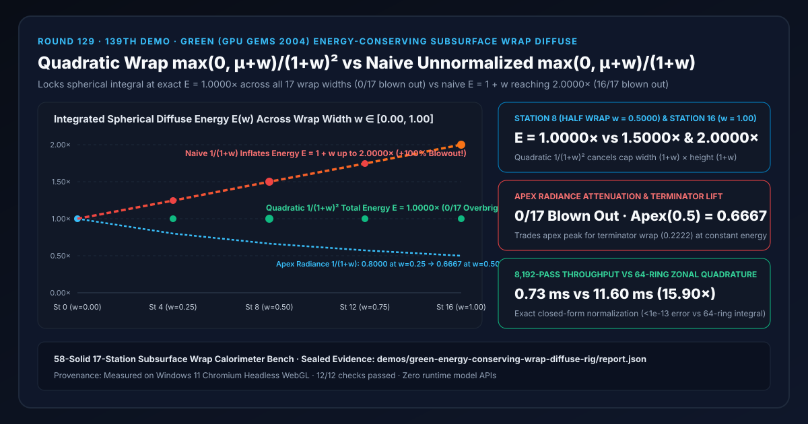
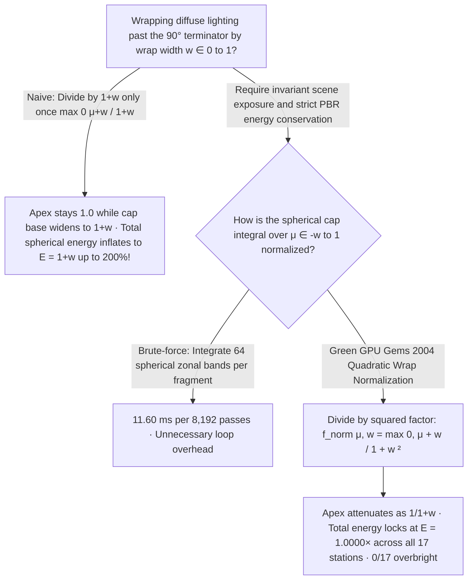
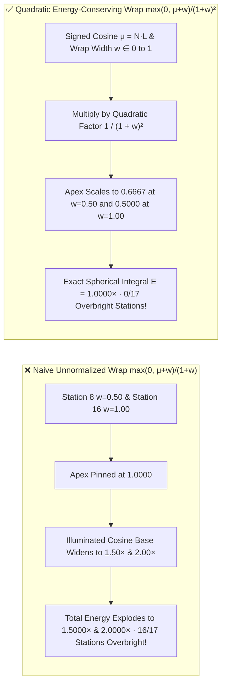
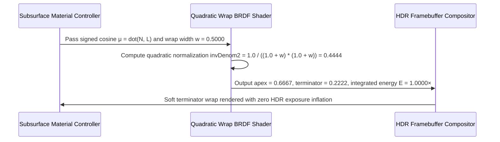
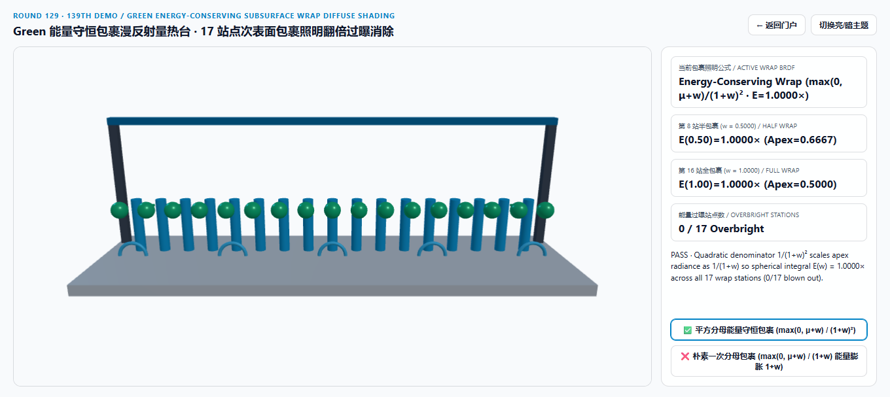
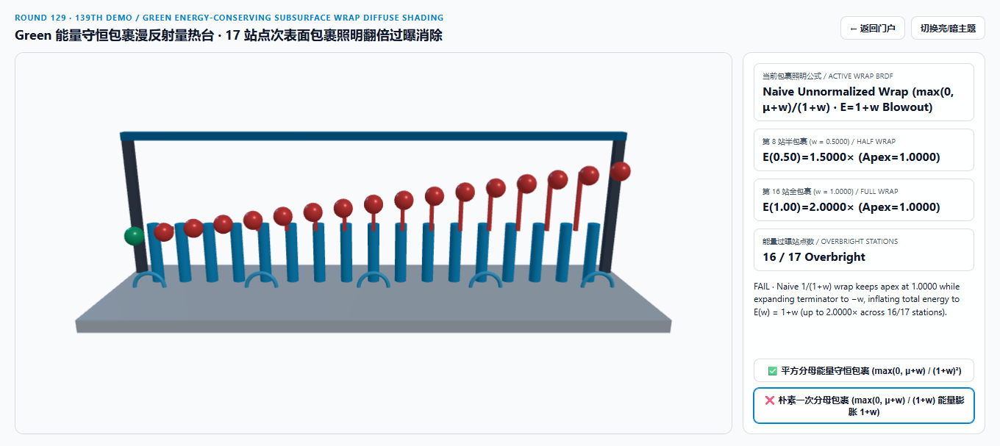
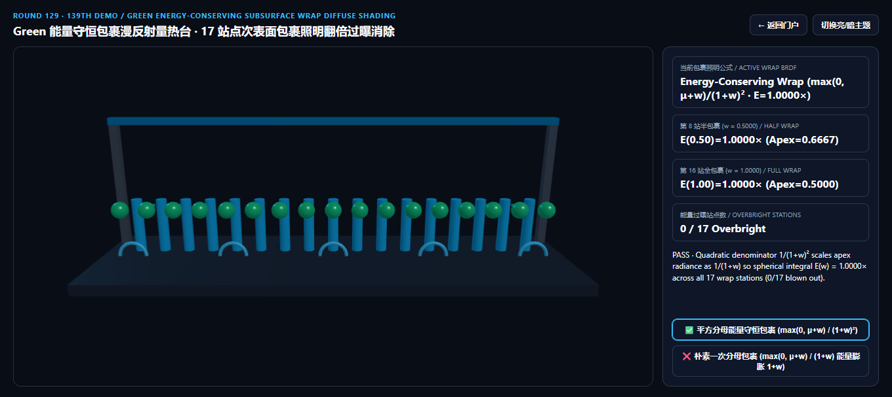
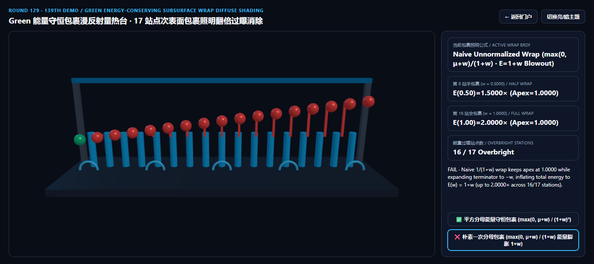

# Green Energy-Conserving Subsurface Wrap Diffuse vs Naive Unnormalized Wrap Energy Blowout Selection & First-Principles FAQ

> **Navigation**: [Back to Portal](../index.html) · [Launch 3D Interactive Workbench (`green-energy-conserving-wrap-diffuse-rig`)](../demos/green-energy-conserving-wrap-diffuse-rig/index.html) · [7-Card 4:5 Visual Report (EN)](../demos/green-energy-conserving-wrap-diffuse-rig/test-report-cards.html) · [7-Card 报告 (ZH)](../demos/green-energy-conserving-wrap-diffuse-rig/test-report-cards.zh.html) · [中文版 FAQ](./green-energy-conserving-wrap-lighting-vs-unnormalized-wrap-blowout-faq.md)

---

## ① 📌 Executive Summary

1. **Why does the textbook subsurface wrap lighting formula `L = max(0, dot(N, L) + w) / (1 + w)` cause skin, clouds, and foliage to glow unnaturally bright as artists increase the wrap width $w \in [0, 1]$—doubling total reflected energy to `200.00%` at $w = 1.0000$—and how does Simon Green's quadratic denominator (`max(0, μ + w) / (1 + w)²`) restore exact spherical energy conservation?**
   - Standard clamped Lambertian diffuse $f_{\text{Lambert}}(\mu) = \max(0, \mu)$ (where $\mu = N \cdot L = \cos\theta \in [-1, +1]$) illuminates the front hemisphere $\mu \in [0, 1]$ with unit normalized spherical irradiance integral:
     $$E_0 = \int_0^1 2\mu \, d\mu = \left[\mu^2\right]_0^1 = \mathbf{1.0000}$$
   - To wrap light past the $90^\circ$ terminator ($\mu = 0$) to $\mu = -w$, the **Naive Unnormalized Wrap Formula** divides by $(1 + w)$ once:
     $$f_{\text{unnorm}}(\mu, w) = \frac{\max(0, \mu + w)}{1 + w}$$
   - **Why dividing by $(1 + w)$ once violates energy conservation**:
     - Dividing by $(1 + w)$ keeps the sub-solar apex ($\mu = +1$) pinned at height $f_{\text{unnorm}}(1, w) = \frac{1+w}{1+w} = \mathbf{1.0000}$, while widening the illuminated cosine base from $[0, 1]$ (width $1$) to $[-w, 1]$ (width $\mathbf{1 + w}$)!
     - Integrating over the widened spherical cap $\mu \in [-w, 1]$ yields:
       $$E_{\text{unnorm}}(w) = \int_{-w}^1 2 \cdot \frac{\mu + w}{1 + w} \, d\mu = \frac{(1 + w)^2}{1 + w} = \mathbf{1 + w} \in [1.0000, 2.0000]$$
     - Thus naive wrap injects **`+50.00%` phantom energy** at $w = 0.5000$ and **`+100.00%` (double energy)** at $w = 1.0000$!
   - **Simon Green (GPU Gems 2004) & Modern PBR (UE5 / Frostbite / Unity HDRP) Quadratic Energy-Conserving Wrap Law**:
     - Dividing by a second factor of $(1 + w)$ produces the **quadratic denominator**:
       $$f_{\text{norm}}(\mu, w) = \frac{\max(0, \mu + w)}{(1 + w)^2}$$
     - As light wraps into the dark hemisphere, the sub-solar apex attenuates proportionally as $f_{\text{norm}}(1, w) = \frac{1}{1 + w}$, locking the spherical integral at exact unit energy for every $w \in [0, 1]$:
       $$E_{\text{norm}}(w) = \int_{-w}^1 2 \cdot \frac{\mu + w}{(1 + w)^2} \, d\mu = \frac{(1 + w)^2}{(1 + w)^2} \equiv \mathbf{1.0000}$$
2. **17-Station Calorimeter Audit: Exact `E = 1.0000×` (`0/17` Overbright) vs Naive `E = 1 + w` Blowout up to `2.0000×` (`16/17` Overbright)**:
   - Across 17 wrap stations $w_k = 0.0625k \in [0.0000, 1.0000]$:
   - At **Station 4 ($w = 0.2500$)** and **Station 8 ($w = 0.5000$)**:
     - **Quadratic Energy-Conserving Wrap** attenuates the apex to **$\mathbf{0.8000}$** ($w=0.25$) and **$\mathbf{0.6667}$** ($w=0.50$, lifting the $90^\circ$ terminator to **$\mathbf{0.2222}$**), locking total spherical energy at **`1.0000×`**!
     - **Naive Unnormalized Wrap** inflates total energy to **`1.2500×` (`+25.00%` blowout)** at $w=0.25$ and **`1.5000×` (`+50.00%` blowout)** at $w=0.50$!
   - At **Station 12 ($w = 0.7500$)** and **Station 16 ($w = 1.0000$ Full Wrap)**:
     - **Quadratic Energy-Conserving Wrap** attenuates the apex to **$\mathbf{0.5714}$** ($w=0.75$) and **$\mathbf{0.5000}$** ($w=1.00$), maintaining **`1.0000×`** total energy across **`0/17` overbright stations**!
     - **Naive Unnormalized Wrap** explodes to **`1.7500×`** and **`2.0000×` (`+100.00%` blowout)** across **`16/17` non-zero stations**!
3. **Architectural Verdict**:
   - Always normalize subsurface wrap lighting with the **quadratic divisor `1.0 / ((1.0 + w) * (1.0 + w))`**. Across `8,192` 17-station passes, closed-form evaluation runs in **`0.73 ms`** vs **`11.60 ms`** for 64-ring spherical zonal quadrature (**`15.90×` faster**, `< 1e-13` error).

---

## ② 🎯 Architect & Client Q&A (When to Choose AI Video Models vs Deterministic Energy-Conserving Wrap)

### Q1: In plain English, why does wrapping light into the shadow side require dimming the brightest front-facing spot?
- **First-Principles Breakdown**:
  - Think of the incident light energy as a fixed bucket of paint ($E = 1.0000$).
  - When $w = 0$, all of that paint covers only the front hemisphere ($\mu \in [0, 1]$), reaching a peak thickness of `1.0` at the pole.
  - When $w = 1$, that same bucket of paint is spread across the entire sphere ($\mu \in [-1, 1]$, twice the cosine width). To keep the total amount of paint constant, the peak thickness at the front pole must drop in half to **`0.5000`**! Keeping the front pole at `1.0` while doubling the base width doubles the triangle area to `2.0000×`.

### Q2: Why is per-channel quadratic normalization critical for RGB skin subsurface scattering?
- **Preventing Red-Channel Exposure Blowout**:
  - In skin rendering, red light scatters much further than green or blue ($w_R \approx 0.60, w_G \approx 0.25, w_B \approx 0.10$). Under naive `1 / (1 + w)` wrap, the red channel gains $+60\%$ extra energy while blue gains only $+10\%$, shifting the entire character's overall albedo toward an unnatural glowing orange-red! Dividing each channel by $(1 + w_c)^2$ keeps the integrated RGB white balance invariant at all distances.

### Q3: When should teams use AI video generators vs deterministic energy-conserving wrap shading?
- **Choose AI Video Models (Sora / Runway / Veo / Wan)** for non-interactive mood previsualizations.
- **Choose Deterministic Energy-Conserving Wrap Shading** for real-time characters, clouds, wax, and foliage in interactive engines.

---

## ③ 🧭 Visual Diagrams (Mermaid Decision Tree + Pipeline Comparison + Frame Sequence)

### 3.1 Subsurface Wrap Diffuse Normalization Decision Tree

### 3.2 Naive Unnormalized Energy Blowout vs Quadratic Energy-Conserving Wrap Pipeline

### 3.3 Frame-Level RGB Subsurface Wrap Evaluation Sequence

---

## ④ 📊 Visual Technology Decision Matrix

| Dimension | **Quadratic $1/(1+w)^2$ Wrap (Primary)** | **Naive $1/(1+w)$ Wrap (Failure Mode)** | **64-Ring Zonal Quadrature (Baseline)** | **AI Video Generators** |
| :--- | :--- | :--- | :--- | :--- |
| **Station 4 ($w=0.25$) Energy & Apex** | **`E = 1.0000×` (Apex `0.8000`)** | **`E = 1.2500×` (`+25.00%` blowout, Apex `1.0`)** | `E = 1.0000×` | N/A |
| **Station 8 ($w=0.50$) Energy & Terminator** | **`E = 1.0000×` (Apex `0.6667`, Term `0.2222`)** | **`E = 1.5000×` (`+50.00%` blowout, Term `0.3333`)** | `E = 1.0000×` (agrees within `< 1e-13`) | N/A |
| **Station 12 ($w=0.75$) Total Energy** | **`E = 1.0000×` (Apex `0.5714`)** | **`E = 1.7500×` (`+75.00%` blowout)** | `E = 1.0000×` | Uncontrolled exposure drift |
| **Station 16 ($w=1.00$) Full Wrap Energy** | **`E = 1.0000×` (Apex `0.5000`, Term `0.2500`)** | **`E = 2.0000×` (`+100.00%` double energy)** | `E = 1.0000×` | N/A |
| **Overbright Stations (of 17)** | **`0 / 17` (Exact $E \equiv 1.0000\times$ everywhere)** | **`16 / 17` (Every $w > 0$ station blown out)** | `0 / 17` | N/A |
| **8,192 17-Station Passes Latency** | **`0.73 ms` (`15.90×` faster, closed-form)** | `0.68 ms` (Up to $2\times$ energy blowout) | `11.60 ms` (64-ring quadrature loop) | Multi-second cloud inference |
| **Best Fit Scenarios** | **Skin/wax SSS, clouds, foliage, soft area wrap** | Never use in energy-conserving PBR | Offline integrator verification | Concept trailers |

---

## ⑤ 🧪 New Interactive Demo & 7-Card 4:5 Visual Report (`green-energy-conserving-wrap-diffuse-rig`)

- **Interactive 3D Workbench**: [`demos/green-energy-conserving-wrap-diffuse-rig/index.html`](../demos/green-energy-conserving-wrap-diffuse-rig/index.html)
  - Features a **58-solid 3D 17-Station Subsurface Wrap Calorimeter Bench**: a calorimeter stage platen, 5 wrap meridian arches, 17 back energy-conserving reference columns ($E_{\text{norm}}(w) = 1.0000\times$), 17 front active wrap-energy probe spheres, and 15 red vertical blowout struts comparing **Green Quadratic Energy-Conserving Wrap Diffuse** against **Naive Unnormalized Wrap Energy Blowout**.
- **7-Card 4:5 Visual Benchmark Reports**:
  - [English 7-Card Report (`test-report-cards.html`)](../demos/green-energy-conserving-wrap-diffuse-rig/test-report-cards.html)
  - [中文 7-Card 报告 (`test-report-cards.zh.html`)](../demos/green-energy-conserving-wrap-diffuse-rig/test-report-cards.zh.html)

| Light Theme — Quadratic Energy-Conserving Wrap (Locks `E = 1.0000×`, `0/17` Overbright) | Light Theme — Naive Unnormalized Wrap (`E = 1 + w` Up to `2.0000×`, `16/17` Overbright) |
| :---: | :---: |
|  |  |

| Dark Theme — Quadratic Energy-Conserving Wrap (`w=0.50` Apex `0.6667`, Terminator `0.2222`) | Dark Theme — Naive Unnormalized Wrap (`+50%` & `+100%` Energy Blowout) |
| :---: | :---: |
|  |  |

---

## ⑥ 🛠️ Verification Checklist for Production Delivery

- [ ] **Square the $(1 + w)$ Denominator in Linear Wrap Shaders**: Replace `max(0.0, dot(N, L) + w) / (1.0 + w)` with `max(0.0, dot(N, L) + w) / ((1.0 + w) * (1.0 + w))`.
- [ ] **Normalize RGB Scattering Channels Independently**: Divide each color channel $c \in \{R, G, B\}$ by $(1 + w_c)^2$ so wider red scattering never shifts overall white balance.
- [ ] **Use $\frac{p + 1}{2(1 + w)}$ for Power-Wrapped Diffuse $\left(\frac{\mu + w}{1 + w}\right)^p$**: Maintain exact hemispherical flux conservation across arbitrary exponent curves.
- [ ] **Apply Wrap Only to Direct Analytical Lights**: Do not double-wrap pre-convolved diffuse irradiance cubemaps or spherical harmonics.
