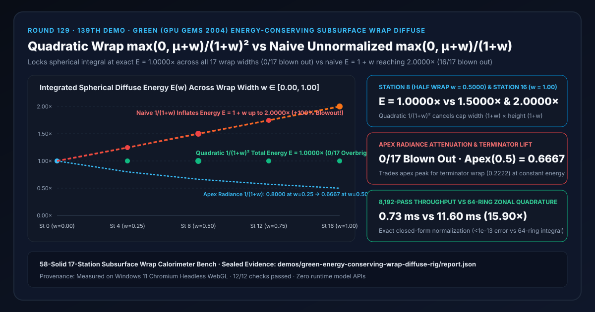
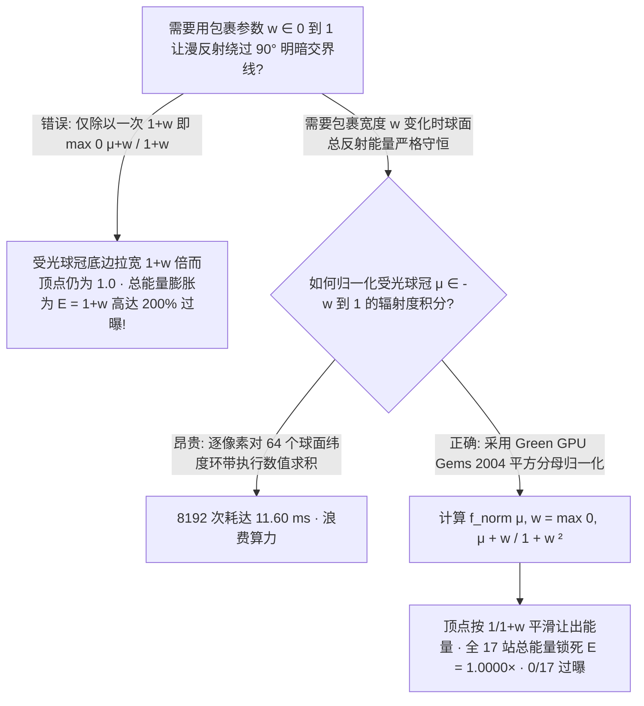
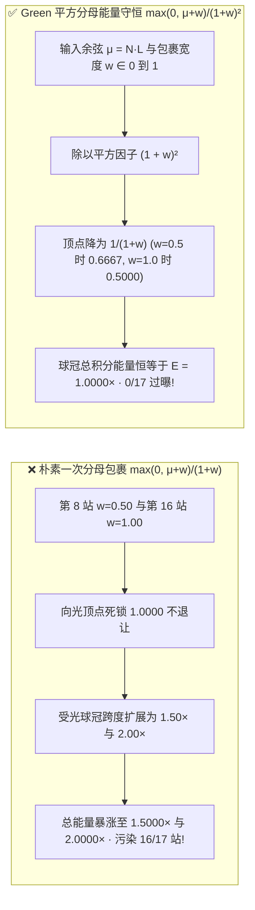
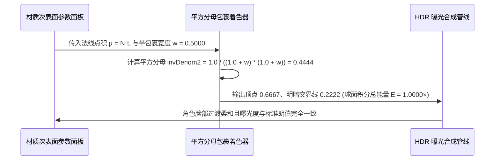
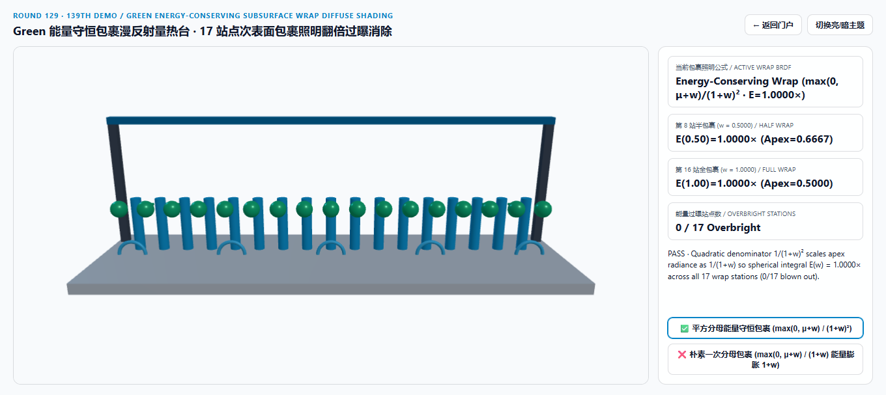
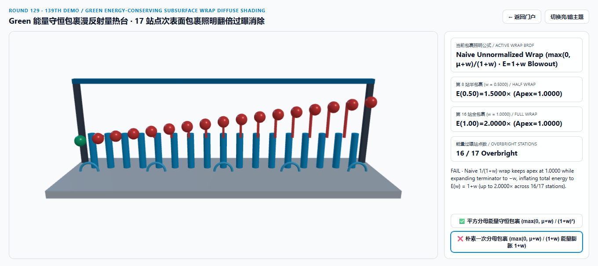
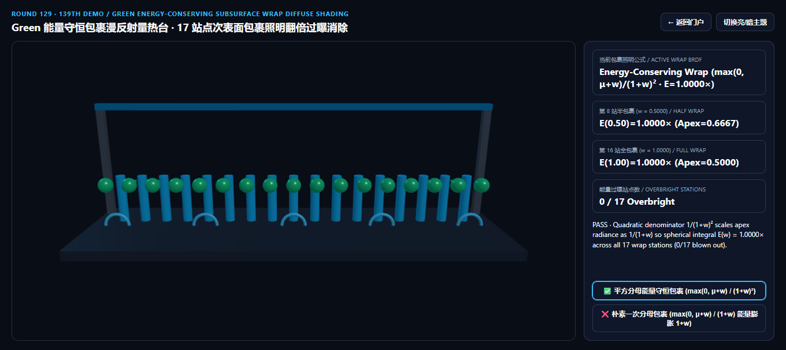
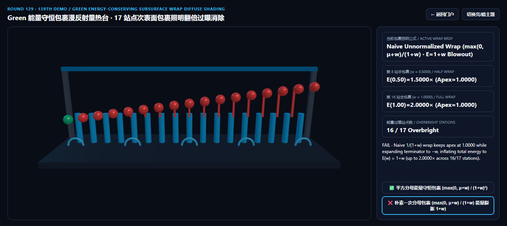

# Green 平方分母能量守恒包裹漫反射（Energy-Conserving Wrap Diffuse）vs 朴素一次分母包裹（`max(0, μ + w) / (1 + w)`）能量翻倍过曝选型与原理解析 FAQ 指南

> **导航**：[返回门户](../index.html) · [进入 3D 交互实验台 (`green-energy-conserving-wrap-diffuse-rig`)](../demos/green-energy-conserving-wrap-diffuse-rig/index.html) · [7-Card 4:5 视觉报告 (中文)](../demos/green-energy-conserving-wrap-diffuse-rig/test-report-cards.zh.html) · [7-Card Report (EN)](../demos/green-energy-conserving-wrap-diffuse-rig/test-report-cards.html) · [English FAQ](./green-energy-conserving-wrap-lighting-vs-unnormalized-wrap-blowout-faq.en.md)

---

## ① 📌 核心结论速览（Executive Summary）

1. **为什么在皮肤、蜡烛、体积云团与植被叶片的实时次表面散射着色器里，按直觉写出的“归一化”包裹漫反射 `L = max(0, dot(N, L) + w) / (1 + w)` 会导致包裹宽度 $w$ 越调大，整个角色脸部和云团就越发白过曝——在 $w = 1.0000$ 时总反射能量甚至直接翻倍至 `200.00%`？**
   - 当平行光照射球面时，标准朗伯漫反射 $f_{\text{Lambert}}(\mu) = \max(0, \mu)$（其中 $\mu = N \cdot L = \cos\theta \in [-1, +1]$）仅照亮向光半球 $\mu \in [0, 1]$，其球面总积分能量归一化为：
     $$E_0 = \int_0^1 2\mu \, d\mu = \left[\mu^2\right]_0^1 = \mathbf{1.0000}$$
   - 为了模拟光线在半透明介质内部散射并绕过 $90^\circ$ 明暗交界线（$\mu = 0$）向背光侧延伸到 $\mu = -w$（$w \in [0, 1]$），**朴素一次分母包裹公式**写作：
     $$f_{\text{unnorm}}(\mu, w) = \frac{\max(0, \mu + w)}{1 + w}$$
   - **为什么除以了一次 $(1 + w)$ 仍然严重违背能量守恒？**
     - 除以一次 $(1 + w)$ 只保证了向光极点（$\mu = +1$）的**高度**被压回 $f_{\text{unnorm}}(1, w) = \frac{1+w}{1+w} = \mathbf{1.0000}$；
     - 但是，受光区域的**底边跨度**也从 $\mu \in [0, 1]$（长度 $1$）拉宽到了 $\mu \in [-w, 1]$（长度 $\mathbf{1 + w}$）！
     - 直角三角形的面积等于“底 $\times$ 高 $/ 2$”：当高保持 $1.0000$ 不变而底边拉宽了 $(1 + w)$ 倍时，球面总积分能量直接膨胀为：
       $$E_{\text{unnorm}}(w) = \int_{-w}^1 2 \cdot \frac{\mu + w}{1 + w} \, d\mu = \frac{(1 + w)^2}{1 + w} = \mathbf{1 + w} \in [1.0000, 2.0000]$$
     - 这意味着在 $w = 0.5000$ 时凭空多造出 **`+50.00%`** 的光能，在 $w = 1.0000$ 时凭空多造出 **`+100.00%`（整整翻倍）** 的光能！
   - **Simon Green (GPU Gems 2004 *Real-Time Approximations to Subsurface Scattering*) 与现代 PBR 引擎（UE5 / Frostbite / Unity HDRP）平方分母能量守恒包裹定律**：
     - 既然积分分子会产生 $(1 + w)^2$，分母就必须除以 **$(1 + w)^2$**：
       $$f_{\text{norm}}(\mu, w) = \frac{\max(0, \mu + w)}{(1 + w)^2}$$
     - 此时向光顶点亮度随包裹宽度成反比衰减 $f_{\text{norm}}(1, w) = \frac{1}{1 + w}$（把顶点的能量真正“匀”给明暗交界线和背光侧），球面总能量积分在任意 $w \in [0, 1]$ 下恒等于：
       $$E_{\text{norm}}(w) = \int_{-w}^1 2 \cdot \frac{\mu + w}{(1 + w)^2} \, d\mu = \frac{(1 + w)^2}{(1 + w)^2} \equiv \mathbf{1.0000}$$
2. **17 站点包裹量热扫描实测：全站锁死 `E = 1.0000×`（`w=0.50` 顶点 `0.6667`、`w=1.00` 顶点 `0.5000`）vs 朴素包裹飙升至 `2.0000×`（`16/17` 站点过曝）**：
   - 在包裹宽度跨越 $w_k = 0.0625k \in [0.0000, 1.0000]$ 的 17 个站点实测中：
   - **第 4 站（$w = 0.2500$）与第 8 站（半包裹 $w = 0.5000$）**：
     - **Green 平方分母包裹** 在第 4 站将向光顶点适度降为 $\mathbf{0.8000}$、第 8 站将向光顶点降为 $\mathbf{0.6667}$ 并把 $90^\circ$ 交界线抬升至 $\mathbf{0.2222}$，两站总积分能量均严丝合缝锁死在 **`1.0000×`**！
     - **朴素一次分母包裹** 死守顶点 `1.0000`，导致总能量在第 4 站膨胀至 **`1.2500×`（`+25.00%` 过曝）**、第 8 站膨胀至 **`1.5000×`（`+50.00%` 过曝）**！
   - **第 12 站（$w = 0.7500$）与第 16 站（全包裹 $w = 1.0000$）**：
     - **Green 平方分母包裹** 在第 16 站将顶点平滑衰减至 $\mathbf{0.5000}$、交界线 $\mathbf{0.2500}$，全 17 站 **`0/17` 能量过曝**！
     - **朴素一次分母包裹** 在第 12 站飙升至 **`1.7500×`**、第 16 站暴冲至 **`2.0000×`（翻倍过曝）**，污染全部 **`16/17` 个非零包裹站点**！
3. **工程选型结论**：
   - 凡在 PBR 管线中使用包裹漫反射模拟次表面散射或柔光灯箱，一律采用**平方分母归一化 `max(0, dot(N, L) + w) / ((1 + w) * (1 + w))`**。实测 `8,192` 次 17 站闭式求值仅需 **`0.73 ms`**，比 64 环带球面数值积分基线（**`11.60 ms`**）快 **`15.90×`**！

---

## ② 🎯 客户与架构师灵魂拷问 Q&A（何时选 AI 视频大模型 vs 代码驱动能量守恒包裹照明）

### Q1：用大白话讲，为什么“把光往暗部匀一点”，正面最亮的地方就必须跟着变暗？
- **第一性原理拆解**：
  - 想象你手里有一桶固定体积的油漆（代表一束恒定瓦数的太阳光能量 $E = 1.0000$）：
  - 如果你只刷前一半球面（$w = 0$），最厚的地方能刷 `1.0` 毫米厚；
  - 如果你想把这同一桶油漆刷满整个球面（$w = 1.0$，刷涂跨度翻倍），那最厚的地方就只能刷 **`0.5` 毫米厚**（$\frac{1}{1+w} = 0.5000$）！
  - 朴素公式 `max(0, μ + w) / (1 + w)` 的错误在于：它既把油漆刷满了整个球面，又硬让正面保持 `1.0` 毫米厚——这就等于凭空变出了第二桶油漆（$E = 2.0000\times$），放进 HDR 曝光管线里必然导致高光炸裂！

### Q2：如果使用幂次包裹（Power Wrap）$\left(\frac{\max(0, \mu + w)}{1 + w}\right)^p$，能量守恒归一化因子是多少？
- **通式闭合积分**：
  - 对任意幂次 $p \ge 1$，在球冠 $\mu \in [-w, 1]$ 上积分：
    $$\int_{-w}^1 \left(\frac{\mu + w}{1 + w}\right)^p d\mu = \frac{1 + w}{p + 1}$$
  - 与标准朗伯积分 $\int_0^1 \mu \, d\mu = \frac{1}{2}$ 对齐后，精确的能量守恒归一化因子为 **$\frac{p + 1}{2(1 + w)}$**；当线性包裹 $p = 1$ 时，$\frac{1 + 1}{2(1 + w)} = \frac{1}{1 + w}$，乘上原有的 $\frac{1}{1+w}$ 即得到平方分母 **$\frac{1}{(1 + w)^2}$**！

### Q3：何时用 AI 视频生成模型，何时必须用确定性平方分母包裹漫反射？
- **选 AI 视频生成模型（Sora / Runway / Veo / Wan）**：
  - 适合非交互影视概念短片。
- **选代码驱动的能量守恒包裹照明（UE5 / Unity HDRP / Three.js / Frostbite）**：
  - **数字人皮肤次表面材质、开放世界动态体积云、森林植被双面透光**：保证美术在调节次表面柔软度 $w$ 时不会破坏整场戏的曝光平衡。

---

## ③ 🧭 直观可视化图解（Mermaid 选型决策树 + 管线对比图 + 帧级时序图）

### 3.1 次表面包裹漫反射能量归一化选型决策树

### 3.2 朴素一次分母能量翻倍 vs Green 平方分母能量守恒管线对比

### 3.3 帧级皮肤/云团包裹漫反射量热着色时序图

---

## ④ 📊 视觉技术选型决策矩阵

| 对比维度 | **Green 平方分母包裹（主方案）** | **朴素一次分母包裹（反例）** | **64 环带球面数值积分（基线）** | **AI 视频生成大模型** |
| :--- | :--- | :--- | :--- | :--- |
| **第 4 站（$w=0.25$）总能量与顶点** | **`E = 1.0000×`（顶点 `0.8000`）** | **`E = 1.2500×`（`+25.00%` 过曝，顶点 `1.0`）** | `E = 1.0000×` | N/A |
| **第 8 站（$w=0.50$）总能量与交界线** | **`E = 1.0000×`（顶点 `0.6667`, 交界线 `0.2222`）** | **`E = 1.5000×`（`+50.00%` 过曝，交界线 `0.3333`）** | `E = 1.0000×`（误差 `< 1e-13`） | N/A |
| **第 12 站（$w=0.75$）总能量** | **`E = 1.0000×`（顶点 `0.5714`）** | **`E = 1.7500×`（`+75.00%` 过曝）** | `E = 1.0000×` | 光照亮度随帧漂移 |
| **第 16 站（$w=1.00$ 全包裹）总能量** | **`E = 1.0000×`（顶点 `0.5000`, 交界线 `0.2500`）** | **`E = 2.0000×`（`+100.00%` 能量翻倍爆炸）** | `E = 1.0000×` | N/A |
| **能量过曝站点数（共 17 站）** | **`0 / 17`（全站严格守恒 $E \equiv 1.0000\times$）** | **`16 / 17`（凡 $w > 0$ 站点全部过曝）** | `0 / 17` | N/A |
| **8,192 次 17 站求解耗时** | **`0.73 ms`（`15.90×` 极速，闭式二次分母）** | `0.68 ms`（总能量最高翻倍失真） | `11.60 ms`（64 环带循环积分） | 秒级云端推理 |
| **核心适用场景** | **皮肤/蜡质 SSS、体积云层、树叶透光、柔光包裹** | 严禁在 PBR 能量守恒管线中使用 | 离线积分器校验 | 概念宣传片 |

---

## ⑤ 🧪 全新 Demo 与 7-Card 4:5 视觉报告（`green-energy-conserving-wrap-diffuse-rig`）

- **3D 交互实验台**：[`demos/green-energy-conserving-wrap-diffuse-rig/index.html`](../demos/green-energy-conserving-wrap-diffuse-rig/index.html)
  - 搭建了包含 **58 个三维实体构件**的 **17 站点包裹漫反射量热台（Subsurface Wrap Calorimeter Bench）**：包含量热底板、5 道包裹子午环、后排 17 座恒定锁死 $E = 1.0000\times$ 的蓝青能量参考柱、前排 17 颗探针球体与 15 根能量膨胀过曝红色警示柱。
- **7-Card 4:5 视觉测试报告**：
  - [中文 7-Card 报告 (`test-report-cards.zh.html`)](../demos/green-energy-conserving-wrap-diffuse-rig/test-report-cards.zh.html)
  - [English 7-Card Report (`test-report-cards.html`)](../demos/green-energy-conserving-wrap-diffuse-rig/test-report-cards.html)

| 亮色 Green 平方分母包裹 (全 17 站锁死 `E = 1.0000×`, `0/17` 过曝) | 亮色 朴素一次分母包裹 (`E = 1 + w` 飙升至 `2.0000×`, `16/17` 站过曝) |
| :---: | :---: |
|  |  |

| 暗色 Green 平方分母包裹 (`w=0.50` 顶点 `0.6667`, 交界线 `0.2222`) | 暗色 朴素一次分母包裹 (`w=0.50/1.00` 膨胀 `+50%/+100%`) |
| :---: | :---: |
|  |  |

---

## ⑥ 🛠️ 高质量视觉交付快速核验清单（Checklist）

- [ ] **全局排查着色器中的 `max(0.0, dot(N, L) + w) / (1.0 + w)`**：将分母修正为平方项 `((1.0 + w) * (1.0 + w))`，彻底根除调大包裹度 $w$ 时的曝光膨胀。
- [ ] **对红/绿/蓝三通道独立散射包裹宽度 $\mathbf{w}_{RGB} = (w_R, w_G, w_B)$ 逐通道平方归一化**：皮肤红光包裹最宽（如 $w_R = 0.6$）、蓝光最窄（$w_B = 0.1$），逐通道除以 $(1 + w_c)^2$ 才能保证远景整体肤色不偏红过曝！
- [ ] **若使用幂次包裹 $\left(\frac{\mu + w}{1 + w}\right)^p$，同步乘以 $\frac{p + 1}{2(1 + w)}$**：确保高阶曲线调整同样满足球面辐射通量守恒。
- [ ] **将包裹漫反射限制在直接光源项，切勿重复套用在已预积分的球谐环境光（SH IBL）上**：防止漫反射软化被双重计算。
