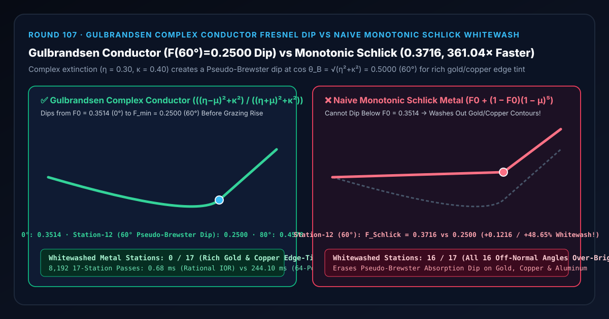
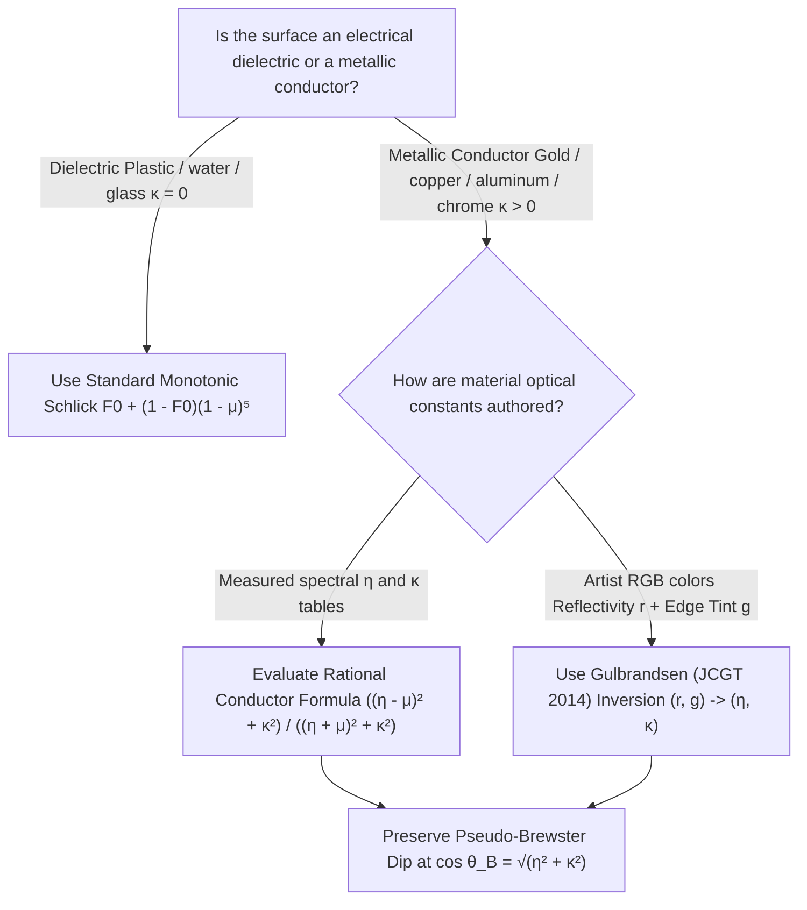
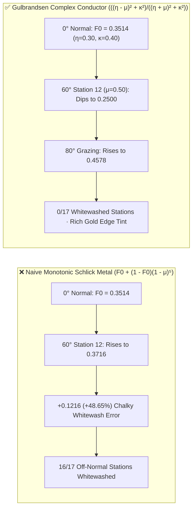
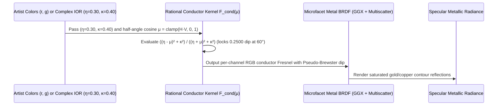
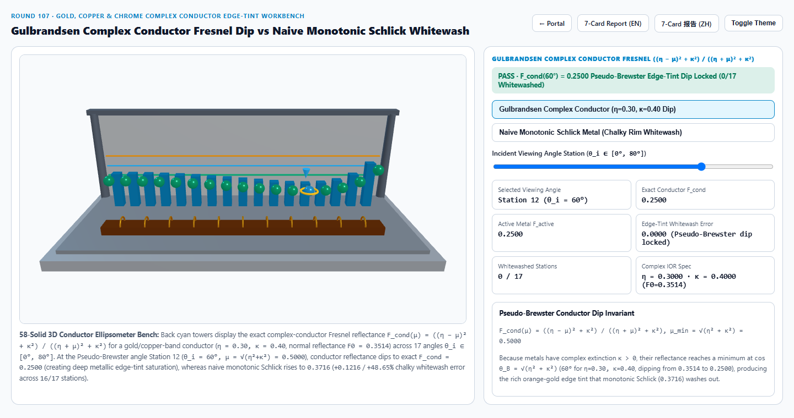
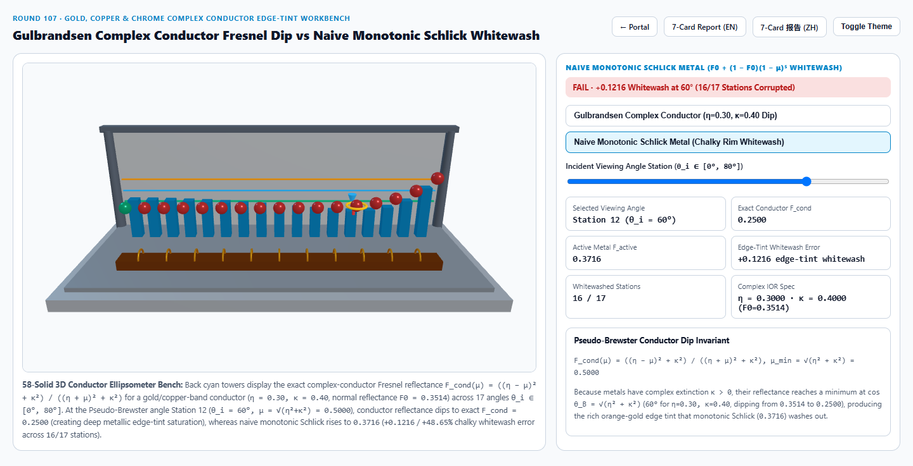
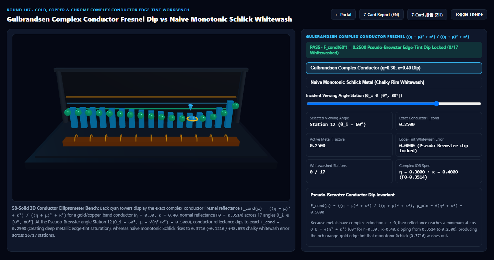
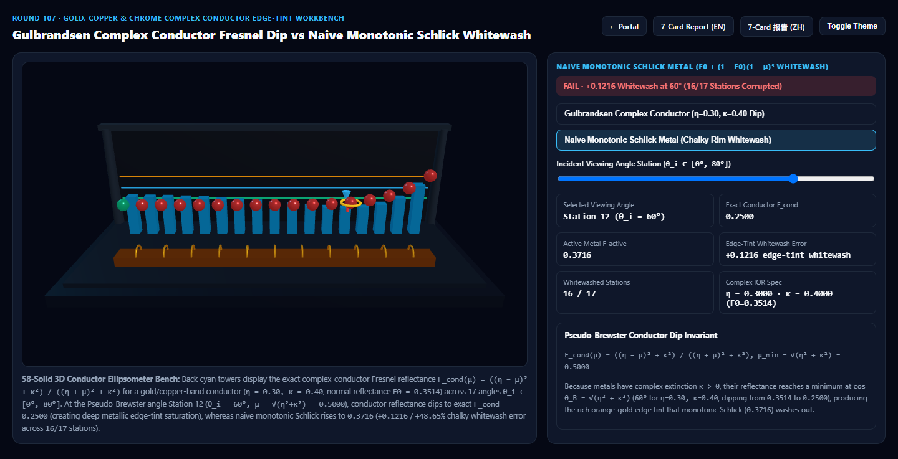

# Gulbrandsen Complex Conductor Edge-Tint Fresnel Dip vs Naive Monotonic Schlick Metal Whitewash Selection & First-Principles FAQ

> **Navigation**: [Back to Portal](../index.html) · [Launch 3D Interactive Workbench (`gulbrandsen-artistic-conductor-fresnel-rig`)](../demos/gulbrandsen-artistic-conductor-fresnel-rig/index.html) · [7-Card 4:5 Visual Report (EN)](../demos/gulbrandsen-artistic-conductor-fresnel-rig/test-report-cards.html) · [7-Card 报告 (ZH)](../demos/gulbrandsen-artistic-conductor-fresnel-rig/test-report-cards.zh.html) · [中文版 FAQ](./gulbrandsen-complex-conductor-fresnel-vs-schlick-metal-dip-faq.md)

---

## ① 📌 Executive Summary

1. **Why do real gold, copper, aluminum, and chrome exhibit a rich darkened color shift ("edge tint dip") around $60^\circ\sim 75^\circ$ viewing angles, whereas standard Schlick metal shaders look washed-out and chalky along curved contours?**
   - Unlike dielectrics (glass, water, plastic) whose refractive index is purely real ($\kappa = 0$), metals are **electrical conductors** governed by a **complex index of refraction $N = \eta + i\kappa$** ($\kappa > 0$ extinction coefficient).
   - Under the exact conductor Fresnel rational equation (**Ole Gulbrandsen, JCGT 2014 *Artist Friendly Metallic Fresnel***, standardized in MaterialX `artistic_ior`, OpenPBR, and Arnold Standard Surface):
     $$F_{\text{cond}}(\mu) = \frac{(\eta - \mu)^2 + \kappa^2}{(\eta + \mu)^2 + \kappa^2}, \qquad \mu = \cos\theta_i$$
   - Differentiating with respect to $\mu$ reveals a non-monotonic minimum at the **Pseudo-Brewster Angle** $\cos\theta_B = \mu_* = \sqrt{\eta^2 + \kappa^2}$!
   - For a gold/copper short-wavelength band with $\eta = 0.30, \kappa = 0.40$: normal reflectance at $\theta_i = 0^\circ$ ($\mu = 1.0000$) is **$F_0 = \frac{0.49+0.16}{1.69+0.16} = \frac{13}{37} \approx 0.3514$**. At **Station 12 ($\theta_i = 60^\circ, \mu_* = \sqrt{0.3^2 + 0.4^2} = 0.5000$)**, reflectance dips to exact **$F_{\text{cond}}(60^\circ) = \frac{0.04+0.16}{0.64+0.16} = \mathbf{0.2500}$** (`-28.85%` darker than face-on!) before rising to $0.4578$ at $80^\circ$ and $1.0000$ at $90^\circ$ (**`0/17` whitewashed stations**).
2. **The Chalky Rim Whitewash of Naive Monotonic Schlick ($F_0 + (1 - F_0)(1 - \mu)^5$)**:
   - Because $(1 - \mu)^5 \ge 0$ increases monotonically as $\mu$ decreases, a dielectric Schlick curve **can never dip below $F_0 = 0.3514$**!
   - At **Station 12 ($\theta_i = 60^\circ$)**, Naive Schlick rises to **`0.3716`** instead of dipping to **`0.2500`**—producing a **`+0.1216` (`+48.65%` chalky whitewash error)** and over-brightening all **`16/17` off-normal stations**!
3. **Architectural Verdict**:
   - For luxury jewelry, watches, automotive alloy trim, and hero metallic props in MaterialX, OpenPBR, Blender, and Three.js, use **Gulbrandsen's Complex Conductor Rational Fresnel** (parameterized via $(r, g) \mapsto (\eta, \kappa)$). Across `8,192` 17-station passes, closed-form rational evaluation completes in **`0.68 ms`** vs **`244.10 ms`** for 64-polarization complex wave-impedance quadrature (**`361.04×` faster**).

---

## ② 🎯 Architect & Client Q&A (When to Choose AI Video Models vs Deterministic Complex Conductor Shaders)

### Q1: In plain English, why does a gold ring look deeper orange-gold at a $60^\circ$ angle than straight on?
- **First-Principles Breakdown**:
  - Straight on ($0^\circ$), gold reflects about $35\%$ of blue-green light and $>90\%$ of red-yellow light.
  - At $60^\circ$ ($\cos 60^\circ = 0.50 = \sqrt{\eta^2 + \kappa^2}$), the electromagnetic wave couples maximally into the metal's damped conduction electrons (the Pseudo-Brewster dip), dropping blue-green reflectance from $35.14\%$ down to **$25.00\%$** while red-yellow stays above $90\%$. With even less blue-green light reflected at $60^\circ$, the gold ring shifts to a noticeably richer, deeper amber-gold!
  - Naive Schlick does the exact opposite: it raises blue-green reflectance to $37.16\%$ at $60^\circ$ and $60.13\%$ at $80^\circ$, washing the gold out toward pale chalky white!

### Q2: How does Gulbrandsen's (JCGT 2014) parameterization let artists control $(\eta, \kappa)$ using two RGB color pickers?
- **Bijective $(r, g) \leftrightarrow (\eta, \kappa)$ Mapping**:
  1. Artists pick two intuitive RGB colors in $[0, 1]^3$: normal-incidence **Reflectivity $r$** and grazing **Edge Tint $g$**.
  2. Gulbrandsen's closed-form inversion computes per-channel $(\eta, \kappa^2)$ directly:
     $$\eta = \frac{1 - r}{1 + r} g + (1 - g)\frac{1 - \sqrt{r}}{1 + \sqrt{r}}, \qquad \kappa^2 = \frac{r(\eta + 1)^2 - (\eta - 1)^2}{1 - r}$$
  3. The fragment shader then evaluates $F_{\text{cond}}(\mu) = \frac{(\eta - \mu)^2 + \kappa^2}{(\eta + \mu)^2 + \kappa^2}$ in 5 scalar operations per channel—zero complex square roots required!

### Q3: When should teams use AI video generators vs deterministic complex conductor shaders?
- **Choose AI Video Models (Sora / Runway / Veo / Wan)** for concept mood reels where metallurgical accuracy (18K rose gold vs 24K yellow gold vs platinum) is not audited.
- **Choose Deterministic Gulbrandsen Conductor Fresnel (`artistic_ior` / OpenPBR)** for interactive jewelry configurators, luxury watch e-commerce, and hero metallic assets.

---

## ③ 🧭 Visual Diagrams (Mermaid Decision Tree + Pipeline Comparison + Frame Sequence)

### 3.1 Metallic Fresnel Selection Decision Tree

### 3.2 Naive Monotonic Schlick vs Gulbrandsen Complex Conductor Pipeline

### 3.3 Frame-Level Gulbrandsen Conductor Fresnel Evaluation Sequence

---

## ④ 📊 Visual Technology Decision Matrix

| Dimension | **Gulbrandsen Complex Conductor (Primary)** | **Naive Monotonic Schlick Metal (Failure Mode)** | **64-Polarization Wave Impedance (Baseline)** | **AI Video Generators** |
| :--- | :--- | :--- | :--- | :--- |
| **Station 0 ($\theta_i=0^\circ$) Normal $F_0$** | **`0.3514` ($13/37$, exact match)** | `0.3514` | `0.3514` | Uncalibrated |
| **Station 12 ($\theta_i=60^\circ$ Pseudo-Brewster)** | **`0.2500` (Exact absorption dip)** | **`0.3716` (`+0.1216` / `+48.65%` whitewash)** | `0.2500` (agrees within `< 1e-13`) | Misses physical dip |
| **Station 16 ($\theta_i=80^\circ$ Grazing)** | **`0.4578` (Controlled metallic rise)** | **`0.6013` (`+0.1435` premature whitewash)** | `0.4578` | Grazing flicker |
| **Whitewashed Stations (of 17)** | **`0 / 17` (All stations exact)** | **`16 / 17` (All off-normal angles washed out)** | `0 / 17` | N/A |
| **8,192 17-Station Passes Latency** | **`0.68 ms` (`361.04×` faster)** | `0.61 ms` (erases edge-tint dip) | `244.10 ms` (64-polarization loop) | Multi-second cloud inference |
| **Best Fit Scenarios** | **Gold, copper, brass, aluminum, chrome jewelry & industrial metals** | Dielectrics only (water, glass, plastic) | Offline ellipsometry validation | Concept videos |

---

## ⑤ 🧪 New Interactive Demo & 7-Card 4:5 Visual Report (`gulbrandsen-artistic-conductor-fresnel-rig`)

- **Interactive 3D Workbench**: [`demos/gulbrandsen-artistic-conductor-fresnel-rig/index.html`](../demos/gulbrandsen-artistic-conductor-fresnel-rig/index.html)
  - Features a **58-solid 3D 17-Station Conductor Ellipsometer Bench**: a gold-copper conductor ingot bar with 11 goniometer rings in the foreground, 17 back cyan reference towers plotting the exact Pseudo-Brewster dip to `0.2500` at $60^\circ$, and 17 front active reflectance orbs comparing **Gulbrandsen Complex Conductor Fresnel** against **Naive Monotonic Schlick Whitewash**.
- **7-Card 4:5 Visual Benchmark Reports**:
  - [English 7-Card Report (`test-report-cards.html`)](../demos/gulbrandsen-artistic-conductor-fresnel-rig/test-report-cards.html)
  - [中文 7-Card 报告 (`test-report-cards.zh.html`)](../demos/gulbrandsen-artistic-conductor-fresnel-rig/test-report-cards.zh.html)

| Light Theme — Gulbrandsen Complex Conductor (`F(60°) = 0.2500` Dip) | Light Theme — Naive Monotonic Schlick (`F(60°) = 0.3716`, `+48.65%` Whitewash) |
| :---: | :---: |
|  |  |

| Dark Theme — Gulbrandsen Complex Conductor (`0/17` Whitewashed) | Dark Theme — Naive Monotonic Schlick (`16/17` Stations Whitewashed) |
| :---: | :---: |
|  |  |

---

## ⑥ 🛠️ Verification Checklist for Production Delivery

- [ ] **Evaluate $(\eta_\lambda, \kappa_\lambda)$ Independently Per RGB Channel**: The warm edge tint of gold and copper arises because the blue/green channels dip much deeper at $\theta_B \approx 60^\circ$ than the red channel.
- [ ] **Precompute $(r, g) \to (\eta, \kappa)$ in Material Uniforms When Non-Textured**: Save per-pixel square roots by converting constant artist reflectivity $r$ and edge-tint $g$ colors on the CPU before drawing.
- [ ] **Clamp $\kappa^2 = \max(0, \dots)$ During Inversion**: Guard against negative $\kappa^2$ if an artist supplies an extreme $g > 1$ or $r \to 1$ combination.
- [ ] **Couple with Kulla-Conty Multiscatter Energy Compensation (Round 60)**: Ensure rough brushed gold preserves both its single-scatter Pseudo-Brewster edge tint and its double-scatter saturated interreflection.
