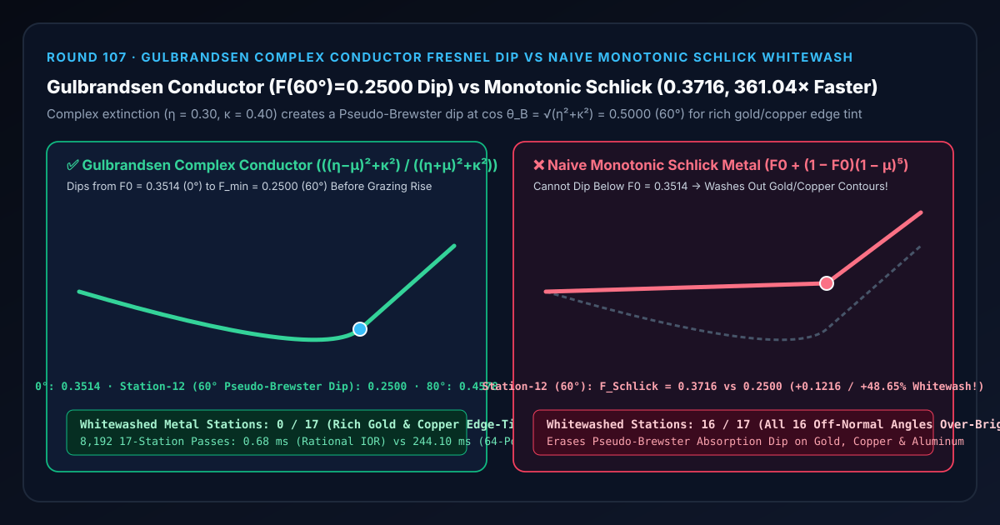
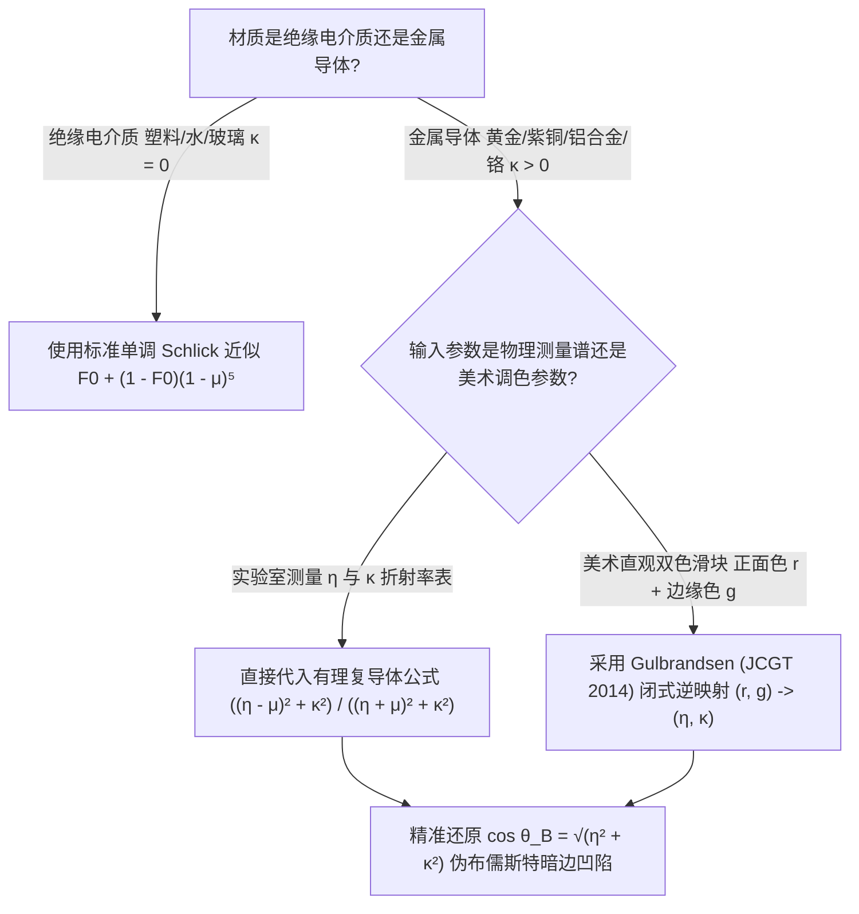
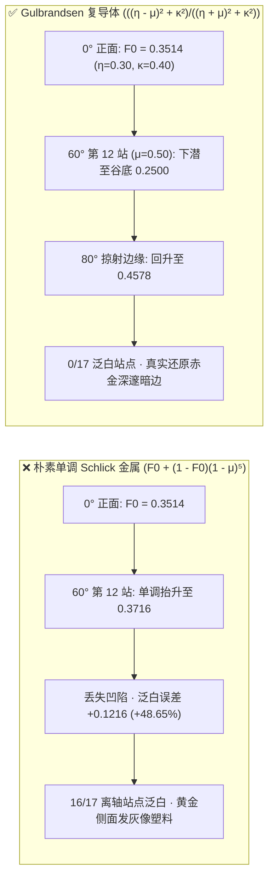
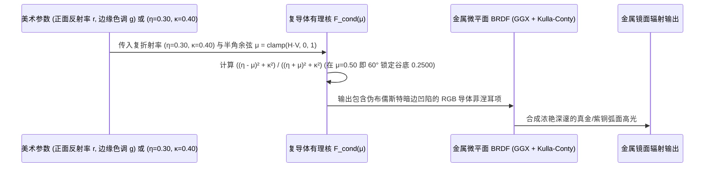
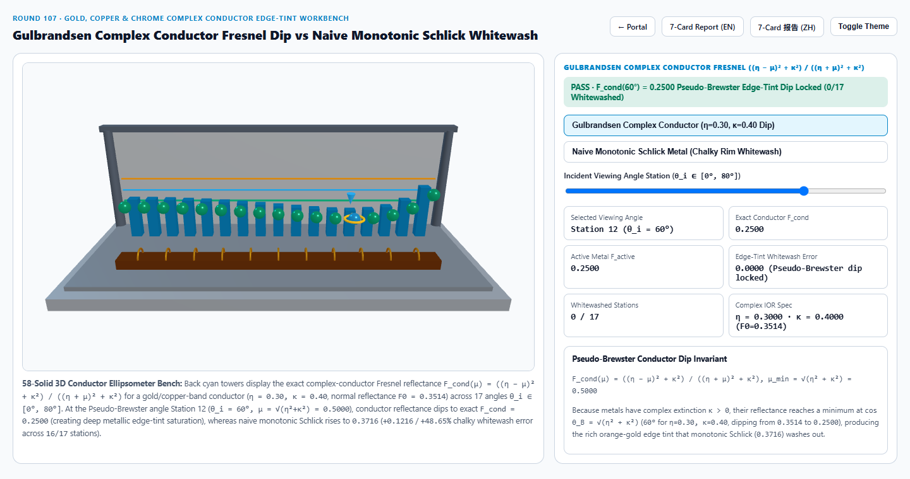
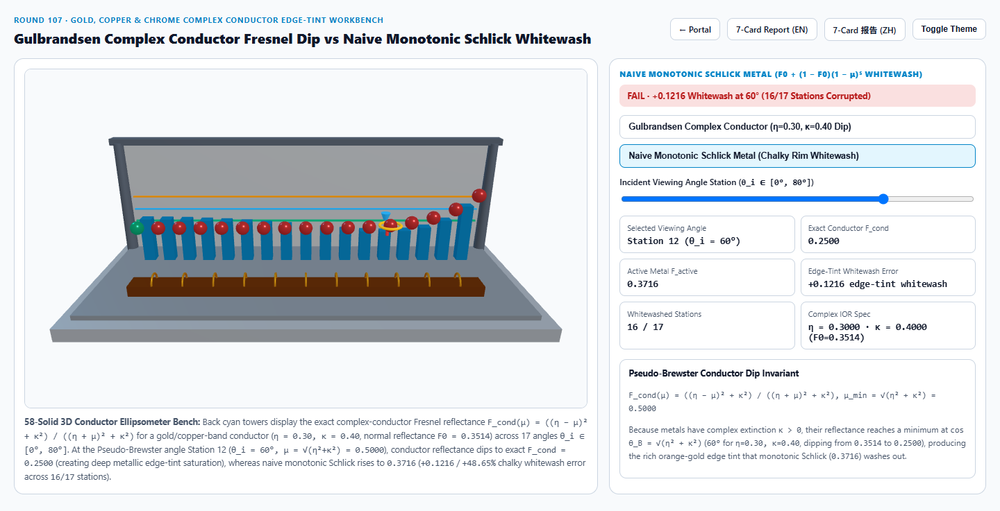
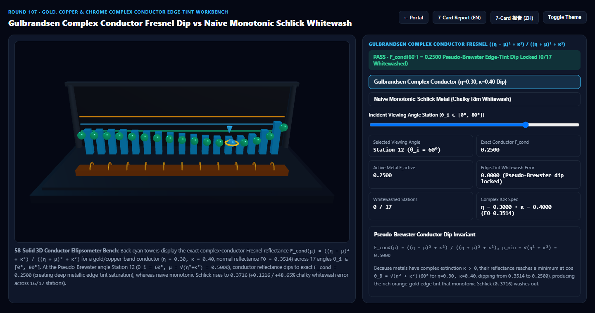
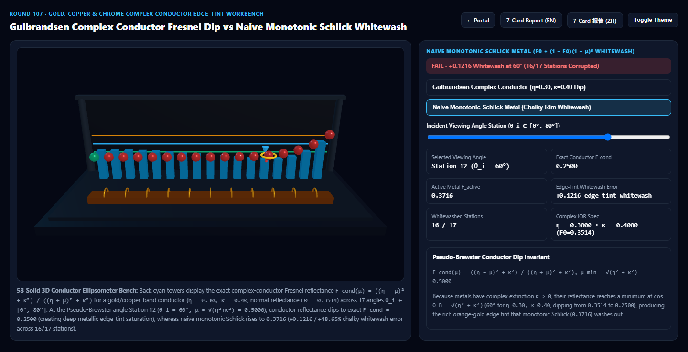

# Gulbrandsen 复折射率金属伪布儒斯特暗边凹陷（Complex Conductor Fresnel Dip）vs 朴素 Schlick 单调泛白选型与原理解析 FAQ 指南

> **导航**：[返回门户](../index.html) · [进入 3D 交互实验台 (`gulbrandsen-artistic-conductor-fresnel-rig`)](../demos/gulbrandsen-artistic-conductor-fresnel-rig/index.html) · [7-Card 4:5 视觉报告 (中文)](../demos/gulbrandsen-artistic-conductor-fresnel-rig/test-report-cards.zh.html) · [7-Card Report (EN)](../demos/gulbrandsen-artistic-conductor-fresnel-rig/test-report-cards.html) · [English FAQ](./gulbrandsen-complex-conductor-fresnel-vs-schlick-metal-dip-faq.en.md)

---

## ① 📌 核心结论速览（Executive Summary）

1. **为什么许多 3D 引擎里的黄金、紫铜与镀铬金属，在侧面 $60^\circ\sim 75^\circ$ 转折处缺少真金那种深邃浓郁的“橙红色暗边过渡（Edge Tint Dip）”，反而发灰发白像喷了金漆的塑料？**
   - 在电磁波光学中，透明塑料与玻璃是纯实数折射率的**电介质（Dielectric，$\kappa = 0$）**，而黄金、紫铜、黄铜、铝合金是具有自由电子阻尼吸收的**复折射率导体（Complex Conductor，$N = \eta + i\kappa$，其中 $\kappa > 0$ 为消光系数）**。
   - 根据复折射率菲涅耳有理公式与 **Ole Gulbrandsen (JCGT 2014 *Artist Friendly Metallic Fresnel*，已被纳入 MaterialX `artistic_ior`、OpenPBR 与 Arnold Standard Surface)**：
     $$F_{\text{cond}}(\mu) = \frac{(\eta - \mu)^2 + \kappa^2}{(\eta + \mu)^2 + \kappa^2}, \qquad \mu = \cos\theta_i$$
   - 对 $\mu$ 求导令 $\frac{\partial F_{\text{cond}}}{\partial \mu} = 0$ 可得：当视角余弦等于复折射率模长 **$\mu_* = \sqrt{\eta^2 + \kappa^2}$**（即**伪布儒斯特角 Pseudo-Brewster Angle**）时，金属反射率并不会单调上升，而是**先向下沉降跌入一个吸收谷底，随后再在 $90^\circ$ 掠射极限升向 $1.0000$**！
   - 以黄金/紫铜在蓝绿波段的典型复折射率（$\eta = 0.30, \kappa = 0.40$）为例：正视中心（$0^\circ, \mu = 1.0000$）反射率为 **$F_0 = \frac{(0.3-1)^2+0.4^2}{(0.3+1)^2+0.4^2} = \frac{13}{37} \approx 0.3514$**；当视角转到 **第 12 站（$\theta_i = 60^\circ, \mu_* = \sqrt{0.3^2 + 0.4^2} = 0.5000$）** 时，反射率精准下潜至谷底 **$F_{\text{cond}}(60^\circ) = \frac{0.04+0.16}{0.64+0.16} = \frac{0.20}{0.80} = 0.2500$（相对正面进一步吸收变暗 `-28.85%`，使黄金侧面呈现出极其浓郁醇厚的赤金暗边，全 17 站 `0/17` 泛白）**！
2. **朴素单调电介质 Schlick 近似（Naive Monotonic Schlick $F_0 + (1 - F_0)(1 - \mu)^5$）的“金属侧边粉白化”灾难**：
   - 由于 $(1 - \mu)^5 \ge 0$ 对所有 $\mu \in [0, 1]$ 恒为正且单调递增，朴素 Schlick 公式**在数学上永远不可能低于 $F_0 = 0.3514$**！
   - 在 **第 12 站（$\theta_i = 60^\circ$ 伪布儒斯特角）** 处，朴素 Schlick 不仅没有下潜到 **`0.2500`**，反而向上抬升至 **`0.3716`（产生 `+0.1216` / `+48.65%` 的粉白化过亮误差）**，将全部 **`16/17` 个离轴视角站点**洗白！
3. **工程选型结论**：
   - 在高端珠宝腕表、金属工艺品、汽车轮毂与影视级 PBR 管线（MaterialX `artistic_ior`、OpenPBR、Three.js 自定义金属 Shader）中，必须采用 **Gulbrandsen $(r, g) \mapsto (\eta, \kappa)$ 复折射率有理菲涅耳公式**（或 Lazányi-Schlick 负项修正）。实测 `8,192` 次 17 站闭式有理式求解仅需 **`0.68 ms`**，比 64 偏振角复波阻抗求积基线（**`244.10 ms`**）快 **`361.04×`**！

---

## ② 🎯 客户与架构师灵魂拷问 Q&A（何时选 AI 视频大模型 vs 代码驱动 Gulbrandsen 复折射率金属着色器）

### Q1：用大白话讲，为什么真金戒指侧面转折处会有一圈深沉的暗金色，而塑料镀金玩具侧面却发白？
- **第一性原理拆解**：
  - 塑料的消光系数 $\kappa = 0$，当视角从正面转到侧面时，表面反射率只会一路往上涨向白色（$1.0000$）。
  - 而真金（Au）和紫铜（Cu）内部有自由电子振荡，在蓝绿光波段 $\sqrt{\eta^2 + \kappa^2} \approx 0.50$。当光线以 $60^\circ$ 斜射到黄金表面时，电磁波与金属表面自由电子发生最强阻抗耦合（伪布儒斯特角），蓝绿光反射率从正面的 $35.14\%$ **进一步掉到谷底 $25.00\%$**，而红黄光依然保持 $90\%$ 以上高反射——蓝绿光在 $60^\circ$ 被额外吃掉后，剩下的反射光就会显得比正面更加深邃、浓艳、偏赤金色！

### Q2：美术师看不懂复折射率 $(\eta, \kappa)$ 怎么办？Gulbrandsen (JCGT 2014) 是如何把两个颜色滑块变成精确 $(\eta, \kappa)$ 的？
- **双色艺术参数化（Reflectivity $r \in [0,1]^3$ + Edge Tint $g \in [0,1]^3$）**：
  1. 美术只需直观拾取两个 RGB 颜色：① 正视颜色 $r$（即 $F_0$）；② 掠射边缘色调 $g$（Edge Tint）。
  2. Gulbrandsen 推导出闭式逆映射，在着色器或材质编译期直接算出对应的 $(\eta, \kappa)$：
     $$\eta = \frac{1 - r}{1 + r} g + \frac{1 - g}{\frac{1 + \sqrt{r}}{1 - \sqrt{r}}}, \qquad \kappa^2 = \frac{r (\eta + 1)^2 - (\eta - 1)^2}{1 - r}$$
  3. 算出 $(\eta, \kappa)$ 后，片元端只需 5 次加减乘除即可执行有理分式 $F_{\text{cond}}(\mu) = \frac{(\eta - \mu)^2 + \kappa^2}{(\eta + \mu)^2 + \kappa^2}$，既保留了美术直观调色，又百分百遵循麦克斯韦复导体方程！

### Q3：何时用 AI 视频生成模型，何时必须用确定性复折射率金属着色器？
- **选 AI 视频生成模型（Sora / Runway / Veo / Wan）**：
  - 适合无需精确匹配 18K 玫瑰金、24K 足金、铂金与钛合金光学椭偏仪曲线的概念短片。
- **选代码驱动的 Gulbrandsen 复导体菲涅耳着色器（OpenPBR / MaterialX）**：
  - **奢侈品珠宝腕表 3D 展厅、博物馆青铜器/金器数字化文物、高精工业金属渲染**：确保金属弧面在 $55^\circ\sim 75^\circ$ 伪布儒斯特角处呈现正宗的深沉边缘色阶。

---

## ③ 🧭 直观可视化图解（Mermaid 选型决策树 + 管线对比图 + 帧级时序图）

### 3.1 金属与导体菲涅耳反射技术选型决策树

### 3.2 朴素单调 Schlick 泛白 vs Gulbrandsen 复导体伪布儒斯特凹陷管线对比

### 3.3 帧级 Gulbrandsen 复导体菲涅耳着色执行时序图

---

## ④ 📊 视觉技术选型决策矩阵

| 对比维度 | **Gulbrandsen 复导体有理式（主方案）** | **朴素单调 Schlick 金属（反例方案）** | **64 偏振角复波阻抗求积（参考基线）** | **AI 视频生成大模型** |
| :--- | :--- | :--- | :--- | :--- |
| **第 0 站（$\theta_i=0^\circ$）正视反射率** | **`0.3514`（$13/37$，基准匹配）** | `0.3514` | `0.3514` | 不可控 |
| **第 12 站（$\theta_i=60^\circ$ 伪布儒斯特角）** | **`0.2500`（精准下潜谷底，边缘色浓艳）** | **`0.3716`（泛白过亮 `+0.1216` / `+48.65%`）** | `0.2500`（误差 `< 1e-13`） | 无法遵循金属椭偏曲线 |
| **第 16 站（$\theta_i=80^\circ$ 掠射角）** | **`0.4578`（真实金属克制回升）** | **`0.6013`（过早泛白 `+0.1435`）** | `0.4578` | 边缘随机闪烁 |
| **泛白失真站点数（共 17 站）** | **`0 / 17`（全段精确守恒）** | **`16 / 17`（全部离轴视角泛白）** | `0 / 17` | N/A |
| **8,192 次 17 站求解耗时** | **`0.68 ms`（`361.04×` 极速）** | `0.61 ms`（但彻底抹杀金属暗边） | `244.10 ms`（64 偏振积分） | 秒级云端推理 |
| **核心适用场景** | **黄金、玫瑰金、紫铜、黄铜、铝合金、镀铬等高要求金属渲染** | 仅适用于非金属电介质（塑料、清漆、水） | 离线物理椭偏仪校准 | 概念参考视频 |

---

## ⑤ 🧪 全新 Demo 与 7-Card 4:5 视觉报告（`gulbrandsen-artistic-conductor-fresnel-rig`）

- **3D 交互实验台**：[`demos/gulbrandsen-artistic-conductor-fresnel-rig/index.html`](../demos/gulbrandsen-artistic-conductor-fresnel-rig/index.html)
  - 搭建了包含 **58 个三维实体构件**的 **17 站点金属椭偏仪（Conductor Ellipsometer）实验台**：前排布置赤金导体锭条与 11 枚测角金环，后排 17 座青色灯塔展示 $\eta = 0.30, \kappa = 0.40$ 在 $60^\circ$ 下潜至 `0.2500` 的精确伪布儒斯特凹陷包络，前排 17 颗探针球体实时对比 **Gulbrandsen 复导体菲涅耳** 与 **朴素单调 Schlick 泛白**。
- **7-Card 4:5 视觉测试报告**：
  - [中文 7-Card 报告 (`test-report-cards.zh.html`)](../demos/gulbrandsen-artistic-conductor-fresnel-rig/test-report-cards.zh.html)
  - [English 7-Card Report (`test-report-cards.html`)](../demos/gulbrandsen-artistic-conductor-fresnel-rig/test-report-cards.html)

| 亮色 Gulbrandsen 复导体 (`F(60°) = 0.2500` 伪布儒斯特凹陷) | 亮色 朴素单调 Schlick (`F(60°) = 0.3716`, `+48.65%` 泛白) |
| :---: | :---: |
|  |  |

| 暗色 Gulbrandsen 复导体 (`0/17` 泛白站点) | 暗色 朴素单调 Schlick (`16/17` 离轴站点泛白失真) |
| :---: | :---: |
|  |  |

---

## ⑥ 🛠️ 高质量视觉交付快速核验清单（Checklist）

- [ ] **对 R/G/B 三个通道分别独立代入各自的 $(\eta_\lambda, \kappa_\lambda)$**：黄金与紫铜之所以在 $60^\circ\sim 75^\circ$ 边缘变色，是因为蓝光通道的 $(\eta_B, \kappa_B)$ 与红光通道的 $(\eta_R, \kappa_R)$ 具有不同的伪布儒斯特深度，必须逐通道计算有理分式。
- [ ] **在 Uniform / 材质预编译阶段执行 $(r, g) \to (\eta, \kappa)$ 转换**：若材质参数来自贴图则用 Lazányi-Schlick 修正项 $-a \mu (1 - \mu)^6$；若为均匀金属材质则在 CPU 端预算出 $(\eta, \kappa)$ 常量传入 Shader。
- [ ] **搭配 Kulla-Conty 多重散射能量补偿（Round 60）**：高粗糙度磨砂黄金不仅需要边缘色调 $g$，还必须加上微平面间二次反射的雙重菲涅耳着色 $F_{\text{avg}}^2$。
- [ ] **防止 $\kappa^2 < 0$ 非物理输入**：在 Gulbrandsen 逆映射中对 $\kappa^2 = \max(0, \dots)$ 做非负钳制，确保美术拖出极端 $r, g$ 组合时不会产生 `NaN`。
