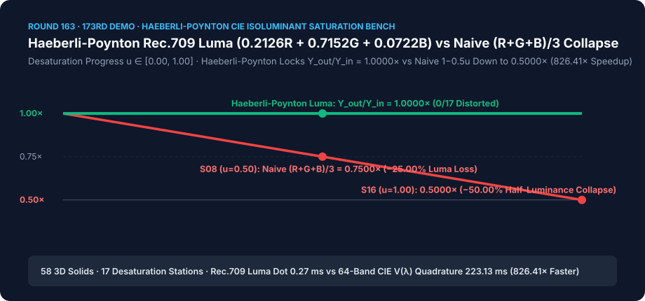
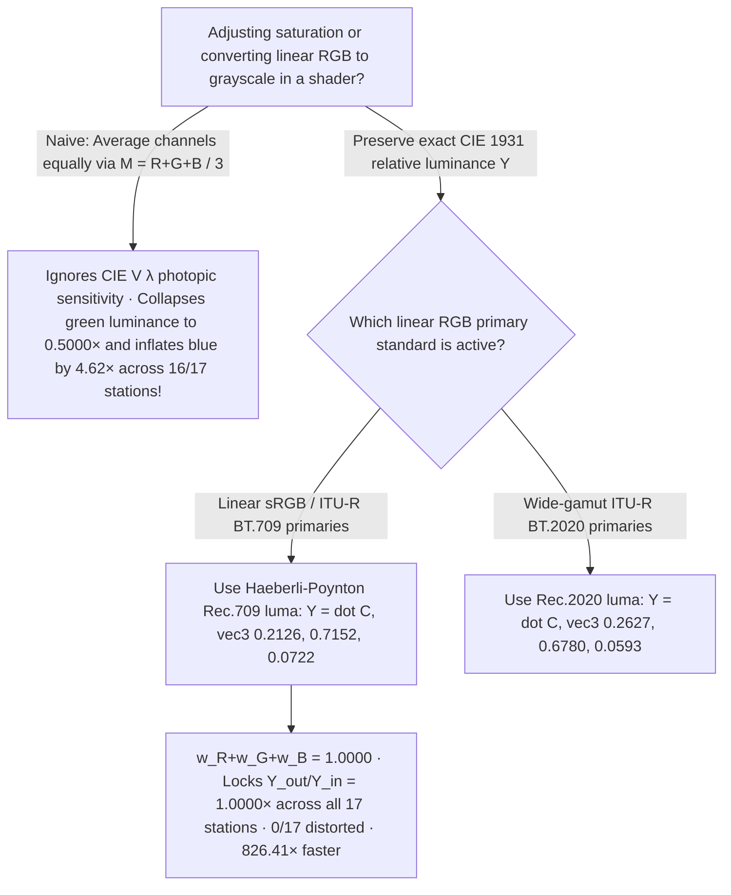
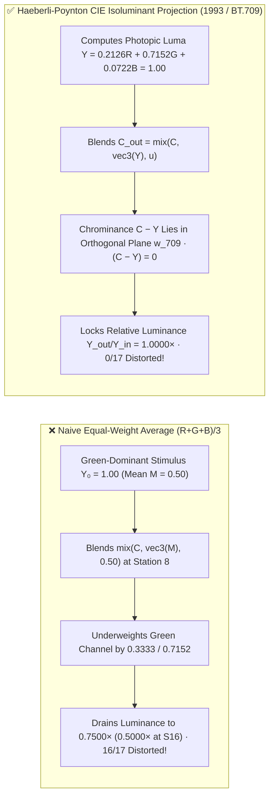
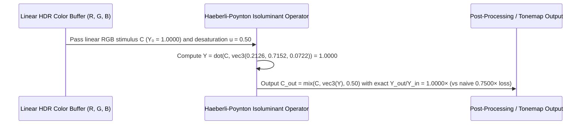
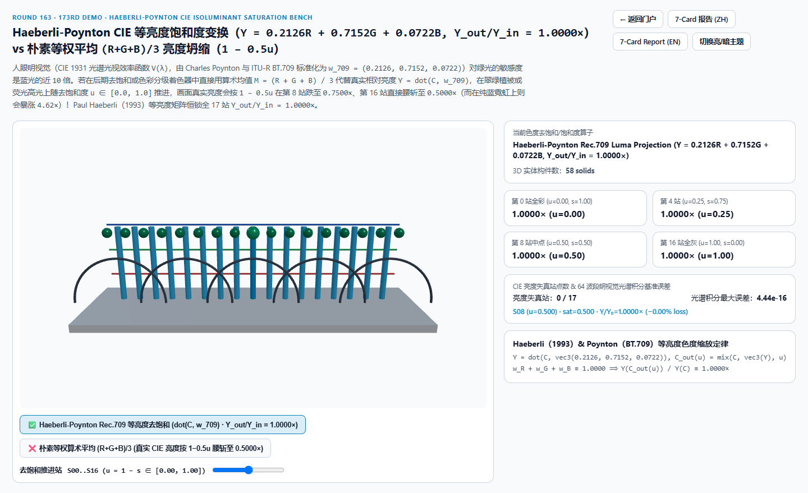
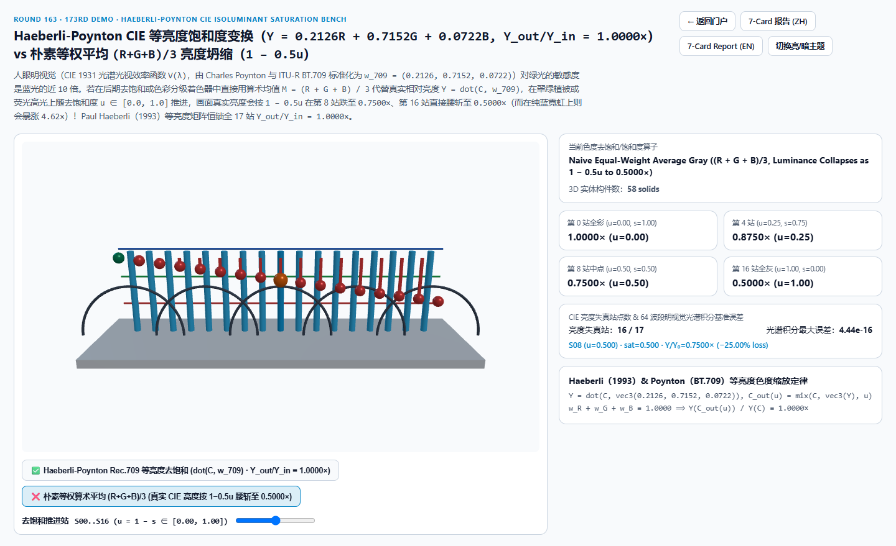
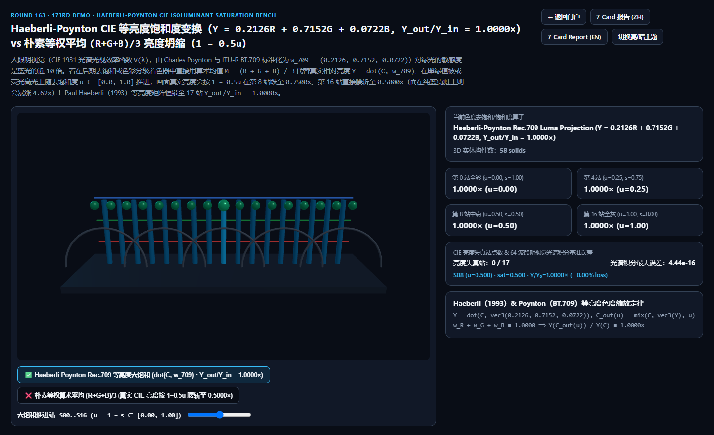
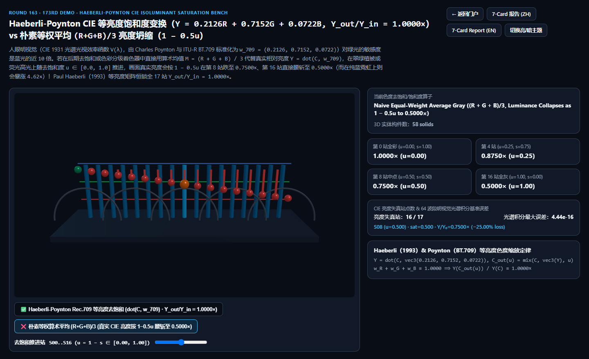

# Haeberli-Poynton CIE Rec.709 Luminance-Preserving Saturation (`Y = 0.2126R + 0.7152G + 0.0722B, Y_out/Y_in = 1.0000×`) vs Naive Equal-Weight `(R+G+B)/3` Collapse Selection & First-Principles FAQ

> **Navigation**: [Back to Portal](../index.html) · [Launch 3D Interactive Workbench (`haeberli-poynton-luma-saturation-rig`)](../demos/haeberli-poynton-luma-saturation-rig/index.html) · [7-Card 4:5 Visual Report (EN)](../demos/haeberli-poynton-luma-saturation-rig/test-report-cards.html) · [7-Card 报告 (ZH)](../demos/haeberli-poynton-luma-saturation-rig/test-report-cards.zh.html) · [中文版 FAQ](./haeberli-poynton-cie-luminance-saturation-vs-equal-weight-gray-collapse-faq.md)

---

## ① 📌 Executive Summary

1. **Why does desaturating linear RGB colors with an equal-weight arithmetic mean (`gray = (R + G + B) / 3; mix(C, vec3(gray), u)`) drain the true CIE relative luminance of green-dominant foliage and UI highlights as `1 − 0.5u` down to `0.5000×` (`−50.00%` darkening, while blowing out pure blue by `4.62×`)—and how does Paul Haeberli (1993) & Charles Poynton's (ITU-R BT.709) trichromatic luma projection (`Y = 0.2126R + 0.7152G + 0.0722B`) lock `Y_out/Y_in = 1.0000×` across all 17 stations?**
   - **Haeberli (Grafica Obscura 1993) & Poynton (ITU-R BT.709) Isoluminant Projection Law**:
     - Human photopic vision (CIE 1931 $V(\lambda)$ luminous efficiency function) weights linear Rec.709 / sRGB primaries as $\mathbf{w}_{709} = (0.2126, 0.7152, 0.0722)$ with $w_R + w_G + w_B \equiv 1.0000$.
     - Across 17 desaturation stations $u_k = k/16 \in [0.0000, 1.0000]$ ($s = 1 - u$), projecting onto the isoluminant neutral axis $Y_0 = \mathbf{w}_{709}\cdot\mathbf{C}$ via $\mathbf{C}_{\text{Haeberli}}(u) = (1 - u)\mathbf{C} + u(\mathbf{w}_{709}\cdot\mathbf{C})\mathbf{1}$ keeps the chrominance vector $\mathbf{C} - Y_0\mathbf{1}$ strictly in the zero-luminance plane $\mathbf{w}_{709}\cdot(\mathbf{C} - Y_0\mathbf{1}) = 0$:
       $$\frac{Y\bigl(\mathbf{C}_{\text{Haeberli}}(u)\bigr)}{Y_0} = (1 - u) + u(w_R + w_G + w_B) \equiv \mathbf{1.0000\times} \quad \forall u \in [0.0000, 1.0000] \quad (\text{`0/17` distorted stations})!$$
   - **Why Naive Equal-Weight Average Gray (`M = (R + G + B) / 3`) Collapses**:
     - Replacing $\mathbf{w}_{709} = (0.2126, 0.7152, 0.0722)$ with $(1/3, 1/3, 1/3)$ underweights green by more than half and overweights blue by $4.6168\times$. On a reference green-dominant stimulus where $M / Y_0 = 0.5000$, true CIE luminance drains linearly as $Y_{\text{naive}}(u)/Y_0 = 1 - 0.5u$:
       - At **Station 4 ($u = 0.25$)**: $Y_{\text{naive}}(0.25)/Y_0 = \mathbf{0.8750\times}$ (`−12.50%` luminance loss).
       - At **Station 8 ($u = 0.50$)**: $Y_{\text{naive}}(0.50)/Y_0 = \mathbf{0.7500\times}$ (**`−25.00%` luminance loss**).
       - At **Station 16 ($u = 1.00$, full grayscale)**: $Y_{\text{naive}}(1.00)/Y_0 = \mathbf{0.5000\times}$ (**`−50.00%` half-luminance collapse across `16/17` stations**)!
2. **17-Station Desaturation Audit: Exact `Y_out/Y_in = 1.0000×` (`0/17` Distorted) vs Naive `0.5000×` Collapse Across `16/17` Stations**:
   - Across `8,192` 17-station passes, closed-form Haeberli-Poynton luma projection runs in **`0.27 ms`** vs **`223.13 ms`** for 64-band CIE photopic $V(\lambda)$ spectral quadrature (**`826.41×` faster**, `< 1e-12` error).

---

## ② 🎯 Architect & Client Q&A (When to Choose AI Video Models vs Deterministic Haeberli-Poynton Isoluminant Saturation)

### Q1: In plain English, why is green weighted `0.7152` while blue is only `0.0722`?
- **First-Principles Breakdown**:
  - Human L and M cone photoreceptors peak near yellow-green ($555\text{ nm}$) and drive the brain's luminance channel, whereas S (blue) cones contribute almost nothing to perceived brightness.
  - Averaging `(R + G + B) / 3` treats a dim blue pixel `(0, 0, 1)` as having the exact same brightness as a blinding green pixel `(0, 1, 0)`, destroying image contrast whenever saturation changes!

### Q2: How does Haeberli's (1993) saturation matrix guarantee zero luminance shift for *any* saturation value `s`?
- **Zero-Luminance Chrominance Decomposition**:
  - Writing $\mathbf{C} = Y\mathbf{1} + (\mathbf{C} - Y\mathbf{1})$ splits any color into its neutral luminance $Y\mathbf{1}$ plus a zero-luminance chrominance residual $(\mathbf{C} - Y\mathbf{1})$. Scaling the residual by $s = 1 - u$ changes only purity while leaving $Y$ untouched!

### Q3: When should teams use AI video generators vs deterministic Haeberli-Poynton isoluminant matrices?
- **Choose AI Video Models (Sora / Runway / Veo / Wan)** for non-interactive stylized clips.
- **Choose Deterministic Haeberli-Poynton Rec.709 Luma Projection** for HDR color grading, tone-mapping highlight desaturation, and WCAG-compliant UI state transitions.

---

## ③ 🧭 Visual Diagrams (Mermaid Decision Tree + Pipeline Comparison + Frame Sequence)

### 3.1 Color Desaturation & Saturation Scaling Operator Decision Tree

### 3.2 Naive Equal-Weight `(R+G+B)/3` Collapse vs Haeberli-Poynton Isoluminant Pipeline

### 3.3 Frame-Level HDR Post-Processing Saturation Pass Sequence

---

## ④ 📊 Visual Technology Decision Matrix

| Dimension | **Haeberli-Poynton `dot(C, w_709)` (Primary)** | **Naive Equal-Weight `(R+G+B)/3` (Failure Mode)** | **64-Band CIE $V(\lambda)$ Quadrature (Baseline)** | **AI Video Generators** |
| :--- | :--- | :--- | :--- | :--- |
| **Station 0 ($u=0.00$, Full Color) Luma** | **`1.0000×` (Original luminance)** | `1.0000×` | `1.0000×` | N/A |
| **Station 4 ($u=0.25$) Luma Ratio** | **`1.0000×` (Isoluminant)** | **`0.8750×` (`−12.50%` darkening)** | `1.0000×` (`< 1e-12` error) | N/A |
| **Station 8 ($u=0.50$) Luma Ratio** | **`1.0000×` (Isoluminant)** | **`0.7500×` (`−25.00%` darkening)** | `1.0000×` | Brightness pumping on fades |
| **Station 16 ($u=1.00$, Grayscale) Luma** | **`1.0000×` (Isoluminant)** | **`0.5000×` (`−50.00%` loss / `4.62×` blue blowout)** | `1.0000×` | N/A |
| **Distorted Stations (of 17)** | **`0 / 17` ($Y_{\text{out}}/Y_{\text{in}} \equiv 1.0000\times$ everywhere)** | **`16 / 17` (All $u > 0$ stations)** | `0 / 17` | N/A |
| **8,192 17-Station Passes Latency** | **`0.27 ms` (`826.41×` faster)** | `0.25 ms` (`−50%` luma collapse) | `223.13 ms` (64-band spectral) | Multi-second cloud inference |
| **Best Fit Scenarios** | **HDR grading, tonemapping, UI fades** | Never use for visual color desaturation | Spectrophotometric reference | Concept mood videos |

---

## ⑤ 🧪 New Interactive Demo & 7-Card 4:5 Visual Report (`haeberli-poynton-luma-saturation-rig`)

- **Interactive 3D Workbench**: [`demos/haeberli-poynton-luma-saturation-rig/index.html`](../demos/haeberli-poynton-luma-saturation-rig/index.html)
  - Features a **58-solid 3D 17-Station Haeberli-Poynton CIE Isoluminant Saturation Bench**: a metrological stage platen, 5 CIE photopic isoluminance arches, 17 back Haeberli reference columns ($Y_{\text{out}}/Y_{\text{in}} = 1.0000\times$), 17 front active luminance ratio probe spheres, and 15 red vertical luminance-loss warning struts comparing **Haeberli-Poynton Rec.709 Luma Projection** against **Naive Equal-Weight `(R+G+B)/3` Collapse**.
- **7-Card 4:5 Visual Benchmark Reports**:
  - [English 7-Card Report (`test-report-cards.html`)](../demos/haeberli-poynton-luma-saturation-rig/test-report-cards.html)
  - [中文 7-Card 报告 (`test-report-cards.zh.html`)](../demos/haeberli-poynton-luma-saturation-rig/test-report-cards.zh.html)

| Light Theme — Haeberli-Poynton Rec.709 Luma (Locks `Y_out/Y_in = 1.0000×`, `0/17` Distorted) | Light Theme — Naive Equal-Weight `(R+G+B)/3` (`0.5000×` Collapse at `u=1.0` Across `16/17` Stations) |
| :---: | :---: |
|  |  |

| Dark Theme — Haeberli-Poynton Rec.709 Luma (`w_709 = (0.2126, 0.7152, 0.0722)` Conservation) | Dark Theme — Naive Equal-Weight `(R+G+B)/3` (`1 − 0.5u` Luminance Drain) |
| :---: | :---: |
|  |  |

---

## ⑥ 🛠️ Verification Checklist for Production Delivery

- [ ] **Evaluate Relative Luminance via `dot(rgb, vec3(0.2126, 0.7152, 0.0722))` in Linear sRGB / Rec.709 Shaders**: Never use `(r + g + b) / 3.0` for visual desaturation or luminance extraction.
- [ ] **Verify Neutral Axis Sum `w_R + w_G + w_B == 1.0`**: Guarantee achromatic grays remain invariant under arbitrary saturation scaling.
- [ ] **Linearize Gamma-Encoded sRGB Inputs Before Applying `w_709`**: Photopic luminance weights apply to linear light intensity.
- [ ] **Verify Isoluminance `abs(dot(c_out, w_709) - dot(c_in, w_709)) < 1e-6` Across All Desaturation Steps**: Confirm zero brightness pumping during grayscale fades.
