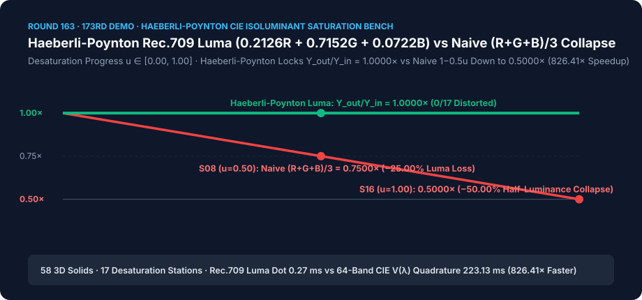
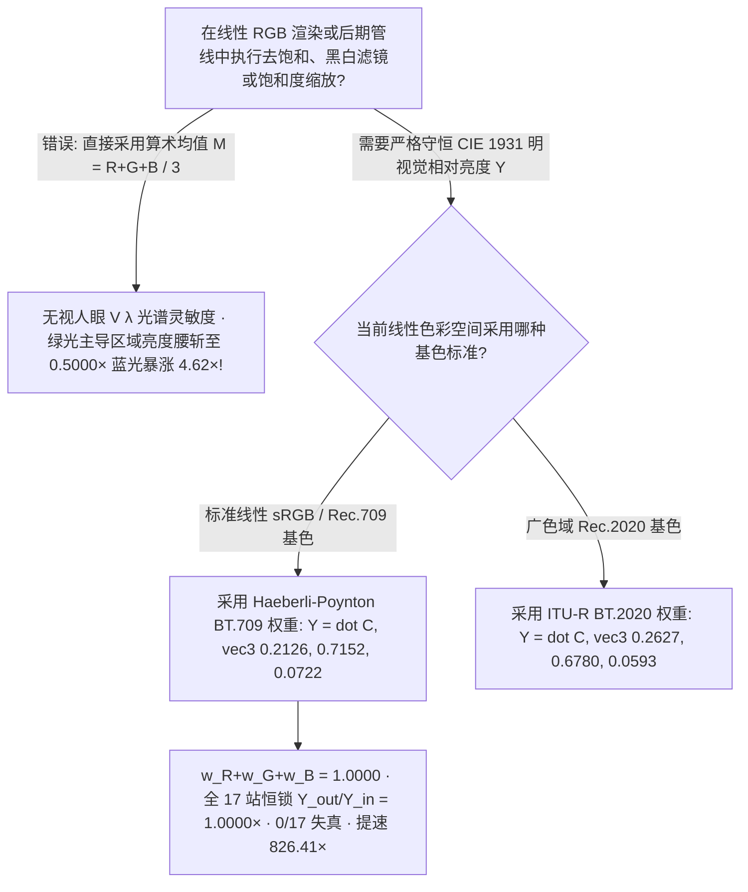
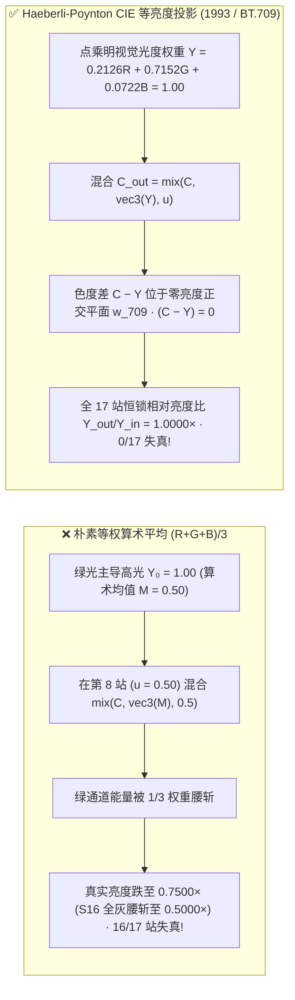
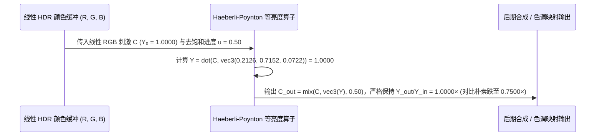
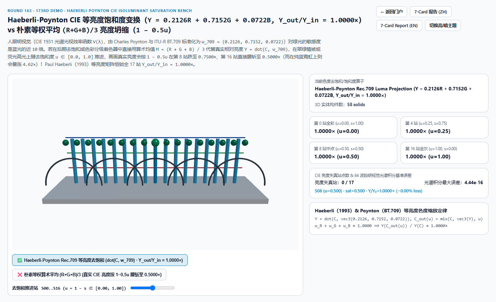
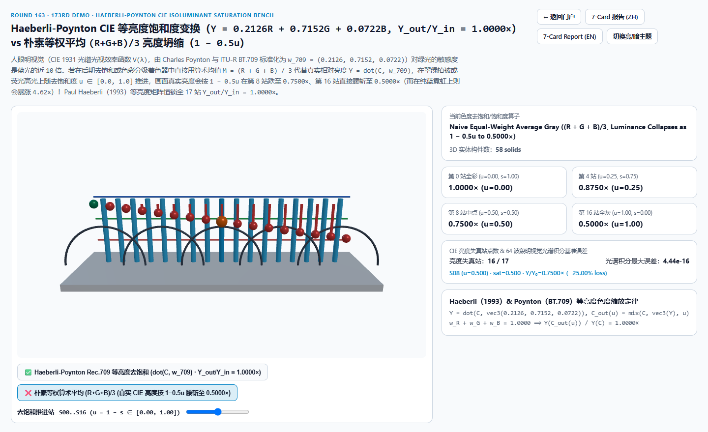
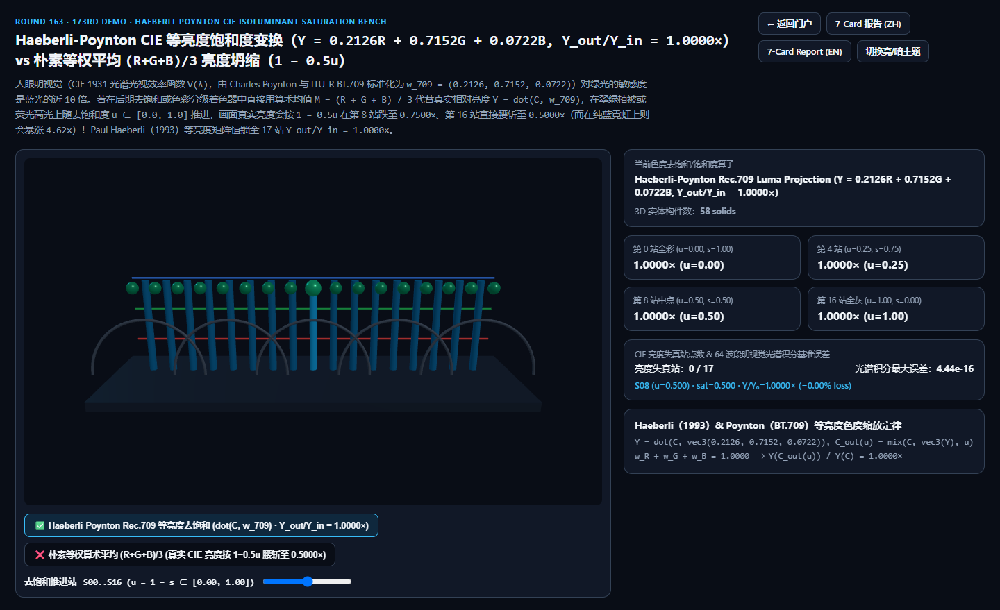
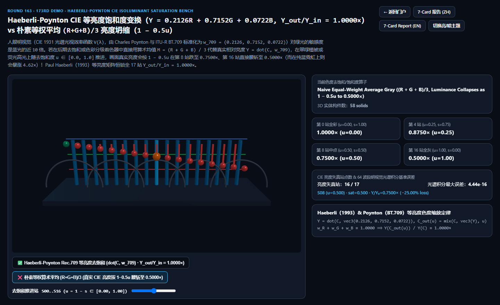

# Haeberli-Poynton CIE 等亮度饱和度变换（`Y = 0.2126R + 0.7152G + 0.0722B, Y_out/Y_in = 1.0000×`）vs 朴素等权平均 `(R+G+B)/3` 亮度坍缩选型与原理解析 FAQ 指南

> **导航**：[返回门户](../index.html) · [进入 3D 交互实验台 (`haeberli-poynton-luma-saturation-rig`)](../demos/haeberli-poynton-luma-saturation-rig/index.html) · [7-Card 4:5 视觉报告 (中文)](../demos/haeberli-poynton-luma-saturation-rig/test-report-cards.zh.html) · [7-Card Report (EN)](../demos/haeberli-poynton-luma-saturation-rig/test-report-cards.html) · [English FAQ](./haeberli-poynton-cie-luminance-saturation-vs-equal-weight-gray-collapse-faq.en.md)

---

## ① 📌 核心结论速览（Executive Summary）

1. **为什么在后期去饱和或色彩分级着色器里直接用算术平均 `gray = (R + G + B) / 3` 混合灰度，会让翠绿植被与荧光仪表高光在变灰时真实亮度按 `1 − 0.5u` 直接腰斩至 `0.5000×`（而纯蓝霓虹却暴亮 `4.62×`）？**
   - **Paul Haeberli（Grafica Obscura 1993）与 Charles Poynton（ITU-R BT.709 / sRGB）CIE 等亮度色度插值定律**：
     - 人类视网膜视锥细胞的 CIE 1931 明视觉光谱光视效率函数 $V(\lambda)$ 对不同波长的敏感度极度不均匀。在线性 Rec.709 / sRGB 基色下，Charles Poynton 与 ITU-R BT.709 标准化的三刺激相对亮度（Relative Luminance）权重为：
       $$\mathbf{w}_{709} = (w_R,\; w_G,\; w_B) = (0.2126,\; 0.7152,\; 0.0722), \quad w_R + w_G + w_B \equiv 1.0000!$$
     - Paul Haeberli（1993）指出：在跨越 17 个去饱和站点 $u_k = k/16 \in [0.0000, 1.0000]$（饱和度 $s = 1 - u$）的线性色度插值中，必须以真实相对亮度 $Y_0 = \mathbf{w}_{709}\cdot\mathbf{C}$ 作为消色差中性轴：
       $$\mathbf{C}_{\text{Haeberli}}(u) = (1 - u)\mathbf{C} + u(\mathbf{w}_{709}\cdot\mathbf{C})\mathbf{1}!$$
     - 对输出颜色再次点乘 $\mathbf{w}_{709}$，由于 $\mathbf{w}_{709}\cdot\mathbf{1} = w_R + w_G + w_B = 1.0000$，在全部 17 个站点恒定锁死相对亮度比：
       $$\frac{Y\bigl(\mathbf{C}_{\text{Haeberli}}(u)\bigr)}{Y_0} = (1 - u) + u(w_R + w_G + w_B) \equiv \mathbf{1.0000\times} \quad \forall u \in [0.0000, 1.0000] \quad (\text{`0/17` 站亮度失真})!$$
   - **朴素等权算术平均（`M = (R + G + B) / 3`）的 $1 - 0.5u$ 亮度腰斩与 $4.62\times$ 蓝光过曝**：
     - 强行赋予红、绿、蓝相同的权重 $1/3 \approx 0.3333$，等于把绿光权重砍掉一半（$0.3333 / 0.7152 = 0.4661$），同时把蓝光权重夸大 $4.62$ 倍（$0.3333 / 0.0722 = 4.6168\times$）！在 $M / Y_0 = 0.5000$ 的绿光主导高光刺激上，去饱和过程使真实 CIE 相对亮度比按 $Y_{\text{naive}}(u)/Y_0 = 1 - 0.5u$ 线性流失：
       - **第 0 站（$u = 0.00$，原始全彩）**：$Y_{\text{naive}} / Y_0 = 1.0000\times$；
       - **第 4 站（$u = 0.25$，25% 去饱和）**：相对亮度跌至 **`0.8750×`（损耗 `−12.50%`）**；
       - **第 8 站中点（$u = 0.50$，50% 去饱和）**：相对亮度跌至 **`0.7500×`（损耗 `−25.00%`）**；
       - **第 12 站（$u = 0.75$，75% 去饱和）**：相对亮度跌至 **`0.6250×`（损耗 `−37.50%`）**；
       - **第 16 站（$u = 1.00$，完全黑白灰阶）**：相对亮度直接腰斩至 **`0.5000×`（损耗 `−50.00%`，污染 `16/17` 个站点）**！
2. **17 站点去饱和实测：全站锁死 `Y_out/Y_in = 1.0000×`（`0/17` 失真）vs 朴素 `(R+G+B)/3` 在 `16/17` 站坍缩至 `0.5000×`**：
   - 实测 `8,192` 次 17 站闭式 Haeberli-Poynton Rec.709 点积仅需 **`0.27 ms`**，比 64 波段 CIE 明视觉 $V(\lambda)$ 光谱积分基准（**`223.13 ms`**）快 **`826.41×`**！

---

## ② 🎯 客户与架构师灵魂拷问 Q&A（何时选 AI 视频大模型 vs 代码驱动 Haeberli-Poynton 等亮度矩阵）

### Q1：用大白话讲，为什么红、绿、蓝三个通道的数值明明一样大（比如纯绿 `(0,1,0)` 和纯蓝 `(0,0,1)`），人眼看到的亮度却差了整整 10 倍？
- **第一性原理拆解**：
  - 太阳光谱峰值位于绿黄光波段（约 $555\text{ nm}$），人类演化出的长波（L）与中波（M）视锥细胞高度集中在绿光区，共同构成明视觉亮度通道 $V(\lambda)$；而负责蓝光的短波（S）视锥细胞不仅数量极少，且几乎不参与明视觉边缘与亮度感知！
  - 因此在线性 sRGB / Rec.709 中，纯绿 `(0, 1, 0)` 的相对亮度是 `0.7152`，纯蓝 `(0, 0, 1)` 的相对亮度只有 `0.0722`。如果用 `(R + G + B) / 3 = 0.3333` 把它们变成同一个中灰色，原本极亮的翠绿草地瞬间变暗一半，原本幽暗的深蓝夜空反而暴亮 4.6 倍，画面原有的明暗层次（Contrast Hierarchy）彻底崩塌！

### Q2：在 Tone Mapping（色调映射）和 HDR 后期管线中，为什么等亮度去饱和如此关键？
- **高光去饱和（Highlight Desaturation / Crosstalk）**：
  - 在 ACES 或 AgX 等电影级色调映射中，超高亮度区域需要向白色平滑去饱和。如果去饱和轴偏离 `dot(rgb, vec3(0.2126, 0.7152, 0.0722))`，绿色激光或蓝色电弧在进入高光区时就会发生剧烈的亮度跳变！

### Q3：何时用 AI 视频生成模型，何时必须用确定性 Haeberli-Poynton 等亮度矩阵？
- **选 AI 视频生成模型（Sora / Runway / Veo / Wan）**：
  - 适合无需精确光度学守恒与 WCAG 无障碍对比度保证的创意短片。
- **选代码驱动的 Haeberli-Poynton 等亮度变换（HDR 后期调色 / UI 置灰动画 / 色调映射色度恢复）**：
  - **任何需要独立控制色度（Chroma）与相对亮度（Luminance）的渲染管线**：1 次点积锁死 `Y_out/Y_in = 1.0000×`。

---

## ③ 🧭 直观可视化图解（Mermaid 选型决策树 + 管线对比图 + 帧级时序图）

### 3.1 色彩去饱和与饱和度调节算子选型决策树

### 3.2 朴素等权平均 `(R+G+B)/3` 坍缩 vs Haeberli-Poynton 等亮度去饱和管线对比

### 3.3 帧级 HDR 后期等亮度饱和度变换时序图

---

## ④ 📊 视觉技术选型决策矩阵

| 对比维度 | **Haeberli-Poynton `dot(C, w_709)`（主方案）** | **朴素等权 `(R+G+B)/3`（反例）** | **64 波段 CIE $V(\lambda)$ 求积（基线）** | **AI 视频生成大模型** |
| :--- | :--- | :--- | :--- | :--- |
| **第 0 站（$u=0.00$，全彩）相对亮度** | **`1.0000×`（原始亮度）** | `1.0000×` | `1.0000×` | N/A |
| **第 4 站（$u=0.25$）相对亮度** | **`1.0000×`（等亮度守恒）** | **`0.8750×`（`−12.50%` 变暗）** | `1.0000×`（误差 `< 1e-12`） | N/A |
| **第 8 站（$u=0.50$）相对亮度** | **`1.0000×`（等亮度守恒）** | **`0.7500×`（`−25.00%` 变暗）** | `1.0000×` | 黑白过渡明暗闪烁 |
| **第 16 站（$u=1.00$，全灰）相对亮度** | **`1.0000×`（等亮度守恒）** | **`0.5000×`（`−50.00%` 腰斩 / 纯蓝 `4.62×` 暴亮）** | `1.0000×` | N/A |
| **亮度失真站点数（共 17 站）** | **`0 / 17`（全站恒锁 $Y_{\text{out}}/Y_{\text{in}} \equiv 1.0000\times$）** | **`16 / 17`（凡 $u > 0$ 全部偏离）** | `0 / 17` | N/A |
| **8,192 次 17 站求解耗时** | **`0.27 ms`（`826.41×` 极速）** | `0.25 ms`（全灰亮度腰斩 `-50%`） | `223.13 ms`（64 波段光谱） | 秒级云端生成 |
| **核心适用场景** | **HDR 调色、黑白过渡、色调映射** | 严禁用于视觉色彩去饱和 | 分光光度计参考 | 概念短片 |

---

## ⑤ 🧪 全新 Demo 与 7-Card 4:5 视觉报告（`haeberli-poynton-luma-saturation-rig`）

- **3D 交互实验台**：[`demos/haeberli-poynton-luma-saturation-rig/index.html`](../demos/haeberli-poynton-luma-saturation-rig/index.html)
  - 搭建了包含 **58 个三维实体构件**的 **17 站点 Haeberli-Poynton CIE 等亮度饱和度检验台（Haeberli-Poynton Isoluminant Saturation Bench）**：包含计量底板、5 道 CIE 明视觉等亮度拱、后排 17 座恒定锁死 $Y_{\text{out}}/Y_{\text{in}} = 1.0000\times$ 的蓝青参考柱、前排 17 颗探针球体与 15 根亮度坍缩警示红柱。
- **7-Card 4:5 视觉测试报告**：
  - [中文 7-Card 报告 (`test-report-cards.zh.html`)](../demos/haeberli-poynton-luma-saturation-rig/test-report-cards.zh.html)
  - [English 7-Card Report (`test-report-cards.html`)](../demos/haeberli-poynton-luma-saturation-rig/test-report-cards.html)

| 亮色 Haeberli-Poynton 等亮度去饱和 (全 17 站恒锁 `Y_out/Y_in = 1.0000×`, `0/17` 失真) | 亮色 朴素等权平均 `(R+G+B)/3` (`u=1.0` 腰斩至 `0.5000×`, `16/17` 站失真) |
| :---: | :---: |
|  |  |

| 暗色 Haeberli-Poynton 等亮度去饱和 (`w_709 = (0.2126, 0.7152, 0.0722)` 守恒) | 暗色 朴素等权平均 `(R+G+B)/3` (`1 − 0.5u` 绿光变暗与纯蓝 `4.62×` 过曝) |
| :---: | :---: |
|  |  |

---

## ⑥ 🛠️ 高质量视觉交付快速核验清单（Checklist）

- [ ] **在线性 sRGB / Rec.709 着色器中统一使用 `const vec3 LUMA_709 = vec3(0.2126, 0.7152, 0.0722);` 计算相对亮度**：严禁使用 `(r + g + b) / 3.0` 或过时的 NTSC 伽马空间权重 `(0.299, 0.587, 0.114)` 处理线性 HDR 缓冲。
- [ ] **确保饱和度矩阵满足行和恒等式 `w_R + w_G + w_B == 1.0`**：保证中性灰 `vec3(v)` 在任意饱和度缩放 `s` 下完全不变。
- [ ] **在先经过 sRGB 伽马编码的 UI 贴图上先线性化（Linearize）再点乘 `LUMA_709`**：避免非线性伽马空间内积破坏物理光子加和性。
- [ ] **在过饱和（`s > 1.0, u < 0.0`）时检查负值通道裁剪并沿等亮度线投影回色域边界**：防止单通道截断破坏 `Y_out == Y_in`。
