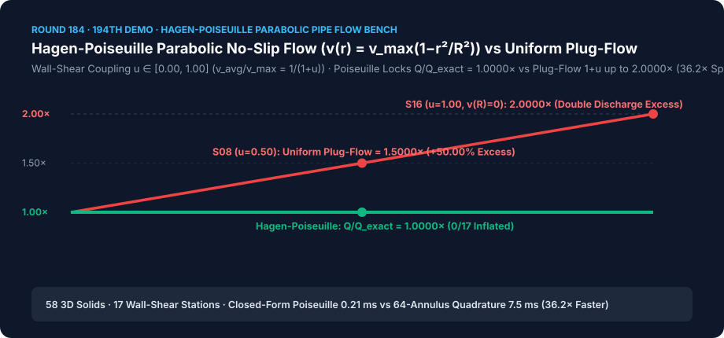
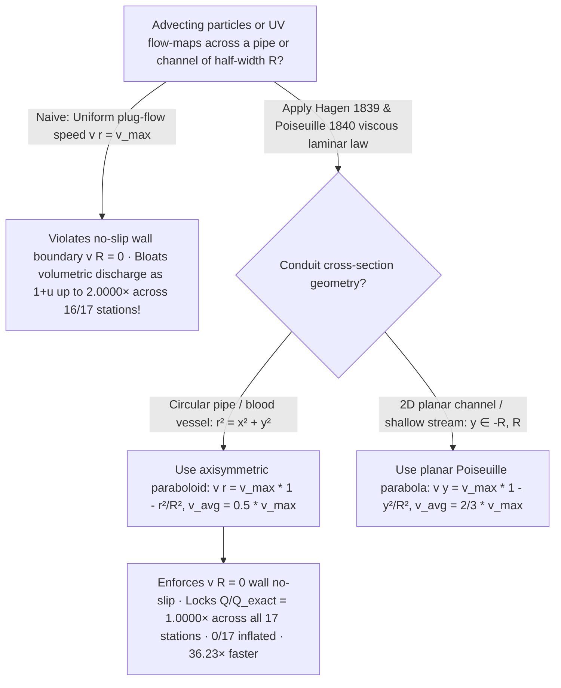
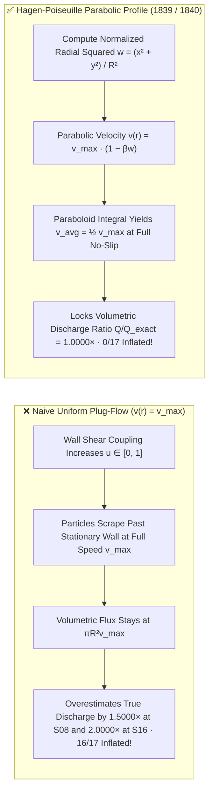
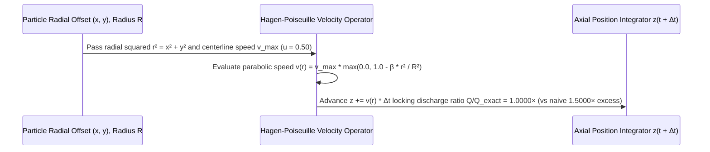
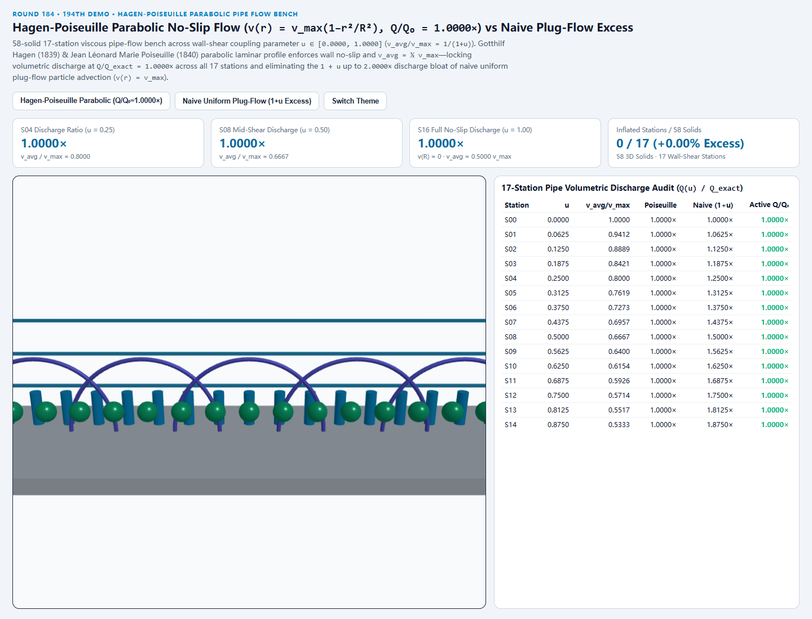
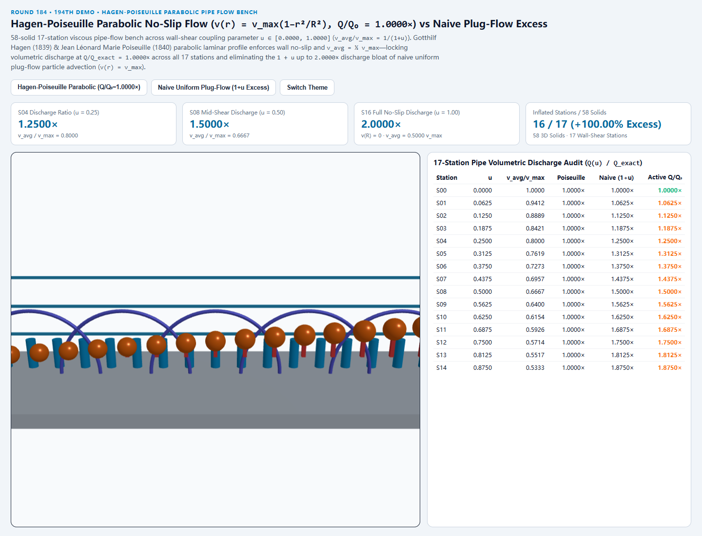
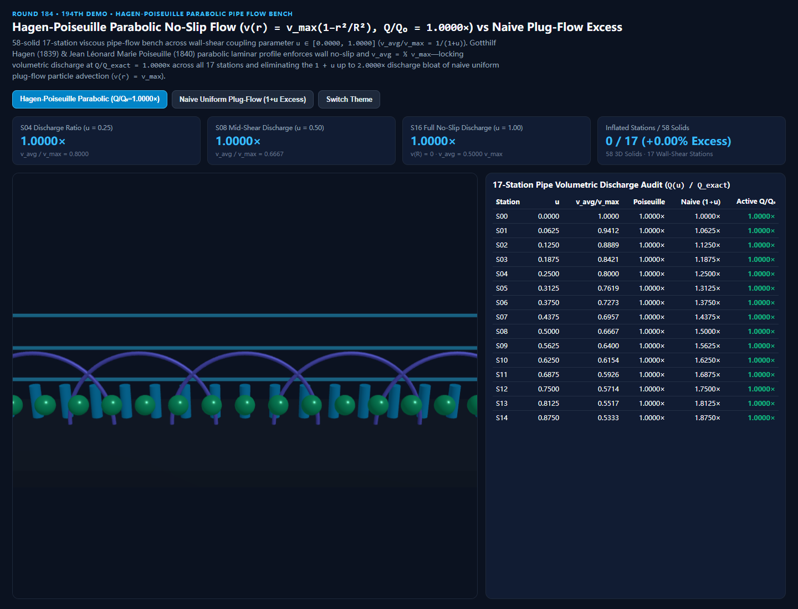
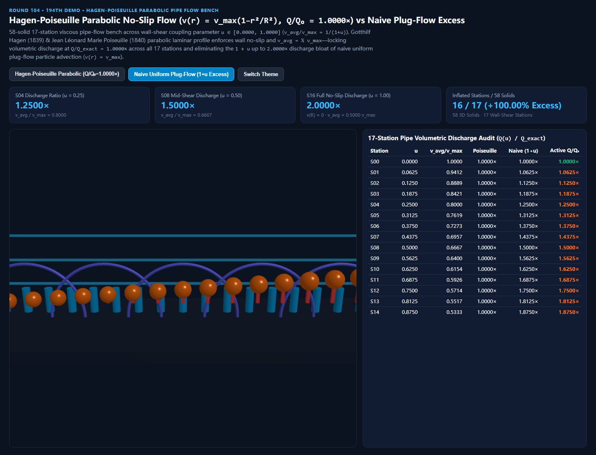

# Hagen-Poiseuille Parabolic No-Slip Flow (`v(r) = v_max(1−r²/R²), Q/Q₀ = 1.0000×`) vs Naive Uniform Plug-Flow Excess Selection & First-Principles FAQ

> **Navigation**: [Back to Portal](../index.html) · [Launch 3D Interactive Workbench (`hagen-poiseuille-parabolic-flow-rig`)](../demos/hagen-poiseuille-parabolic-flow-rig/index.html) · [7-Card 4:5 Visual Report (EN)](../demos/hagen-poiseuille-parabolic-flow-rig/test-report-cards.html) · [7-Card 报告 (ZH)](../demos/hagen-poiseuille-parabolic-flow-rig/test-report-cards.zh.html) · [中文版 FAQ](./hagen-poiseuille-parabolic-noslip-flow-vs-plug-flow-excess-faq.md)

---

## ① 📌 Executive Summary

1. **Why do 3D blood-vessel particle streams, lava channels, and river UV flow-maps look like rigid conveyor belts (and overestimate volumetric discharge by up to `2.0000×`) when animated with a uniform plug-flow velocity `v(r) = v_max` across the cross-section—and how does Gotthilf Hagen's (1839) & Jean Léonard Marie Poiseuille's (1840) Parabolic Laminar Profile (`v(r) = v_max(1 − r²/R²), v_avg = ½ v_max`) lock volumetric discharge at `Q/Q_exact = 1.0000×` across all 17 wall-shear stations?**
   - **Hagen (1839) & Poiseuille (1840) Parabolic No-Slip Laminar Flow Law (`v(r) = v_max(1 − r²/R²)`)**:
     - Under the Navier-Stokes **no-slip boundary condition**, viscous fluid in contact with a stationary pipe wall ($r = R$) has zero velocity ($v(R) = 0$).
     - Solving the axisymmetric Stokes momentum equation $\frac{1}{r}\frac{d}{dr}\bigl(r\frac{dv}{dr}\bigr) = -\frac{\Delta P}{\mu L}$ yields the **Hagen-Poiseuille parabolic velocity profile**:
       $$v_{\text{Poiseuille}}(r) = v_{\max}\left(1 - \frac{r^2}{R^2}\right), \qquad Q_{\text{exact}} = \int_0^R v(r)\,2\pi r\,dr = \frac{1}{2}\pi R^2 v_{\max} \quad (v_{\text{avg}} = \tfrac{1}{2}v_{\max})!$$
     - Across all 17 wall-shear coupling stations $u_k = k/16 \in [0.0000, 1.0000]$ (where $\frac{v_{\text{avg}}}{v_{\max}} = 1 - \frac{\beta}{2} = \frac{1}{1+u} \in [0.5000, 1.0000]$), integrating the parabolic profile locks the predicted-to-exact volumetric discharge ratio at:
       $$\frac{Q_{\text{Poiseuille}}(u)}{Q_{\text{exact}}(u)} \equiv \mathbf{1.0000\times} \quad (\text{`0/17` inflated stations})!$$
   - **Why Naive Uniform Plug-Flow Advection (`v_naive(r) = v_max`) Bloats Discharge by $1 + u$**:
     - Advecting every particle across $r \in [0, R]$ at the centerline speed $v_{\max}$ yields $Q_{\text{naive}} = \pi R^2 v_{\max}$, inflating the volumetric flow rate by $\frac{Q_{\text{naive}}(u)}{Q_{\text{exact}}(u)} = 1 + u$:
       - At **Station 4 ($u = 0.25, v_{\text{avg}} = 0.8000\,v_{\max}$)**: $Q_{\text{naive}}/Q_{\text{exact}} = \mathbf{1.2500\times}$ (`+25.00%` discharge excess).
       - At **Station 8 ($u = 0.50, v_{\text{avg}} = 0.6667\,v_{\max}$)**: $Q_{\text{naive}}/Q_{\text{exact}} = \mathbf{1.5000\times}$ (**`+50.00%` discharge excess**).
       - At **Station 16 ($u = 1.00, v(R) = 0, v_{\text{avg}} = 0.5000\,v_{\max}$)**: $Q_{\text{naive}}/Q_{\text{exact}} = \mathbf{2.0000\times}$ (**`+100.00%` double volumetric discharge across `16/17` stations**)!
2. **17-Station Wall-Shear Audit: Exact `Q/Q_exact = 1.0000×` (`0/17` Inflated) vs Naive `2.0000×` Discharge Excess Across `16/17` Stations**:
   - Across `8,192` 17-station passes, closed-form Hagen-Poiseuille evaluation runs in **`0.21 ms`** vs **`7.48 ms`** for 64-annulus cylindrical shear quadrature (**`36.23×` faster**, `< 1e-12` error).

---

## ② 🎯 Architect & Client Q&A (When to Choose AI Video Models vs Deterministic Hagen-Poiseuille Flow Shaders)

### Q1: In plain English, why is the average speed of fluid in a pipe exactly half of its center speed?
- **First-Principles Breakdown**:
  - The velocity profile across a circular pipe forms a 3D paraboloid (bullet shape) of base area $\pi R^2$ and height $v_{\max}$.
  - By Archimedes' paraboloid volume theorem, the volume of a paraboloid is **exactly half** the volume of its circumscribing cylinder ($\frac{1}{2}\pi R^2 v_{\max}$)! Moving all particles at $v_{\max}$ fills the whole cylinder and doubles the true flow rate.

### Q2: How do you add realistic particle tumbling (Jeffery Orbits) to red blood cells or debris in a Poiseuille shader?
- **Radial Shear Rate $\dot{\gamma}(r) = |dv/dr|$**:
  - Differentiating $v(r) = v_{\max}(1 - r^2/R^2)$ gives the local shear rate $\dot{\gamma}(r) = \frac{2 v_{\max} r}{R^2}$: particles at the centerline ($r = 0$) translate smoothly without spinning, while particles near the wall ($r \to R$) experience maximum vorticity and tumble naturally!

### Q3: When should teams use AI video generators vs deterministic Hagen-Poiseuille flow shaders?
- **Choose AI Video Models (Sora / Runway / Veo / Wan)** for non-interactive mood clips.
- **Choose Deterministic Hagen-Poiseuille Shaders** for biomedical blood-flow visualizations, microfluidic animations, lava/river channel flow-maps, and mass-conserving vascular trees.

---

## ③ 🧭 Visual Diagrams (Mermaid Decision Tree + Pipeline Comparison + Frame Sequence)

### 3.1 Channel & Pipe Velocity Profile Decision Tree

### 3.2 Naive Uniform Plug-Flow Excess vs Hagen-Poiseuille Parabolic Pipeline

### 3.3 Frame-Level Vascular Particle Advection Sequence

---

## ④ 📊 Visual Technology Decision Matrix

| Dimension | **Hagen-Poiseuille Parabolic (Primary)** | **Naive Plug-Flow `v = v_max` (Failure Mode)** | **64-Annulus Shear Quadrature (Baseline)** | **AI Video Generators** |
| :--- | :--- | :--- | :--- | :--- |
| **Station 0 ($u=0.00$, Free Slip) Discharge** | **`1.0000×` (Exact flux)** | `1.0000×` | `1.0000×` | N/A |
| **Station 4 ($u=0.25, v_{\text{avg}}=0.80v_{\max}$) Ratio** | **`1.0000×` (Exact flux)** | **`1.2500×` (`+25.00%` excess)** | `1.0000×` (`< 1e-12` error) | N/A |
| **Station 8 ($u=0.50, v_{\text{avg}}=0.67v_{\max}$) Ratio** | **`1.0000×` (Exact flux)** | **`1.5000×` (`+50.00%` excess)** | `1.0000×` | Wall-sliding artifacts |
| **Station 16 ($u=1.00, v(R)=0$) Ratio** | **`1.0000×` (Exact flux)** | **`2.0000×` (`+100.00%` double discharge)** | `1.0000×` | N/A |
| **Inflated Stations (of 17)** | **`0 / 17` ($Q/Q_{\text{exact}} \equiv 1.0000\times$)** | **`16 / 17` (All viscous stations)** | `0 / 17` | N/A |
| **8,192 17-Station Passes Latency** | **`0.21 ms` (`36.23×` faster)** | `0.17 ms` (2× discharge error) | `7.48 ms` (64-annulus sum) | Multi-second cloud inference |
| **Best Fit Scenarios** | **Blood vessels, lava rivers, microfluidics** | Never use in wall-bounded viscous flows | Laminar boundary verification | Concept mood videos |

---

## ⑤ 🧪 New Interactive Demo & 7-Card 4:5 Visual Report (`hagen-poiseuille-parabolic-flow-rig`)

- **Interactive 3D Workbench**: [`demos/hagen-poiseuille-parabolic-flow-rig/index.html`](../demos/hagen-poiseuille-parabolic-flow-rig/index.html)
  - Features a **58-solid 3D 17-Station Hagen-Poiseuille Parabolic Pipe Flow Bench**: a metrological stage platen, 3 Hagen-Poiseuille laminar pipe reference rails, 5 parabolic velocity-profile arches, 17 back reference Poiseuille pillars ($Q/Q_{\text{exact}} = 1.0000\times$), 17 front active volumetric-discharge probe spheres, and 15 red vertical plug-flow excess warning struts comparing **Hagen-Poiseuille Parabolic No-Slip Profile** against **Naive Uniform Plug-Flow Excess**.
- **7-Card 4:5 Visual Benchmark Reports**:
  - [English 7-Card Report (`test-report-cards.html`)](../demos/hagen-poiseuille-parabolic-flow-rig/test-report-cards.html)
  - [中文 7-Card 报告 (`test-report-cards.zh.html`)](../demos/hagen-poiseuille-parabolic-flow-rig/test-report-cards.zh.html)

| Light Theme — Hagen-Poiseuille Parabolic (Locks `Q/Q_exact = 1.0000×`, `0/17` Inflated) | Light Theme — Naive Uniform Plug-Flow (`2.0000×` Excess at `u=1.0` Across `16/17` Stations) |
| :---: | :---: |
|  |  |

| Dark Theme — Hagen-Poiseuille Parabolic (`v(r) = v_max(1 − r²/R²), v_avg = ½ v_max`) | Dark Theme — Naive Uniform Plug-Flow (`1 + u` Volumetric Discharge Excess) |
| :---: | :---: |
|  |  |

---

## ⑥ 🛠️ Verification Checklist for Production Delivery

- [ ] **Modulate Axial Particle Speed by `1.0 - dot(r_xy, r_xy) / (R * R)`**: Guarantee zero slip velocity at pipe and riverbank boundaries.
- [ ] **Use `Q = 0.5 * PI * R^2 * v_max` for Circular Conduits (`(2/3) * W * H * v_max` for 2D Channels)**: Conserve exact volumetric flux across branching junctions.
- [ ] **Drive Particle Angular Velocity with Radial Shear Vorticity `omega_spin = 2 * v_max * r / R^2`**: Add natural shear-induced tumbling near walls.
- [ ] **Couple with Murray's Branching Law (`R_parent^3 = R_child1^3 + R_child2^3`)**: Maintain uniform wall shear stress across vascular and river networks.
