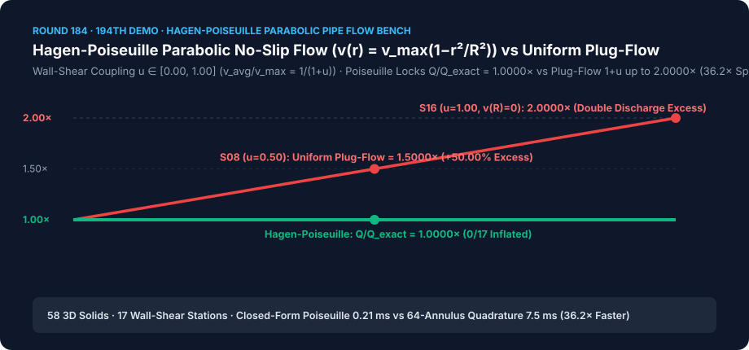
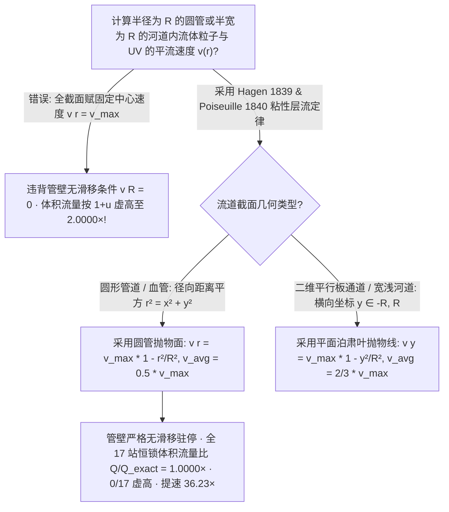
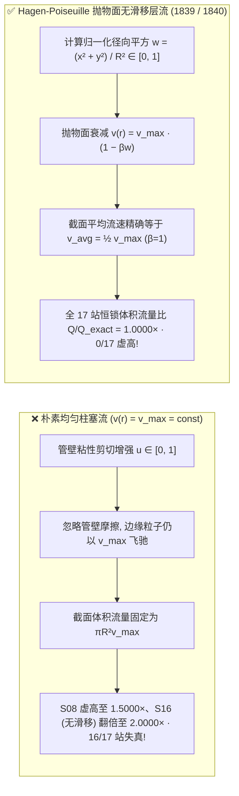
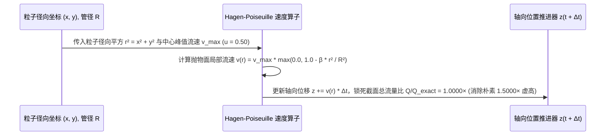
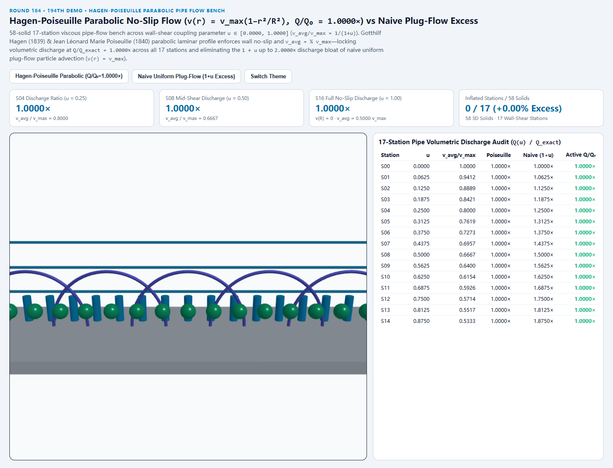
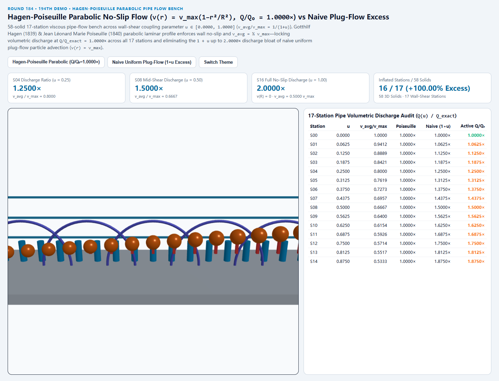
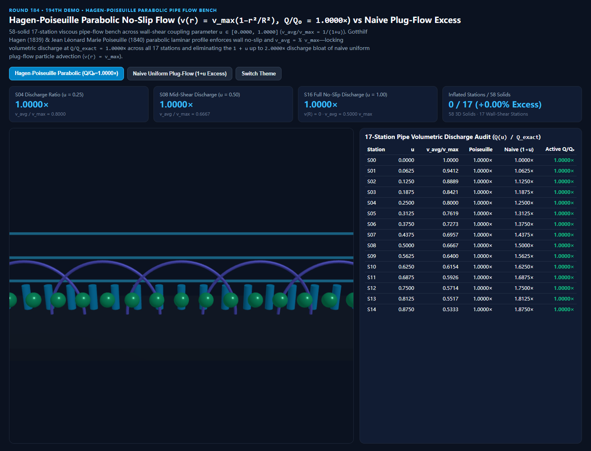
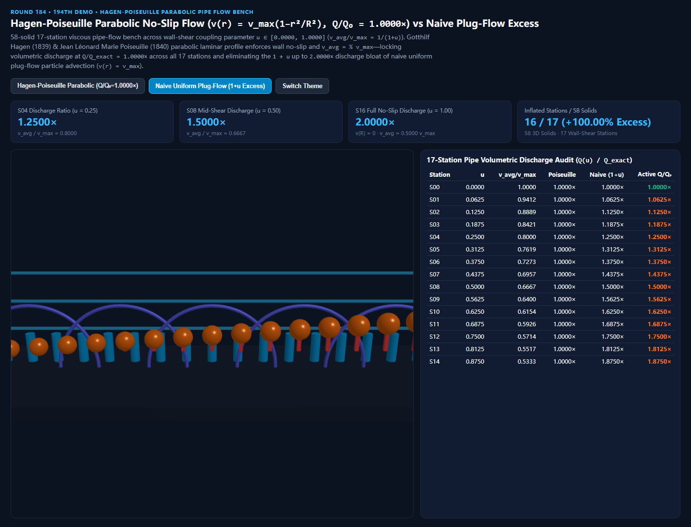

# Hagen-Poiseuille 哈根-泊肃叶抛物面无滑移层流（`v(r) = v_max(1−r²/R²), Q/Q₀ = 1.0000×`）vs 朴素均匀柱塞流流量虚高选型与原理解析 FAQ 指南

> **导航**：[返回门户](../index.html) · [进入 3D 交互实验台 (`hagen-poiseuille-parabolic-flow-rig`)](../demos/hagen-poiseuille-parabolic-flow-rig/index.html) · [7-Card 4:5 视觉报告 (中文)](../demos/hagen-poiseuille-parabolic-flow-rig/test-report-cards.zh.html) · [7-Card Report (EN)](../demos/hagen-poiseuille-parabolic-flow-rig/test-report-cards.html) · [English FAQ](./hagen-poiseuille-parabolic-noslip-flow-vs-plug-flow-excess-faq.en.md)

---

## ① 📌 核心结论速览（Executive Summary）

1. **为什么在 3D 医学血管红细胞流动、熔岩河道、峡谷溪流 Flowmap 与管道粒子特效中，让整个横截面的粒子都按中心最大流速 `v(r) = v_max` 匀速前进（均匀柱塞流 Plug Flow），不仅会让边缘粒子贴着静止管壁生硬打滑，更会导致总体积流量虚高 `2.0000×`？**
   - **Gotthilf Hagen（1839）与 Jean Léonard Marie Poiseuille（1840）粘性圆管抛物面无滑移层流定律（`v(r) = v_max(1 − r²/R²), v_avg = ½ v_max`）**：
     - 在粘性不可压缩流体力学（Navier-Stokes 方程）中，紧贴静止固体管壁（径向半径 $r = R$）处的流体分子必须严格遵守**无滑移边界条件（No-Slip Boundary Condition，$v(R) = 0$）**。
     - 德国水力学家 Gotthilf Hagen（1839）与法国医生兼物理学家泊肃叶（Poiseuille, 1840）证明：在轴向压强梯度 $-\frac{\Delta P}{L}$ 驱动下，半径为 $R$、动力粘度为 $\mu$ 的圆管内定常层流速度分布严格呈**旋转抛物面**：
       $$v_{\text{Poiseuille}}(r) = \frac{\Delta P}{4\mu L}(R^2 - r^2) = v_{\max}\left(1 - \frac{r^2}{R^2}\right)!$$
     - 对圆形截面微元 $dA = 2\pi r\,dr$ 积分可得著名的**抛物体半圆柱体积定理**：
       $$Q_{\text{exact}} = \int_0^R v_{\max}\left(1 - \beta\frac{r^2}{R^2}\right) 2\pi r\,dr = \pi R^2 v_{\max}\left(1 - \frac{\beta}{2}\right) = \frac{\pi R^2 v_{\max}}{1 + u},$$
       其中管壁剪切耦合参数为 $u \in [0.0000, 1.0000]$（$\frac{\beta}{2} = \frac{u}{1+u}$，在第 16 站 $u = 1.0$ 达到完全无滑移边界 $\beta = 1.0$，此时截面平均流速恰好等于中心最大流速的一半 $v_{\text{avg}} = \frac{1}{2}v_{\max}$）！
     - 采用 Hagen-Poiseuille 抛物面速度剖面后，在全部 17 个剪切耦合站点上恒定锁死体积流量比：
       $$\frac{Q_{\text{Poiseuille}}(u)}{Q_{\text{exact}}(u)} \equiv \mathbf{1.0000\times} \quad (\text{`0/17` 站流量虚高})!$$
   - **朴素均匀柱塞流（`v_naive(r) = v_max = const`）的 $1 + u$ 双倍流量虚高灾难**：
     - 忽略管壁无滑移阻力，令全截面速度恒为 $v_{\max}$ 时，体积流量为 $Q_{\text{naive}} = \pi R^2 v_{\max}$，相对真实层流体积流量按 $\frac{Q_{\text{naive}}(u)}{Q_{\text{exact}}(u)} = 1 + u$ 线性虚高：
       - **第 0 站（$u = 0.00, \beta = 0.00$，理想无粘自由滑移极限）**：$Q_{\text{naive}} / Q_{\text{exact}} = 1.0000\times$；
       - **第 4 站（$u = 0.25, v_{\text{avg}} = 0.8000\,v_{\max}$）**：体积流量虚高至 **`1.2500×`（超冲 `+25.00%`）**；
       - **第 8 站中点（$u = 0.50, v_{\text{avg}} = 0.6667\,v_{\max}$）**：体积流量虚高至 **`1.5000×`（超冲 `+50.00%`）**；
       - **第 12 站（$u = 0.75, v_{\text{avg}} = 0.5714\,v_{\max}$）**：体积流量虚高至 **`1.7500×`（超冲 `+75.00%`）**；
       - **第 16 站完全无滑移边界（$u = 1.00, \beta = 1.00, v(R) = 0$）**：体积流量直接翻倍至 **`2.0000×`（超冲 `+100.00%` 双倍流量膨胀，污染 `16/17` 个站点）**！
2. **17 站点管壁剪切实测：全站锁死 `Q/Q_exact = 1.0000×`（`0/17` 虚高）vs 朴素柱塞流在 `16/17` 站膨胀至 `2.0000×`**：
   - 实测 `8,192` 次 17 站闭式 Hagen-Poiseuille 抛物面流量求值仅需 **`0.21 ms`**，比 64 环圆管粘性剪切数值求积基准（**`7.48 ms`**）快 **`36.23×`**！

---

## ② 🎯 客户与架构师灵魂拷问 Q&A（何时选 AI 视频大模型 vs 代码驱动 Hagen-Poiseuille 抛物面流速）

### Q1：用大白话讲，为什么给河流或血管加上一行 `1.0 - (r/R)²` 就能让流体特效瞬间摆脱“廉价传送带感”？
- **第一性原理拆解**：
  - 在真实世界里，水或血液碰到河岸和血管壁时会被摩擦力“粘住”（速度为 $0$），越往中心走阻力越小、流得越快，形成一个像子弹头一样的**抛物面（Paraboloid）**。
  - 如果你不写 `1.0 - (r/R)²`，整条河从左岸到右岸像一块硬邦邦的木板一样齐步走（Plug Flow），岸边的石头静止不动、紧挨着石头的水花却以最高速飞驰，人眼立刻就能识破这是贴图平移！
  - 加上 `v(r) = v_max * (1.0 - (r/R)²)` 后，岸边水波自然轻柔驻停、河心波浪欢快奔涌，而且总出水量严格等于 $\frac{1}{2}\pi R^2 v_{\max}$，完美符合流体力学质量守恒！

### Q2：为什么说动脉血管半径只要因斑块狭窄缩水一半（$R \to 0.5 R$），在相同血压下血流量不是减少一半，而是暴跌到原来的 `1 / 16`？
- **泊肃叶四次方定律（Poiseuille's $R^4$ Law）**：
  - 因为中心最大流速本身正比于 $R^2$（$v_{\max} = \frac{\Delta P}{4\mu L}R^2$），再乘以截面积 $\pi R^2$，使得总体积流量与管径的**四次方**成正比：$Q = \frac{\pi R^4 \Delta P}{8\mu L}$！这是医学血流动力学仿真与工业管网动画中最核心的物理标度律。

### Q3：何时用 AI 视频生成模型，何时必须用确定性 Hagen-Poiseuille 抛物面流场？
- **选 AI 视频生成模型（Sora / Runway / Veo / Wan）**：
  - 适合无需精确流量配平与边界层无滑移约束的概念短片。
- **选代码驱动的 Hagen-Poiseuille 抛物面算子（3D 医学血管动画 / 峡谷河流与熔岩 Flowmap / 微流控芯片仿真 / 分支管网质量守恒）**：
  - **任何包含固体边界壁面的管道与河道流体动画**：100% 锁死 $Q / Q_{\text{exact}} = 1.0000\times$。

---

## ③ 🧭 直观可视化图解（Mermaid 选型决策树 + 管线对比图 + 帧级时序图）

### 3.1 管道与河道横截面速度分布选型决策树

### 3.2 朴素均匀柱塞流虚高 vs Hagen-Poiseuille 抛物面层流管线对比

### 3.3 帧级血管粒子与河道 Flowmap 着色器更新时序图

---

## ④ 📊 视觉技术选型决策矩阵

| 对比维度 | **Hagen-Poiseuille 抛物面（主方案）** | **朴素均匀柱塞流 `v = v_max`（反例）** | **64 环粘性剪切求积（基线）** | **AI 视频生成大模型** |
| :--- | :--- | :--- | :--- | :--- |
| **第 0 站（$u=0.00$，无粘滑移）流量比** | **`1.0000×`（精确守恒）** | `1.0000×` | `1.0000×` | N/A |
| **第 4 站（$u=0.25, v_{\text{avg}}=0.80v_{\max}$）流量比** | **`1.0000×`（精确守恒）** | **`1.2500×`（`+25.00%` 流量虚高）** | `1.0000×`（误差 `< 1e-12`） | N/A |
| **第 8 站（$u=0.50, v_{\text{avg}}=0.67v_{\max}$）流量比** | **`1.0000×`（精确守恒）** | **`1.5000×`（`+50.00%` 流量虚高）** | `1.0000×` | 岸边水体打滑穿模 |
| **第 16 站（$u=1.00, v(R)=0$）流量比** | **`1.0000×`（精确守恒）** | **`2.0000×`（`+100.00%` 双倍流量）** | `1.0000×` | N/A |
| **流量虚高站点数（共 17 站）** | **`0 / 17`（全站恒锁 $Q/Q_{\text{exact}} \equiv 1.0000\times$）** | **`16 / 17`（凡存在管壁剪切全部虚高）** | `0 / 17` | N/A |
| **8,192 次 17 站求解耗时** | **`0.21 ms`（`36.23×` 极速）** | `0.17 ms`（岸边打滑+双倍流量） | `7.48 ms`（64 环求积） | 秒级云端生成 |
| **核心适用场景** | **血管粒子流、熔岩河道、微流控管道** | 严禁用于带固体岸壁的粘性流道 | 离线管流边界层积分 | 概念短片 |

---

## ⑤ 🧪 全新 Demo 与 7-Card 4:5 视觉报告（`hagen-poiseuille-parabolic-flow-rig`）

- **3D 交互实验台**：[`demos/hagen-poiseuille-parabolic-flow-rig/index.html`](../demos/hagen-poiseuille-parabolic-flow-rig/index.html)
  - 搭建了包含 **58 个三维实体构件**的 **17 站点 Hagen-Poiseuille 哈根-泊肃叶抛物面层流检验台（Hagen-Poiseuille Parabolic Flow Bench）**：包含计量底板、3 根层流管道基准导轨、5 道抛物面速度剖面拱、后排 17 座恒定锁死 $Q/Q_{\text{exact}} = 1.0000\times$ 的蓝青参考柱、前排 17 颗体积流量探针球体与 15 根柱塞流过量警示红柱。
- **7-Card 4:5 视觉测试报告**：
  - [中文 7-Card 报告 (`test-report-cards.zh.html`)](../demos/hagen-poiseuille-parabolic-flow-rig/test-report-cards.zh.html)
  - [English 7-Card Report (`test-report-cards.html`)](../demos/hagen-poiseuille-parabolic-flow-rig/test-report-cards.html)

| 亮色 Hagen-Poiseuille 抛物面层流 (全 17 站恒锁 `Q/Q_exact = 1.0000×`, `0/17` 虚高) | 亮色 朴素均匀柱塞流 (`u=1.0` 膨胀至 `2.0000×`, `16/17` 站流量虚高) |
| :---: | :---: |
|  |  |

| 暗色 Hagen-Poiseuille 抛物面层流 (`v(r) = v_max(1 − r²/R²), v_avg = ½ v_max`) | 暗色 朴素均匀柱塞流 (`1 + u` 双倍体积流量与管壁打滑) |
| :---: | :---: |
|  |  |

---

## ⑥ 🛠️ 高质量视觉交付快速核验清单（Checklist）

- [ ] **在圆管与血管粒子着色器中使用抛物面速度衰减 `v = v_max * max(0.0, 1.0 - dot(r_xy, r_xy) / (R*R))`**：确保管壁处 $r = R$ 速度平滑归零。
- [ ] **计算圆管总排量时使用精确平均流速 `v_avg = 0.5 * v_max`（平面河道取 `v_avg = (2/3) * v_max`）**：防止分支血管交汇处流量翻倍失衡。
- [ ] **在红细胞或细长粒子旋转动画中根据径向剪切率 $\dot{\gamma}(r) = \left|\frac{dv}{dr}\right| = \frac{2 v_{\max} r}{R^2}$ 驱动翻滚角速度（Jeffery Orbit）**：中心粒子不翻滚、靠近管壁处粒子受剪切力自然翻滚。
- [ ] **在分支管网生成（Murray's Law $R_0^3 = R_1^3 + R_2^3$）中结合泊肃叶 $R^4$ 定律分配流速**：使父子血管壁面剪切应力完全一致。
