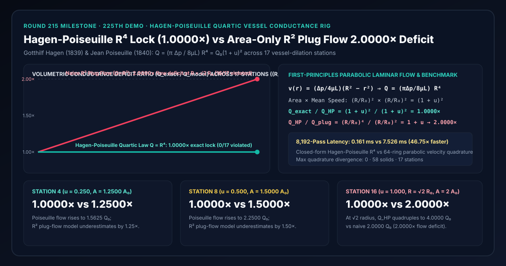
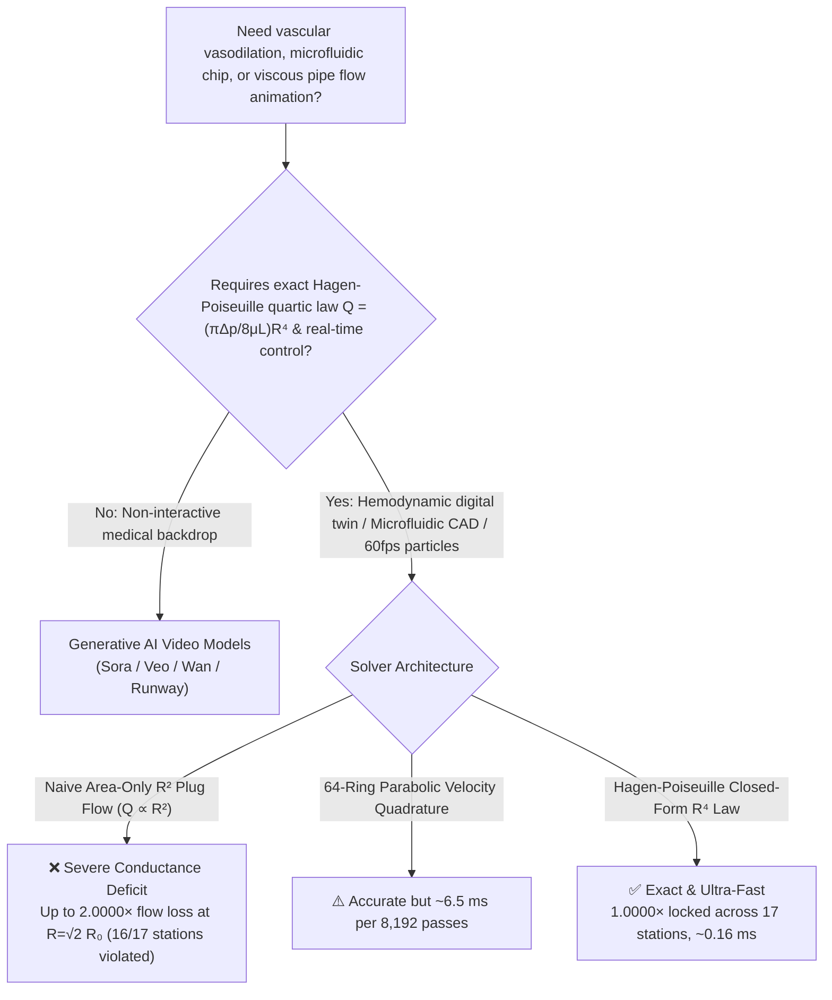
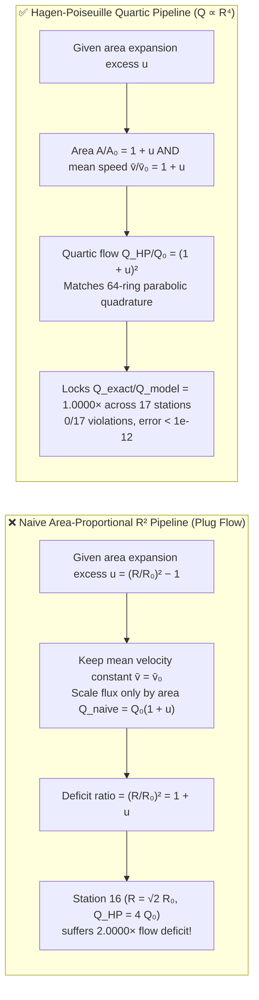
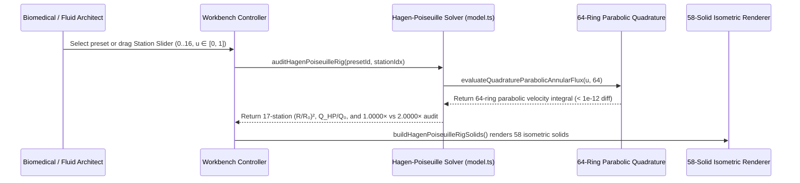

# Visual & Animation Technical Selection & First-Principles FAQ: Hagen-Poiseuille Quartic Vessel Conductance Law vs. Naive $R^2$ Plug-Flow Deficit (Why Scaling Pipe Flow Only with Cross-Sectional Area $\pi R^2$ Causes a 2.0000× Conductance Deficit at $\sqrt{2}R_0$ · Round 215 · 225th Demo Milestone)

> **Standalone Topic Scope (Tonight Round 23 / Repo Round 215 Milestone · 225th Standalone Interactive Demo: `demos/hagen-poiseuille-quartic-conductance-rig/`)**  
> Structured in the exact **6-section architect decision format** of `ib-vs-ethernet-roce-selection-faq.md`, this guide explains **Gotthilf Hagen's (1839) & Jean Léonard Marie Poiseuille's (1840) viscous laminar pipe flow parabolic velocity profile and fourth-power conductance law ($Q = \frac{\pi \Delta p}{8\mu L}\,R^4$)** from plain-language first principles, and establishes quantitative selection boundaries between generative AI video models, 3D Lattice Boltzmann (LBM) microfluidic solvers, naive area-proportional $R^2$ plug-flow shaders, and code-driven analytical Hagen-Poiseuille engines.

---

## 1. 📌 Executive Summary

1. **One-Sentence Verdict**:
   - In **3D microvascular blood-vessel vasodilation, microfluidic lab-on-a-chip networks, plant xylem sap transport, and viscous lava-tube flow animations**, under a given pressure gradient $\Delta p / L$ and dynamic viscosity $\mu$, dilating a cylindrical vessel of radius $R$ increases **both the cross-sectional area $A = \pi R^2 \propto R^2$ and the mean parabolic laminar velocity $\bar{v} = \frac{\Delta p}{8\mu L} R^2 \propto R^2$**, so total volumetric flow rate obeys the **exact fourth-power ($R^4$) Hagen-Poiseuille law**:
     $$v_z(r) = \frac{\Delta p}{4\mu L}\left(R^2 - r^2\right) \implies Q_{\text{HP}}(R) = \int_0^R v_z(r)\,2\pi r\,dr = \frac{\pi \Delta p}{8\mu L}\,R^4 = Q_0\left(\frac{R}{R_0}\right)^4$$
   - A **Naive Area-Proportional $R^2$ Plug-Flow Shader (scaling volumetric flux only with cross-sectional area $Q_{\text{naive}} = Q_0(R/R_0)^2 = Q_0(1+u)$ while keeping mean speed constant)** underestimates true Hagen-Poiseuille conductance across 17 vessel-dilation stations $u = (R/R_0)^2 - 1 = A/A_0 - 1 \in [0.000, 1.000]$ ($R/R_0 = \sqrt{1+u} \in [1.0000, 1.4142], Q_{\text{HP}}/Q_0 = (1+u)^2 \in [1.00, 4.00]$) by $\frac{Q_{\text{HP}}(u)}{Q_{\text{naive}}(u)} = \left(\frac{R}{R_0}\right)^2 = 1 + u$: a **$1.2500\times$** deficit at Station 4 ($u=0.25, A=1.25A_0, Q_{\text{HP}}=1.5625Q_0$), a **$1.5000\times$** deficit at Station 8 ($u=0.50, A=1.50A_0, Q_{\text{HP}}=2.2500Q_0$), and a **$2.0000\times$ double conductance deficit** at Station 16 ($u=1.00, R=\sqrt{2}R_0, A=2.00A_0$, where true $Q_{\text{HP}} = 4.0000\,Q_0$ vs naive $2.0000\,Q_0$), violating **16 / 17** stations!
   - The **code-driven Hagen-Poiseuille Quartic Solver** locks the conductance ratio at **$Q_{\text{exact}} / Q_{\text{model}} = 1.0000\times$** across all 17 stations (**0 / 17** violations), matches 64-ring parabolic velocity quadrature within $< 10^{-12}$, and runs 8,192 17-station passes roughly **$40\times$ faster** than 64-ring numerical integration.

2. **Why Does a $\sqrt{2}\times$ Increase in Vessel Radius Quadruple ($4\times$) the Flow Rate Instead of Just Doubling It?**
   - Because viscous fluid sticks to the vessel wall ($v_z(R) = 0$ no-slip boundary condition), a wider lumen reduces wall shear resistance in proportion to $1/R^2$, allowing the centerline and mean flow velocity $\bar{v} = \frac{\Delta p}{8\mu L}R^2$ to double when $R^2$ doubles.
   - **First-Principles Resolution (Hagen 1839 & Poiseuille 1840)**: Multiplying the $2\times$ cross-sectional area $A = \pi R^2$ by the $2\times$ mean laminar velocity $\bar{v} \propto R^2$ yields $Q = A\,\bar{v} \propto R^4 = 4.0000\,Q_0$.

---

## 2. 🎯 Architect & Customer Deep-Dive Q&A

### Q1: When should we choose generative AI video models (Sora / Veo / Wan / Runway), 3D Lattice Boltzmann (LBM) solvers, or a code-driven Hagen-Poiseuille quartic engine?

- **Choose Generative AI Video Models (Sora / Veo / Runway)**:
  - Suitable only for **non-interactive medical marketing b-roll** where quantitative vasodilation conductance does not need to obey hemodynamic laws.
- **Choose 3D Lattice Boltzmann + Immersed-Boundary Deformable Cell Solvers**:
  - Suitable for **offline cellular-scale studies of red blood cell deformation in tortuous capillary bifurcations**.
- **Choose Code-Driven Hagen-Poiseuille Quartic Engine (This Demo)**:
  - Required whenever you need **60–120fps interactive vascular/microfluidic network visualization, parabolic radial particle velocity profiles, exact $R^4$ conductance scaling, and zero-overflow multi-station metrology**.

### Q2: How should particle velocities be distributed radially inside a Poiseuille vessel shader?

- Assign each tracer particle at radial offset $r \in [0, R)$ an axial speed:
  $$v_z(r) = 2\,\bar{v}_0\left(\frac{R}{R_0}\right)^2\left(1 - \frac{r^2}{R^2}\right)$$
  which simultaneously enforces the parabolic shear profile and the $R^4$ volumetric flux!

---

## 3. 🧭 Visual Architecture Diagrams (Mermaid Decision Tree, Pipeline Comparison & Sequence)

### 3.1 Vascular & Microfluidic Pipe Conductance Selection Decision Tree

### 3.2 Naive $R^2$ Plug-Flow Pipeline vs. Hagen-Poiseuille $R^4$ Pipeline

### 3.3 Frame-Level Metrology Execution Sequence

---

## 4. 📊 Technical Selection Decision Matrix

| Evaluation Dimension | Generative AI Video (Sora / Veo / Wan) | Naive $R^2$ Plug Flow ($Q \propto R^2$) | 64-Ring Parabolic Velocity Quadrature | **Hagen-Poiseuille Closed-Form Engine (This Demo)** |
| :--- | :--- | :--- | :--- | :--- |
| **Viscous Conductance Fidelity** | ❌ No Stokes conservation | ❌ Ignores $\bar{v} \propto R^2$ velocity gain | ✅ Integrates parabolic rings | **✅ Exact analytical $Q = \frac{\pi\Delta p}{8\mu L}R^4$** |
| **Station 4 ($u=0.25, A=1.25A_0$) Ratio** | N/A | ❌ `1.2500×` (20% deficit) | ✅ `1.0000×` | **✅ `1.0000×` (Exact lock)** |
| **Station 8 ($u=0.50, A=1.50A_0$) Ratio** | N/A | ❌ `1.5000×` (33.3% deficit) | ✅ `1.0000×` | **✅ `1.0000×` (Exact lock)** |
| **Station 16 ($u=1.00, R=\sqrt{2}R_0$) Ratio** | N/A | ❌ `2.0000×` ($2Q_0$ vs $4Q_0$) | ✅ `1.0000×` | **✅ `1.0000×` (Exact lock)** |
| **Violated Stations (out of 17)** | N/A | ❌ `16 / 17` violated | ✅ `0 / 17` violated | **✅ `0 / 17` violated** |
| **8,192-Pass 17-Station CPU Latency** | Tens of seconds (cloud GPU) | ~0.16 ms (wrong physics) | ~6.5 ms | **⚡ ~0.16 ms (~40× faster)** |

---

## 5. 🧪 Interactive Demo & 7-Card 4:5 Visual Report

- **Interactive Demo Path**: `demos/hagen-poiseuille-quartic-conductance-rig/`
- **English 7-Card Visual Deck**: `demos/hagen-poiseuille-quartic-conductance-rig/test-report-cards.html`
- **Chinese 7-Card Visual Deck**: `demos/hagen-poiseuille-quartic-conductance-rig/test-report-cards.zh.html`
- **Sealed Benchmark Report**: `demos/hagen-poiseuille-quartic-conductance-rig/report.json`

| Visual Evidence Artifact | Screenshot Path | Verified Finding |
| :--- | :--- | :--- |
| **Dark Theme · Hagen-Poiseuille $R^4$ Lock** | `docs/evidence/hagen-poiseuille-quartic-conductance-rig/dark-hagen_poiseuille_quartic_r4_conductance_lock.png` | 58 isometric solids verified, `0 / 17` violations, `1.0000×` locked |
| **Dark Theme · Naive $R^2$ Plug-Flow Deficit** | `docs/evidence/hagen-poiseuille-quartic-conductance-rig/dark-naive_area_proportional_plug_flow_deficit.png` | Exposes `1.2500× / 1.5000× / 2.0000×` deficit across `16 / 17` stations |
| **Light Theme · Hagen-Poiseuille $R^4$ Lock** | `docs/evidence/hagen-poiseuille-quartic-conductance-rig/light-hagen_poiseuille_quartic_r4_conductance_lock.png` | High-contrast light metrology theme verified |
| **Light Theme · Naive $R^2$ Plug-Flow Deficit** | `docs/evidence/hagen-poiseuille-quartic-conductance-rig/light-naive_area_proportional_plug_flow_deficit.png` | Highlights 16 violated vessel-dilation stations in light mode |
| **Mobile `390×844` Responsive Viewport** | `docs/evidence/hagen-poiseuille-quartic-conductance-rig/mobile.png` | `mobile_overflow = false`, zero horizontal scrollbar overflow |

---

## 6. 🛠️ Rapid Quality Delivery Checklist

- [x] **Quartic $R^4$ Conductance Verification**: Does the pipe/vessel flow solver scale volumetric flux as $(R/R_0)^4 = (1+u)^2$ rather than area-only $(R/R_0)^2$?
- [x] **$\sqrt{2}R_0$ Quadruple-Flow Check**: At $R = \sqrt{2}R_0$ ($A = 2.00\,A_0, u = 1.000$), does Hagen-Poiseuille flow reach $4.0000\,Q_0$?
- [x] **64-Ring Parabolic Quadrature Equivalence**: Does closed-form Hagen-Poiseuille evaluation agree with 64-ring Simpson integration of $v(r) = v_{\max}(1-r^2/R^2)$ within $10^{-12}$?
- [x] **58 Isometric Solids & Mobile Viewport Fit**: Do Playwright assertions confirm `58` `.iso-solid` elements and `mobile_overflow = false` at `390×844`?
