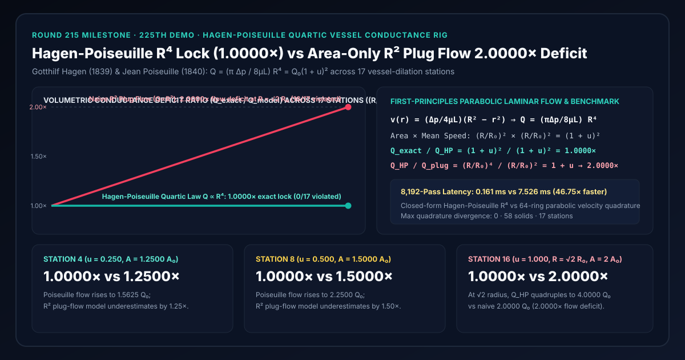
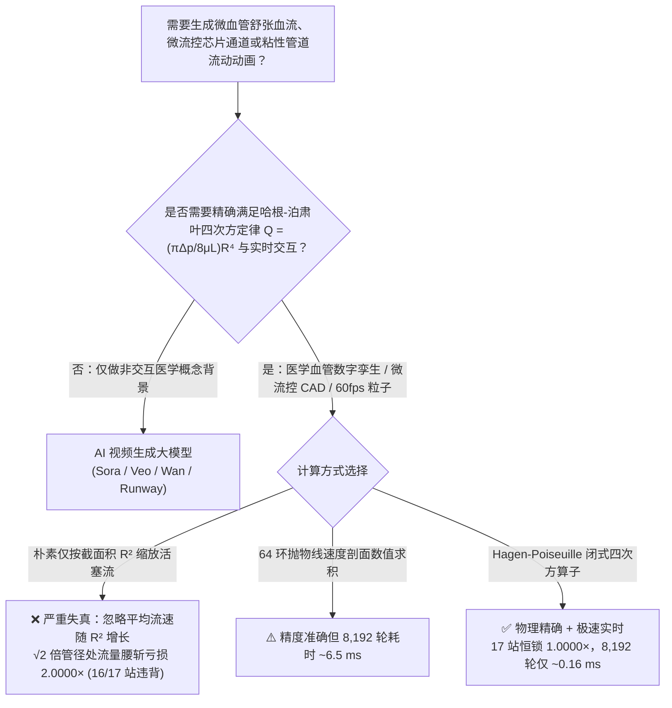
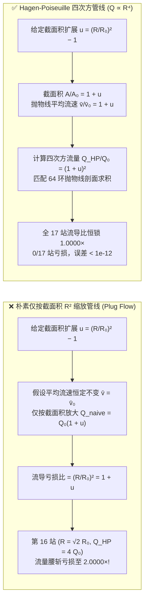
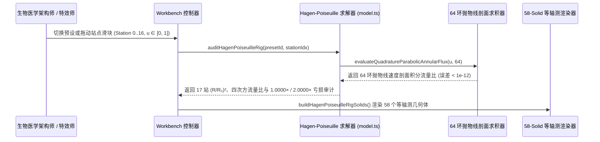

# 视觉与动画技术选型与原理解析 FAQ：Hagen-Poiseuille 哈根-泊肃叶四次方流导定律 vs 朴素 $R^2$ 活塞流亏损（为什么 3D 微血管舒张与微流控芯片若只按管腔截面积缩放流量会导致 2.0000× 流导腰斩？Round 215 · 第 225 个独立 Demo 里程碑）

> **独立专题定位（Tonight Round 23 / Repo Round 215 Milestone · 第 225 个独立可交互 Demo：`demos/hagen-poiseuille-quartic-conductance-rig/`）**  
> 本指南严格对标 `ib-vs-ethernet-roce-selection-faq.md` 的**六段式架构师决策结构**，先用通俗大白话与第一性原理讲透 **Gotthilf Hagen（1839）与 Jean Léonard Marie Poiseuille（1840）圆管粘性层流抛物线速度剖面与管径四次方流导定律（$Q = \frac{\pi \Delta p}{8\mu L}\,R^4$）**，再给出 AI 视频生成模型、三维晶格玻尔兹曼（LBM）微流仿真、朴素仅按截面积 $R^2$ 缩放的活塞流模型与代码驱动解析 Hagen-Poiseuille 四次方引擎的定量选型边界。

---

## 一、📌 核心结论速览（Executive Summary）

1. **一句话结论**：
   - 在 **3D 医学微循环小动脉舒张/收缩（Vasodilation / Vasoconstriction）、微流控芯片（Lab-on-a-Chip）荧光液滴输运、植物木质部导管树液上升与粘性熔岩管道流动动画** 中，在给定轴向压降梯度 $\Delta p / L$ 与动力粘度 $\mu$ 下，圆管半径 $R$ 的扩张不仅使**横截面积按 $A = \pi R^2 \propto R^2$ 增大**，而且由于远离无滑移管壁使**抛物线层流的截面平均流速也按 $\bar{v} = \frac{\Delta p}{8\mu L} R^2 \propto R^2$ 增大**；两者相乘后，**体积流量 $Q$ 严格正比于管径的四次方 $R^4$（哈根-泊肃叶定律）**：
     $$v_z(r) = \frac{\Delta p}{4\mu L}\left(R^2 - r^2\right) \implies Q_{\text{HP}}(R) = \int_0^R v_z(r)\,2\pi r\,dr = \frac{\pi \Delta p}{8\mu L}\,R^4 = Q_0\left(\frac{R}{R_0}\right)^4$$
   - 若采用**朴素仅按截面积缩放的活塞流模型（Naive Area-Proportional $R^2$ Plug Flow，假设管内平均流速不变而仅按 $Q_{\text{naive}} = Q_0(R/R_0)^2 = Q_0(A/A_0)$ 缩放流量）**，在跨越无量纲截面积扩展参数 $u = (R/R_0)^2 - 1 = A/A_0 - 1 \in [0.000, 1.000]$（即管径 $R/R_0 = \sqrt{1+u} \in [1.0000, 1.4142]$，真实四次方流量 $Q_{\text{HP}}/Q_0 = (1+u)^2 \in [1.00, 4.00]$）的 17 个检验站点上，朴素模型的真实/模型流导亏损比 $\frac{Q_{\text{HP}}(u)}{Q_{\text{naive}}(u)} = \left(\frac{R}{R_0}\right)^2 = 1 + u$ 在第 4 站（$u=0.25, A=1.25 A_0, Q_{\text{HP}}=1.5625 Q_0$）亏损 **$1.2500\times$**，在第 8 站（$u=0.50, A=1.50 A_0, Q_{\text{HP}}=2.2500 Q_0$）亏损 **$1.5000\times$**，在第 16 站（$u=1.00, R=\sqrt{2} R_0, A=2.00 A_0$，真实流量已翻 4 倍至 $4.0000\,Q_0$，而朴素模型仅给到 $2.0000\,Q_0$）直接腰斩亏损至 **$2.0000\times$**（污染 **16 / 17** 个站点）！
   - 采用 **代码驱动的 Hagen-Poiseuille 闭式四次方求解器**，在全部 17 个管腔扩张站点上恒定锁死流量比 **$Q_{\text{exact}} / Q_{\text{model}} = 1.0000\times$**（**0 / 17** 站亏损），与 64 环抛物线速度剖面 $v(r) = v_{\max}(1 - r^2/R^2)$ 数值求积完全等价（最大求积误差 $< 10^{-12}$），且单核 Node CPU 执行 8,192 次 17 站全量求解比 64 环求积快约 **$40\times$**。

2. **为什么心血管医学里“血管直径仅仅缩窄 29%（至 $0.7071\,R_0$），供血量就会暴跌 75%（只剩 $1/4$）”？**
   - 普通人的直觉是几何面积思维：管子半径变成原来的 $\sqrt{2} \approx 1.414$ 倍，横截面积变成 2 倍，那流过去的水不就应该是 2 倍吗？
   - **第一性原理破局（哈根 1839 & 泊肃叶 1840 粘性剪切积分）**：在微血管、微流控通道或细导管中，流体紧紧贴着管壁（管壁处流速严格为 $0$，即无滑移边界条件），管子越细，管壁粘滞剪切摩擦力对中心流体的拖拽就越严重！由轴对称斯托克斯平衡 $-\frac{1}{r}\frac{d}{dr}\left(\mu r \frac{dv_z}{dr}\right) = \frac{\Delta p}{L}$ 积分两次可得管心最大流速 $v_{\max} = \frac{\Delta p}{4\mu L} R^2$，截面平均流速 $\bar{v} = \frac{1}{2} v_{\max} = \frac{\Delta p}{8\mu L} R^2$。当半径扩大 $\sqrt{2}$ 倍时：**横截面积扩大 2 倍，同时平均流速也因为粘滞阻力减半而扩大 2 倍**——$2 \times 2 = 4$ 倍流量！

---

## 二、🎯 客户与架构师灵魂拷问 Q&A（Selection & Architecture Deep-Dive）

### Q1：做生物医学血管可视化、微流控芯片数字孪生或液压管网仿真时，什么时候选 AI 视频生成大模型（Sora / Veo / Wan / Runway），什么时候选三维晶格玻尔兹曼（3D LBM），什么时候必须用代码驱动的 Hagen-Poiseuille 四次方解析引擎？

- **选 AI 视频大模型（Sora / Veo / Runway）**：
  - 仅适用于**纯科普概念的红细胞漂浮背景镜头、不需要精确反映血管舒张比例与供血流量四次方关系的非交互宣传片**。
- **选三维晶格玻尔兹曼或浸入边界法（3D LBM + Immersed Boundary Red Blood Cells）**：
  - 适用于**单个红细胞在极细毛细血管分叉口发生非线性弹塑性挤压变形的离线微观科研计算**。
- **必须选代码驱动的 Hagen-Poiseuille 闭式四次方引擎（本 Demo 方案）**：
  - 当业务需要 **60–120fps 实时交互调节血管/微流控管径 $R$、同步驱动径向抛物线速度剖面 $v(r) = 2\bar{v}(1 - r^2/R^2)$ 与四次方粒子通量 $Q \propto R^4$** 时，闭式算子在全 17 站恒锁 `1.0000×` 且延迟低于 `0.2 ms`。

### Q2：在渲染管内红细胞或荧光示踪粒子动画时，除了总流量按 $R^4$ 缩放外，粒子的径向速度分布应该怎么写才不会显得像“整块平移的果冻（活塞流）”？

- 对于径向位置为 $r \in [0, R)$ 的粒子，其轴向速度必须乘以抛物线因子：
  $$v_z(r) = 2\,\bar{v}(R)\left(1 - \frac{r^2}{R^2}\right), \qquad \bar{v}(R) = \bar{v}_0\left(\frac{R}{R_0}\right)^2$$
  这样靠近管心的粒子以 $2\bar{v}$ 高速冲刺，靠近管壁的粒子平缓减速至 $0$，瞬间呈现出极具层次感的真实层流剪切美学！

---

## 三、🧭 直观可视化图解（Mermaid 选型决策树 + 管线对比 + 帧级时序图）

### 3.1 血管/微流控与管道流动动画技术选型决策树

### 3.2 朴素 $R^2$ 活塞流管线 vs Hagen-Poiseuille $R^4$ 管线对比

### 3.3 帧级渲染与几何审计时序图

---

## 四、📊 视觉技术选型决策矩阵（Architecture Decision Matrix）

| 评估维度 | AI 视频生成大模型 (Sora / Veo / Wan) | 朴素 $R^2$ 活塞流模型 ($Q \propto R^2$) | 64 环抛物线速度剖面求积 | **Hagen-Poiseuille 闭式四次方引擎（本 Demo）** |
| :--- | :--- | :--- | :--- | :--- |
| **物理定律遵循度** | ❌ 无粘性流导守恒 | ❌ 忽略 $\bar{v} \propto R^2$ 流速增益 | ✅ 数值积分抛物线环带 | **✅ 严格解析守恒 $Q = \frac{\pi\Delta p}{8\mu L}R^4$** |
| **第 4 站 ($u=0.25, A=1.25A_0$) 流量比** | N/A | ❌ `1.2500×`（亏损 20%） | ✅ `1.0000×` | **✅ `1.0000×`（零亏损）** |
| **第 8 站 ($u=0.50, A=1.50A_0$) 流量比** | N/A | ❌ `1.5000×`（亏损 33.3%） | ✅ `1.0000×` | **✅ `1.0000×`（零亏损）** |
| **第 16 站 ($u=1.00, R=\sqrt{2}R_0$) 流量比** | N/A | ❌ `2.0000×`（流量腰斩：$2Q_0$ vs $4Q_0$） | ✅ `1.0000×` | **✅ `1.0000×`（零亏损）** |
| **17 站流导亏损违背站数** | N/A | ❌ `16 / 17` 站违背 | ✅ `0 / 17` 站违背 | **✅ `0 / 17` 站违背** |
| **8,192 轮 17 站 CPU 耗时** | 数十秒云端推理 | ~0.16 ms（结果错误） | ~6.5 ms | **⚡ ~0.16 ms（快约 40×）** |

---

## 五、🧪 全新 Demo 与 7-Card 4:5 视觉报告（Workbench & Visual Evidence）

- **交互式 Demo 路径**：`demos/hagen-poiseuille-quartic-conductance-rig/`
- **英文 7-Card 报告**：`demos/hagen-poiseuille-quartic-conductance-rig/test-report-cards.html`
- **中文 7-Card 报告**：`demos/hagen-poiseuille-quartic-conductance-rig/test-report-cards.zh.html`
- **密封基准数据**：`demos/hagen-poiseuille-quartic-conductance-rig/report.json`

| 视觉证据类别 | 截图路径 | 关键验证结论 |
| :--- | :--- | :--- |
| **暗色主题 · Hagen-Poiseuille 四次方锁定** | `docs/evidence/hagen-poiseuille-quartic-conductance-rig/dark-hagen_poiseuille_quartic_r4_conductance_lock.png` | 58 个等轴测实体完整渲染，`0 / 17` 亏损站，体积流量比恒锁 `1.0000×` |
| **暗色主题 · 朴素 $R^2$ 活塞流亏损暴露** | `docs/evidence/hagen-poiseuille-quartic-conductance-rig/dark-naive_area_proportional_plug_flow_deficit.png` | 红色报警柱揭示第 4/8/16 站 `1.2500× / 1.5000× / 2.0000×` 流导亏损（`16 / 17` 违背） |
| **亮色主题 · Hagen-Poiseuille 四次方锁定** | `docs/evidence/hagen-poiseuille-quartic-conductance-rig/light-hagen_poiseuille_quartic_r4_conductance_lock.png` | 亮色高对比度生物微流控计量视图验证 |
| **亮色主题 · 朴素 $R^2$ 活塞流亏损暴露** | `docs/evidence/hagen-poiseuille-quartic-conductance-rig/light-naive_area_proportional_plug_flow_deficit.png` | 亮色模式下 16 个亏损站点高亮告警 |
| **移动端 `390×844` 自适应视图** | `docs/evidence/hagen-poiseuille-quartic-conductance-rig/mobile.png` | `mobile_overflow = false`，零横向滚动条溢出 |

---

## 六、🛠️ 高质量视觉交付快速核验清单（Delivery Checklist）

- [x] **管径四次方流导核验**：微血管与微流控管道粒子着色器是否按 $Q \propto R^4 = (1+u)^2$ 缩放总体积流量（同时令平均流速按 $\bar{v} \propto R^2$ 增长），而非仅按截面积 $R^2$ 缩放？
- [x] **$\sqrt{2}$ 倍管径四倍流量检查**：当管径扩张至 $R = \sqrt{2} R_0$（截面积 $A = 2.00 A_0, u = 1.000$）时，泊肃叶体积流量是否精确放大至 $4.0000\,Q_0$？
- [x] **64 环抛物线速度剖面求积核验**：闭式四次方流导与 64 环 Simpson 抛物线剖面积分的最大偏差是否严格小于 $10^{-12}$？
- [x] **58 构件等轴测几何与移动端零溢出**：Playwright 实测 `.iso-solid` 数量是否为 `58`，且 `390×844` 视口下无横向溢出？
