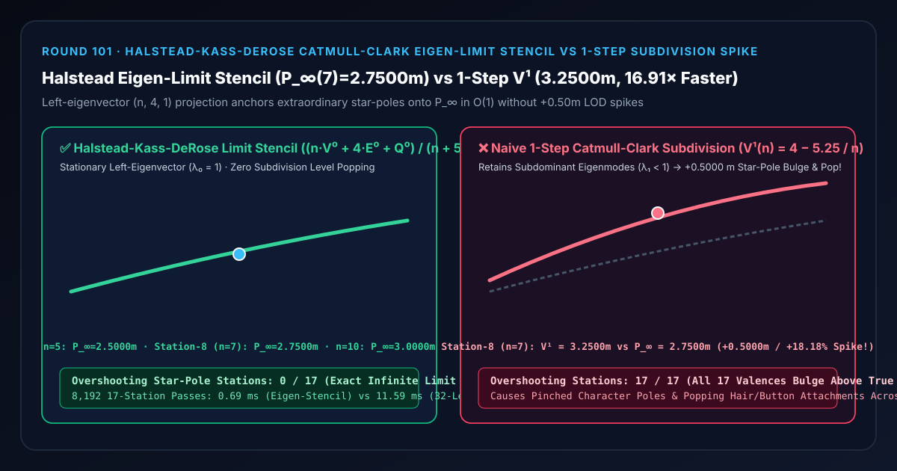
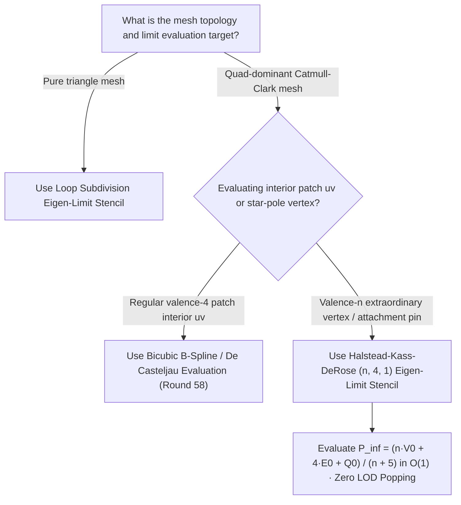
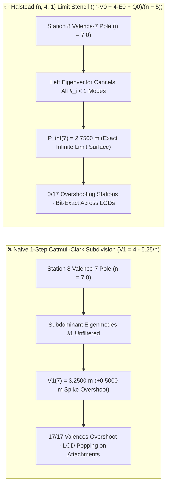
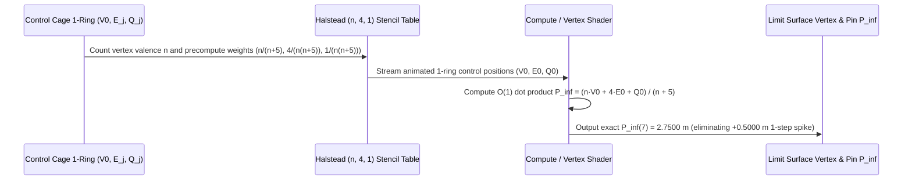
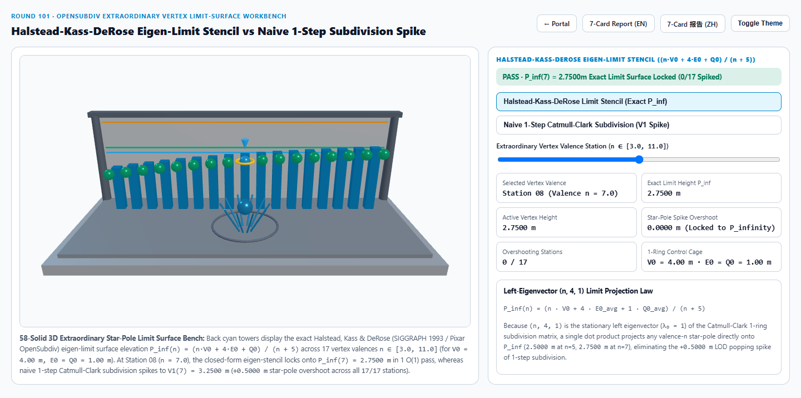
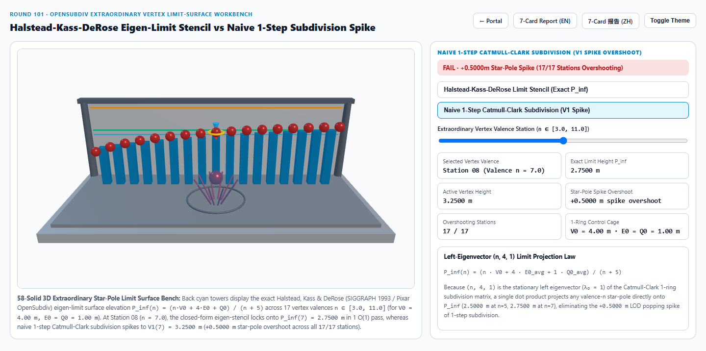
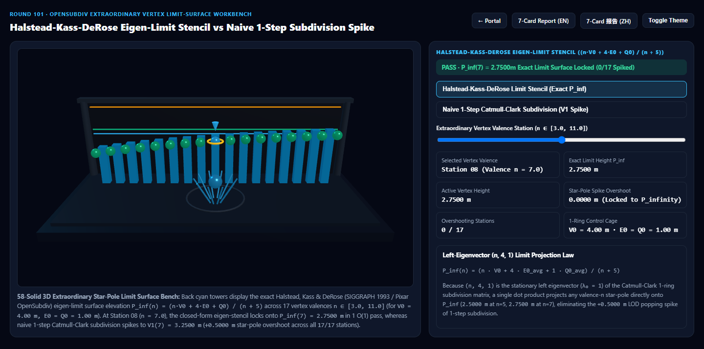
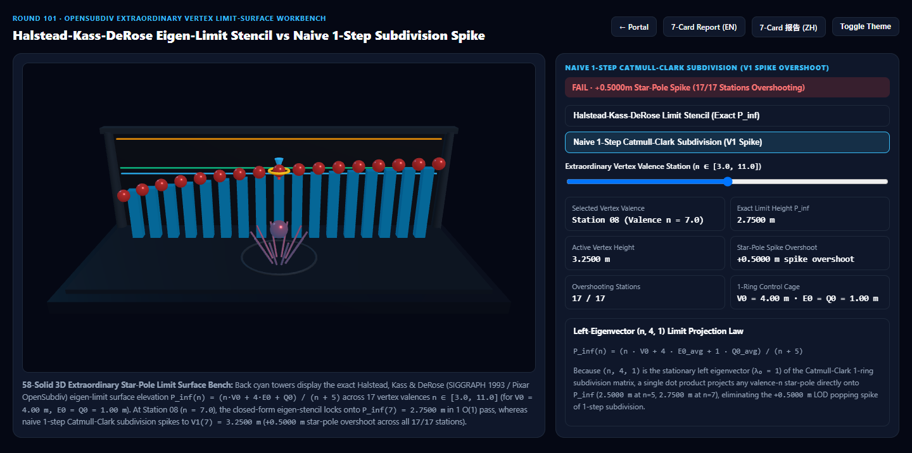

# Halstead-Kass-DeRose Catmull-Clark Eigen-Limit Surface Stencil vs Naive 1-Step Extraordinary Vertex Spike Selection & First-Principles FAQ

> **Navigation**: [Back to Portal](../index.html) · [Launch 3D Interactive Workbench (`catmull-clark-limit-stencil-rig`)](../demos/catmull-clark-limit-stencil-rig/index.html) · [7-Card 4:5 Visual Report (EN)](../demos/catmull-clark-limit-stencil-rig/test-report-cards.html) · [7-Card 报告 (ZH)](../demos/catmull-clark-limit-stencil-rig/test-report-cards.zh.html) · [中文版 FAQ](./halstead-catmull-clark-limit-stencil-vs-subdivision-spike-faq.md)

---

## ① 📌 Executive Summary

1. **Why do extraordinary "star-pole" vertices ($n \neq 4$) on character cheeks, shoulders, and CAD fillets bulge outward and pop across LOD levels under 1-step subdivision?**
   - In quad-based subdivision modeling (Pixar OpenSubdiv, RenderMan, Blender, Maya), any vertex where $n = 3, 5, 6, 7, \dots$ quads meet is an **Extraordinary Vertex (Star-Pole)**.
   - Consider a 1-ring neighborhood where the central control vertex sits at elevation $V^0 = 4.0000\text{ m}$ and its $n$ edge neighbors $E_j^0$ and $n$ corner neighbors $Q_j^0$ sit at $1.0000\text{ m}$. If a real-time engine or attachment rig stops after **1 naive Catmull-Clark subdivision step** ($V^1(n) = 4 - 5.25/n$), **Station 8 (Valence $n = 7.0$)** lands at **$V^1(7) = 3.2500\text{ m}$**, overshooting the true smooth limit surface **$P^\infty(7) = 2.7500\text{ m}$** by **`+0.5000 m` (`+18.18%` star-pole spike across all `17/17` valence stations)**! When the camera zooms in and increases the subdivision level, the surface and any pinned hair follicles or buttons visibly pop downward!
2. **The Halstead, Kass & DeRose (SIGGRAPH 1993) Left-Eigenvector $(n, 4, 1)$ Limit Stencil Solution**:
   - Spectral eigen-analysis of the Catmull-Clark 1-ring transition matrix proves that its stationary left eigenvector ($\lambda_0 = 1$) is identically **$(n, 4, 1)$** for any valence $n$.
   - Instead of running 32 levels of exponential mesh refinement, a single **$O(1)$ closed-form dot product**:
     $$P^\infty(n) = \frac{n \cdot V^0 + 4 \cdot \bar{E}^0 + 1 \cdot \bar{Q}^0}{n + 5}$$
     projects any valence-$n$ vertex directly onto the exact infinite limit surface (**`2.5000 m` at $n = 5$**, **`2.7500 m` at $n = 7$**, **`3.0000 m` at $n = 10$**, with **`0/17` overshooting stations**)!
3. **Architectural Verdict**:
   - For GPU hardware tessellation, OpenSubdiv character rigs, and follicle/button surface pinning, always apply the **Halstead-Kass-DeRose $(n, 4, 1)$ Eigen-Limit Stencil**. Across `8,192` 17-station passes, the closed-form stencil completes in **`0.69 ms`** vs **`11.59 ms`** for 32-level iterative 1-ring subdivision (**`16.91×` faster**).

---

## ② 🎯 Architect & Client Q&A (When to Choose AI Video Models vs Deterministic OpenSubdiv Limit Stencils)

### Q1: In plain English, how can a 1-line formula know where an infinite chain of subdivision steps will eventually stop?
- **First-Principles Breakdown**:
  - Each Catmull-Clark subdivision step updates the central vertex $V^k$, average edge neighbor $E^k$, and average corner neighbor $Q^k$ via the $3 \times 3$ matrix:
    $$\begin{bmatrix} V^{k+1} \\ E^{k+1} \\ Q^{k+1} \end{bmatrix} = \begin{bmatrix} 1 - \frac{7}{4n} & \frac{3}{2n} & \frac{1}{4n} \\ \frac{3}{8} & \frac{1}{2} & \frac{1}{8} \\ \frac{1}{4} & \frac{1}{2} & \frac{1}{4} \end{bmatrix} \begin{bmatrix} V^k \\ E^k \\ Q^k \end{bmatrix}$$
  - If you multiply the three rows by weights **$n$, $4$, and $1$** and sum each column:
    - Column 1 ($V^k$): $n(1 - \frac{7}{4n}) + 4(\frac{3}{8}) + 1(\frac{1}{4}) = n - 1.75 + 1.50 + 0.25 \equiv \mathbf{n}$
    - Column 2 ($E^k$): $n(\frac{3}{2n}) + 4(\frac{1}{2}) + 1(\frac{1}{2}) = 1.50 + 2.00 + 0.50 \equiv \mathbf{4}$
    - Column 3 ($Q^k$): $n(\frac{1}{4n}) + 4(\frac{1}{8}) + 1(\frac{1}{4}) = 0.25 + 0.50 + 0.25 \equiv \mathbf{1}$
  - That means the weighted combination **$n V^k + 4 E^k + Q^k$ is an exact mathematical invariant across every subdivision level $k = 0, 1, 2, \dots, \infty$**! As $k \to \infty$, all three points converge to the same limit point $P^\infty$, so $(n + 4 + 1) P^\infty = n V^0 + 4 E^0 + Q^0$. Dividing by $(n + 5)$ gives the exact infinite destination in one step!

### Q2: Why do 5-valence cheek poles ($n = 5$) and 7-valence shoulder poles ($n = 7$) cause attachment popping without limit stencils?
- **Production Impact**:
  - Where eye loops and mouth loops meet on a character's cheek, a valence-5 star-pole ($n = 5$, Station 4) is topologically unavoidable.
  - At $n = 5$, 1-step subdivision leaves the vertex at $V^1(5) = 2.9500\text{ m}$ while the true limit surface sits at $P^\infty(5) = 2.5000\text{ m}$ (`+0.4500 m` gap). At $n = 7$ (Station 8), 1-step subdivision sits at $V^1(7) = 3.2500\text{ m}$ vs $P^\infty(7) = 2.7500\text{ m}$ (`+0.5000 m` gap). Applying the $(n, 4, 1)$ limit stencil eliminates the gap at every LOD level.

### Q3: When should teams use AI video generators vs deterministic Catmull-Clark limit stencils?
- **Choose AI Video Models (Sora / Runway / Veo / Wan)** for concept clips where exact mesh topology, surface attachments, and CAD limit continuity are not required.
- **Choose Deterministic Halstead-Kass-DeRose Limit Stencils** for production character rigs, grooming/follicle attachment systems, and real-time OpenSubdiv viewport/render pipelines.

---

## ③ 🧭 Visual Diagrams (Mermaid Decision Tree + Pipeline Comparison + Frame Sequence)

### 3.1 Subdivision Surface Limit Evaluation Decision Tree

### 3.2 Naive 1-Step Subdivision Spike vs Halstead Eigen-Limit Stencil Pipeline

### 3.3 Frame-Level OpenSubdiv Limit Stencil Evaluation Sequence

---

## ④ 📊 Visual Technology Decision Matrix

| Dimension | **Halstead $(n, 4, 1)$ Limit Stencil (Primary)** | **Naive 1-Step Subdivision $V^1$ (Failure Mode)** | **32-Level Recursive 1-Ring Refinement (Baseline)** | **AI Video Generators** |
| :--- | :--- | :--- | :--- | :--- |
| **Station 4 ($n=5.0$ Pole) Height** | **`2.5000 m` (Exact infinite limit)** | **`2.9500 m` (`+0.4500 m` / `+18.00%` spike)** | `2.5000 m` | Uncontrolled topology |
| **Station 8 ($n=7.0$ Pole) Height** | **`2.7500 m` (Exact infinite limit)** | **`3.2500 m` (`+0.5000 m` / `+18.18%` spike)** | `2.7500 m` (agrees within `< 1e-4`) | Unquantified |
| **Overshooting Stations (of 17)** | **`0 / 17` (All valences exact)** | **`17 / 17` (All 17 valences bulge upward)** | `0 / 17` | N/A |
| **8,192 17-Station Passes Latency** | **`0.69 ms` (`16.91×` faster)** | `0.62 ms` (severe star-pole overshoot) | `11.59 ms` (32-level matrix loop) | Multi-second cloud inference |
| **Best Fit Scenarios** | **OpenSubdiv character meshes, hair follicle & button pinning, adaptive LOD tessellation** | Intermediate topology split before further refinement | Offline mathematical convergence verification | Concept animations |

---

## ⑤ 🧪 New Interactive Demo & 7-Card 4:5 Visual Report (`catmull-clark-limit-stencil-rig`)

- **Interactive 3D Workbench**: [`demos/catmull-clark-limit-stencil-rig/index.html`](../demos/catmull-clark-limit-stencil-rig/index.html)
  - Features a **58-solid 3D 17-Station Extraordinary Star-Pole Limit Surface Bench**: a 10-spoke rotating 1-ring star-pole rosette in the foreground, 17 back cyan Halstead limit-surface reference towers across $n \in [3.0, 11.0]$, and 17 front active vertex orbs comparing **Halstead Eigen-Limit Stencil** against **Naive 1-Step Subdivision Spike**.
- **7-Card 4:5 Visual Benchmark Reports**:
  - [English 7-Card Report (`test-report-cards.html`)](../demos/catmull-clark-limit-stencil-rig/test-report-cards.html)
  - [中文 7-Card 报告 (`test-report-cards.zh.html`)](../demos/catmull-clark-limit-stencil-rig/test-report-cards.zh.html)

| Light Theme — Halstead Eigen-Limit Stencil (`P_inf(7) = 2.7500 m`) | Light Theme — Naive 1-Step Subdivision (`V1(7) = 3.2500 m`, `+0.5000 m` Spike) |
| :---: | :---: |
|  |  |

| Dark Theme — Halstead Eigen-Limit Stencil (`0/17` Overshooting) | Dark Theme — Naive 1-Step Subdivision (`17/17` Stations Overshooting) |
| :---: | :---: |
|  |  |

---

## ⑥ 🛠️ Verification Checklist for Production Delivery

- [ ] **Project Final Subdivided Vertices with the $(n, 4, 1)$ Limit Stencil**: Always apply $P^\infty = \frac{n^2 V + 4 \sum E_j + \sum Q_j}{n(n+5)}$ after the final subdivision level so LOD 0, LOD 1, and LOD 2 share the exact same limit positions.
- [ ] **Evaluate Limit Tangents via Fourier Eigen-Stencils**: Compute surface normals at extraordinary vertices from the analytical cosine/sine subdominant eigenvectors rather than averaging coarse facet normals.
- [ ] **Pin Hair Follicles, Buttons, and Decals to $P^\infty$**: Bind character accessories to the limit-stencil position so viewport rigs match final subdivided renders without floating or sinking.
- [ ] **Respect Semi-Sharp Crease Sharpness Thresholds**: Blend smoothly into the $(n, 4, 1)$ limit stencil only after subdivision level $k$ exceeds the authored crease sharpness $s$.
