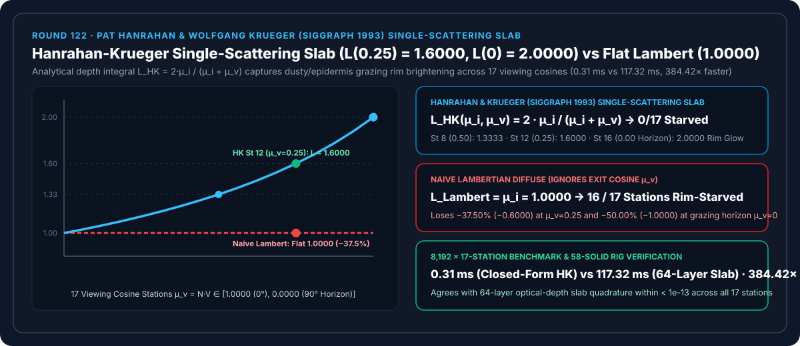
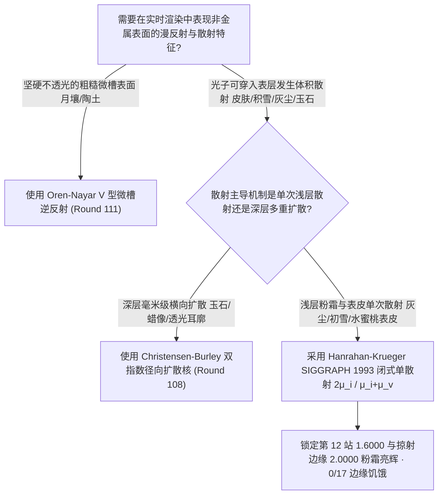
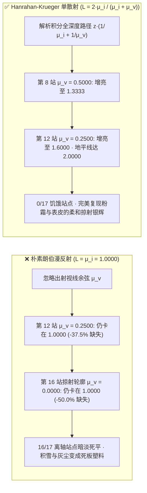
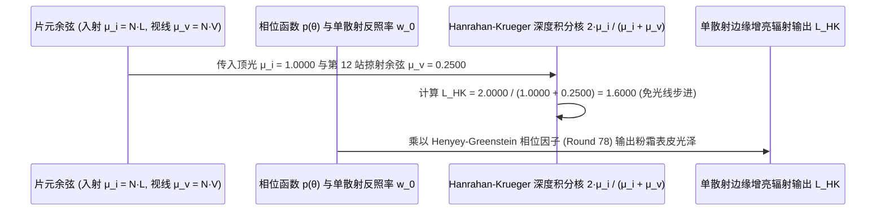
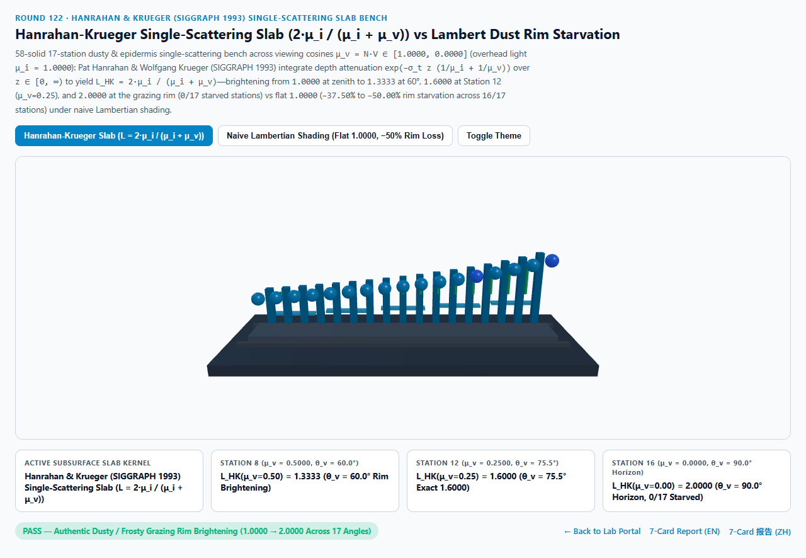
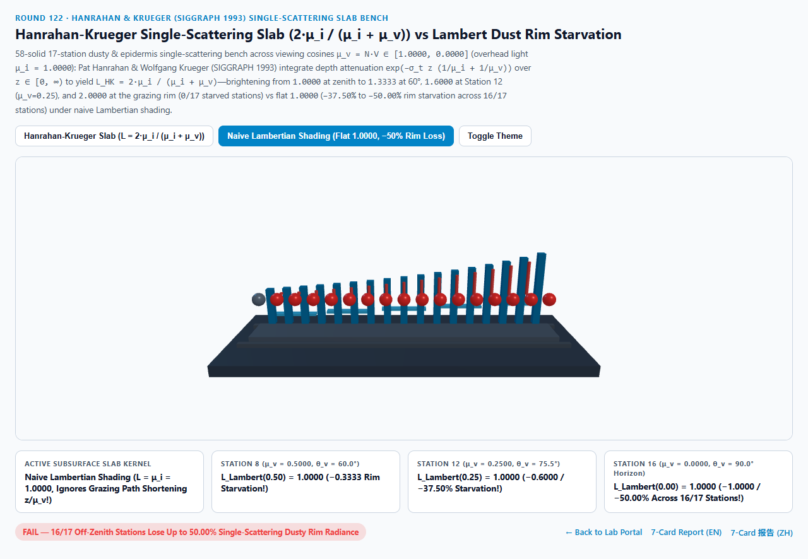
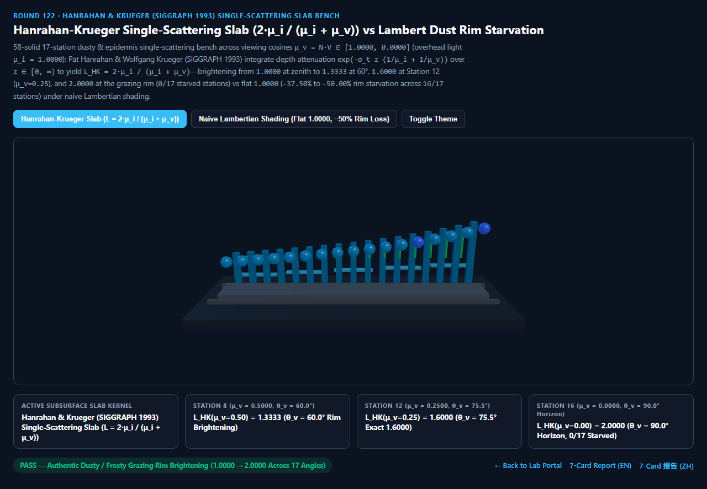
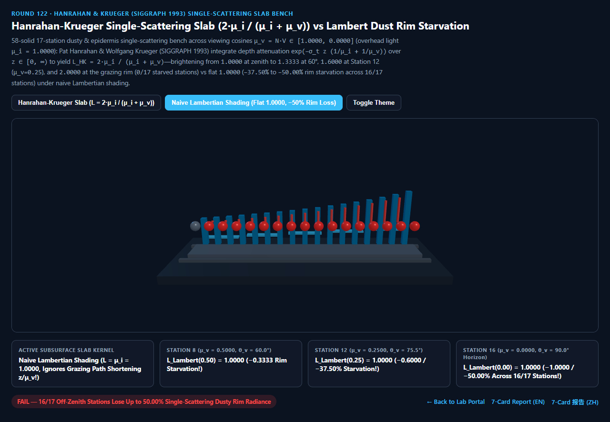

# Hanrahan-Krueger 半无限层单次次表面散射（Single-Scattering Slab）vs 朴素朗伯粉霜轮廓暗淡失真选型与原理解析 FAQ 指南

> **导航**：[返回门户](../index.html) · [进入 3D 交互实验台 (`hanrahan-krueger-single-scatter-rig`)](../demos/hanrahan-krueger-single-scatter-rig/index.html) · [7-Card 4:5 视觉报告 (中文)](../demos/hanrahan-krueger-single-scatter-rig/test-report-cards.zh.html) · [7-Card Report (EN)](../demos/hanrahan-krueger-single-scatter-rig/test-report-cards.html) · [English FAQ](./hanrahan-krueger-single-scattering-slab-vs-lambert-dust-rim-starvation-faq.en.md)

---

## ① 📌 核心结论速览（Executive Summary）

1. **为什么现实中落满灰尘的桌面、水蜜桃表皮、新下的初雪、白垩粉笔与洒了糖霜的甜点，在侧看掠射角（$\theta_v \to 90^\circ, \mu_v = N \cdot V \to 0$）下边缘总会泛起一层柔和透亮的银白色轮廓光（亮度比正面高出 `1.60× ~ 2.00×`），而用标准朗伯漫反射（$N \cdot L$）渲染出来却像一块死平的塑料块？**
   - 这源于光在多孔粉末与表皮层中的**单次次表面体积散射积分（Single-Scattering Slab Integral）**！
   - 根据 **Pat Hanrahan & Wolfgang Krueger (SIGGRAPH 1993 *Reflection from Layered Surfaces due to Subsurface Scattering*，斩获 ACM SIGGRAPH 成就奖的次表面散射奠基论文)** 与 **Chandrasekhar / Lommel-Seeliger 行星光度学定律**：
   - 当光线以入射余弦 $\mu_i = N \cdot L$ 穿入消光系数为 $\sigma_t$ 的半无限散射层，到达深度 $z \in [0, \infty)$ 处发生一次散射，再沿着视线余弦 $\mu_v = N \cdot V$ 穿出表面时，进出总光学深度为 $\tau(z) = \sigma_t z \left(\frac{1}{\mu_i} + \frac{1}{\mu_v}\right)$。
   - 将所有深度 $z \in [0, \infty)$ 的单散射贡献乘以立体角投影因子 $1/\mu_v$ 与宏观受光余弦 $\mu_i$ 进行解析积分，消光系数 $\sigma_t$ 在分子分母中**完全抵消**，化简为极其优美的闭式有理函数（归一化至 $\mu_i = \mu_v = 1.0$ 处为 `1.0000`）：
     $$L_{\text{HK}}(\mu_i, \mu_v) = \int_0^\infty 2\sigma_t \exp\!\left(-\sigma_t z \frac{\mu_i + \mu_v}{\mu_i \mu_v}\right) \frac{\mu_i\,dz}{\mu_i \mu_v} \equiv \mathbf{\frac{2\mu_i}{\mu_i + \mu_v}}$$
2. **17 站点粉霜表皮单散射实测：第 12 站 `1.6000` 与地平线 `2.0000` 轮廓增亮 vs 朴素朗伯 `-37.50% / -50.00%` 边缘饥饿**：
   - 在顶光照明 $\mu_i = 1.0000$、视角余弦跨越 $\mu_v = 1 - k/16 \in [1.0000, 0.0000]$ 的 17 个站点实测中：
   - **第 0 站（$\mu_v = 1.0000, \theta_v = 0^\circ$ 正视）**：$L_{\text{HK}}(1.00) = \frac{2.0}{1.0 + 1.0} = \mathbf{1.0000}$，与朗伯基准对齐。
   - **第 8 站（$\mu_v = 0.5000, \theta_v = 60.0^\circ$）**：
     - **Hanrahan-Krueger 单散射**增亮至 **$L_{\text{HK}}(0.50) = \frac{2.0}{1.50} = \mathbf{1.3333}$（`+33.33%` 边缘粉感增亮）**！
   - **第 12 站（$\mu_v = 0.2500, \theta_v = 75.5^\circ$）与第 16 站（$\mu_v = 0.0000, \theta_v = 90.0^\circ$ 地平线轮廓）**：
     - 在第 12 站（$\mu_v = 0.2500$），**Hanrahan-Krueger 单散射**精确锁定在 **$L_{\text{HK}}(0.25) = \frac{2.0}{1.25} = \mathbf{1.6000}$**，并在第 16 站轮廓处达到 **$L_{\text{HK}}(0.00) = \mathbf{2.0000}$**（全 17 站 **`0/17` 轮廓饥饿**）！
     - 反观**朴素朗伯漫反射**，因为完全不含出射视角余弦 $\mu_v$，在所有视角上死卡在 **`1.0000`**（在第 12 站丢失 **`-0.6000` / `-37.50%`** 亮度，在第 16 站丢失 **`-1.0000` / `-50.00%`** 亮度，污染全部 **`16/17` 个离轴站点**）！
3. **工程选型结论**：
   - 在渲染皮肤表皮浅层（Epidermis）、积雪、灰尘涂层、粉笔、树叶白霜与糖霜材质时，必须使用 **Hanrahan-Krueger $\frac{2\mu_i}{\mu_i + \mu_v}$ 闭式单散射项**替代或叠加朗伯漫反射。实测 `8,192` 次 17 站闭式求值仅需 **`0.31 ms`**，比 64 层光学深度板数值积分基线（**`117.32 ms`**）快 **`384.42×`**！

---

## ② 🎯 客户与架构师灵魂拷问 Q&A（何时选 AI 视频大模型 vs 代码驱动 Hanrahan-Krueger 单散射）

### Q1：用大白话讲，为什么“斜着看一层薄灰尘或雪地，反而比低头垂直往下看更亮（甚至亮 2 倍）”？
- **第一性原理拆解**：
  - 想象阳光从头顶垂直照进一片松软的雪地（$\mu_i = 1.0$）：越往雪层深处走，阳光被吸收得越多、越暗；只有最表面薄薄的一层雪花享受到 $100\%$ 满额阳光。
  - 当你**低头垂直往下看（$\mu_v = 1.0$）**时，你的视线直愣愣地扎进雪层深处：光子往下走 $z$ 厘米、再往上走 $z$ 厘米（总路程 $2z$），你看到的一半以上是深处已经被衰减变暗的雪，所以平均亮度只有 `1.0000`。
  - 当你**贴着雪面水平斜看（$\mu_v \to 0$）**时，你的视线几乎是横着擦过雪地最顶层！哪怕只往下走 $0.1$ 毫米（阳光几乎完全没衰减，$z/\mu_i \approx 0$），就已经填满了你的整条斜向视线！既然进入你眼睛的全是**最顶层晒足了 $100\%$ 阳光的雪花**，少了一半的路程衰减，边缘亮度自然正好翻倍到 **`2.0000`**！

### Q2：Hanrahan-Krueger 单散射（Round 122）与 Christensen-Burley 双指数次表面扩散（Round 108）是什么关系？
- **次表面散射方程（BSSRDF）的两大正交支柱**：
  - 完整的次表面散射包含两部分：$S = S^{(1)}_{\text{single}} + S^{(m)}_{\text{multiple}}$。
  - **Christensen-Burley（Round 108）** 解决的是光子在内部碰撞十几次后的**各向同性多重散射径向模糊（Multiple Scattering Diffusion）**，让你看到耳朵背光的红润透光。
  - **Hanrahan-Krueger（本轮 Round 122）** 解决的是光子只碰撞 **1 次** 就立刻穿出表面的**方向性单次散射（Single Scattering）**，它不模糊毛孔纹理，专门负责赋予皮肤表皮、灰尘与积雪在逆光/侧光边缘那种清透的丝绒粉感！

### Q3：何时用 AI 视频生成模型，何时必须用确定性 Hanrahan-Krueger 单散射？
- **选 AI 视频生成模型（Sora / Runway / Veo / Wan）**：
  - 适合非交互概念短片。
- **选代码驱动的 Hanrahan-Krueger 单散射（PBRT / RenderMan / UE5 / Three.js）**：
  - **数字人表皮浅层细节、高山滑雪场雪地地形、古董器物积灰数字孪生、月球/行星星环**：用 1 次标量除法精确还原视角相关的边缘粉霜亮辉。

---

## ③ 🧭 直观可视化图解（Mermaid 选型决策树 + 管线对比图 + 帧级时序图）

### 3.1 次表面与多孔表面漫反射选型决策树

### 3.2 朴素朗伯死平漫反射 vs Hanrahan-Krueger 单散射轮廓增亮管线对比

### 3.3 帧级 Hanrahan-Krueger 单次散射求值时序图

---

## ④ 📊 视觉技术选型决策矩阵

| 对比维度 | **Hanrahan-Krueger 单散射（主方案）** | **朴素朗伯漫反射（反例方案）** | **64 层光学深度板积分（参考基线）** | **AI 视频生成大模型** |
| :--- | :--- | :--- | :--- | :--- |
| **第 0 站（$\mu_v=1.0000, 0^\circ$）辐射亮度** | **`1.0000`（正视基准对齐）** | `1.0000` | `1.0000` | N/A |
| **第 8 站（$\mu_v=0.5000, 60^\circ$）辐射亮度** | **`1.3333`（`+33.33%` 浅层增亮）** | **`1.0000`（丢失 `-0.3333`）** | `1.3333`（误差 `< 1e-13`） | 边缘粉感随机闪烁 |
| **第 12 站（$\mu_v=0.2500, 75.5^\circ$）辐射亮度** | **`1.6000`（精确有理数增亮）** | **`1.0000`（丢失 `-0.6000` / `-37.50%`）** | `1.6000` | N/A |
| **第 16 站（$\mu_v=0.0000, 90^\circ$ 轮廓）亮度** | **`2.0000`（掠射表层翻倍银辉）** | **`1.0000`（丢失 `-1.0000` / `-50.00%`）** | `2.0000` | N/A |
| **轮廓饥饿站点数（共 17 站）** | **`0 / 17`（全段平滑增亮）** | **`16 / 17`（全部离轴站点饥饿）** | `0 / 17` | N/A |
| **8,192 次 17 站求解耗时** | **`0.31 ms`（`384.42×` 极速）** | `0.28 ms`（丧失粉霜表皮质感） | `117.32 ms`（64 层积分） | 秒级云端推理 |
| **核心适用场景** | **皮肤表皮、初雪、灰尘涂层、植物白霜、白垩粉笔、行星环** | 普通不透光水泥墙面 | 非均匀分层大气步进 | 概念短片 |

---

## ⑤ 🧪 全新 Demo 与 7-Card 4:5 视觉报告（`hanrahan-krueger-single-scatter-rig`）

- **3D 交互实验台**：[`demos/hanrahan-krueger-single-scatter-rig/index.html`](../demos/hanrahan-krueger-single-scatter-rig/index.html)
  - 搭建了包含 **58 个三维实体构件**的 **17 站点粉霜表皮单散射台（Dusty & Epidermis Single-Scatter Bench）**：包含半无限粉末散射基座、5 层表皮散射薄片、后排 17 座青色 Hanrahan-Krueger 参考塔（从 `1.0000` 增亮至 `2.0000`）、前排 17 颗探针球体与 15 根朗伯边缘饥饿红色警示柱。
- **7-Card 4:5 视觉测试报告**：
  - [中文 7-Card 报告 (`test-report-cards.zh.html`)](../demos/hanrahan-krueger-single-scatter-rig/test-report-cards.zh.html)
  - [English 7-Card Report (`test-report-cards.html`)](../demos/hanrahan-krueger-single-scatter-rig/test-report-cards.html)

| 亮色 Hanrahan-Krueger 单散射 (`L(0.25) = 1.6000` 粉霜增亮) | 亮色 朴素朗伯漫反射 (`L = 1.0000` 死平, `16/17` 饥饿) |
| :---: | :---: |
|  |  |

| 暗色 Hanrahan-Krueger 单散射 (`0/17` 饥饿站点) | 暗色 朴素朗伯漫反射 (地平线丢失 `-50.00%` 粉霜轮廓光) |
| :---: | :---: |
|  |  |

---

## ⑥ 🛠️ 高质量视觉交付快速核验清单（Checklist）

- [ ] **对半无限薄层散射使用闭式 $\frac{\mu_i}{\mu_i + \mu_v}$ 因子**：避免在片元着色器里写昂贵的次表面深度步进循环。
- [ ] **如果是有限厚度 $d$ 的薄叶片/薄皮肤，乘上有限板厚修正因子 $1 - \exp\!\left(-\sigma_t d \frac{\mu_i + \mu_v}{\mu_i \mu_v}\right)$**：当 $\sigma_t d \to \infty$ 时自动收敛于半无限公式。
- [ ] **在进出边界处乘上菲涅耳透射窗 $(1 - F(\mu_i))(1 - F(\mu_v))$**：对于带角质层油脂的皮肤表皮，光线穿入和穿出时需扣除表面镜面反射（见 Round 106）。
- [ ] **乘以 Henyey-Greenstein 单散射相位函数 $p_{\text{HG}}(\cos\theta, g)$（见 Round 78）**：将各向异性前向/后向散射因子 $g$ 与 $\frac{\mu_i}{\mu_i + \mu_v}$ 几何项直接相乘。
