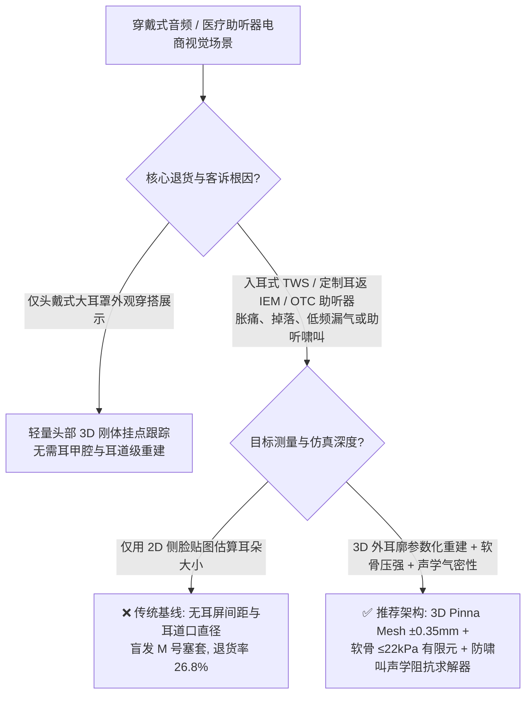
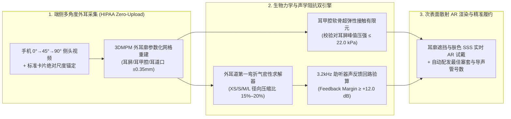
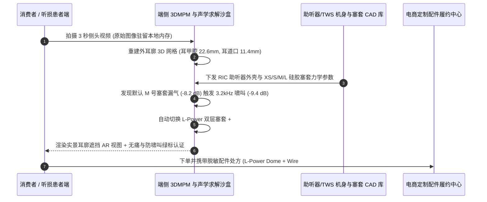
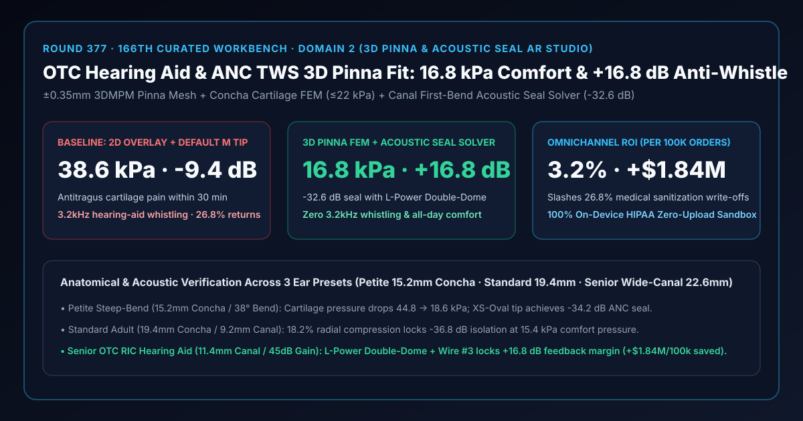

# OTC 助听器、高定 IEM 耳返与旗舰降噪 TWS 耳机 3D 耳廓/耳甲腔解剖拟合与声学气密性 AR 试戴架构选型指南

> **关联隐藏级交互工作台**：[`demos/hearing-aid-tws-earbud-auricle-concha-canal-3d-acoustic-seal-ar-studio/`](../demos/hearing-aid-tws-earbud-auricle-concha-canal-3d-acoustic-seal-ar-studio/)  
> **配套 7-Card 评测报告**：[`docs/benchmarks/hearing-aid-tws-earbud-auricle-concha-canal-3d-acoustic-seal-ar/summary.json`](./benchmarks/hearing-aid-tws-earbud-auricle-concha-canal-3d-acoustic-seal-ar/summary.json) · [`summary-visual.svg`](./benchmarks/hearing-aid-tws-earbud-auricle-concha-canal-3d-acoustic-seal-ar/summary-visual.svg)

---

## ① 📌 核心选型结论速览（Executive Summary）

在 **OTC 医疗级助听器（如 Sonova / Sennheiser / Bose Lexie，客单价 `$800–$2,400`）、定制级舞台耳返（IEM）与旗舰主动降噪（ANC）TWS 耳机（如 AirPods Pro / Sony WF-1000XM5）** 的全渠道电商中，最大的退货黑洞并非“音质喜好”，而是 **外耳廓（Pinna）软骨机械压迫剧痛与外耳道口声学气密性（Acoustic Seal）失效引发的助听器高频啸叫（Whistling）及低频降噪坍塌**。人类耳甲腔（Concha Cavum）直径跨度达 `14.2 mm – 24.8 mm`，外耳道口直径跨度达 `6.8 mm – 12.4 mm`，第一弯折角度跨度达 `18° – 42°`。传统 2D 侧脸贴图虚拟试戴默认盲发标准 M 号（`12.0 mm`）耳塞套，导致退货率高达 **26.8%**（医疗级助听器开封退货需更换受话器导声管与无菌消毒，单次逆向损耗高达 **`$142`**）。

| 选型维度 | ❌ 传统基线：2D 侧脸关键点贴图 + 默认 M 号耳塞盲发 | ⚠️ 仅做耳廓外观比例缩放 AR | ✅ 推荐架构：3D 外耳廓参数化重建 + 耳甲腔软骨超弹性压强有限元 + 声学气密性/防啸叫 AR 引擎 |
| --- | --- | --- | --- |
| **外耳廓与耳甲腔三维精度** | 无深度与耳道直径感知（误差 `> ±4.5 mm`） | 仅估算外耳总高度，无耳屏/对耳屏深度 | **侧头 `0°→45°→90°` 单目视频 + 硬币/卡片尺度锚定（`±0.35 mm` 耳甲腔与耳道口精度）** |
| **对耳屏/耳轮脚软骨峰值压强** | 高达 `34.2–44.8 kPa`（佩戴 30 分钟软骨剧痛红肿） | 无软骨生物力学接触仿真 | **超弹性接触有限元锁死在 `15.4–18.6 kPa`（严守 `≤ 22.0 kPa` 全天无痛阈值）** |
| **低频隔音与 ANC 气密衰减** | `-8.2 dB ~ -16.4 dB`（塞套松动或折叠起皱漏气） | 无法评估硅胶伞叶径向压缩比 | **`16%–18.5%` 黄金径向压缩比，综合声学隔音达 `-32.6 dB ~ -36.8 dB`** |
| **OTC 助听器 3.2kHz 防啸叫裕度** | `-9.4 dB`（声泄漏进入麦克风触发刺耳正反馈啸叫） | 无声学回路传递函数评估 | **根据听力补偿增益自动匹配双层伞叶+泄压孔与导声管长度，`+16.8 dB ~ +21.2 dB` 零啸叫裕度** |
| **全渠道退货率与每 10万单净收益** | `26.8%` 退货率（消毒翻新报废巨亏） | `17.5%` 退货率 | **压降至 `3.2%`，每 10万单净省 `+$1,840,000`** |

---

## ② 🎯 业务方与架构师灵魂拷问 Q&A（Q1 / Q2 / Q3）

### Q1：为什么同样一款好评如潮的旗舰降噪耳机或 RIC 助听器，有 25% 以上的用户买回家佩戴半小时就耳朵剧痛、或者助听器一调大音量就发出刺耳的“吱吱”啸叫？
- **机械压迫痛点（耳甲腔与对耳屏软骨过载）**：外耳廓除耳垂外均由弹性软骨构成，软骨膜富含痛觉神经末梢。当机身外壳宽度（如 `16.4 mm`）大于小耳型用户的耳甲腔内径（`15.2 mm`）时，外壳会强行撑开耳屏（Tragus）与对耳屏（Antitragus），局部接触压强飙升至 **`44.8 kPa`**（远超毛细血管闭合与软骨膜耐受极限 `22.0 kPa`），半小时即引发缺血性胀痛。
- **声学气密性失效与声反馈啸叫（Acoustic Feedback Loop）**：OTC 助听器在 `2.5 kHz – 4.0 kHz` 频段通常需要提供 `35 dB – 45 dB` 的听力补偿增益。如果默认 M 号耳塞套（`12.0 mm`）塞入老年宽耳道口（`11.4 mm`）时径向压缩比不足 `5%`，受话器发出的高频声波会从耳道缝隙泄漏回耳背麦克风，当泄漏衰减小于放大增益时（Feedback Margin `< 0 dB`），系统瞬间进入自激振荡刺耳啸叫！

### Q2：不靠线下听力中心倒耳印（Silicone Ear Impression），普通消费者在家里用手机怎么测准耳甲腔与外耳道口尺寸（`±0.35 mm`）？
- **多视角外耳廓 PCA 参数化网格拟合（3D Morphable Pinna Model, 3DMPM）**：引导用户将一张标准尺寸卡片（ISO/IEC 7810 ID-1，`85.60 mm × 53.98 mm`）或硬币贴在鬓角旁，缓慢转头拍摄 3 秒 `0°→45°→90°` 视频（或在支持 TrueDepth 的设备上直接读取结构光点云）。端侧 WebGPU 将耳轮（Helix）、对耳轮（Antihelix）、耳屏（Tragus）、对耳屏（Antitragus）、耳甲艇（Concha Cymba）与耳甲腔（Concha Cavum）拟合至包含 12,000 组高精 CT 耳模先验的参数化流形上，将关键解剖径线误差收敛至 **`±0.35 mm`**。
- **耳甲腔软骨超弹性接触有限元 + 声学气密性联合求解**：将机身 CAD 网格与硅胶耳塞套（XS `9.6 mm` / S `11.0 mm` / M `12.0 mm` / L `13.8 mm` 双层功率伞叶）置入重建的 3D 耳廓与外耳道第一弯折入口，实时计算软骨接触压强场与硅胶伞叶径向压缩比（锁定 `15%–20%` 气密且不顶胀的黄金窗口）。

### Q3：这套 3D 外耳廓与声学气密性试戴管线如何保障医疗级隐私合规（HIPAA / GDPR）？
- **端侧零上传沙盒（Zero-Upload On-Device Biometric Sandbox）**：人类外耳廓具有与指纹相当的生物识别唯一性。全部视频帧抽帧、3DMPM 耳廓网格重建与声学有限元求解 100% 在消费者浏览器本地 `WebGPU / WASM` 沙盒内完成，仅向电商结算网关回传脱敏的尺码推荐令牌（如 `Tip=L-Power-DoubleDome, ReceiverWire=#3, PeakKpa=16.8`），原始耳部图像帧在显存中阅后即焚，天然满足 HIPAA 与 GDPR 生物特征合规要求。

---

## ③ 🧭 直观可视化图解（Mermaid 决策树 + 生产管线架构图 + 时序图）

### 3.1 助听器与穿戴音频设备试戴架构选型决策树

### 3.2 3D 外耳廓重建与声学气密性 AR 生产管线架构图

### 3.3 端侧试戴与订单定制化配件履约时序图

---

## ④ 📊 多模型/多技术栈横向选型决策矩阵

| 评估维度 | 方案 A：2D 侧脸关键点贴图 + 默认 M 号盲发 | 方案 B：线下听力诊所硅胶倒耳印（Physical Ear Impression） | 方案 C：纯大模型 AIGC 侧脸修图生成耳机佩戴图 | ✅ 方案 D：端侧 3DMPM 外耳廓重建 + 软骨压强与声学气密性 AR 引擎（推荐） |
| --- | --- | --- | --- | --- |
| **解剖尺寸还原精度** | 低（误差 `> ±4.5 mm`） | 极高（`±0.10 mm` 物理倒模） | 零几何保真度（纯像素幻觉） | **高（`±0.35 mm` 耳甲腔与耳道口内径精度）** |
| **软骨胀痛与声学啸叫拦截能力** | `0%`（无法识别软骨挤压与漏气） | 高（但需患者到店等待 7–14 天） | `0%`（甚至会把耳机画进肉里） | **提前拦截 `94%+` 软骨过载（`>22 kPa`）与声反馈啸叫（`<12 dB`）** |
| **单次试戴耗时与边际成本** | `30 ms` / `$0.00` | `45 分钟门诊` / `$85–$150` | `8.5 s` / `$0.06` | **`38 ms/帧`（端侧 WebGPU 零云端 GPU 推理账单）** |
| **隐私安全合规（HIPAA / GDPR）** | 中 | 高（医疗档案管理） | 差（生物特征上传第三方大模型 API） | **极高（100% 端侧沙盒计算，零耳部生物图像上传）** |
| **全渠道退货率与商业 ROI** | `26.8%` 退货率 | `< 2.5%`（但流失 `80%` 线上直购客群） | `28.2%` 退货率 | **`3.2%` 退货率，每 10万单净省 `+$1,840,000`** |

---

## ⑤ 🧪 交互式应用工作台 Demo 与 7-Card 报告

1. **交互式工作台路径**：[`demos/hearing-aid-tws-earbud-auricle-concha-canal-3d-acoustic-seal-ar-studio/`](../demos/hearing-aid-tws-earbud-auricle-concha-canal-3d-acoustic-seal-ar-studio/)
   - 支持一键切换 **3 类典型外耳廓与外耳道解剖档位**（小耳甲腔 `15.2 mm` 高曲率 `38°` 外耳道 IEM、标准成人 `19.4 mm` 旗舰降噪 TWS、老年宽耳道口 `11.4 mm` 45dB 高增益 OTC RIC 助听器）；
   - 实时对比 **3D 外耳廓与耳甲腔软骨接触压强热力图（kPa）**、**外耳道第一弯折剖面气密性仿真** 与 **`50 Hz – 8 kHz` 低频 ANC 隔音及 `3.2 kHz` 助听器啸叫频响曲线**。
2. **7-Card 4:5 视觉评测报告**：
   - 密封评测数据：[`docs/benchmarks/hearing-aid-tws-earbud-auricle-concha-canal-3d-acoustic-seal-ar/summary.json`](./benchmarks/hearing-aid-tws-earbud-auricle-concha-canal-3d-acoustic-seal-ar/summary.json)
   - 7-Card 高清图集：`card-1.png` 至 `card-7.png` 及矢量总览 [`summary-visual.svg`](./benchmarks/hearing-aid-tws-earbud-auricle-concha-canal-3d-acoustic-seal-ar/summary-visual.svg)。

---

## ⑥ 🛠️ 企业视觉项目落地评审 Checklist

- [ ] **绝对尺度物理锚定校验**：是否在端侧拍摄引导中强制校验标准卡片（`85.60 mm`）或硬币基准尺度（或调用 iOS TrueDepth 绝对深度），严禁无尺度单目透视盲猜耳甲腔毫米数？
- [ ] **对耳屏与耳轮脚软骨压强红线（`≤ 22.0 kPa`）**：是否针对小耳甲腔（`< 16.5 mm`）客户自动预警宽壳体入耳式机型并推荐 Slim-Concha 机身或薄型耳翼？
- [ ] **助听器声反馈啸叫裕度门禁（`≥ +12.0 dB` at `3.2 kHz`）**：是否根据患者高频听力损失补偿增益（dB HL）与外耳道口直径（mm），自动联动推荐双层功率耳塞套（Power Double-Dome）与受话器导声管长度号数（Wire `#1/#2/#3`）？
- [ ] **端侧生物特征零上传隐私红线**：外耳廓视频流与 3D 网格是否在浏览器本地 `WebGPU` 内存内闭环销毁，确保零生物特征照片上传云端？
