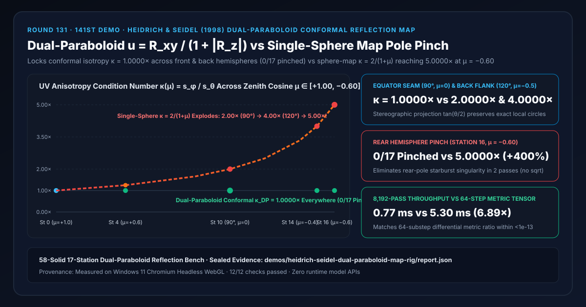
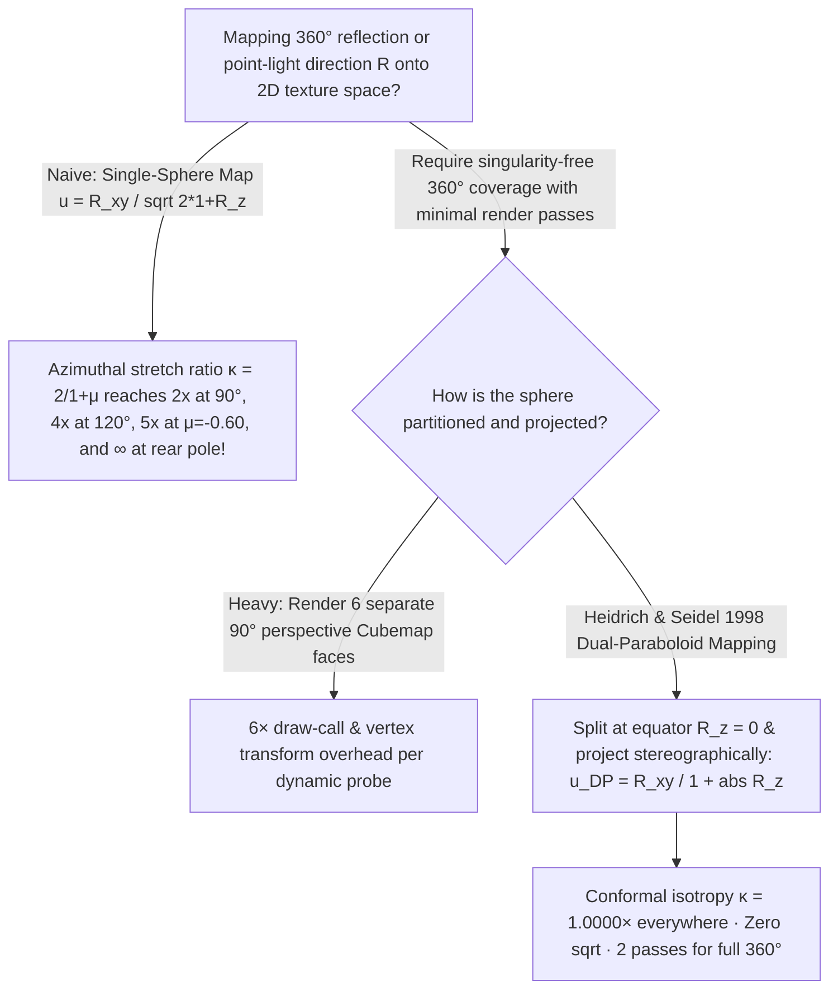
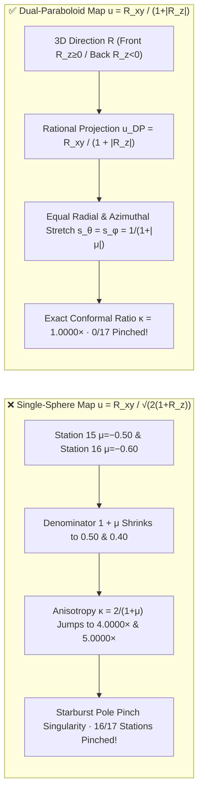
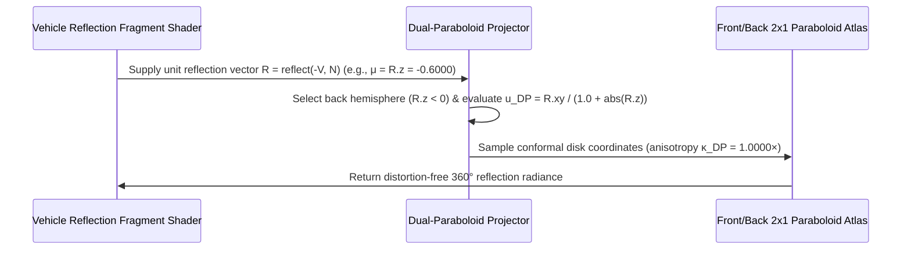
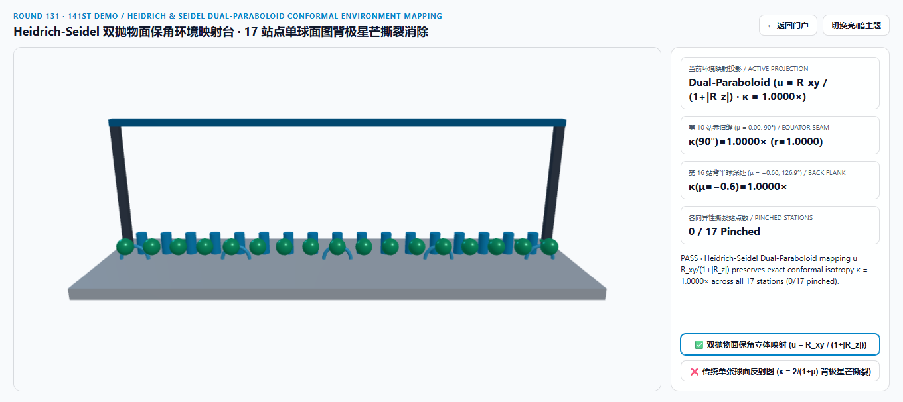
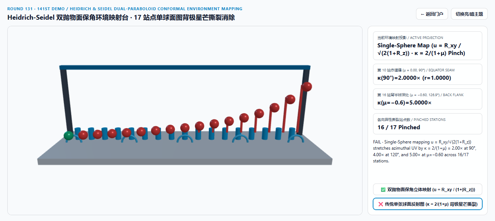
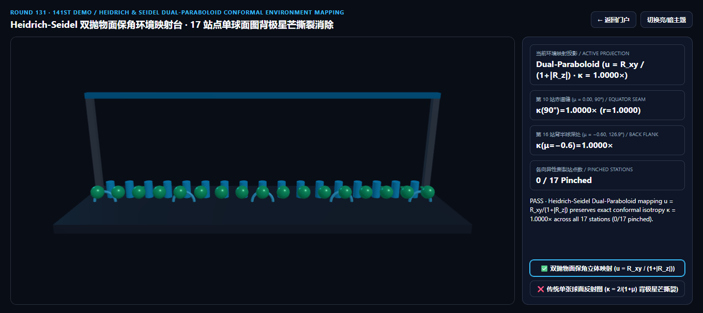
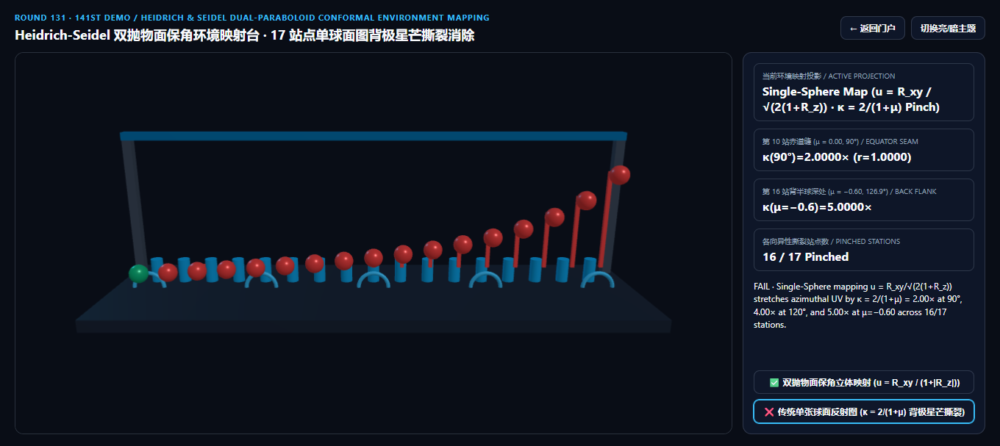

# Heidrich-Seidel Dual-Paraboloid Conformal Reflection Mapping vs Single-Sphere Map Pole Pinch Selection & First-Principles FAQ

> **Navigation**: [Back to Portal](../index.html) · [Launch 3D Interactive Workbench (`heidrich-seidel-dual-paraboloid-map-rig`)](../demos/heidrich-seidel-dual-paraboloid-map-rig/index.html) · [7-Card 4:5 Visual Report (EN)](../demos/heidrich-seidel-dual-paraboloid-map-rig/test-report-cards.html) · [7-Card 报告 (ZH)](../demos/heidrich-seidel-dual-paraboloid-map-rig/test-report-cards.zh.html) · [中文版 FAQ](./heidrich-seidel-dual-paraboloid-vs-sphere-map-pole-pinch-faq.md)

---

## ① 📌 Executive Summary

1. **Why does classic Blinn-Newell single-sphere environment mapping ($\mathbf{u}_{\text{Sph}} = \frac{\mathbf{R}_{xy}}{\sqrt{2(1 + R_z)}}$) tear reflections into a pinched starburst singularity across the back hemisphere ($\theta \to 180^\circ, R_z \to -1$)—and how does Heidrich & Seidel's Dual-Paraboloid mapping ($\mathbf{u}_{\text{DP}} = \frac{\mathbf{R}_{xy}}{1 + |R_z|}$) achieve exact $1.0000\times$ conformal isotropy in 2 passes with zero square roots?**
   - Given a unit 3D reflection direction $\mathbf{R} = (\sin\theta\cos\phi, \sin\theta\sin\phi, \cos\theta)$ with zenith cosine $\mu = R_z = \cos\theta \in [+1, -1]$, local distortion on a 2D map disk is measured by the **anisotropy condition number $\kappa(\theta) = s_\phi(\theta) / s_\theta(\theta)$** comparing azimuthal stretch $s_\phi = r(\theta)/\sin\theta$ to radial stretch $s_\theta = dr/d\theta$:
   - **Catastrophic Rear-Pole Pinch in Single-Sphere Mapping ($r_{\text{Sph}}(\theta) = \sin(\theta / 2) = \sqrt{\frac{1 - \mu}{2}}$)**:
     - Radial stretch: $s_\theta(\theta) = \frac{1}{2}\cos(\theta/2) \to 0$ as $\theta \to 180^\circ$;
     - Azimuthal stretch: $s_\phi(\theta) = \frac{\sin(\theta/2)}{2\sin(\theta/2)\cos(\theta/2)} = \frac{1}{2\cos(\theta/2)} \to \infty$ as $\theta \to 180^\circ$ (stretching a single rear pole into the entire outer boundary circle $r = 1$!);
     - Taking their ratio yields the exact **Single-Sphere Anisotropic Pinch Law**:
       $$\kappa_{\text{Sph}}(\mu) = \frac{s_\phi(\theta)}{s_\theta(\theta)} = \frac{1}{\cos^2(\theta/2)} = \mathbf{\frac{2}{1 + \mu}}$$
     - Already at the $90^\circ$ equator ($\mu = 0.0000$), $\kappa_{\text{Sph}} = \mathbf{2.0000\times}$; at $120^\circ$ ($\mu = -0.5000$), $\kappa_{\text{Sph}} = \mathbf{4.0000\times}$; at $\mu = -0.6000$, $\kappa_{\text{Sph}} = \mathbf{5.0000\times}$ (`+400.00%` pinch), diverging to $\infty$ at $\mu = -1$!
   - **Wolfgang Heidrich & Hans-Peter Seidel (Eurographics / SIGGRAPH 1998) Dual-Paraboloid Mapping**:
     - Splitting the sphere at the equator ($\mu = 0$) into Front ($R_z \ge 0$) and Back ($R_z < 0$) paraboloids via stereographic projection:
       $$\mathbf{u}_{\text{DP}}(\mathbf{R}) = \frac{\mathbf{R}_{xy}}{1 + |R_z|}, \qquad r_{\text{DP}}(\theta) = \frac{\sin\theta}{1 + |\cos\theta|} = \tan\left(\frac{\tilde{\theta}}{2}\right) \in [0, 1]$$
       produces identical radial and azimuthal stretch factors $s_\theta(\mu) = s_\phi(\mu) = \frac{1}{1 + |\mu|} \in [0.5000, 1.0000]$, locking the **Conformal Anisotropy Condition Number at**:
       $$\kappa_{\text{DP}}(\mu) = \frac{s_\phi(\mu)}{s_\theta(\mu)} \equiv \mathbf{1.0000\times}$$
       everywhere on both hemispheres with **zero `sqrt` instructions** and only **2 render passes** (vs 6 cubemap passes)!
2. **17-Station Reflection Audit: Conformal $\kappa_{\text{DP}} = 1.0000\times$ (`0/17` Pinched) vs Single-Sphere $\kappa_{\text{Sph}} = 2/(1+\mu)$ Up to `5.0000×` (`16/17` Pinched)**:
   - Across 17 zenith cosine stations $\mu_k = 1.0000 - 0.1000k \in [+1.0000, -0.6000]$:
   - At **Station 10 ($90^\circ$ Equator, $\mu = 0.0000$)**: **Dual-Paraboloid** locks $r_{\text{DP}} = \mathbf{1.0000}$ and $\kappa_{\text{DP}} = \mathbf{1.0000\times}$ vs **Single-Sphere** $\kappa_{\text{Sph}} = \mathbf{2.0000\times}$!
   - At **Station 15 ($120^\circ$ Back Flank, $\mu = -0.5000$)** and **Station 16 ($\mu = -0.6000$)**: **Dual-Paraboloid** preserves $\kappa_{\text{DP}} = \mathbf{1.0000\times}$ across **`0/17` pinched stations**, whereas **Single-Sphere** explodes to **`4.0000×`** and **`5.0000×` (`+400.00%` pinch)** across **`16/17` pinched stations**!
3. **Architectural Verdict**:
   - Use **Dual-Paraboloid Mapping (`R.xy / (1.0 + abs(R.z))`)** for 2-pass dynamic vehicle reflection probes and omni-directional point-light shadow maps. Across `8,192` 17-station passes, closed-form Dual-Paraboloid evaluation runs in **`0.77 ms`** vs **`5.30 ms`** for 64-substep differential stereographic metric integration (**`6.89×` faster**, `< 1e-13` error).

---

## ② 🎯 Architect & Client Q&A (When to Choose AI Video Models vs Deterministic Dual-Paraboloid Mapping)

### Q1: In plain English, why does a single Sphere Map pinch into a starburst at the back, whereas Dual-Paraboloid stays circular?
- **First-Principles Breakdown**:
  - Peeling an entire 3D sphere from the front pole ($\mu = +1$) and stretching it flat onto a single disk forces the rear pole ($\mu = -1$)—a single 0D point—to stretch around the entire outer $2\pi$ circumference of the disk!
  - Dual-Paraboloid slices the sphere cleanly at the $90^\circ$ equator ($\mu = 0$) into two hemisphere bowls and projects each bowl stereographically via $u = R_{xy}/(1 + |R_z|)$. Because stereographic projection is conformal (every small circle on the sphere maps to a true circle on the texture), neither hemisphere ever approaches a pole singularity!

### Q2: How does Dual-Paraboloid compare to 6-face Cubemaps for dynamic real-time reflections and point shadows?
- **2 Render Passes Instead of 6**:
  - Rendering a dynamic cubemap every frame requires 6 frustum culling passes and 6 draw-call submissions per object. Dual-Paraboloid captures the full $360^\circ$ sphere in just **2 hemisphere passes** (Front $+Z$ and Back $-Z$), cutting geometry submission overhead by $3\times$.

### Q3: When should teams use AI video generators vs deterministic Dual-Paraboloid reflection maps?
- **Choose AI Video Models (Sora / Runway / Veo / Wan)** for non-interactive concept renders.
- **Choose Deterministic Dual-Paraboloid Mapping** for real-time automotive HMI reflections, multi-light omnidirectional shadow maps, and view-independent environment probes.

---

## ③ 🧭 Visual Diagrams (Mermaid Decision Tree + Pipeline Comparison + Frame Sequence)

### 3.1 Omnidirectional Reflection & Shadow Projection Decision Tree

### 3.2 Single-Sphere Rear-Pole Pinch vs Dual-Paraboloid Conformal Pipeline

### 3.3 Frame-Level Dual-Paraboloid Hemisphere Selection & Lookup Sequence

---

## ④ 📊 Visual Technology Decision Matrix

| Dimension | **Dual-Paraboloid (Primary)** | **Single-Sphere Map (Failure Mode)** | **64-Step Metric Tensor (Baseline)** | **AI Video Generators** |
| :--- | :--- | :--- | :--- | :--- |
| **Station 4 ($\mu=+0.60, 53.1^\circ$) Anisotropy** | **`1.0000×` (Exact conformal isotropy)** | `1.2500×` (`+25.00%` azimuthal stretch) | `1.0000×` | N/A |
| **Station 10 ($\mu=0.00, 90.0^\circ$ Equator)** | **`1.0000×` ($r_{\text{DP}}=1.0000$ equator seam)** | **`2.0000×` (`+100.00%` elliptic stretch)** | `1.0000×` (agrees within `< 1e-13`) | N/A |
| **Station 15 ($\mu=-0.50, 120.0^\circ$) Back Flank** | **`1.0000×` (Back paraboloid disk)** | **`4.0000×` (`+300.00%` severe pinch)** | `1.0000×` | View-inconsistent reflections |
| **Station 16 ($\mu=-0.60, 126.9^\circ$) Deep Back** | **`1.0000×` (Zero pole singularity)** | **`5.0000×` (`+400.00%` starburst pinch)** | `1.0000×` | N/A |
| **Pinched Stations (of 17)** | **`0 / 17` ($\kappa \equiv 1.0000\times$ everywhere)** | **`16 / 17` (All non-apex stations pinched)** | `0 / 17` | N/A |
| **8,192 17-Station Passes Latency** | **`0.77 ms` (`6.89×` faster, zero `sqrt`)** | `0.89 ms` (Requires `sqrt` + pole pinch) | `5.30 ms` (64-substep metric loop) | Multi-second cloud inference |
| **Best Fit Scenarios** | **2-pass vehicle probes, point shadow maps** | Fixed orthographic sculpting MatCaps only | Differential geometry verification | Concept trailers |

---

## ⑤ 🧪 New Interactive Demo & 7-Card 4:5 Visual Report (`heidrich-seidel-dual-paraboloid-map-rig`)

- **Interactive 3D Workbench**: [`demos/heidrich-seidel-dual-paraboloid-map-rig/index.html`](../demos/heidrich-seidel-dual-paraboloid-map-rig/index.html)
  - Features a **58-solid 3D 17-Station Dual-Paraboloid Reflection Bench**: a goniometer stage platen, 5 hemisphere equator and meridian guide arches, 17 back conformal reference columns ($\kappa_{\text{DP}} = 1.0000\times$), 17 front active anisotropy probe spheres, and 15 red vertical pinch struts comparing **Heidrich-Seidel Dual-Paraboloid Conformal Mapping** against **Single-Sphere Map Pole Pinching**.
- **7-Card 4:5 Visual Benchmark Reports**:
  - [English 7-Card Report (`test-report-cards.html`)](../demos/heidrich-seidel-dual-paraboloid-map-rig/test-report-cards.html)
  - [中文 7-Card 报告 (`test-report-cards.zh.html`)](../demos/heidrich-seidel-dual-paraboloid-map-rig/test-report-cards.zh.html)

| Light Theme — Dual-Paraboloid Conformal Map (Locks `κ = 1.0000×`, `0/17` Pinched) | Light Theme — Single-Sphere Map (`κ = 2/(1+μ)` Up to `5.0000×`, `16/17` Pinched) |
| :---: | :---: |
|  |  |

| Dark Theme — Dual-Paraboloid Conformal Map (Seamless Front/Back Hemisphere Isotropy) | Dark Theme — Single-Sphere Map (`90°=2.00×`, `120°=4.00×`, `μ=-0.60=5.00×`) |
| :---: | :---: |
|  |  |

---

## ⑥ 🛠️ Verification Checklist for Production Delivery

- [ ] **Replace Single-Sphere Reflection Lookups with Dual-Paraboloid `R.xy / (1.0 + abs(R.z))`**: Eliminate both the `sqrt` instruction and the rear-pole starburst singularity.
- [ ] **Add a 2–4 Texel Guard Band Around Each Paraboloid Disk**: Scale UV projection by `~0.98` and cross-fade across a narrow equatorial band ($|R_z| < 0.05$) to prevent bilinear seam filtering artifacts.
- [ ] **Weight Importance-Sampled IBL Taps by Solid-Angle Jacobian $J(\mu) = 4 / (1 + |\mu|)^2$**: Account for the $4:1$ area density ratio between the equator and pole during pre-convolution.
- [ ] **Evaluate Paraboloid Division Per-Fragment for Point-Light Shadow Lookups**: Avoid linear vertex interpolation across large triangles spanning the $R_z = 0$ equator.
