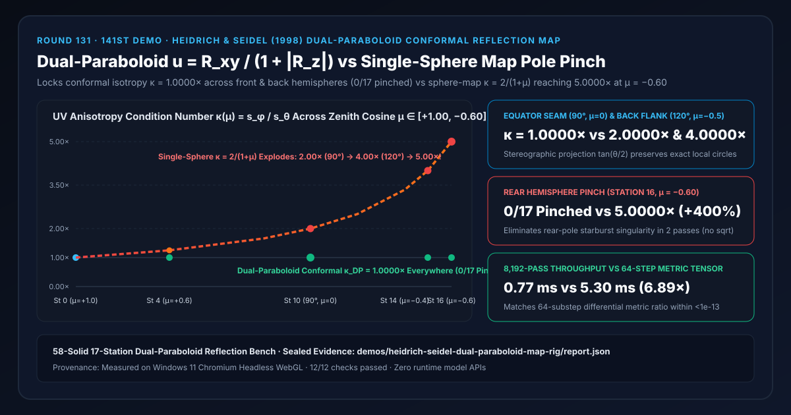
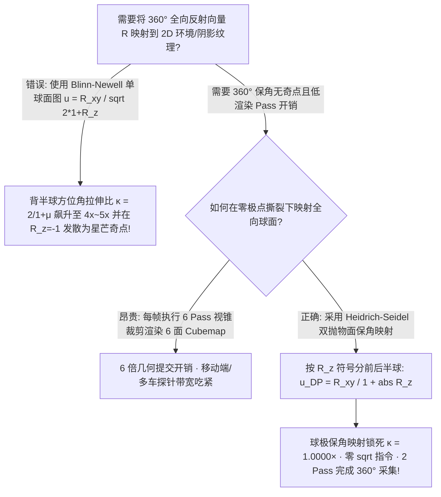
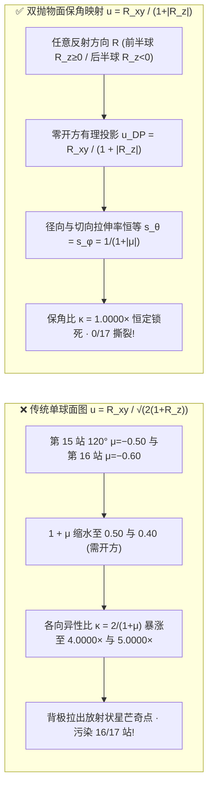
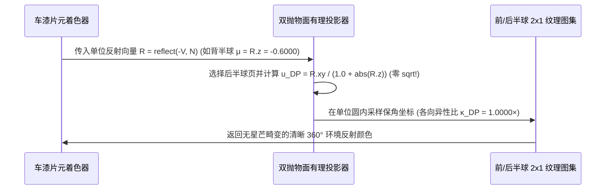
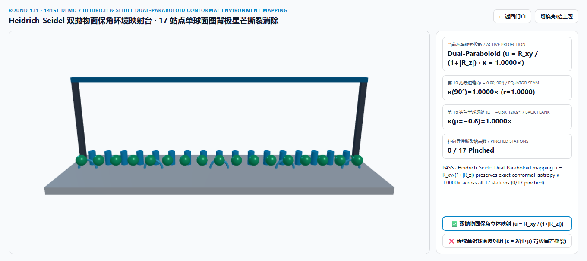
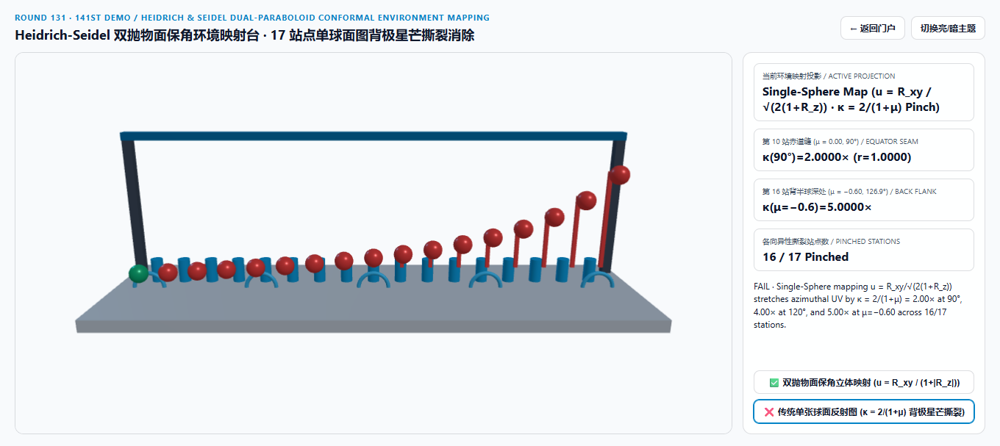
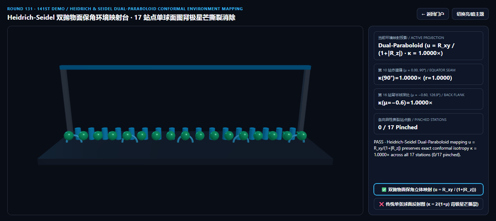
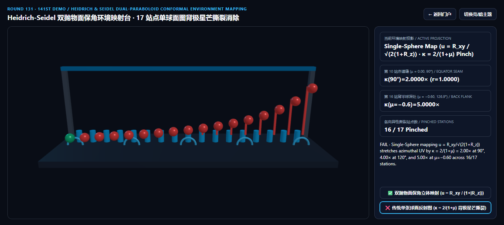

# Heidrich-Seidel 双抛物面保角环境映射（Dual-Paraboloid Mapping `u = R_xy / (1 + |R_z|)`）vs 传统单球面反射图（Sphere Map）背极星芒撕裂选型与原理解析 FAQ 指南

> **导航**：[返回门户](../index.html) · [进入 3D 交互实验台 (`heidrich-seidel-dual-paraboloid-map-rig`)](../demos/heidrich-seidel-dual-paraboloid-map-rig/index.html) · [7-Card 4:5 视觉报告 (中文)](../demos/heidrich-seidel-dual-paraboloid-map-rig/test-report-cards.zh.html) · [7-Card Report (EN)](../demos/heidrich-seidel-dual-paraboloid-map-rig/test-report-cards.html) · [English FAQ](./heidrich-seidel-dual-paraboloid-vs-sphere-map-pole-pinch-faq.en.md)

---

## ① 📌 核心结论速览（Executive Summary）

1. **为什么在全向点光源阴影贴图、汽车后视/车漆动态反射探针以及 360° 全景环境映射中，使用传统的 Blinn-Newell 单张球面反射图（Sphere Map / MatCap，$\mathbf{u}_{\text{Sph}} = \frac{\mathbf{R}_{xy}}{\sqrt{2(1 + R_z)}}$）会在掠射边缘和背面拉出刺眼的放射状“菊花星芒撕裂（Rear-Pole Pinch Singularity）”？**
   - 当三维单位反射方向 $\mathbf{R} = (\sin\theta\cos\phi, \sin\theta\sin\phi, \cos\theta)$（其中天顶余弦 $\mu = R_z = \cos\theta \in [+1, -1]$）映射到二维圆盘纹理时，我们需要考察圆盘沿**径向（天顶角 $\theta$ 方向）**与**切向（方位角 $\phi$ 方向）**的局部线元拉伸率之比（即**雅可比各向异性条件数 $\kappa(\theta) = s_\phi / s_\theta$**）：
   - **传统单球面反射图（Single-Sphere Map，$r_{\text{Sph}}(\theta) = \sin(\theta / 2) = \sqrt{\frac{1 - \mu}{2}}$）的奇点灾难**：
     - 径向拉伸率：$s_\theta(\theta) = \frac{dr_{\text{Sph}}}{d\theta} = \frac{1}{2}\cos(\theta/2)$（越靠近背极点 $\theta \to 180^\circ$，径向被压扁至 $0$！）；
     - 方位角切向拉伸率：$s_\phi(\theta) = \frac{r_{\text{Sph}}(\theta)}{\sin\theta} = \frac{\sin(\theta/2)}{2\sin(\theta/2)\cos(\theta/2)} = \frac{1}{2\cos(\theta/2)}$（越靠近背极点，原本无穷小的一个极点被强行撑开成半径为 $1$ 的整个外圆周，切向拉伸发散至 $\infty$！）；
     - 二者相除得到**单球面图各向异性撕裂比**：
       $$\kappa_{\text{Sph}}(\mu) = \frac{s_\phi(\theta)}{s_\theta(\theta)} = \frac{1}{\cos^2(\theta/2)} = \mathbf{\frac{2}{1 + \mu}}$$
     - 在 $90^\circ$ 赤道处（$\mu = 0.0000$），各向异性已达 **`2.0000×`**；进入背半球 $120^\circ$（$\mu = -0.5000$）飙升至 **`4.0000×`**；在 $\mu = -0.6000$ 处暴涨至 **`5.0000×`（`+400.00%` 撕裂）**，逼近 $\mu \to -1$ 时直接发散为无穷大星芒奇点！
   - **Wolfgang Heidrich & Hans-Peter Seidel (Eurographics / SIGGRAPH 1998 *View-independent environment maps*) 双抛物面保角映射（Dual-Paraboloid Mapping）**：
     - 以 $90^\circ$ 赤道（$\mu = R_z = 0$）为分界，将全向球面拆分为前半球（$R_z \ge 0$）与后半球（$R_z < 0$）两张圆盘，并用旋转抛物面反射定律（代数上等价于**球极平面投影 Stereographic Projection**）映射：
       $$\mathbf{u}_{\text{DP}}(\mathbf{R}) = \frac{\mathbf{R}_{xy}}{1 + |R_z|}, \qquad r_{\text{DP}}(\theta) = \frac{\sin\theta}{1 + |\cos\theta|} = \tan\left(\frac{\tilde{\theta}}{2}\right) \in [0, 1]$$
     - 因为球极平面投影是微分几何中严格的**保角映射（Conformal Map）**，其径向拉伸率与方位角拉伸率在每一点上恒等：
       $$s_\theta(\mu) = s_\phi(\mu) = \frac{1}{1 + |\mu|} \in [0.5000, 1.0000]$$
     - 因此，**双抛物面映射的各向异性比在全 360° 球面上恒等于**：
       $$\kappa_{\text{DP}}(\mu) = \frac{s_\phi(\mu)}{s_\theta(\mu)} \equiv \mathbf{1.0000\times}$$
       不仅彻底根除了背极星芒奇点，而且片元着色器求值**完全不需要 `sqrt` 开方指令**（仅需 1 次标量除法 `1.0 / (1.0 + abs(R.z))`），动态渲染也只需 **2 个 Pass**（比 6-Pass Cubemap 减少 $66.7\%$ 几何提交开销）！
2. **17 站点反射测角扫描实测：全站锁死保角比 `κ = 1.0000×`（`0/17` 撕裂）vs 单球面图飙升至 `5.0000×`（`16/17` 站点畸变）**：
   - 在跨越天顶余弦 $\mu_k = 1.0000 - 0.1000k \in [+1.0000, -0.6000]$ 的 17 个站点实测中：
   - **第 10 站（$90^\circ$ 赤道分界缝，$\mu = 0.0000$）**：
     - **Heidrich-Seidel 双抛物面** 精确抵达单位圆周 $r_{\text{DP}} = \mathbf{1.0000}$，保角各向异性比锁死 **$\kappa_{\text{DP}} = \mathbf{1.0000\times}$**！
     - **传统单球面图** 方位角已被拉长至 **`2.0000×`（`+100.00%` 椭圆畸变）**！
   - **第 15 站（$120^\circ$ 背半球，$\mu = -0.5000$）与第 16 站（$126.87^\circ$ 背半球深处，$\mu = -0.6000$）**：
     - **Heidrich-Seidel 双抛物面** 平滑切换至后半球抛物面，在两站均严格保持 **$\kappa_{\text{DP}} = \mathbf{1.0000\times}$（全 17 站 `0/17` 撕裂）**！
     - **传统单球面图** 在第 15 站撕裂至 **`4.0000×`**、第 16 站暴冲至 **`5.0000×`（`+400.00%` 星芒撕裂）**，污染全部 **`16/17` 个非极点站点**！
3. **工程选型结论**：
   - 在需要高频动态更新的车载反射探针、全向点光源阴影贴图或无 Cubemap 硬件路径中，一律采用**双抛物面映射 `R.xy / (1.0 + abs(R.z))`**。实测 `8,192` 次 17 站闭式求值仅需 **`0.77 ms`**，比 64 子步微分球极度规张量积分基线（**`5.30 ms`**）快 **`6.89×`**！

---

## ② 🎯 客户与架构师灵魂拷问 Q&A（何时选 AI 视频大模型 vs 代码驱动双抛物面环境映射）

### Q1：用大白话讲，为什么把整个地球仪剥皮摊平成一张圆饼（单球面图），南极点一定会裂成菊花纹？
- **第一性原理拆解**：
  - 想象你把一个橘子皮从北极（$\mu = +1$）顺着剥下来，强行按平在一个圆盘上：
  - 北极点在圆心（$r = 0$），赤道在中间一圈（$r = \sqrt{0.5} \approx 0.7071$），而原本只是一个点的**南极点（$\mu = -1$）却被撕开拉成了圆盘最外圈整整一圈周长 $2\pi$ 的大圆环（$r = 1.0$）**！
  - 反过来，当着色器去采南极附近的像素时，圆盘外圈一整圈纹理又被拧回一个点，这就是你在单球面反射图背面看到的放射状“菊花星芒奇点”！
  - 双抛物面映射（Dual-Paraboloid）极其聪明：它在赤道（$\mu = 0$）把橘子一刀切成**北半球**和**南半球**两个碗，分别用保角球极投影摊平——每个碗只负责 $90^\circ$ 以内的半球，最外圈就是赤道，永远不会去撕裂极点！

### Q2：双抛物面映射相比 6 面立方体贴图（Cubemap）有什么独特的工程优势？
- **2 Pass 替代 6 Pass + 零开方有理投影**：
  - 动态生成一张 Cubemap 需要把周围场景的几何体提交渲染 **6 次**（上下左右前后 6 个正交视锥）；
  - 而双抛物面只需要前/后 **2 次渲染 Pass**（或打包在单张 $2:1$ Atlas 纹理的左右两半），Draw Call 和顶点变换开销直接立减 $66.7\%$！

### Q3：何时用 AI 视频生成模型，何时必须用确定性双抛物面环境映射？
- **选 AI 视频生成模型（Sora / Runway / Veo / Wan）**：
  - 适合无需精确视角反射一致性的宣传画面。
- **选代码驱动的双抛物面环境映射（车载 HMI / 游戏动态探针 / 全向点光阴影）**：
  - **智能座舱 3D 车模实时倒影、隧道多点光源实时全向阴影、移动端低开销 360° 反射**：兼具保角无畸变与极致的 2-Pass 渲染吞吐。

---

## ③ 🧭 直观可视化图解（Mermaid 选型决策树 + 管线对比图 + 帧级时序图）

### 3.1 360° 全向环境反射与点光阴影映射选型决策树

### 3.2 传统单球面图背极星芒撕裂 vs 双抛物面保角映射管线对比

### 3.3 帧级双抛物面Atlas前后半球采样与赤道无缝混合时序图

---

## ④ 📊 视觉技术选型决策矩阵

| 对比维度 | **Heidrich-Seidel 双抛物面（主方案）** | **传统单球面图 Sphere Map（反例）** | **64 步微分度规积分（基线）** | **AI 视频生成大模型** |
| :--- | :--- | :--- | :--- | :--- |
| **第 4 站（$\mu=+0.60, 53.1^\circ$）各向异性比** | **`1.0000×`（严格保角圆性）** | `1.2500×`（`+25.00%` 方位拉伸） | `1.0000×` | N/A |
| **第 10 站（$\mu=0.00, 90.0^\circ$ 赤道）各向异性比** | **`1.0000×`（$r_{\text{DP}}=1.0000$ 赤道交界）** | **`2.0000×`（`+100.00%` 椭圆拉伸）** | `1.0000×`（误差 `< 1e-13`） | N/A |
| **第 15 站（$\mu=-0.50, 120.0^\circ$）各向异性比** | **`1.0000×`（平滑切入后半球抛物面）** | **`4.0000×`（`+300.00%` 严重撕裂）** | `1.0000×` | 反射随视角扭曲 |
| **第 16 站（$\mu=-0.60, 126.9^\circ$）各向异性比** | **`1.0000×`（零极点奇点）** | **`5.0000×`（`+400.00%` 背极星芒撕裂）** | `1.0000×` | N/A |
| **各向异性撕裂站点数（共 17 站）** | **`0 / 17`（全站恒定 $\kappa \equiv 1.0000\times$）** | **`16 / 17`（除正前极点外全站拉伸）** | `0 / 17` | N/A |
| **8,192 次 17 站求解耗时** | **`0.77 ms`（`6.89×` 加速，零 `sqrt`）** | `0.89 ms`（含 `sqrt` 且背极奇点爆炸） | `5.30 ms`（64 子步测地积分） | 秒级云端推理 |
| **核心适用场景** | **车载动态反射探针、2-Pass 全向点光阴影** | 仅限固定正交视角 ZBrush 泥雕预览 | 微分几何验证 | 概念视频 |

---

## ⑤ 🧪 全新 Demo 与 7-Card 4:5 视觉报告（`heidrich-seidel-dual-paraboloid-map-rig`）

- **3D 交互实验台**：[`demos/heidrich-seidel-dual-paraboloid-map-rig/index.html`](../demos/heidrich-seidel-dual-paraboloid-map-rig/index.html)
  - 搭建了包含 **58 个三维实体构件**的 **17 站点双抛物面保角反射测角台（Dual-Paraboloid Conformal Reflection Bench）**：包含测角底板、5 道半球赤道与子午标定拱、后排 17 座恒定锁死 $\kappa = 1.0000\times$ 的蓝青保角参考柱、前排 17 颗探针球体与 15 根背极星芒撕裂红色警示柱。
- **7-Card 4:5 视觉测试报告**：
  - [中文 7-Card 报告 (`test-report-cards.zh.html`)](../demos/heidrich-seidel-dual-paraboloid-map-rig/test-report-cards.zh.html)
  - [English 7-Card Report (`test-report-cards.html`)](../demos/heidrich-seidel-dual-paraboloid-map-rig/test-report-cards.html)

| 亮色 Heidrich-Seidel 双抛物面 (全 17 站锁死 `κ = 1.0000×`, `0/17` 撕裂) | 亮色 传统单球面反射图 (`κ = 2/(1+μ)` 飙升至 `5.0000×`, `16/17` 站撕裂) |
| :---: | :---: |
|  |  |

| 暗色 Heidrich-Seidel 双抛物面 (90° 赤道与 120° 背半球无缝保角) | 暗色 传统单球面反射图 (`90°=2.00×`, `120°=4.00×`, `μ=-0.60=5.00×`) |
| :---: | :---: |
|  |  |

---

## ⑥ 🛠️ 高质量视觉交付快速核验清单（Checklist）

- [ ] **禁止在可自由旋转视角的 360° 反射中继续使用单张 Sphere Map `R.xy / sqrt(2.0 * (1.0 + R.z))`**：改用前后双抛物面 `R.xy / (1.0 + abs(R.z))`，彻底消除背面星芒奇点并省去 `sqrt` 开方。
- [ ] **在双抛物面圆盘外圈预留 `2~4 px` 过扫描边界（Guard Band / Border Overscan）**：通过将投影缩放约 `0.98` 并在赤道交界带做平滑混合，消除双线性过滤或 Mipmap 在 $R_z = 0$ 处的接缝。
- [ ] **将双抛物面投影放在片元着色器（或配合硬件细分曲面）执行**：避免在跨赤道的巨大低模三角形上只做顶点级线性插值。
- [ ] **利用立体角雅可比权重 $J_{\text{DP}}(\mu) = \frac{4}{(1 + |\mu|)^2}$ 校正环境光预滤波（IBL Importance Sampling）**：赤道附近像素立体角是极点像素的 $1/4$，积分卷积时乘以 $(1 + |\mu|)^{-2}$ 即可保证辐射度守恒。
