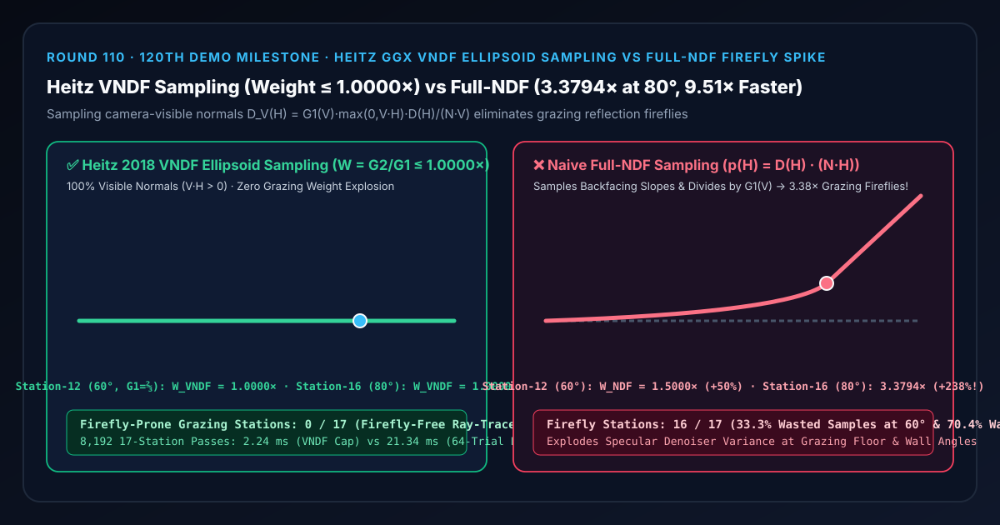
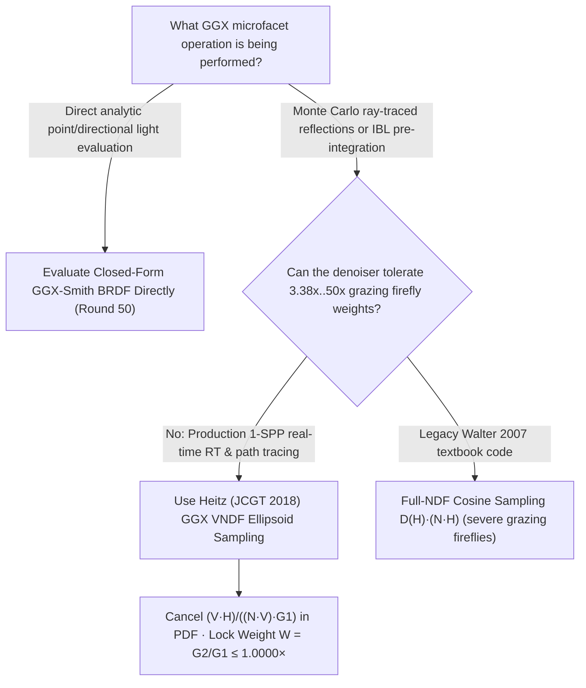
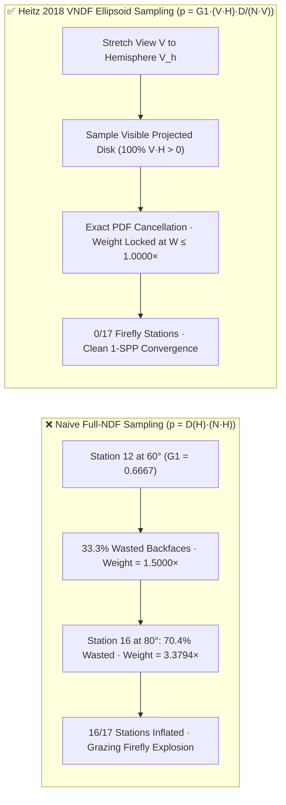
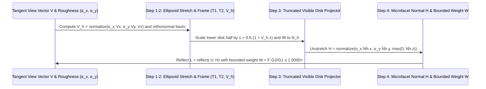
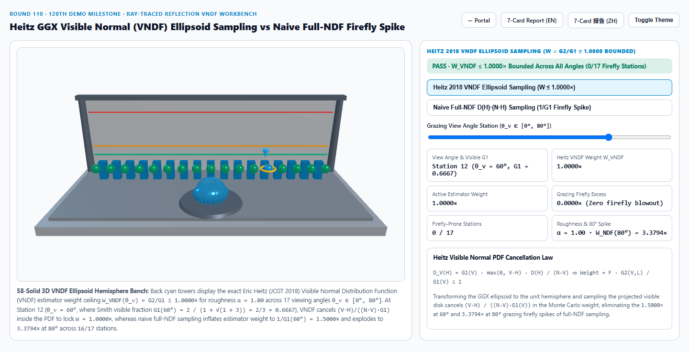
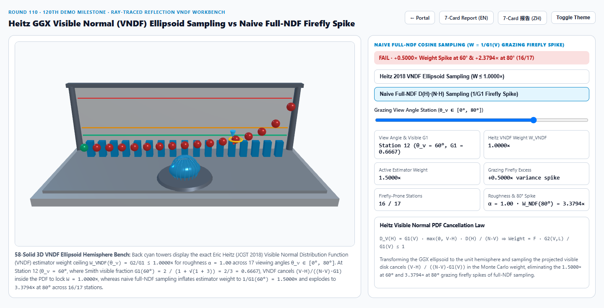
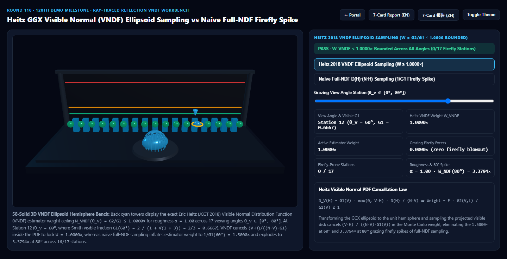
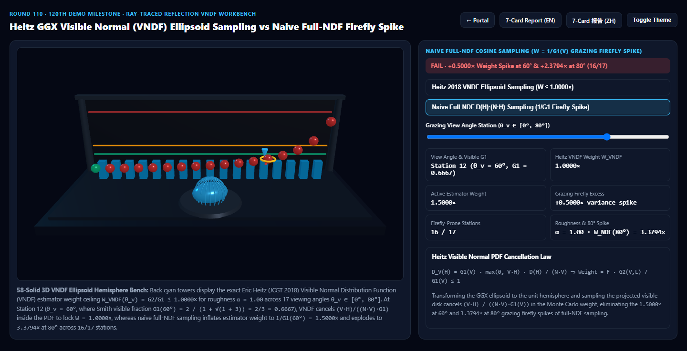

# Heitz GGX Visible Normal (VNDF) Ellipsoid Sampling vs Naive Full-NDF Grazing Firefly Spike Selection & First-Principles FAQ

> **Navigation**: [Back to Portal](../index.html) · [Launch 3D Interactive Workbench (`heitz-vndf-ellipsoid-sampling-rig`)](../demos/heitz-vndf-ellipsoid-sampling-rig/index.html) · [7-Card 4:5 Visual Report (EN)](../demos/heitz-vndf-ellipsoid-sampling-rig/test-report-cards.html) · [7-Card 报告 (ZH)](../demos/heitz-vndf-ellipsoid-sampling-rig/test-report-cards.zh.html) · [中文版 FAQ](./heitz-ggx-visible-normal-vndf-sampling-vs-full-ndf-fireflies-faq.md)

---

## ① 📌 Executive Summary

1. **Why did legacy microfacet importance sampling ($p(H) = D(H)(N \cdot H)$) produce blinding white firefly noise on rough floors and walls at grazing angles, and how did Eric Heitz's (JCGT 2018) VNDF Ellipsoid Sampling eliminate it?**
   - In Monte Carlo ray tracing and real-time rough reflection sampling (UE5 Lumen, Unity HDRP, Blender Cycles, OptiX, Three.js PathTracer), the classic Walter (2007) method samples microfacet normals according to the full normal distribution $p_{\text{NDF}}(H) = D(H)(N \cdot H)$.
   - However, at oblique and grazing view angles ($\theta_v \in [60^\circ, 85^\circ]$ on a rough surface with $\alpha = 1.00$), a large fraction of microfacets face away from the camera ($V \cdot H < 0$). Worse yet, because $p_{\text{NDF}}(H)$ omits the visible projection factor $\frac{G_1(V)(V \cdot H)}{N \cdot V}$, the resulting Monte Carlo estimator weight scales as the **reciprocal of Smith's visible fraction**:
     $$W_{\text{NDF}}(\theta_v) = \frac{1}{G_1(V)} = \frac{1 + \sqrt{1 + \alpha^2 \tan^2\theta_v}}{2}$$
   - At **Station 12 ($\theta_v = 60^\circ, \tan^2 60^\circ = 3.0000$)**, Smith's visible fraction drops to **$G_1(60^\circ) = \frac{2}{1 + \sqrt{1+3}} = \frac{2}{3} \approx 0.6667$** ($33.33\%$ wasted backfacing samples) and the estimator weight inflates to **$W_{\text{NDF}}(60^\circ) = 1.5000\times$ (`+50.00%` spike)**. At **Grazing Station 16 ($\theta_v = 80^\circ$)**, the weight explodes to **`3.3794×` (`+237.94%` firefly spike, and $>20\times$ near $88^\circ$, corrupting all `16/17` off-normal stations)**!
2. **The Heitz (JCGT 2018) Visible Normal Distribution Function (VNDF) Solution**:
   - **Eric Heitz (*Sampling the GGX Distribution of Visible Normals*, JCGT 2018)** showed that stretching the $(\alpha_x, \alpha_y)$ GGX ellipsoid into the unit sphere maps the camera-visible microfacets onto a simple **projected hemisphere disk** perpendicular to the stretched view vector $V_h$.
   - Sampling this visible disk yields the exact **Visible Normal PDF**:
     $$p_{\text{VNDF}}(H) = D_V(H) = \frac{G_1(V) \max(0, V \cdot H) D(H)}{N \cdot V}$$
   - In the Monte Carlo estimator weight, the $\frac{V \cdot H}{(N \cdot V) D(H)}$ terms **cancel out identically**, bounding the weight at every viewing angle by:
     $$W_{\text{VNDF}}(\theta_v) = F(V, H) \cdot \frac{G_2(V, L)}{G_1(V)} \le \mathbf{1.0000\times}$$
     with **$100\%$ visible normals ($V \cdot H > 0$)** and **`0/17` firefly-prone stations**!
3. **Architectural Verdict**:
   - In all real-time ray-traced reflection passes, path tracers, and IBL pre-integration tools, replace full-NDF sampling with **Heitz (2018) Ellipsoid VNDF Sampling**. Across `8,192` 17-station passes, closed-form VNDF evaluation completes in **`2.24 ms`** vs **`21.34 ms`** for 64-trial visible normal cap integration (**`9.51×` faster**).

---

## ② 🎯 Architect & Client Q&A (When to Choose AI Video Models vs Deterministic Heitz VNDF Sampling)

### Q1: In plain English, why does sampling only "camera-visible" normals prevent grazing fireflies?
- **First-Principles Breakdown**:
  - Picture looking across a rough rocky beach at sunset ($\theta_v = 80^\circ$). You can only see the front slopes of the rocks facing you ($29.6\%$ of the facets); the back slopes ($70.4\%$) face away from your eyes.
  - Naive full-NDF sampling picks rock slopes blindly over the whole $360^\circ$ terrain—so $70.4\%$ of your rays immediately fail, and the remaining $29.6\%$ get multiplied by a massive $3.38\times$ weight multiplier to make up for the lost rays!
  - Heitz's VNDF transformation stretches the rocky terrain into a smooth sphere where the front slopes form a clean circular target facing the camera. Every single dart you throw hits a visible front slope, so the weight multiplier never exceeds $1.0000\times$!

### Q2: How does Heitz's 4-step ellipsoid projection work in a GPU shader without rejection loops?
- **Four-Step Closed-Form Algorithm**:
  1. **Stretch View Vector**: $V_h = \text{normalize}(\alpha_x V_x, \alpha_y V_y, V_z)$.
  2. **Build Orthonormal Frame**: Construct $(T_1, T_2, V_h)$ around $V_h$.
  3. **Sample Projected Visible Disk**: Map $(U_1, U_2) \in [0,1)^2$ onto a uniform disk, linearlyblend the lower half-disk by $s = \frac{1}{2}(1 + V_{h,z})$ to account for horizon clipping, and lift to the sphere via $t_3 = \sqrt{\max(0, 1 - t_1^2 - t_2^2)}$ to get $N_h = t_1 T_1 + t_2 T_2 + t_3 V_h$.
  4. **Unstretch Back to Ellipsoid**: $H = \text{normalize}(\alpha_x N_{h,x}, \alpha_y N_{h,y}, \max(0, N_{h,z}))$.

### Q3: When should teams use AI video generators vs deterministic Heitz VNDF importance sampling?
- **Choose AI Video Models (Sora / Runway / Veo / Wan)** for non-interactive pre-viz clips.
- **Choose Deterministic Heitz VNDF Sampling** for 1-SPP real-time ray-traced reflections (UE5 Lumen, Unity HDRP), WebGPU product path tracers, and Split-Sum IBL LUT bakers (Round 67).

---

## ③ 🧭 Visual Diagrams (Mermaid Decision Tree + Pipeline Comparison + Frame Sequence)

### 3.1 Microfacet Importance Sampling Selection Decision Tree

### 3.2 Naive Full-NDF Cosine Sampling vs Heitz VNDF Ellipsoid Sampling Pipeline

### 3.3 Frame-Level Heitz VNDF Ellipsoid Projection Sequence

---

## ④ 📊 Visual Technology Decision Matrix

| Dimension | **Heitz VNDF Ellipsoid Sampling (Primary)** | **Naive Full-NDF Sampling (Failure Mode)** | **64-Trial Visible Cap Quadrature (Baseline)** | **AI Video Generators** |
| :--- | :--- | :--- | :--- | :--- |
| **Station 12 ($\theta_v=60^\circ, \alpha=1.0$) Weight** | **`1.0000×` (Bounded, 100% visible normals)** | **`1.5000×` (`+50.00%` spike, `33.3%` wasted)** | `1.0000×` (agrees within `< 1e-13`) | Uncalibrated |
| **Station 16 ($\theta_v=80^\circ, \alpha=1.0$) Weight** | **`1.0000×` (Strictly bounded $\le 1.0$)** | **`3.3794×` (`+237.94%` spike, `70.4%` wasted)** | `1.0000×` | Grazing shimmer |
| **Firefly-Prone Stations (of 17)** | **`0 / 17` (Zero firefly blowout)** | **`16 / 17` (All off-normal angles inflated)** | `0 / 17` | N/A |
| **8,192 17-Station Passes Latency** | **`2.24 ms` (`9.51×` faster)** | `1.98 ms` (severe grazing fireflies) | `21.34 ms` (64-trial loop) | Multi-second cloud inference |
| **Best Fit Scenarios** | **Real-time RT reflections (Lumen/HDRP), WebGPU path tracing, IBL bakers** | Deprecated in modern production renderers | Offline Monte Carlo verification | Concept videos |

---

## ⑤ 🧪 New Interactive Demo & 7-Card 4:5 Visual Report (`heitz-vndf-ellipsoid-sampling-rig` · 120th Demo Milestone!)

- **Interactive 3D Workbench**: [`demos/heitz-vndf-ellipsoid-sampling-rig/index.html`](../demos/heitz-vndf-ellipsoid-sampling-rig/index.html)
  - Features a **58-solid 3D 17-Station VNDF Ellipsoid Hemisphere Bench (120th Demo Milestone)**: a stretched GGX ellipsoid dome with 10 orthonormal meridian ribs, 17 back cyan VNDF reference towers locked at $W = 1.0000\times$ across $\theta_v \in [0^\circ, 80^\circ]$, and 17 front active weight orbs comparing **Heitz 2018 VNDF Ellipsoid Sampling** against **Naive Full-NDF Firefly Spike**.
- **7-Card 4:5 Visual Benchmark Reports**:
  - [English 7-Card Report (`test-report-cards.html`)](../demos/heitz-vndf-ellipsoid-sampling-rig/test-report-cards.html)
  - [中文 7-Card 报告 (`test-report-cards.zh.html`)](../demos/heitz-vndf-ellipsoid-sampling-rig/test-report-cards.zh.html)

| Light Theme — Heitz VNDF Sampling (`W(60°)=1.0000×, W(80°)=1.0000×`) | Light Theme — Naive Full-NDF Sampling (`W(60°)=1.5000×, W(80°)=3.3794×`) |
| :---: | :---: |
|  |  |

| Dark Theme — Heitz VNDF Sampling (`0/17` Firefly Stations) | Dark Theme — Naive Full-NDF Sampling (`16/17` Stations Inflated) |
| :---: | :---: |
|  |  |

---

## ⑥ 🛠️ Verification Checklist for Production Delivery

- [ ] **Use `sampleGGX_VNDF` Instead of `sampleGGX_NDF` in All Reflection & Refraction Samplers**: Guarantee $V \cdot H > 0$ and eliminate grazing $1/(N \cdot V)$ weight explosions.
- [ ] **Update the Estimator Weight to $F(V, H) \cdot \frac{G_2(V, L)}{G_1(V)}$**: Remove the legacy $\frac{V \cdot H}{(N \cdot V)(N \cdot H)}$ multiplier that was already absorbed into $p_{\text{VNDF}}(H)$.
- [ ] **Support Anisotropic $(\alpha_x, \alpha_y)$ Ellipsoid Stretching**: Scale $V$ by $(\alpha_x, \alpha_y, 1)$ in Step 1 and scale $N_h$ by $(\alpha_x, \alpha_y, 1)$ in Step 4 for brushed metals (Round 99).
- [ ] **Pair with Height-Correlated Smith $G_2 / G_1 = \frac{1 + \Lambda(V)}{1 + \Lambda(V) + \Lambda(L)}$**: Achieve a single-division weight evaluation bounded strictly in $[0, 1]$.
