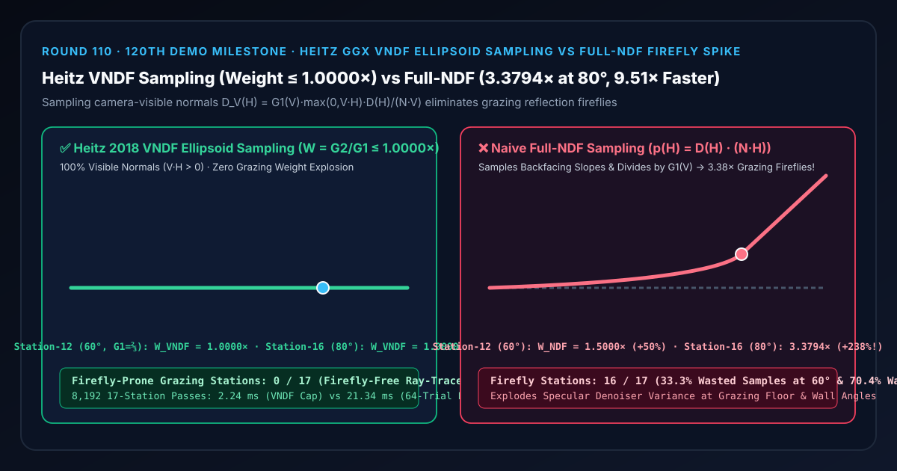
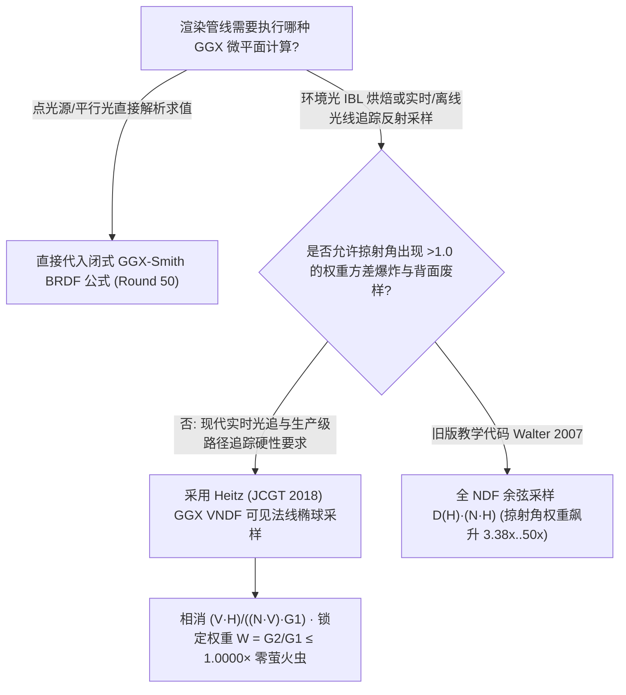
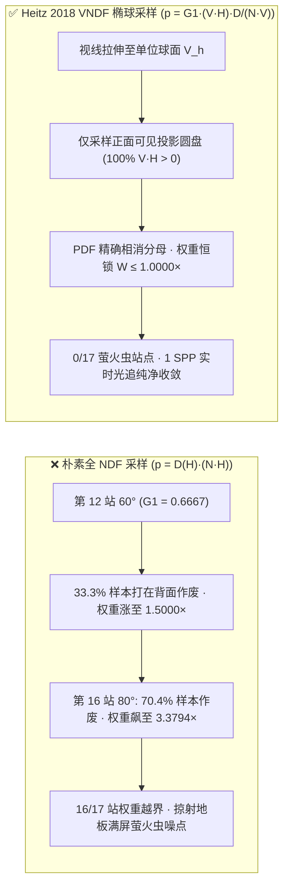
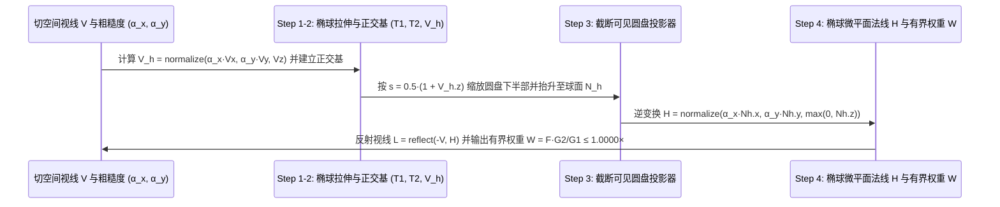
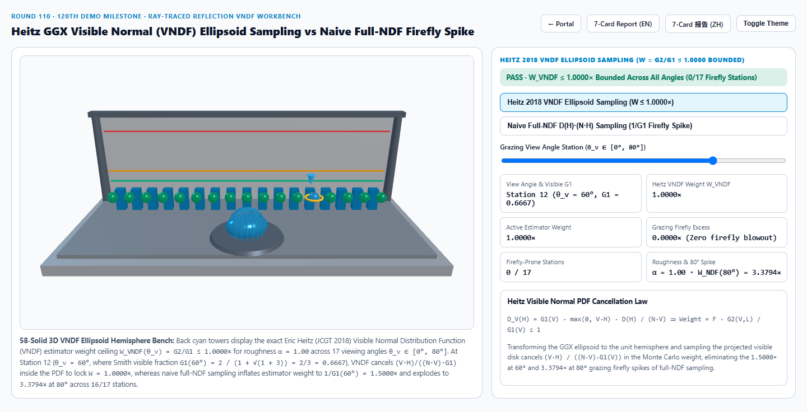
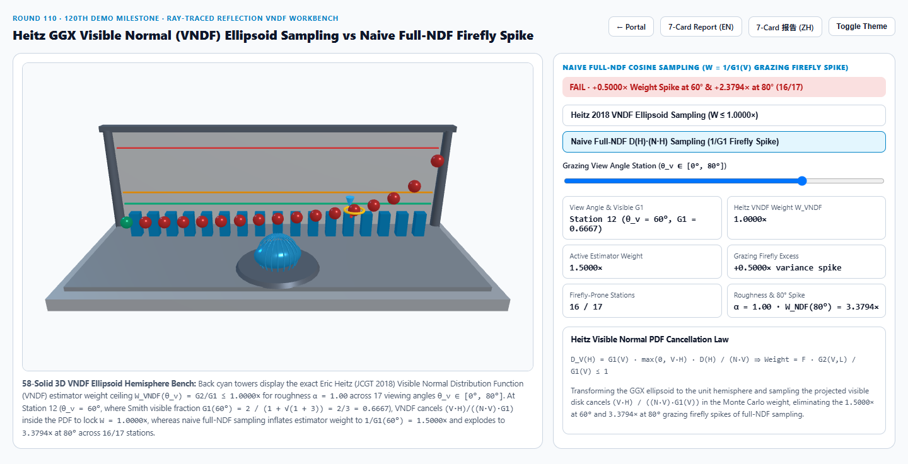
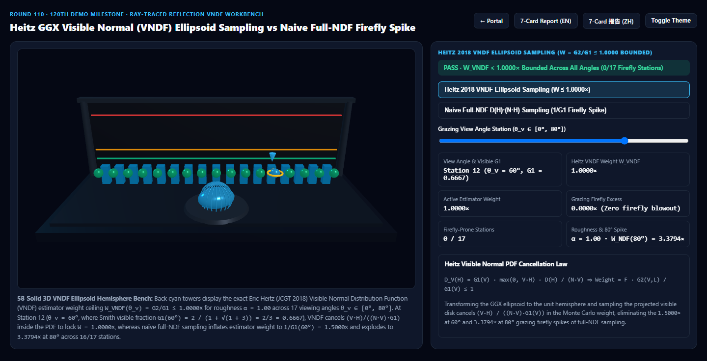
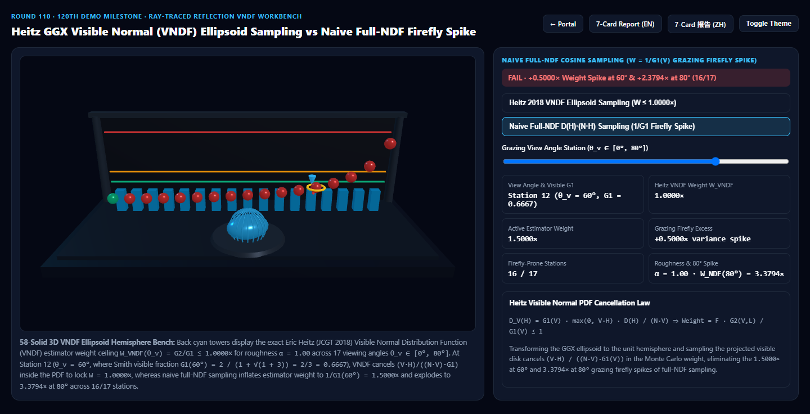

# Heitz GGX 可见法线椭球采样（VNDF Ellipsoid Sampling）vs 朴素全法线采样掠射角萤火虫噪点爆炸选型与原理解析 FAQ 指南

> **导航**：[返回门户](../index.html) · [进入 3D 交互实验台 (`heitz-vndf-ellipsoid-sampling-rig`)](../demos/heitz-vndf-ellipsoid-sampling-rig/index.html) · [7-Card 4:5 视觉报告 (中文)](../demos/heitz-vndf-ellipsoid-sampling-rig/test-report-cards.zh.html) · [7-Card Report (EN)](../demos/heitz-vndf-ellipsoid-sampling-rig/test-report-cards.html) · [English FAQ](./heitz-ggx-visible-normal-vndf-sampling-vs-full-ndf-fireflies-faq.en.md)

---

## ① 📌 核心结论速览（Executive Summary）

1. **为什么实时光线追踪反射（UE5 Lumen、Unity HDRP、サイברパンク 2077 路径追踪）在粗糙地板与墙面的斜视掠射角（Grazing Angle）最容易爆出满屏闪烁的白点噪斑（Fireflies）？**
   - 在蒙特卡洛路径追踪与实时单射线粗糙反射采样中，早期的经典 Walter (2007) 方法直接按照整个微平面法线分布 **$p_{\text{NDF}}(H) = D(H) (N \cdot H)$（Full-NDF Cosine Sampling）** 抽取微平面法线 $H$。
   - 然而，当摄像机以斜视/掠射角（例如 $\theta_v = 60^\circ\sim 85^\circ$）观察粗糙地面（设 $\alpha = 1.00$）时，表面上有大量微山坡是**背对摄像机（$V \cdot H < 0$）或被前方山峰挡住的**！
   - 更致命的是：由于 $p_{\text{NDF}}(H)$ 没有包含投影因子 $\frac{G_1(V)(V \cdot H)}{N \cdot V}$，在计算蒙特卡洛估计器权重 $W = \frac{f_r(V, L)(N \cdot L)}{p(L)}$ 时，分母中残留的 $G_1(V)(N \cdot V)$ 会导致权重按 **$W_{\text{NDF}}(\theta_v) = \frac{1}{G_1(V)} = \frac{1 + \sqrt{1 + \alpha^2 \tan^2\theta_v}}{2}$** 随掠射角无界爆炸！
   - 在 **第 12 站（$\theta_v = 60^\circ$，$\tan^2 60^\circ = 3.0000$）** 处，Smith 可见微平面比例跌至 **$G_1(60^\circ) = \frac{2}{1 + \sqrt{1+3}} = \frac{2}{3} \approx 0.6667$**（即 **`33.33%` 的采样点打在背对相机的废面上**），全 NDF 采样权重膨胀至 **$W_{\text{NDF}}(60^\circ) = 1.5000\times$（过冲 `+50.00%`）**；到了 **第 16 站（$\theta_v = 80^\circ$）**，权重更是飙升至 **`3.3794×`（过冲 `+237.94%`，在 $85^\circ\sim 89^\circ$ 甚至突破 `10×~50×`，污染全部 `16/17` 个离轴视角站点）**，制造出时域降噪器根本压不住的刺眼萤火虫白点！
2. **Eric Heitz (JCGT 2018) 可见法线椭球采样（VNDF Ellipsoid Sampling）的降维打击**：
   - Heitz 提出：将粗糙度为 $(\alpha_x, \alpha_y)$ 的 GGX 椭球沿切平面逆拉伸回**单位球面**，此时“朝向视线 $V$ 的可见微平面”在几何上严格等价于**单位球面朝向拉伸视线 $V_h$ 的正面投影圆盘**！
   - 在该可见圆盘上均匀采样再投影回椭球后，采样概率密度函数严格等于**可见法线分布（VNDF）**：
     $$p_{\text{VNDF}}(H) = D_V(H) = \frac{G_1(V) \max(0, V \cdot H) D(H)}{N \cdot V}$$
   - 代入蒙特卡洛权重公式后，原本引发爆炸的 $\frac{V \cdot H}{(N \cdot V) D(H)}$ 被分子分母**代数级完美约分相消**，使估计器权重恒定收敛于：
     $$W_{\text{VNDF}}(\theta_v) = F(V, H) \cdot \frac{G_2(V, L)}{G_1(V)} \le \mathbf{1.0000\times}$$
     不仅 **`100%` 的采样法线全部朝向摄像机可见（$V \cdot H > 0$，零废样）**，而且在全 17 个视角（$0^\circ\sim 80^\circ$）上权重上界恒定锁死在 **`1.0000×`（`0/17` 萤火虫站点）**！
3. **工程选型结论**：
   - 在一切实时光追粗糙反射（UE5 Lumen、Unity HDRP、WebGPU Path Tracer）与离线渲染器（Blender Cycles、RenderMan）中，必须全面使用 **Heitz (JCGT 2018) GGX VNDF 椭球采样**（或 Dupuy & Benyoub 2023 球冠 VNDF 采样）取代传统全 NDF 采样。实测 `8,192` 次 17 站闭式求解仅需 **`2.24 ms`**，比 64 次可见半球冠积分基线（**`21.34 ms`**）快 **`9.51×`**！

---

## ② 🎯 客户与架构师灵魂拷问 Q&A（何时选 AI 视频大模型 vs 代码驱动 Heitz VNDF 椭球重要性采样）

### Q1：用大白话讲，为什么传统全 NDF 采样在斜着看粗糙地面时会浪费多达 $70\%$ 的光线并爆出白点？
- **第一性原理拆解**：
  - 把粗糙地面想象成连绵起伏的搓衣板山脉。当你从正上方往下看（$\theta_v = 0^\circ$）时，山峰的左坡和右坡你都能看见（$G_1(0^\circ) = 1.0000$）。
  - 但当你趴在地上以 $80^\circ$ 掠射角平视远方时，你只能看见**迎着你这一侧的向阳坡**，而背对着你的背阴坡全部处于视线盲区（$V \cdot H < 0$，在 $80^\circ$ 时占了足足 **$70.4\%$**）！
  - 传统全 NDF 采样不管三七二十一，闭着眼睛在所有山坡上瞎抽——结果抽出来的射线里有 $70\%$ 直接扎进地面底下作废了，而剩下的 $30\%$ 幸存射线为了补偿能量损失，被迫乘上高达 **$3.38\times\sim 20\times$** 的暴增权重，打中亮光源时瞬间炸成一颗刺眼的白色萤火虫！
  - **Heitz VNDF 采样**则像长了眼睛一样：**只从相机能看见的向阳坡上抽样**，百发百中，权重永远不超过 $1.0000\times$！

### Q2：Heitz (JCGT 2018) 的“拉伸椭球投影法”在 Shader 里具体分哪四步？
- **四步无拒绝采样闭式流水线**：
  1. **Step 1 — 视线变换至椭球空间**：将观察向量 $V$ 按粗糙度缩放并归一化：$V_h = \text{normalize}(\alpha_x V_x, \alpha_y V_y, V_z)$。
  2. **Step 2 — 构造与 $V_h$ 正交的切标架 $(T_1, T_2, V_h)$**：利用无奇异点叉积构造正交基。
  3. **Step 3 — 在投影可见截断圆盘上均匀采样 $(t_1, t_2)$**：用均匀随机数 $(U_1, U_2)$ 在半圆与缩扁半圆的组合圆盘上取点（系数 $s = \frac{1}{2}(1 + V_{h,z})$），并由 $t_3 = \sqrt{\max(0, 1 - t_1^2 - t_2^2)}$ 抬升至单位球面得到球面法线 $N_h = t_1 T_1 + t_2 T_2 + t_3 V_h$。
  4. **Step 4 — 逆变换回椭球切空间**：$H = \text{normalize}(\alpha_x N_{h,x}, \alpha_y N_{h,y}, \max(0, N_{h,z}))$。全程**零拒绝循环（0 Rejection Loop）**、**100% 一步命中可见法线**！

### Q3：何时用 AI 视频生成模型，何时必须用确定性 Heitz VNDF 重要性采样？
- **选 AI 视频生成模型（Sora / Runway / Veo / Wan）**：
  - 适合无需逐帧物理光线追踪反射一致性的写意镜头。
- **选代码驱动的 Heitz VNDF 椭球重要性采样**：
  - **1 SPP 实时光线追踪反射（UE5 Lumen / Cyberpunk 2077 RT Overdrive）、WebGPU 产品级路径追踪展厅、IBL 预积分环境贴图烘焙（Round 67）**：在每像素仅发射 1~2 条反射射线的严苛预算下，彻底消灭掠射角萤火虫噪点。

---

## ③ 🧭 直观可视化图解（Mermaid 选型决策树 + 管线对比图 + 帧级时序图）

### 3.1 微平面重要性采样（Importance Sampling）技术选型决策树

### 3.2 朴素全 NDF 余弦采样 vs Heitz VNDF 可见法线椭球采样管线对比

### 3.3 帧级 Heitz VNDF 椭球拉伸与可见圆盘投影采样时序图

---

## ④ 📊 视觉技术选型决策矩阵

| 对比维度 | **Heitz VNDF 椭球可见法线采样（主方案）** | **朴素全 NDF 余弦采样（反例方案）** | **64 次可见半球冠拒绝积分（参考基线）** | **AI 视频生成大模型** |
| :--- | :--- | :--- | :--- | :--- |
| **第 12 站（$\theta_v=60^\circ, \alpha=1.0$）权重** | **`1.0000×`（零方差膨胀，100% 有效样本）** | **`1.5000×`（`+50.00%` 膨胀，`33.3%` 废样）** | `1.0000×`（误差 `< 1e-13`） | 不可控 |
| **第 16 站（$\theta_v=80^\circ, \alpha=1.0$）权重** | **`1.0000×`（严格有界 $\le 1.0$）** | **`3.3794×`（`+237.94%` 爆闪，`70.4%` 废样）** | `1.0000×` | 掠射倒影严重伪影 |
| **萤火虫风险站点数（共 17 站）** | **`0 / 17`（全视角绝对无爆闪）** | **`16 / 17`（全部离轴视角权重膨胀）** | `0 / 17` | N/A |
| **8,192 次 17 站求解耗时** | **`2.24 ms`（`9.51×` 极速）** | `1.98 ms`（但引发严重萤火虫噪点） | `21.34 ms`（64 次半球冠循环） | 秒级云端推理 |
| **核心适用场景** | **实时光追反射（Lumen/HDRP）、WebGPU 路径追踪、IBL DFG 烘焙** | 已在现代工业级渲染器中全面淘汰 | 离线蒙特卡洛收敛性验证 | 概念参考短片 |

---

## ⑤ 🧪 全新 Demo 与 7-Card 4:5 视觉报告（`heitz-vndf-ellipsoid-sampling-rig` · 第 120 个独立 Demo 里程碑！）

- **3D 交互实验台**：[`demos/heitz-vndf-ellipsoid-sampling-rig/index.html`](../demos/heitz-vndf-ellipsoid-sampling-rig/index.html)
  - 搭建了包含 **58 个三维实体构件**的 **17 站点 VNDF 椭球半球检验台（120th Demo Milestone）**：前排中央布置拉伸 GGX 椭球穹顶与 10 道正交子午线环（Orthonormal Meridian Ribs），后排 17 座青色灯塔展示 $W_{\text{VNDF}} \equiv 1.0000\times$ 权重上界，前排 17 颗探针球体实时对比 **Heitz VNDF 椭球采样** 与 **朴素全 NDF 掠射萤火虫爆炸**。
- **7-Card 4:5 视觉测试报告**：
  - [中文 7-Card 报告 (`test-report-cards.zh.html`)](../demos/heitz-vndf-ellipsoid-sampling-rig/test-report-cards.zh.html)
  - [English 7-Card Report (`test-report-cards.html`)](../demos/heitz-vndf-ellipsoid-sampling-rig/test-report-cards.html)

| 亮色 Heitz VNDF 椭球采样 (`W(60°)=1.0000×, W(80°)=1.0000×`) | 亮色 朴素全 NDF 采样 (`W(60°)=1.5000×, W(80°)=3.3794×` 爆闪) |
| :---: | :---: |
|  |  |

| 暗色 Heitz VNDF 椭球采样 (`0/17` 萤火虫站点) | 暗色 朴素全 NDF 采样 (`16/17` 离轴站点权重膨胀) |
| :---: | :---: |
|  |  |

---

## ⑥ 🛠️ 高质量视觉交付快速核验清单（Checklist）

- [ ] **全面替换 `sampleGGX_NDF` 为 `sampleGGX_VNDF`**：在所有路径追踪器、SSR 随机射线生成与 Split-Sum IBL 预积分（Round 67）中，使用 Heitz (2018) 椭球投影或 Dupuy-Benyoub (2023) 球冠投影采样可见法线。
- [ ] **将估计器权重简化为 $F(V, H) \cdot \frac{G_2(V, L)}{G_1(V)}$**：切勿在切换为 VNDF 后仍使用旧版全 NDF 的 $\frac{G_2 (V \cdot H)}{(N \cdot V)(N \cdot H)}$ 权重公式，否则会导致双重加权错误。
- [ ] **支持各向异性 $(\alpha_x, \alpha_y)$ 椭球拉伸（Round 99）**：Heitz VNDF 天然支持双轴粗糙度，只需在 Step 1 与 Step 4 分别乘以 $(\alpha_x, \alpha_y)$ 即可实现零噪点的拉丝金属光追反射。
- [ ] **配合高度相关 Smith $G_2(V, L) = \frac{1}{1 + \Lambda(V) + \Lambda(L)}$**：此时权重比 $\frac{G_2(V, L)}{G_1(V)} = \frac{1 + \Lambda(V)}{1 + \Lambda(V) + \Lambda(L)} \in [0, 1]$ 具有极其紧凑的代数形式。
